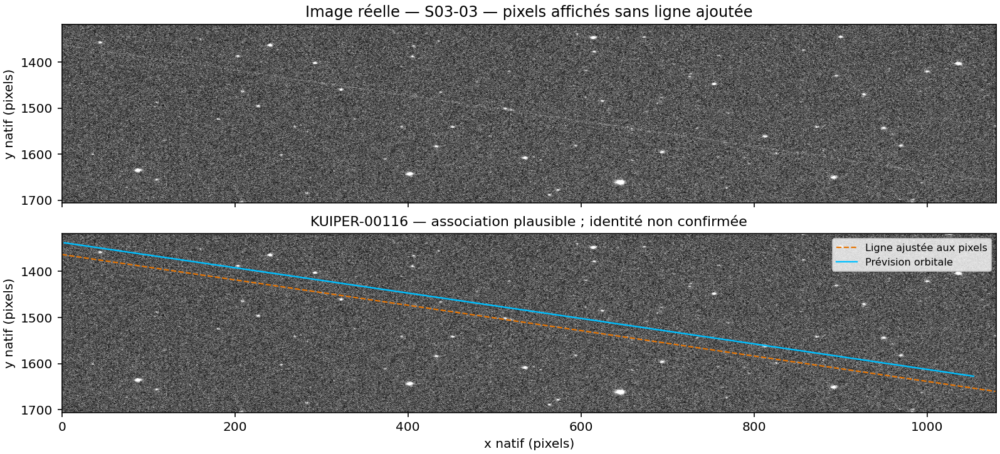
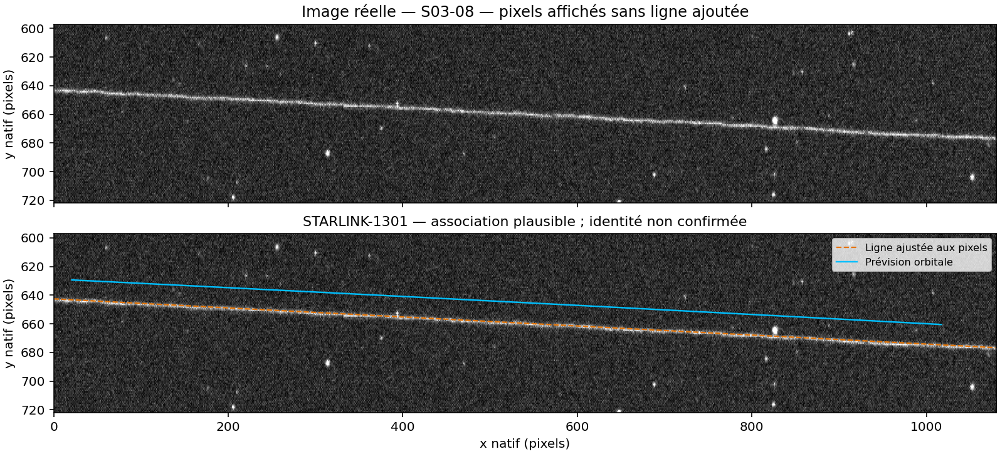
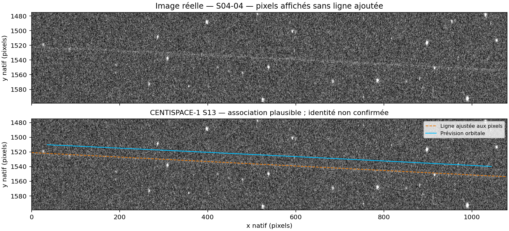

# Journal des passages candidats

Trois passages de satellites connus sont proposés. **Aucune identité n’est confirmée. Aucun nouveau satellite n’est découvert.**

Le journal conserve des hypothèses, leurs preuves et leurs changements. Un résultat numérique isolé ne suffit pas à changer son statut.

Données réelles autorisées sous CC0 : [seize FITS et manifeste](examples/data/seestar-series34/README.md).
Reproduction : [tutoriel depuis zéro](docs/REPRODUIRE-SATELLITES.md). Article : [sources LaTeX et PDF](docs/article-satellites/README.md).

## Les trois entrées initiales

| Identifiant durable | Pose | Satellite proposé | NORAD | Écart médian | Orientation | Statut |
|---|---|---|---:|---:|---:|---|
| GAR-2026-0001 | S03-03 | KUIPER-00116 | 65153 | 60.1″ | 0.056° | Plausible, non confirmé |
| GAR-2026-0002 | S03-08 | STARLINK-1301 | 45361 | 33.7″ | 0.057° | Plausible, non confirmé |
| GAR-2026-0003 | S04-04 | CENTISPACE-1 S13 | 62582 | 29.7″ | 0.114° | Plausible, non confirmé |

## GAR-2026-0001 — KUIPER-00116

**Date déclarée :** 2025-09-20T00:25:29.904624 ; UTC et début d’exposition supposés, non qualifiés.
**Source :** [S03-03.fit](examples/data/seestar-series34/S03-03.fit), pose de 10 s.
**Empreinte SHA-256 :** `c65b3d8fd631364201188f2afaaf14987911937187d4d7c280f7219a2e8fdce6`.

Le rapprochement présente 60.05″ d’écart transversal médian et 0.0562° de différence d’orientation.
Les éléments orbitaux ont environ 0.104 jour d’écart avec la pose.
La mesure ajuste une ligne sur les pixels natifs. Les traces atteignent les limites du champ.

**Lire sans image.** La ligne mesurée et le passage calculé ont des orientations proches, avec un écart non nul.
Le trait discontinu représente la mesure ; le trait continu représente la prévision. Le FITS reste intact.

**Autres explications à contrôler :** autre satellite, avion, météore ou artefact ; aucune probabilité formelle n’est attribuée.
**Pour confirmer :** qualification indépendante de l’heure et de la géométrie, incertitudes orbitales et instrumentales, contrôle supplémentaire du passage.

**Historique :** 18 novembre 2026, création publique à partir de la revue ciblée et du rejeu guidé ; statut conservé.

## GAR-2026-0002 — STARLINK-1301

**Date déclarée :** 2025-09-20T00:50:36.029572 ; UTC et début d’exposition supposés, non qualifiés.
**Source :** [S03-08.fit](examples/data/seestar-series34/S03-08.fit), pose de 10 s.
**Empreinte SHA-256 :** `cae088746ab8387a1e00387afd647423f08092db76f87b1249a8b50c02acf980`.

Le rapprochement présente 33.65″ d’écart transversal médian et 0.0567° de différence d’orientation.
Les éléments orbitaux ont environ 0.226 jour d’écart avec la pose.
La mesure ajuste une ligne sur les pixels natifs. Les traces atteignent les limites du champ.

**Lire sans image.** La ligne mesurée et le passage calculé ont des orientations proches, avec un écart non nul.
Le trait discontinu représente la mesure ; le trait continu représente la prévision. Le FITS reste intact.

**Autres explications à contrôler :** autre satellite, avion, météore ou artefact ; aucune probabilité formelle n’est attribuée.
**Pour confirmer :** qualification indépendante de l’heure et de la géométrie, incertitudes orbitales et instrumentales, contrôle supplémentaire du passage.

**Historique :** 18 novembre 2026, création publique à partir de la revue ciblée et du rejeu guidé ; statut conservé.

## GAR-2026-0003 — CENTISPACE-1 S13

**Date déclarée :** 2025-09-20T01:10:26.594465 ; UTC et début d’exposition supposés, non qualifiés.
**Source :** [S04-04.fit](examples/data/seestar-series34/S04-04.fit), pose de 10 s.
**Empreinte SHA-256 :** `3ca53f84a5566e98626c54f8304f65edba204c36487408607fde08038b9a9000`.

Le rapprochement présente 29.74″ d’écart transversal médian et 0.1141° de différence d’orientation.
Les éléments orbitaux ont environ 0.434 jour d’écart avec la pose.
La mesure ajuste une ligne sur les pixels natifs. Les traces atteignent les limites du champ.

**Lire sans image.** La ligne mesurée et le passage calculé ont des orientations proches, avec un écart non nul.
Le trait discontinu représente la mesure ; le trait continu représente la prévision. Le FITS reste intact.

**Autres explications à contrôler :** autre satellite, avion, météore ou artefact ; aucune probabilité formelle n’est attribuée.
**Pour confirmer :** qualification indépendante de l’heure et de la géométrie, incertitudes orbitales et instrumentales, contrôle supplémentaire du passage.

**Historique :** 18 novembre 2026, création publique à partir de la revue ciblée et du rejeu guidé ; statut conservé.

## Une trace qui reste douteuse

`S04-01` n’est pas l’une des trois associations retenues. Elle reste faible et non identifiée.
Le premier rapprochement numérique diffère de 73,6° et d’environ 2 904″ ; ce n’est pas une association plausible.
Son incertitude est conservée dans le fichier structuré, sans la transformer en découverte.

## Mettre le journal à jour

1. Conserver l’identifiant initial. Ne pas le réattribuer à un autre passage.
2. Ajouter une date, la nouvelle preuve, son auteur et la raison du changement.
3. Garder les statuts précédents et les raisons de rejet.
4. Distinguer candidat, association plausible, identification confirmée et éventuel objet nouveau.
5. Ne déclarer une confirmation ou une découverte qu’avec les preuves et contrôles appropriés.

Les données structurées sont dans [journal/candidates.json](journal/candidates.json).
Le [bilan complet](journal/study-results.json) conserve les quatre classements, les mesures et l’environnement.
La grande fouille reste en pause. Ce journal ne constitue ni soumission scientifique ni validation indépendante.
