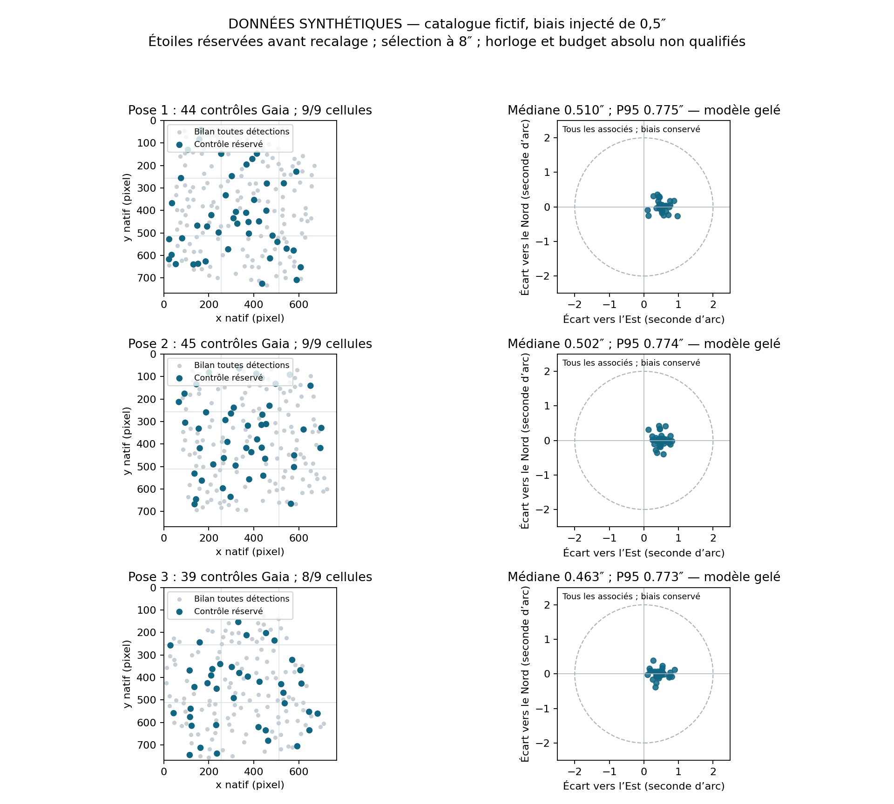

# GNU Astrophotography Recycle

**Donner une seconde vie scientifique aux archives du Seestar S50.**

[Dépôt public et suivi du projet](https://github.com/steveprudhomme/gnu-astrophotography-recycle).

Projet de logiciel **libre, à distribution gratuite**, sous **GNU GPL version 3 ou ultérieure** ([texte intégral](COPYING), [application au projet](LICENSE-NOTICE.md)). La GPL permet aussi la redistribution commerciale.

**Statut : Alpha 0.9 — inventaire, diagnostics, copies vérifiées, recalage, comparaison Gaia et dossier préparatoire de qualification temporelle. L’horloge reste non qualifiée ; les mesures de mobiles, la photométrie et la distribution portable restent à développer.**

Le [contrôle Gaia des poses](docs/CONTRAT-GAIA-POSES.md) est livré dans le [commit `9bcf431`](https://github.com/steveprudhomme/gnu-astrophotography-recycle/commit/9bcf4318fc1fd1f5ffe2afe4ef72d7c364626f6e). Le lot applicatif 0.8 a passé **197 tests** ; ce résultat ne certifie ni l’horloge ni un budget d’erreur absolue complet.

L’Alpha 0.9 ajoute [la préparation des preuves temporelles](docs/CONTRAT-PREUVES-TEMPS.md) et un [protocole illustré de mesure future](docs/PROTOCOLE-QUALIFICATION-TEMPS.md). **223 tests** passent ; aucune mesure instrumentale ou qualification d’horloge n’est annoncée.



*Résultats réellement calculés sur des données synthétiques, sans observation personnelle. Le [tutoriel de comparaison Gaia](docs/TUTORIEL.md#13-comparer-les-trois-poses-à-gaia-sans-réajuster-les-modèles) fournit les commandes, les critères et la lecture de cette figure. La [procédure de publication](docs/TUTORIEL.md#14-mettre-à-jour-github-et-vérifier-la-publication) explique les vérifications avant et après envoi.*

## Mission

Permettre aux astronomes amateurs de réexaminer leurs poses FITS individuelles du ZWO Seestar S50 pour rechercher des objets mobiles et des variations stellaires. Chaque mesure devra être traçable, accompagnée de ses incertitudes et reproductible. Les originaux resteront intacts ; le traitement scientifique s’effectuera localement, sur Windows 11.

Le projet est indépendant et ne revendique aucune affiliation officielle au projet GNU, à ZWO, à l’AAVSO ou au Minor Planet Center.

## Fonctionnalités prévues

| Étape | Résultat attendu | État |
|---|---|---|
| Inventaire FITS | SHA-256, chaque HDU, anomalies, CSV/JSON et synthèse Markdown/SVG | Première version disponible, phase 1 |
| Séances candidates | Regroupement depuis un manifeste local, exclusions et résumés CSV/JSON/SVG | Première version disponible, phase 1 |
| Diagnostic temporel | Forme des dates, déclarations, cadence et anomalies depuis un manifeste local | Disponible ; ne certifie pas l’horloge, phase 2 |
| Préparation temporelle | En-têtes complets des copies, inconnues, canevas de preuves et protocole | Disponible ; aucun essai instrumental ni export temporel qualifié |
| Diagnostic WCS | Axes et paramètres observés, contrôles numériques limités et contexte manquant | Disponible ; ne certifie pas l’astrométrie, phase 2 |
| Échantillon local | Copie de fichiers sélectionnés, SHA-256 et collecte de tous les en-têtes | Disponible, sources préservées ; aucune mesure scientifique |
| Contrôle sur étoiles | Comparaison de la WCS originale à des références locales, résidus et couverture | Disponible ; critères exploratoires, sans certification de soumission |
| Recalage relatif | Rotation/translation vers une référence WCS gelée, contrôle sur étoiles réservées | Disponible ; composition céleste exploratoire, heures non qualifiées |
| Gaia sur poses | Comparaison des positions composées à un catalogue local, modèles gelés | Disponible ; verdict sur étoiles réservées, budget absolu incomplet |
| Qualification scientifique complète | Budget d’erreur absolue et horodatages vérifiés | À poursuivre, phase 2 |
| Objets mobiles | Trajectoires candidates, vitesses et GIF | Recherche, phase 3 |
| Photométrie différentielle | Courbes de lumière et budget d’incertitude | Recherche, phase 4 |
| Passerelles scientifiques | Exports AAVSO, MPC ADES et ALCDEF validés localement | Phase 5 |

## Limites

Une détection n’est pas une découverte confirmée. Un GIF ne constitue pas une mesure scientifique. La qualité des archives, des calibrations, des heures et des catalogues détermine les usages possibles. Le vert Bayer n’est pas automatiquement une mesure Johnson V. Aucun format d’export ni aucune acceptation par un organisme n’est garanti à ce stade. Aucune soumission automatique n’est prévue.

## Démarrer

Les documents sont lisibles immédiatement. L’inventaire a été testé avec Python 3.13.6, Astropy 7.2.0 et NumPy 2.4.1 sur Windows. Le lanceur `scripts/gar-inventory.bat` utilise votre Python ou l’environnement `.venv` du projet ; voir [INSTALL.md](INSTALL.md). Il n’est pas encore autonome.

1. Lire le [dossier de lancement](docs/DOSSIER-LANCEMENT.md).
2. Suivre la [feuille de route](ROADMAP.md) et le [protocole pilote](docs/VALIDATION-PILOTE.md).
3. Consulter [INSTALL.md](INSTALL.md) et [CONTRIBUTING.md](CONTRIBUTING.md).
4. Suivre le [tutoriel illustré](docs/TUTORIEL.md) pour produire un exemple synthétique et lire les rapports.

Depuis PowerShell, à la racine du projet, avec les dépendances installées :

```powershell
.\scripts\gar-inventory.bat "D:\ArchivesFITS" --output ".\local\premier-inventaire"
```

Choisir une sortie nouvelle et extérieure aux archives. Le calcul SHA-256 lit tous les fichiers et peut prendre du temps. Les rapports contiennent potentiellement des informations privées ; ils restent locaux. Voir le [contrat des sorties et codes de retour](docs/CONTRAT-INVENTAIRE.md).

Pour regrouper un manifeste déjà présent sur l’ordinateur, sans rouvrir les FITS :

```powershell
.\scripts\gar-sessions.bat ".\local\premier-inventaire\manifest.json" --output ".\local\seances-01"
```

Les dates déclarées et les configurations restent séparées ; les interruptions de plus de 30 minutes coupent un groupe par défaut. Les copies, empilements et dates inutilisables sont expliqués dans les exclusions. Le [contrat des séances](docs/CONTRAT-SEANCES.md) précise les limites et le code de retour `2`, qui peut signaler des exclusions attendues. Aucun fichier n’est déplacé. Choisir la destination locale indiquée pour ne rien écrire sur le support externe des observations.

Pour diagnostiquer les horodatages du même manifeste, sans rouvrir les observations :

```powershell
.\scripts\gar-timing.bat ".\local\premier-inventaire\manifest.json" --output ".\local\horodatages-01"
```

Le [diagnostic temporel](docs/CONTRAT-HORODATAGES.md) sépare résolution écrite et exactitude. Aucun milieu de pose n’est calculé ; les heures restent non qualifiées sans preuve indépendante. Le code `2` après production des rapports rappelle cette limite, même si la cadence ne présente aucune anomalie.

Pour examiner les informations WCS disponibles dans le même manifeste :

```powershell
.\scripts\gar-wcs.bat ".\local\premier-inventaire\manifest.json" --output ".\local\wcs-01"
```

Le [diagnostic WCS](docs/CONTRAT-WCS.md) ne rouvre pas les FITS et ne calcule aucune position céleste. Le manifeste étant partiel, le code `2` après production des rapports rappelle qu’aucune solution astrométrique n’est certifiée.

Les FITS personnels, coordonnées d’observation et paramètres locaux ne doivent pas être joints aux contributions publiques. Voir la [politique des données](docs/DONNEES.md).

Pour préparer des copies de travail dans `local/`, suivre le [contrat d’échantillon local](docs/CONTRAT-WORKSET.md) et le [tutoriel illustré](docs/TUTORIEL.md). Les sources sont uniquement lues ; les en-têtes complets et modèles construits restent privés et ne certifient pas les positions célestes.

La commande [astrometry](docs/CONTRAT-ASTROMETRIE.md) permet ensuite une comparaison hors ligne sur étoiles, sans réajuster la WCS. Les critères doivent être fixés avant l’évaluation ; l’acquisition éventuelle d’un catalogue réseau est une étape séparée, explicitement autorisée.

Pour recaler des poses déjà copiées, sans consulter les sources historiques :

```powershell
.\.venv\Scripts\python.exe -m gar register ".\local\lot\workset.json" --reference-index 4 --frame-indices 1 2 3 --output ".\local\recalage-01"
```

Le [contrat de recalage](docs/CONTRAT-RECALAGE.md) explique les étoiles réservées, les critères, la composition vers la WCS de référence et l’erreur héritée. Aucun FITS n’est modifié ; aucun support externe ni catalogue réseau n’est consulté par cette commande. Le [tutoriel](docs/TUTORIEL.md#12-recaler-trois-poses-locales-avec-un-contrôle-réservé) fournit un exemple entièrement synthétique illustré.

Pour contrôler ensuite les coordonnées composées contre le catalogue local, sans réajuster les modèles :

```powershell
.\.venv\Scripts\python.exe -m gar gaia-frames ".\local\lot\workset.json" --registration ".\local\recalage-01\registration.json" --catalog ".\local\references\catalog.csv" --output ".\local\gaia-poses-01"
```

Le [contrat Gaia des poses](docs/CONTRAT-GAIA-POSES.md) distingue le verdict sur étoiles réservées du bilan secondaire sur toutes les détections. Le catalogue doit avoir son `provenance.json` avec SHA-256. Tout est local, sans USB ni téléchargement ; les heures et le budget d’erreur absolue restent non qualifiés.

Pour préparer le dossier temporel depuis les copies déjà locales, sans consulter les originaux :

```powershell
.\.venv\Scripts\python.exe -m gar time-evidence ".\local\lot\workset.json" --output ".\local\preuves-temps-01"
```

Le code **2** signifie que le dossier a été produit avec une heure toujours non qualifiée. Le [tutoriel illustré](docs/TUTORIEL.md#15-préparer-la-qualification-des-horodatages-sur-les-copies-locales) explique les six sorties, le cas synthétique et les preuves encore nécessaires. Aucune date UTC de milieu de pose n’est calculée.

## Contribuer et vérifier

Proposer un objectif, produire un changement limité, ouvrir une proposition de fusion, attendre la revue et itérer. Toute évolution scientifique doit préciser ses hypothèses, ses références et ses critères de validation. Les décisions sont consignées publiquement ; les données privées restent locales.

Voir [gouvernance](GOVERNANCE.md), [licences tierces](docs/LICENCES-TIERCES.md) et [sources](docs/SOURCES.md).

Une [note de propositions pour les métadonnées Seestar S50](docs/PROPOSITIONS-SEESTAR-S50.md) rassemble les demandes de clarification et améliorations à discuter avec la communauté, en séparant constats limités et recommandations.

[English version — Seestar S50 FITS recommendations](docs/SEESTAR-S50-FITS-RECOMMENDATIONS.en.md), including the translated illustration and references.
