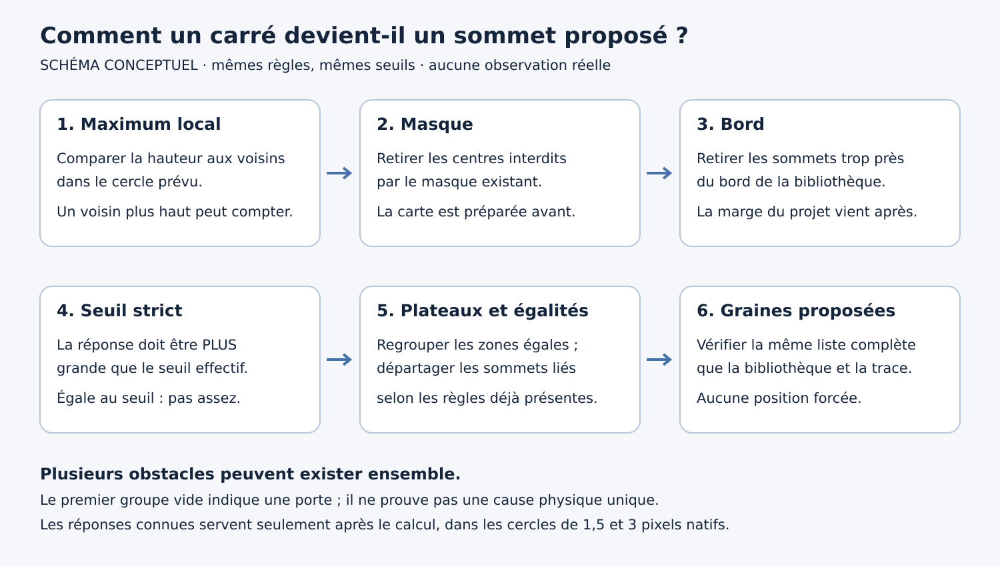
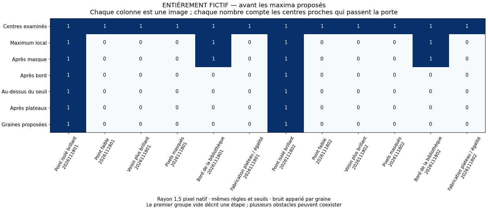
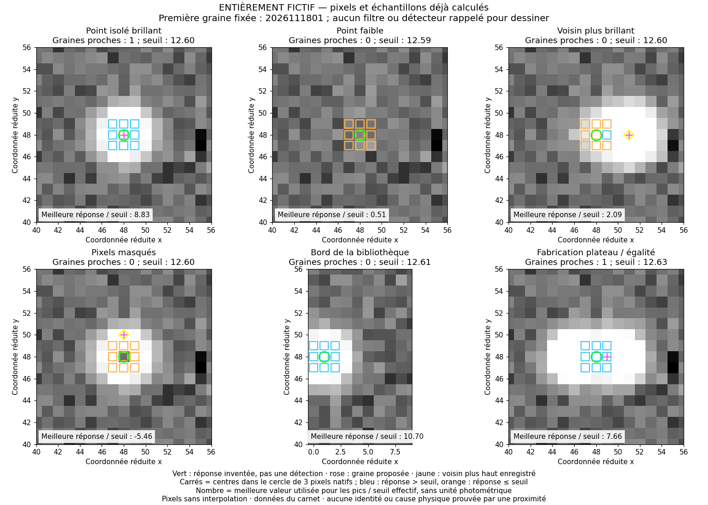

# Comprendre les absences de maxima

Le [carnet du détecteur](TRACE-DETECTEUR.md) a examiné les 17 ajouts artificiels manqués dans le domaine de recherche. Parmi leurs 136 situations image-ajout, 115 n'avaient aucun maximum brut proche aux deux rayons examinés, et 21 avaient un point retenu proche. Ce lot suit les portes **avant** la liste des maxima proposés. Les 115 situations constituent une cohorte fixée par le lot précédent, pas 115 objets ou expériences indépendantes.

Le plan [**`4a5bd4b`**](https://github.com/steveprudhomme/gnu-astrophotography-recycle/commit/4a5bd4b9161056e2ac81d429c130e421801bc0be) a été committé, publié et contrôlé avant le code. Trois agents travaillent sur diagnostic, vérification et pédagogie, avec des fichiers distincts et un coordinateur chargé de l'intégration. Leur revue reste interne.

## Comprendre dès 10 ans

Imagine une carte de montagnes faite de petits carrés. Le programme cherche des **sommets**, puis vérifie plusieurs règles. Un carré clair n'est pas forcément un sommet : un voisin peut être plus haut. Un sommet peut aussi être trop près du bord, sur un carré interdit, ou ne pas dépasser la barre demandée.



*Schéma conceptuel : ce n'est pas une capture d'écran ou une image du ciel. Nous lisons les règles existantes ; nous ne les rendons pas plus faciles.*

- Une **réponse convoluée** est une nouvelle carte calculée avec un petit modèle de forme. Sa hauteur n'est ni une luminosité calibrée, ni une magnitude, ni un rapport signal/bruit photométrique.
- Un **maximum local** est un carré aussi haut que les carrés du voisinage prévu par le programme.
- Un **masque** désigne des carrés dont le programme ne doit pas proposer le centre, par exemple si leur valeur est invalide ou saturée.
- Un **seuil strict** exige une valeur plus grande que la barre. Une valeur exactement égale ne suffit pas.
- Un **plateau** contient des sommets de même hauteur. Le programme les regroupe et départage les égalités selon ses règles existantes.

Le programme calcule toutes les cartes sans recevoir les positions des réponses. Nous regardons ensuite les carrés dont le centre tombe dans les cercles déjà prévus : **1,5 pixel natif**, puis **3 pixels natifs**. Les coordonnées réduites se convertissent en coordonnées natives par `2*x + 0,5`. Un cercle peut contenir plusieurs centres de carrés ; nous gardons leurs preuves séparées.

## Les portes suivies

Les paramètres restent ceux du détecteur gelé et de Photutils 3.1.1 : masque des pixels non finis ou saturés, fond et bruit robustes, noyau DAOStarFinder, seuil effectif interne, maximum circulaire de rayon cinq pixels réduits, bord de bibliothèque, comparaison stricte au seuil, puis plateaux et égalités. Les pixels masqués de la carte de recherche sont remplacés selon la même règle que la bibliothèque avant la comparaison des voisins.

Chaque image doit retrouver la **liste complète et ordonnée des graines de maxima** proposée par la bibliothèque et la trace du lot 20. Les positions finales doivent également retrouver celles qui étaient gelées. Une divergence bloque le bilan, sans déplacer les points ou changer les réglages pour réussir.

| Constat de porte | Lecture prudente |
|---|---|
| Aucun maximum local dans le cercle | Aucun centre échantillonné du cercle ne passe la comparaison locale. |
| Retrait par le masque | Les maxima concernés sont sur des centres interdits par le masque. |
| Retrait par le bord | Les maxima restants sont trop près du bord de bibliothèque. |
| Valeur sous ou égale au seuil | Aucun maximum restant ne dépasse strictement le seuil effectif. |
| Regroupement ou départage | La sélection des plateaux ou égalités ne garde pas de graine dans le cercle. |
| Maximum proposé | Une graine y est proposée ; cela ne prouve pas son identité. |
| Cercle sans centre échantillonné | Le rapport conserve cette absence d'échantillon, sans inventer une valeur. |

Le **premier effectif nul** indique une étape dans cet ordre, pas une cause physique exclusive. Nous conservons aussi les obstacles simultanés : un voisin peut être plus haut alors que la réponse examinée est également sous le seuil. Les rayons peuvent donner des constats différents. Mesurer un voisin ne démontre ni son identité ni qu'il explique seul le manque.

## Fabriquer et lire un nouveau banc fictif

Le banc comporte douze images 96 × 96, six situations pour chacune des graines `2026111801` et `2026111802` : source isolée brillante, source faible, voisin plus brillant, source masquée, bord de bibliothèque et plateau/égalité. Les sources, positions et bruits sont inventés indépendamment des observations. Le bruit est apparié entre les situations d'une même graine ; ces images ne sont donc pas douze essais indépendants. Les noms décrivent la fabrication et ne garantissent pas un résultat particulier.

Depuis la racine, avec les dépendances déjà installées et des sorties neuves :

```powershell
.\.venv\Scripts\python.exe examples/make_peak_absence_demo.py local/exercice-maxima-images
.\.venv\Scripts\python.exe examples/trace_peak_creation.py local/exercice-maxima-images/manifest.json local/exercice-maxima-images/truth.json local/exercice-maxima-bilan
.\.venv\Scripts\python.exe examples/plot_peak_absences.py local/exercice-maxima-bilan/trace.json local/exercice-maxima-figures
```

Les trois codes attendus sont **0** pour un banc complet et cohérent. La première commande prépare les images et des réponses séparées. La deuxième calcule les portes sur les images avant de lire les réponses. La troisième dessine les preuves déjà calculées, sans refaire détection ou recherche de maxima. Les sorties détaillées sont dans `trace.json` et le rapport lisible `report.md` ; les figures sont dans le dernier dossier.



*Chaque colonne est une image, chaque ligne une porte. Un zéro peut apparaître tôt alors que d'autres conditions échouent aussi. Le tableau utilise 1,5 pixel natif ; le rapport conserve également le contexte à 3 pixels.*



*Première graine fixée avant résultat. Vert : réponse inventée, pas une détection. Rose : graine proposée ; jaune : voisin plus haut enregistré. Les petits carrés montrent les centres examinés à 3 pixels natifs, en bleu au-dessus du seuil et orange sinon. Le nombre est la meilleure valeur utilisée pour les pics divisée par le seuil effectif : ce n'est pas un rapport signal/bruit photométrique. Une valeur supérieure à 1 ne garantit pas un maximum local ; une valeur négative de cette carte calculée ne décrit pas une luminosité physique négative. Aucune convolution n'est recalculée pour dessiner.*

Sur ce banc, le rayon 1,5 donne huit premières portes vides au maximum local, deux au bord et deux maxima proposés. Le rayon 3 donne cinq premières portes vides au maximum local, deux au bord, une au seuil et quatre maxima proposés. Les fabrications ne garantissent donc pas leur nom comme motif de rejet, et les deux rayons peuvent différer. Ces comptes descriptifs utilisent des images appariées, sans estimer une probabilité universelle.

## Reprendre les résultats déjà locaux

Le rejeu utilise un score complet, le diagnostic du lot 19 et la trace complète du lot 20, avec les fichiers individuels liés et leurs empreintes :

```powershell
.\.venv\Scripts\python.exe examples/diagnose_peak_absences.py local/exercice-injections-bilan/score.json local/exercice-diagnostic-manques/diagnostic.json local/exercice-trace-manques/trace.json local/exercice-maxima-manques
```

Ces noms sont ceux de l'exercice fictif de référence ; les chemins des observations ne sont pas publiés. Les nouveaux résultats réels détaillés restent ignorés sous `local/`. Aucun support externe, nouvelle observation ou injection réelle n'est nécessaire. Les 21 situations contextuelles et les scores historiques sont conservés, sans nouvelle association de trajectoires.

## Bilan descriptif des 115 absences sur fond réel

Les 115 situations sans maximum brut proche du lot 20 sont conservées. Les premières portes vides se répartissent ainsi :

| Première porte vide dans le cercle | Rayon 1,5 pixel natif | Rayon 3 pixels natifs |
|---|---:|---:|
| Aucun maximum local | 69 | 47 |
| Réponse sous ou égale au seuil | 46 | 68 |
| Total des absences | 115 | 115 |

Dans **22 situations**, la première porte vide change avec le rayon ; le programme n'est pas réglé autrement, nous regardons seulement un cercle plus large après les calculs. Aucun blocage par masque ou bord n'est observé dans ces voisinages.

Les conditions examinées séparément ajoutent du contexte : pour chacun des deux rayons, **105 situations n'ont aucun échantillon dépassant strictement le seuil**, et dix ont une réponse au-dessus du seuil mais aucun maximum local proche. Ces comptes ne s'ajoutent pas aux lignes précédentes : plusieurs obstacles peuvent être vrais ensemble. Cela ne démontre pas une cause astrophysique unique, un manque de luminosité seul ou l'identité d'un voisin.

Dans ces dix situations, un voisin strictement plus élevé est enregistré par la trace dans le voisinage de comparaison du chercheur, aux deux rayons de lecture. C'est un obstacle numérique observé : sa position et sa hauteur ne démontrent pas qu'il s'agit d'une étoile identifiée ou d'une cause physique unique.

Les 21 situations avec centre retenu proche restent en contexte. À 1,5 pixel, une de ces situations a sa graine initiale hors du cercle alors que son centre ajusté est proche ; à 3 pixels, les 21 graines sont proches. Un centre mesuré et la graine d'un maximum ne sont donc pas interchangeables. Les scores, candidats et modèles restent inchangés ; aucun nouveau mobile n'est découvert. Les détails individuels et traces sur fond réel restent locaux.

## Erreurs et limites

Les entrées modifiées, incomplètes ou incompatibles, les chemins hors du périmètre local, les divergences de graines ou de positions et les sorties déjà présentes sont refusés. Conserver les messages et produits partiels ; corriger la cause, puis choisir une sortie neuve. Une trace incomplète ne doit pas être dessinée comme un résultat terminé.

Le diagnostic décrit des calculs et des voisinages. Il ne prouve pas seul pourquoi un signal astrophysique n'a pas été retrouvé, ne définit pas une magnitude limite, ne crée aucun candidat et ne qualifie ni les heures ni les performances universelles du Seestar. Les nouvelles figures publiques sont entièrement fictives ; les cinq médias réels CC0 déjà autorisés restent inchangés. Aucun essai avec un enfant ou sur ordinateur vierge n'est revendiqué.

## Vérifications et reproduction

Les **48 nouveaux tests fictifs** passent en **32,61 s** : seuil strict, carte constante, masque, bord, plateaux et égalités, graines ordonnées, voisin plus haut, obstacles simultanés, coordonnées/rayons, caches altérés, contexte historique, sorties partielles et dessins sans nouvelle recherche. La revue interne a corrigé le drapeau de vérification des positions dans le rejeu et renforcé le contexte des neuf exclusions de vitesse. Un contre-exemple vérifie que la première porte vide peut changer avec le rayon alors que l'obstacle indépendant du seuil demeure.

Depuis le commit propre **`f1f159f`**, la suite complète donne **471 tests réussis en 172,63 secondes**. Les trois commandes du parcours ont été exécutées dans des dossiers neufs : codes 0, mêmes douze images et traces fictives, deux PNG identiques par empreinte. Les 17 cas et 136 traces réels sont identiques, avec les 115 absences et 21 situations contextuelles inchangées. Les 380 entrées, traces et notices/médias surveillés restent intacts, dont les cinq médias CC0. Les gardes relèvent zéro association, filtre stationnaire, injection, accès externe/réseau et écriture FITS/NPY.

La revue publique contrôle 211 fichiers et 45 ancres Markdown, sans tableaux FITS/NPY privés suivis par Git. Les 58 anciennes commandes conservent leurs preuves sans réexécution générale ; aucune injection réelle n'est régénérée. Version, moteurs, seuils et scores inchangés. Publication par branche dédiée et PR, revue interne puis contrôle de `main` distant et local ; tests locaux, aucun contrôle automatique GitHub configuré. Aucun essai instrumental, utilisateur enfant ou validation scientifique indépendante n'est annoncé.
