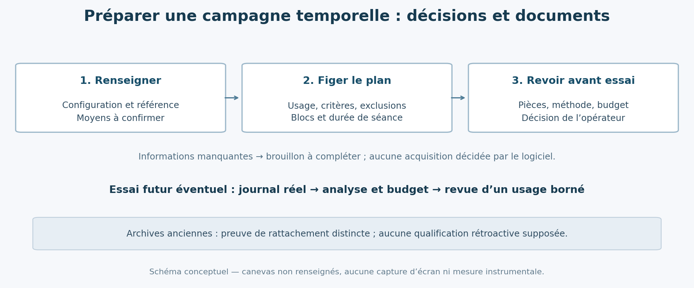

# Fiche opérationnelle d’une future campagne temporelle

**État : préparation non exécutée.** Le dossier logiciel 0.9 a déjà collecté les déclarations des copies locales. Cette fiche rend la suite renseignable : configuration, moyens disponibles, critères, planning et journaux. Elle n’ajoute ni commande d’acquisition ni validation automatique. Aucun accès USB ou au télescope n’est nécessaire pour préparer les documents.



*Schéma de procédure future, sans capture d’écran, acquisition ou mesure réelle. [Version SVG](images/fiche-campagne-temps.svg).*

## 1. Choisir une configuration et décrire l’usage

Renseigner le modèle et l’identité privée de l’appareil, les versions firmware/application vérifiées, le mode d’acquisition et les durées réellement supportées. Conserver les pièces et leur date ; les valeurs PROGRAM/CREATOR d’un ancien en-tête ne remplacent pas cette confirmation. Toute information non fournie reste **à confirmer**, sans présumer qu’un matériel est disponible ou absent.

Définir le mesurande et la tolérance avant de mesurer. Indiquer si la tolérance porte sur une borne de décalage, une incertitude-type ou une incertitude élargie avec couverture ; ces quantités ne sont pas interchangeables. La durée de séance visée, les configurations et l’usage scientifique doivent être explicites. Aucun seuil universel n’est ajouté par ce lot.

## 2. Décrire les moyens indépendants disponibles

Identifier la référence et les preuves de son indépendance, de sa traçabilité et de son incertitude. Décrire comment l’instant de la transition physique sera enregistré et relié à l’exposition. Une commande logicielle ou une heure affichée ne remplace pas cette caractérisation. Aucun choix de modèle commercial, achat ou montage déjà validé n’est présumé.

Si ces éléments sont inconnus, la fiche reste un brouillon à compléter. Les documents peuvent être préparés ; l’essai réel ne peut pas être présenté comme défini ou prêt à qualifier une horloge. Le [protocole détaillé](PROTOCOLE-QUALIFICATION-TEMPS.md) explique les questions expérimentales à résoudre.

## 3. Copier les cinq canevas dans un dossier local neuf

Depuis PowerShell, à la racine du projet :

```powershell
$campaignFolder = Join-Path $PWD 'local\ma-campagne-temps-01'
if (Test-Path -LiteralPath $campaignFolder) { throw 'Choisir un nouveau dossier local.' }
New-Item -ItemType Directory -Path $campaignFolder -ErrorAction Stop | Out-Null
Copy-Item -LiteralPath 'examples\timing-campaign\configuration.example.json' -Destination (Join-Path $campaignFolder 'configuration.json') -ErrorAction Stop
Copy-Item -LiteralPath 'examples\timing-campaign\planned-runs.example.csv' -Destination (Join-Path $campaignFolder 'planned-runs.csv') -ErrorAction Stop
Copy-Item -LiteralPath 'examples\timing-campaign\measurement-log.blank.csv' -Destination (Join-Path $campaignFolder 'measurement-log.csv') -ErrorAction Stop
Copy-Item -LiteralPath 'examples\timing-campaign\uncertainty-budget.blank.csv' -Destination (Join-Path $campaignFolder 'uncertainty-budget.csv') -ErrorAction Stop
Copy-Item -LiteralPath 'examples\timing-campaign\review.blank.md' -Destination (Join-Path $campaignFolder 'review.md') -ErrorAction Stop
```

Le chemin fixe de cet exemple reste dans `local/` ; conserver ce périmètre, sans lien/jonction vers un autre support. Ne pas déplacer des observations pour remplir ces canevas. Les modèles publics sont vides ou proposés ; les copies renseignées deviennent privées. Aucune commande ci-dessus ne contacte un appareil ou ne lit un FITS.

| Fichier | Travail à réaliser | Ce qu’il ne démontre pas |
|---|---|---|
| `configuration.json` | Configuration, usage, référence, méthode, critères et périmètre historique | Disponibilité d’une référence ou validité du firmware tant que les champs restent non renseignés |
| `planned-runs.csv` | Trois blocs proposés, 10 répétitions par bloc, durées et positions à fixer | Acquisitions réalisées ; 3×10 est une proposition du projet, pas un standard |
| `measurement-log.csv` | Journal initialement sans ligne de mesure, à remplir après observations réelles | Mesures existantes ou association temporelle déjà validée |
| `uncertainty-budget.csv` | Contributions à caractériser, valeurs/unités/types/couvertures et dépendances | Budget calculé ; les valeurs sont vides et les contributions doivent être adaptées |
| `review.md` | Revue préalable puis revue des résultats et de l’applicabilité | Autorisation automatique, certificat ou changement de statut dans `gar` |

Les chemins de pièces sont relatifs au dossier local. Conserver dates/échelles brutes dans le journal ; une conversion ultérieure nécessitera un modèle explicite. Une ligne rejetée garde son identifiant, son motif et sa pièce de référence. Les blancs signifient **inconnu/non renseigné**, jamais zéro ou incertitude nulle. Les contributions du budget ne sont pas additionnées automatiquement ; les covariances doivent être examinées.

## 4. Figer les critères et faire la revue avant essai

Adapter les blocs, répétitions, durée de séance et configurations à l’usage, puis fixer exclusions et critères d’acceptation. La proposition 30 répétitions réparties en début/milieu/fin ne garantit aucune puissance statistique ou précision particulière. Documenter les écarts à cette proposition et les raisons avant acquisition.

Archiver une version figée du plan et des critères, son empreinte, le responsable et la date de revue avant l’essai. Toute modification ultérieure reste une nouvelle révision avec sa justification ; ne pas remplacer silencieusement les critères après lecture des résultats. Une fiche renseignée ou des cases cochées constituent des déclarations à revoir, pas des preuves de performance.

## 5. Prévoir deux décisions différentes

Une campagne future peut justifier un usage borné à la configuration et à l’époque testées, après revue des données et incertitudes. Le rattachement aux anciennes archives doit être démontré séparément. Sans éléments contemporains applicables, celles-ci restent temporellement non qualifiées, même après un nouvel essai favorable.

La préparation présente n’effectue aucune mesure et ne lit pas les canevas comme preuves. Les champs `measurement_performed`, `time_validated`, `historical_time_validated` et `scientific_time_export_allowed` des modèles restent faux. Leur édition manuelle ne modifie aucune décision du logiciel ni la réalité de l’instrument.

Références de méthode et limites : [protocole temporel](PROTOCOLE-QUALIFICATION-TEMPS.md), [contrat des preuves](CONTRAT-PREUVES-TEMPS.md), [politique des données](DONNEES.md). Les canevas et blocs proposés sont des décisions de préparation du projet, sans certification instrumentale.
