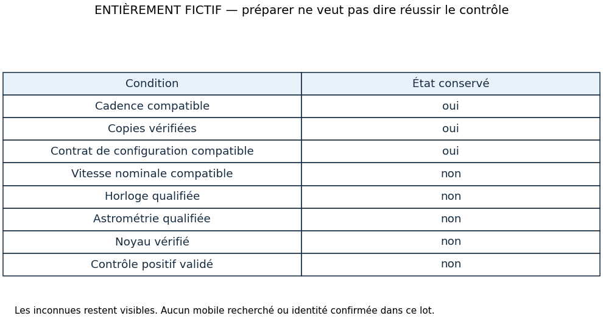
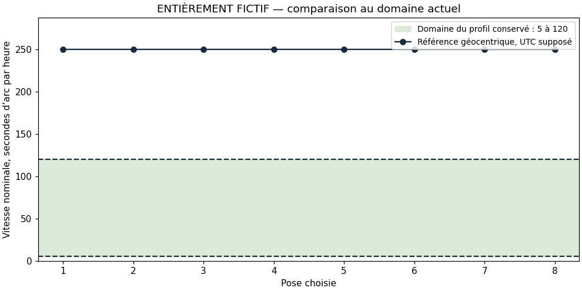
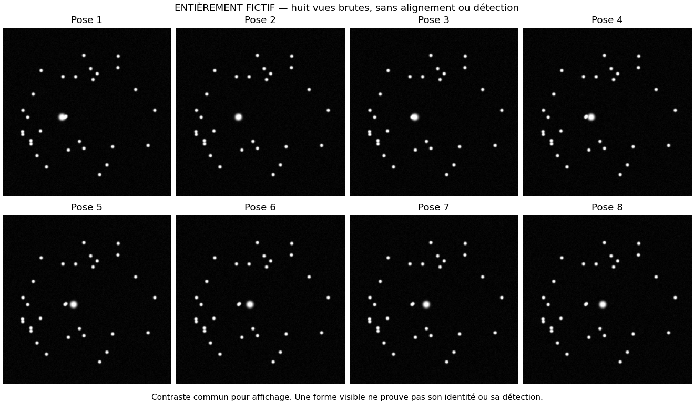

# Préparer un contrôle avec un objet mobile connu

Un **contrôle positif** est un essai où nous savons qu'un objet recherché est présent.
Il permet de vérifier si le programme le retrouve. Le préparer ne signifie pas qu'il a réussi.
Ce lot conserve les seuils et les moteurs. Il ne lance aucune détection, aucun alignement ou recherche de trajet.

Le [plan initial](https://github.com/steveprudhomme/gnu-astrophotography-recycle/commit/3799e33efbe9eca366099ad35312bf837b5c672c) précède le code.
Le [complément sur les copies](https://github.com/steveprudhomme/gnu-astrophotography-recycle/commit/a3b66df0ba95153cf96d64f6431add1aeea0a1f8) précède aussi son implémentation.

## Comprendre les mots

Une **comète** possède un noyau et peut développer une enveloppe diffuse de gaz et de poussières.
Dans nos images, nous chercherions un repère central brillant, parfois appelé noyau apparent.
Une tache centrale visible ne résout pas nécessairement le noyau solide. La [présentation des comètes par la NASA](https://science.nasa.gov/solar-system/comets/facts/) explique ces structures.

Une **éphéméride** est une table qui prévoit des positions et des mouvements pour des dates choisies.
L'**astrométrie** mesure les positions des objets dans le ciel. Une qualification réunit les preuves que cette mesure convient à l'usage prévu.
Une référence **géocentrique** décrit ce qui serait observé depuis le centre de la Terre.
Elle diffère d'une référence calculée pour votre lieu précis.
**UTC** est une référence internationale de temps. Nous ne supposons pas que l'horloge du télescope a été vérifiée.

Une **pose** est une image prise pendant une exposition. La **cadence** décrit les intervalles entre les poses.
Le profil conservé exige huit poses, espacées de 240 à 360 secondes, sur 1800 à 2700 secondes déclarées.
Son domaine de vitesse nominale reste **5 à 120 secondes d'arc par heure**.
Une seconde d'arc est une très petite unité d'angle sur le ciel.

## Préparer l'atelier

Suivre le [parcours débutant](DEMARRER-DE-ZERO.md), avec les outils de dessin.
Ouvrir PowerShell dans le projet. Choisir des noms de sorties encore inutilisés dans `local/`.
Ce dossier garde les fichiers de travail hors de GitHub.
Une **empreinte** est un code calculé depuis le contenu d'un fichier ; elle aide à vérifier son intégrité.

## 1. Fabriquer un exemple entièrement fictif

```powershell
.\.venv\Scripts\python.exe examples/make_positive_control_demo.py local/controle-entree
```

La commande invente huit images Bayer, un inventaire et une référence locale.
Une image **Bayer** conserve les mesures des cases colorées du capteur avant la création d'une image couleur.
Le point diffus inventé avance à 250 secondes d'arc par heure. Sa référence est aussi inventée.
La graine 2026112801 fixe les nombres aléatoires. Aucun appel à NASA ou à un autre service n'est effectué.

**Vérifier :** le dossier contient `plan/plan.json`, `copies/copies.json` et `reference/reference.json`.
Le nom de comète utilisé dans cet exercice est une étiquette pédagogique ; ses images et positions sont fictives.

## 2. Évaluer la préparation

```powershell
.\.venv\Scripts\python.exe examples/prepare_positive_control.py assess local/controle-entree/plan/plan.json local/controle-entree/copies/copies.json local/controle-preparation --reference local/controle-entree/reference/reference.json
```

Les copies et les fichiers liés sont vérifiés avant le bilan.
Une copie intacte et un groupe admissible au moteur sont deux conditions différentes.
Le programme conserve séparément les états vérifié, refusé et inconnu.

**Vérifier :** `preparation.json` indique `blocked_outside_rate` et `positive_control_validated: false`.
Le code de retour **2 est attendu**. Il conserve une préparation qui ne valide pas encore le contrôle.
Un code 1 indique une erreur. Un fichier `status: complete` peut contenir un refus correctement établi.

## 3. Dessiner les conditions et les vues

```powershell
.\.venv\Scripts\python.exe examples/plot_positive_control.py local/controle-preparation/preparation.json local/controle-figures
```

Le dessin relit les preuves. Il n'effectue aucun téléchargement ou recherche de mobile.



**Lire sans image.** Cadence, copies et contrat de configuration donnent « oui ».
La vitesse compatible et le contrôle positif validé donnent « non ».
Horloge, astrométrie et noyau ne sont pas qualifiés. Cela ne prouve pas une horloge fausse ou un noyau absent.



**Lire sans image.** Les huit points valent 250. Les lignes pointillées délimitent le domaine de 5 à 120.
Tous les points sont au-dessus de ce domaine. Nous conservons le refus, sans changer une limite.



**Lire sans image.** La tache diffuse progresse vers la droite. Les étoiles gardent leurs positions dans cette fabrication.
Les vues sont brutes, avec contraste commun et sans alignement. Ce sont des images calculées, pas des captures d'écran.
La présence visible d'un point inventé ne démontre pas sa détection par le moteur.

**Petite question.** Un objet bien visible peut-il être refusé avant une recherche ?
**Réponse.** Oui. Sa vitesse ou la configuration de ses images peut sortir des conditions prévues.

## 4. Garder une référence absente comme inconnue

```powershell
.\.venv\Scripts\python.exe examples/prepare_positive_control.py assess local/controle-entree/plan/plan.json local/controle-entree/copies/copies.json local/controle-sans-reference
.\.venv\Scripts\python.exe examples/plot_positive_control.py local/controle-sans-reference/preparation.json local/controle-sans-reference-figures
```

La première commande rend 2, puis le dessin rend 0.
Le bilan conserve `nominal_rate_compatible: null` et `rate_range_arcsec_hour: null`.
`null` signifie ici inconnu. Une référence manquante n'est jamais remplacée par une vitesse nulle.

## 5. Choisir de vraies poses depuis l'inventaire exploratoire

Un **inventaire** est une liste des fichiers et de leurs métadonnées.
Cette préparation lit le schéma exploratoire `exploratory-1`, avec `inventory.json` et `summary.json` déjà locaux.
Remplacer les deux chemins d'entrée ci-dessous par ceux de votre inventaire.
La première version reconnaît les alias explicites des deux désignations gérées par le code ; la cible de référence reste fixée.

```powershell
.\.venv\Scripts\python.exe examples/prepare_positive_control.py plan local/mon-inventaire/inventory.json local/mon-inventaire/summary.json local/mon-controle-plan
```

La commande ne lit pas le support original. Elle garde les groupes trop courts et les exclusions dans le plan privé.
Les groupes sont classés par effectif décroissant, puis date et dossier.
Pour chaque groupe, elle retient le premier départ permettant huit poses admissibles.
Elle minimise ensuite les écarts aux repères espacés de 300 secondes et départage les égalités par indices.
Cette méthode évite qu'un simple arrondi choisisse un intervalle inférieur à 240 ou supérieur à 360 secondes.

**Vérifier :** `selected` contient huit poses ; sinon il vaut `null` et la commande rend 2.
Le plan est fixé avant les calculs de vitesse et l'examen des pixels.

## 6. Copier sans modifier le support

Pour réutiliser un lot local déjà vérifié, employer la commande suivante.
Un **workset** est un lot de copies avec son rapport de vérification et ses en-têtes conservés.
Remplacer `local/ancien-lot/workset.json` par le rapport du lot disponible.

```powershell
.\.venv\Scripts\python.exe examples/prepare_positive_control.py copy local/mon-controle-plan/plan.json local/mon-controle-copies --local-workset local/ancien-lot/workset.json
```

Le programme revalide ces copies, sans réécrire les images ou relire le support.
Si vous n'avez pas de copies vérifiées, retirer `--local-workset local/ancien-lot/workset.json` de cette commande.
Seuls les huit chemins sélectionnés sont lus sur le support. Aucun dossier du support n'est exploré.
Les empreintes source/copie/source, les tailles et les métadonnées attendues sont vérifiées.
L'ancien inventaire ne contient pas d'empreinte historique de tous les pixels. Le rapport garde cette limite visible.
Une comparaison faite aujourd'hui ne prouve pas que l'image est identique à celle d'une ancienne inspection sans empreinte.

Les différences de configuration restent un refus du contrat historique. Aucun en-tête n'est corrigé pour les masquer.

## 7. Obtenir une référence externe avec autorisation

La commande suivante envoie à JPL Horizons le seul nom fixé et les huit dates/heures choisies.
Elle ne transmet aucune image, coordonnée du champ, position terrestre ou en-tête complet.
L'option `--allow-date-query` exprime l'autorisation de cet envoi. Sans cette option, la commande refuse la requête.

```powershell
.\.venv\Scripts\python.exe examples/fetch_control_ephemeris.py local/mon-controle-plan/plan.json local/mon-controle-reference --allow-date-query
```

Le calcul utilise le géocentre. Les dates `DATE-OBS` sont interprétées conditionnellement comme UTC.
Aucune correction de fuseau ou d'heure de milieu de pose n'est inventée.
La réponse brute, les paramètres et les empreintes restent locaux. Une réponse ambiguë ou mal formée est refusée.
Un exercice fictif ne peut pas employer cette commande réseau.

Si vous ne souhaitez pas transmettre ces dates, conserver la préparation sans référence externe.
La [documentation JPL Horizons](https://ssd-api.jpl.nasa.gov/doc/horizons.html) décrit l'API ; le [manuel](https://ssd.jpl.nasa.gov/horizons/manual.html) définit les résultats.

## 8. Évaluer et dessiner les copies réelles

```powershell
.\.venv\Scripts\python.exe examples/prepare_positive_control.py assess local/mon-controle-plan/plan.json local/mon-controle-copies/copies.json local/mon-controle-preparation --reference local/mon-controle-reference/reference.json
.\.venv\Scripts\python.exe examples/plot_positive_control.py local/mon-controle-preparation/preparation.json local/mon-controle-figures
```

Ces commandes utilisent uniquement les copies et la référence en cache. Le support et le réseau ne sont plus nécessaires.
Les nouveaux rapports, dates, coordonnées et vues réels restent dans `local/`.
Les images publiques de ce guide sont entièrement fictives.

## Résultat et limites de la préparation réelle

Huit copies intègres sont disponibles, avec une cadence admissible.
Le contrat historique de configuration refuse leur groupe. La référence géocentrique donne aussi une vitesse hors du domaine conservé.
Ces deux refus restent visibles. Aucun seuil, moteur ou en-tête n'est modifié.
Les détails de la série et de la référence restent privés.

Le contrôle positif naturel reste **non validé**. Aucun appel de détection, alignement ou association n'est effectué dans ce lot.
La qualification des heures, de la géométrie absolue et du repère central reste nécessaire.
Une éphéméride ou un nom d'objet dans l'en-tête ne prouve pas que le moteur a retrouvé cet objet.
La forme diffuse d'une comète ne représente pas tous les types de mobiles.

## Lire les erreurs et les conditions

- `copies_verified: true` : les nouvelles comparaisons d'empreintes et de métadonnées aboutissent.
- `profile_copy_contract_compatible: false` : les copies restent intactes, mais le contrat de groupe refuse leur configuration.
- `blocked_outside_rate` : la vitesse nominale de référence sort du domaine prévu.
- `blocked_copy_metadata` : la configuration empêche l'admission ; les autres motifs restent conservés aussi.
- `needs_reference` : aucune vitesse indépendante n'est disponible.
- `needs_qualification` : la vitesse est compatible, mais les preuves restantes ne permettent pas encore un essai qualifié.

Une sortie existante est refusée : choisir un nouveau nom et conserver les anciens dossiers.
Une copie modifiée est refusée avant la préparation. Ne pas recalculer une empreinte pour dissimuler ce changement.
Le fichier CSV conserve les états ; ses valeurs inconnues restent vides.

Le parcours suit le [guide de rédaction accessible](REDACTION-ACCESSIBLE.md).
Les descriptions rendent les figures compréhensibles sans perception des couleurs. Aucun essai enfant ou audit complet n'est revendiqué.

## Vérifications effectuées

Les 39 nouveaux tests fictifs passent en 5,81 secondes, avec une graine de développement distincte de l'exercice public.
Ils vérifient aussi la cohérence entre positions et vitesse de la référence inventée.
Les neuf commandes hors ligne du parcours sont exécutées avec les codes `0,2,0,2,0,0,0,2,0`.
La requête JPL est effectuée séparément une seule fois, après autorisation. Elle n'est pas répétée pour les dessins ou reprises.

Le premier lecteur attendait une colonne de jours juliens ; JPL fournit une date calendaire UTC par défaut dans cette réponse.
Les deux formats documentés sont maintenant pris en charge. La réponse initiale et le refus sont conservés.
La reprise décrit la nouvelle interprétation du même fichier, sans modifier l'ancien reçu ni faire une nouvelle requête.

Les gardes préservent 163 anciens fichiers et les cinq médias CC0 surveillés.
Aucun appel de détection, alignement ou association n'est relevé. Les évaluations restent sans réseau ou accès support.
Les 107 anciens fichiers Python contrôlés sont identiques, hors métadonnée de version. Quatre sources Photutils restent épinglées.
L'audit vérifie 280 fichiers publics, leurs avis et leurs liens, ainsi que les neuf commandes hors ligne.
Les trois images publiques sont comparées aux figures fictives calculées. La revue est réalisée par le coordinateur.

La reproduction depuis le commit propre `f189c22` confirme les neuf codes attendus.
Les huit sources fictives et leurs huit copies sont identiques. Les huit copies réelles restent intactes et sont réutilisées.
Les sélections réelles et fictives, les trois bilans de décision et leurs trois CSV sont identiques en contenu utile.
Les chemins et métadonnées de provenance des JSON changent selon le dossier et le commit.
Les neuf PNG sont identiques, dont les trois images publiques. La réponse JPL brute initiale reste identique.
Cette reproduction n'utilise ni support, réseau, détection, alignement ou recherche de trajet.
Les 163 anciens fichiers surveillés et les médias CC0 sont préservés. Les nouvelles sources du contrôle restent identiques.

Suite globale finale : **728 tests réussis en 341,74 secondes**, dont les 39 nouveaux tests fictifs. Aucun contrôle positif naturel n’est validé.
