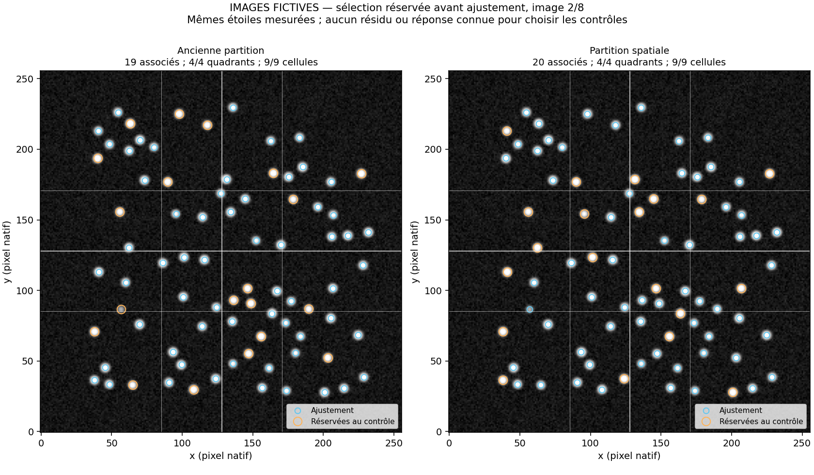
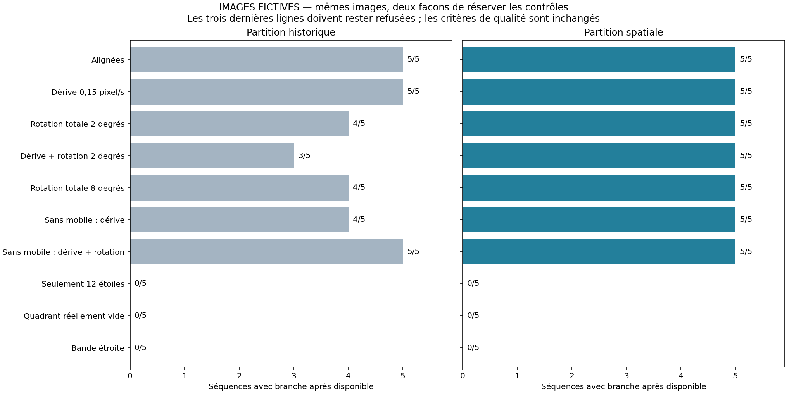
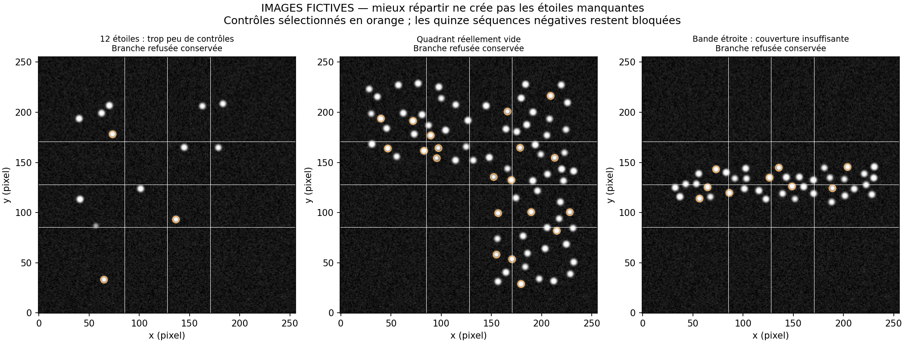
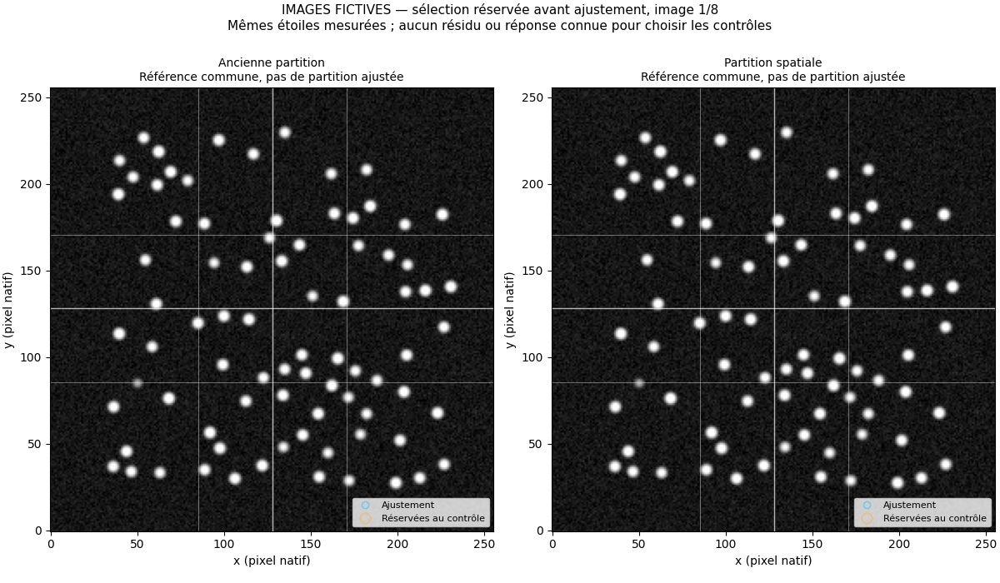

# Mieux répartir les étoiles réservées au contrôle

Plan **[`bbe9776`](https://github.com/steveprudhomme/gnu-astrophotography-recycle/commit/bbe977609ff526f87d13d4181bdc18e108f3fbbe)** publié et vérifié avant le code du lot 14. La nouvelle partition est une **recette expérimentale** dans `examples/spatial_controls.py` ; elle ne remplace pas `gar register`. L’application reste 0.10.0a1, les moteurs antérieurs, leurs seuils et les dépendances restent inchangés.

**Sur le nouveau jeu**, la méthode spatiale rend disponibles les 20 séquences principales, contre 17 pour la partition historique sur les mêmes images. Elle retrouve les 20 mobiles, sans faux candidat. Les quinze négatifs restent bloqués. Les critères exploratoires préenregistrés sont satisfaits sur ce jeu fictif ; cela ne valide pas le bruit, Bayer, les calibrations ou l’horloge du Seestar.

## Ce qui change et ce qui reste réservé

Les listes de sources natives et stellaires sont mesurées une seule fois par image, puis partagées entre les méthodes. La référence reste la première image mesurée. La partition historique utilise sa permutation habituelle ; la partition spatiale réserve le même nombre de contrôles : `max(1, floor(N/4))`.

La sélection spatiale précède tout appariement, hypothèse, score ou ajustement :

1. Ranger les centres mesurés dans les intersections des **quatre quadrants** et des **neuf cellules 3×3**.
2. Permuter les indices à l’intérieur de chaque compartiment, avec le générateur de graine fixe 20261116 et ordre lexicographique des compartiments.
3. Parcourir cycliquement les quadrants `(qy,qx)` dans l’ordre `(0,0), (0,1), (1,0), (1,1)`. Dans chacun, visiter les cellules `(cy,cx)` dans l’ordre lexicographique, en prenant un point du prochain compartiment non vide. Recommencer sans réutiliser de point jusqu’au nombre demandé.
4. Trier les indices retenus ; tous les autres constituent l’ensemble d’ajustement. Les contrôles ne participent ni aux hypothèses ni au choix du modèle ou à son ajustement.

Un compartiment vide est sauté, sans créer d’étoile. Aucune nouvelle partition n’est tentée après un refus. La méthode n’utilise pas les réponses connues, la transformation exacte ou les résidus. Elle dépend des coordonnées mesurées ; une variation des détections peut donc changer la partition. Les contrôles sont réservés par pose, pas des identités stellaires indépendantes sur toute la série. La référence commune et la sélection géométrique impliquent des corrélations et une représentativité limitée.

`fit_partition` réutilise `solve`, `mutual` et `metrics` du moteur historique. Les critères restent **≥20 associations d’ajustement, ≥10 de contrôle, médiane ≤0,75 pixel, P95 ≤1,5 pixel, ≥6 cellules et quatre quadrants**. Les rayons et autres paramètres du recalage et du détecteur restent ceux des [contrats](CONTRAT-RECALAGE.md). Un modèle refusé bloque toute la branche après de la séquence, sans identité de secours. Les pixels FITS ne sont jamais rééchantillonnés.



*Pixels entièrement fictifs de `combined-s1103`, image 2/8 ; bleu : ajustement, orange : contrôles sélectionnés avant ajustement. Les titres indiquent les contrôles associés après gel du modèle, pas une sélection après examen des résidus.*

## Nouveau jeu, sans sélection des graines favorables

Graines **1103, 1201, 1301, 1409, 1511**, différentes du lot 13. Cinquante séquences, quatre cents images, trente injections mobiles. Les huit premières conditions reprennent le modèle du [lot précédent](RECALAGE-MOBILES-SYNTHETIQUES.md) : fond 100 ADU, bruit gaussien sigma 2, PSF sigma 1,3 pixel, images 256×256, huit temps fictifs de 0 à 70 s, mobile de pic 120 et vitesse initiale `(0,5 ; 0,2)` pixel/s. Champs ordinaires de 80 étoiles, plus le contrôle à 12 étoiles. Mêmes étoiles/bruits par graine pour les comparaisons appariées ; les cellules ne sont pas toutes statistiquement indépendantes.

Deux conditions négatives sans mobile s’ajoutent, avec dérive 0,15 pixel/s et rotation totale 2 degrés :

- **Quadrant vide** : 80 étoiles, en excluant tout centre ayant simultanément x<150 et y<150. Le quadrant bas-gauche reste réellement sans étoiles de référence utilisables dans cet essai.
- **Bande étroite** : 40 étoiles, y entre 110 et 145, sans couverture suffisante de la grille 3×3.

La génération s’arrête explicitement si les centres ne peuvent pas être placés en 100 000 propositions ; aucune graine de remplacement n’est tirée. Les quatre sources historiques gelées sont vérifiées par empreintes normalisées UTF-8/LF :

| Source | SHA-256 |
|---|---|
| `src/gar/registration.py` | `23828292730f324a4a06ba5b247187fd21aa1eeb01bd8e4dfda90c46d3d709da` |
| `src/gar/moving.py` | `f492032e0188310484faaf372db4c96597fd7910ecd3821629edb8365f27be67` |
| `src/gar/moving_reports.py` | `b3b543591ad7cbe35dd0c08a92a8aee67b89888a1488f6b80fdbb354a0b6be0c` |
| `examples/moving_registration.py` | `c1f35892be3af3ecdaed09ec88bdcb5f7c7cc24ba69ec5d5b69ab98407f3870f` |

Ce gel ne remplace pas la consignation des versions des bibliothèques. Aucun FITS réel, catalogue ou support externe n’est lu pour cet essai.

## Commandes et sorties

Depuis la racine, après l’[installation](DEMARRER-DE-ZERO.md), outils graphiques inclus, choisir des dossiers neufs et prévoir environ 108 Mo pour les images, plus les rapports :

```powershell
.\.venv\Scripts\python.exe examples/compare_spatial_controls.py make local/controles-spatiaux-entree
.\.venv\Scripts\python.exe examples/compare_spatial_controls.py run local/controles-spatiaux-entree/manifest.json local/controles-spatiaux-entree/truth.json local/controles-spatiaux-rapport
.\.venv\Scripts\python.exe examples/plot_spatial_controls.py local/controles-spatiaux-entree/manifest.json local/controles-spatiaux-rapport/spatial.json local/controles-spatiaux-figures
```

Sur ce jeu, les trois commandes aboutissent avec **code 0**. Pour l’analyse, 0 signifie critères exploratoires satisfaits, 2 rapport complet avec critère non satisfait, 1 analyse impossible. Cela ne modifie pas le code 2 attendu de l’ancienne recette sur son ancien jeu : ses refus restent conservés. Les chemins extérieurs à `local/`, liens/jonctions, sorties existantes et images modifiées sont refusés.

`manifest.json` et `truth.json` restent privés localement. Les modèles/candidats des **deux méthodes et des cinquante séquences** sont tous gelés avant la première lecture des coordonnées de vérité. Leur intégrité et celle des entrées sont contrôlées avant/après. Les fichiers individuels gardent les résultats avant évaluation ; `spatial.json` rassemble modèles, indices, contrôles sélectionnés/associés, couverture, résidus, candidats, erreurs sur appariés, comptages, transitions et provenance. La couverture des contrôles sélectionnés contient des comptages, pas des résidus artificiellement nuls. Les résidus mesurés sont dans les métriques des associations.

`comparison.csv` et `report.md` présentent les comptages ; les valeurs indisponibles sont absentes, pas remplacées par zéro. `progress.json` garde les séquences terminées et les interruptions ; aucun bilan complet n’est fabriqué à partir d’un lot incomplet. Une erreur d’écriture peut laisser un dossier partiel : garder ce dossier et choisir une nouvelle sortie après résolution.

## Résultats sur les mêmes nouvelles images

| Condition, cinq séquences | Disponibles historique | Disponibles spatiale | Récupérés historique / disponibles avec mobile | Récupérés spatiale / disponibles avec mobile |
|---|---:|---:|---:|---:|
| Alignées | 5/5 | 5/5 | 5/5 | 5/5 |
| Dérive | 5/5 | 5/5 | 5/5 | 5/5 |
| Rotation 2 degrés | 4/5 | 5/5 | 4/4 | 5/5 |
| Combinaison | 3/5 | 5/5 | 3/3 | 5/5 |
| Rotation 8 degrés, descriptive | 4/5 | 5/5 | 4/4 | 5/5 |
| Témoin dérive | 4/5 | 5/5 | Aucun mobile | Aucun mobile |
| Témoin combinaison | 5/5 | 5/5 | Aucun mobile | Aucun mobile |
| Douze étoiles | 0/5 | 0/5 | Indisponible | Indisponible |
| Quadrant vide | 0/5 | 0/5 | Indisponible | Indisponible |
| Bande étroite | 0/5 | 0/5 | Indisponible | Indisponible |



Sur les principales, trois transitions refus→acceptation et aucune acceptation→refus : **17/20 → 20/20**. Les dix-sept séquences principales disponibles pour les deux méthodes conservent leurs dix-sept mobiles sans ajout de faux candidat. Les trois nouvelles disponibles retrouvent également leur mobile. Les témoins et la rotation descriptive ajoutent chacun une transition favorable. Aucun faux candidat dans les branches après disponibles des deux méthodes.

Le P95 global des erreurs sur les vingt mobiles principaux appariés de la méthode spatiale est **0,0776 pixel**, l’erreur vectorielle maximale de vitesse **0,00110 pixel/s fictive**. La disponibilité s’améliore sur cet essai ; il ne faut pas en déduire une amélioration universelle de précision. Les jeux et sous-ensembles diffèrent, et les erreurs ne décrivent pas les sources manquées ou les branches indisponibles.

Les huit critères préenregistrés sont satisfaits : vingt principales disponibles, vingt mobiles retrouvés, aucun faux candidat principal, P95 ≤0,3, erreur de vitesse ≤0,02, dix témoins acceptés sans candidat, quinze négatifs bloqués, et aucune perte de mobile récupéré ou ajout de faux candidat dans les principales acceptées par l’ancienne méthode. Cinq graines et ces modèles simples ne fournissent pas une probabilité de réussite universelle.

**Le lot 13 conserve son résultat 15/20 sur son propre jeu.** Le 17/20 historique ci-dessus concerne les nouvelles graines ; annoncer « 15 → 20 » en mélangeant les deux jeux serait une comparaison incorrecte. La recette spatiale n’a pas été rejouée sur les anciennes données pour réécrire leur bilan.



*Images fictives de graine 1103, deuxième image de chaque séquence. Les cercles orange sont les contrôles effectivement sélectionnés. Une meilleure partition ne crée ni étoiles, ni quadrants, ni couverture absents.*



*Exemple `combined-s1103` fixé dans le plan. La première image est la référence commune ; les sept suivantes montrent les sélections mesurées avant ajustement sur les pixels de chaque pose. Aucun mouvement exact, résidu ou réponse connue n’a servi à choisir ces contrôles. Le GIF est synthétique, pas une capture d’écran.*

## Vérifications et passage au réel

**20 nouveaux cas, soit 297 tests logiciels réussis** en 46,51 secondes lors du contrôle du lot. Sélection déterministe, unicité/complément, vrais manques, ordre avant ajustement, contrôles perturbés avec partition figée, détection partagée, comparaison appariée, interruptions, intégrité et vérité après tous les résultats sont contrôlés. Les moteurs historiques restent inchangés.

L’inspection des figures a repéré un mauvais raccord entre l’image négative et la liste de contrôles illustrée : le programme de dessin a été corrigé avant publication, puis les figures réexaminées. Les images d’essai, modèles, comptages et critères n’ont pas été changés. Les rapports de travail et premières figures restent locaux. Reproduction complète depuis le code committé et vérification des commandes pédagogiques avant publication.

Le [passage aux images Seestar](PASSAGE-AUX-IMAGES-SEESTAR.md) devient le prochain jalon à préparer : vérifier les manifestes locaux, identifier une série réelle compatible et les copies disponibles, puis adapter et exécuter un pilote exploratoire distinct. Le petit échantillon actuel ne suffit pas à cette chaîne ; aucune date ou découverte n’est promise. La préparation de ce lot n’a consulté que le manifeste local et les documents, sans FITS réel ou USB.

Référence primaire revue le 17 novembre 2026 : [SciPy cKDTree](https://docs.scipy.org/doc/scipy/reference/generated/scipy.spatial.cKDTree.html). Les choix de partition, profils et critères sont propres au projet, les bibliothèques et contrats antérieurs restent les mêmes. Ce résultat ne qualifie ni instrument, ni chronologie réelle, ni soumission scientifique.
