# Construire l’application, pas à pas

Ce parcours est écrit pour une personne qui débute, y compris un enfant de 10 ans. Tu peux faire une étape, regarder son résultat, puis faire une pause. Pour installer Python ou Git, fais-toi accompagner si tu ne les connais pas encore.

**Notre but :** récupérer les recettes du projet, reconstruire l’application sur ton ordinateur et essayer **tous ses modules disponibles** avec de fausses images du ciel. C’est une application à laquelle tu parles avec des commandes dans PowerShell. Les prochaines fonctions du projet ne sont pas encore toutes construites.


*Schéma pour apprendre, pas une capture d’écran. [Version SVG](images/debutant-parcours.svg).*

## 1. Cinq mots pour commencer

| Mot | Ce que cela veut dire ici |
|---|---|
| Code source | Les recettes écrites pour que l’ordinateur sache quoi faire |
| Dossier | Une boîte qui contient des fichiers ou d’autres dossiers |
| Commande | Une petite instruction que tu écris à l’ordinateur |
| Image FITS | Une image du ciel avec une étiquette contenant des informations |
| Synthétique | Inventé par notre programme pour nous entraîner ; aucune vraie observation |

Un **pixel** est un petit carré d’une image. Un **rapport** est un carnet de résultats. Une **erreur** est aussi une information utile : on s’arrête pour la comprendre.

## 2. Préparer Python et Git

Python permet d’exécuter les recettes. Git permet de récupérer leur version publique. Les liens de départ sont [Python pour Windows](https://www.python.org/downloads/windows/) et [Git pour Windows](https://git-scm.com/install/windows). Utilise les sites officiels. Les explications détaillées sont dans [INSTALL.md](../INSTALL.md).

Ouvre **PowerShell** depuis le menu Démarrer de Windows. Écris une ligne, puis appuie sur **Entrée**. Copie seulement le contenu des blocs de commandes ; n’ajoute pas les trois petits accents qui entourent ces blocs dans le document.

```powershell
py -3.13 --version
git --version
```

**Tu dois voir :** un numéro Python commençant par `3.13`, puis un numéro Git. Le projet a été essayé avec Python 3.13.6 ; ton numéro de correction peut être différent. Le minimum technique du projet est Python 3.12, mais ce parcours emploie le lanceur `py -3.13` pour rester simple.

**Si Windows dit que la commande est introuvable :** l’outil manque ou la fenêtre a été ouverte avant son installation. Termine son installation, ferme puis rouvre PowerShell et réessaie. Ne continue pas si les deux outils ne répondent pas.

## 3. Récupérer les recettes

Nous allons travailler dans un nouveau dossier `AtelierGAR` de tes Documents. Ces commandes ne touchent pas à une clé USB.

```powershell
Set-Location ([Environment]::GetFolderPath('MyDocuments'))
git clone https://github.com/steveprudhomme/gnu-astrophotography-recycle.git AtelierGAR
Set-Location AtelierGAR
```

**Tu dois voir :** des messages de téléchargement, puis retrouver les fichiers `README.md`, `pyproject.toml` et les dossiers ci-dessous. Le téléchargement demande Internet. Si `AtelierGAR` existe déjà, garde-le et choisis un autre nom pour un nouvel atelier ; ne supprime pas un dossier au hasard.

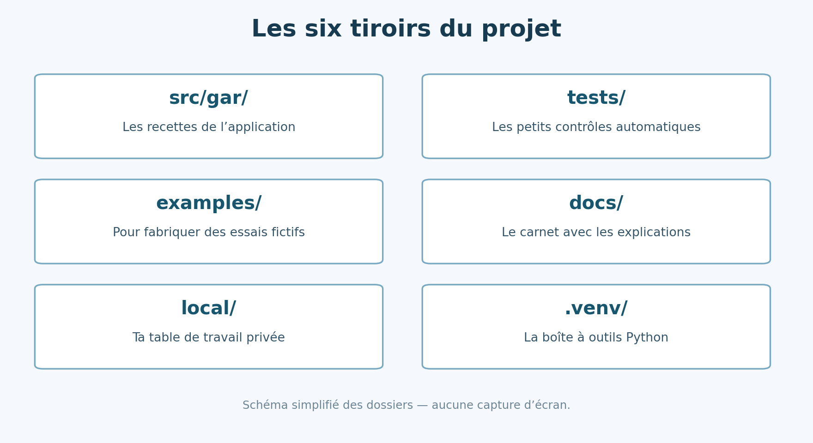

*Schéma simplifié, pas une capture d’écran. [Version SVG](images/debutant-dossiers.svg).*

| Tiroir | Son rôle |
|---|---|
| `src/gar/` | Les recettes de l’application |
| `tests/` | Les contrôles automatiques des recettes |
| `examples/` | Les recettes qui fabriquent nos images fictives |
| `docs/` | Les explications et images de ce carnet |
| `local/` | Les résultats de tes essais, conservés sur ton ordinateur |
| `.venv/` | La boîte à outils Python créée à l’étape suivante |

Reste à la racine de `AtelierGAR` pour les commandes suivantes. Tape `Get-Location` si tu veux savoir où tu es.

## 4. Construire ta boîte à outils et l’application

Chaque ligne attend que la précédente ait terminé. L’installation peut prendre quelques minutes et demander Internet.

```powershell
py -3.13 -m venv .venv
.\.venv\Scripts\python.exe -m pip install -r requirements/dev-tested.txt
.\.venv\Scripts\python.exe -m pip install --no-deps -e .
.\.venv\Scripts\gar.exe --version
```

**Tu dois voir :** `0.10.0a1` pour cette leçon. Une version plus récente peut apparaître si le projet a évolué ; ses nombres de tests et résultats peuvent alors changer.

La première ligne fabrique la boîte `.venv`. La deuxième y range les outils. La troisième reconstruit et installe l’application à partir de **tout son code source**. Le point final `.` signifie « ce dossier-ci » : garde-le. L’option `-e` relie l’application à ses recettes, pour que les modifications de code soient visibles pendant l’apprentissage.

Pour fabriquer aussi les graphiques et le petit film GIF de ce parcours :

```powershell
.\.venv\Scripts\python.exe -m pip install -r requirements/figures-tested.txt
```

Ces outils de dessin sont séparés des outils d’analyse. Nous appelons directement le Python de `.venv` : aucune commande d’activation PowerShell n’est nécessaire.

## 5. Vérifier la construction avant de jouer

```powershell
New-Item -ItemType Directory -Path local/parcours -Force
.\.venv\Scripts\python.exe -m pytest -q -p no:cacheprovider --basetemp="local/parcours/tests-01"
.\.venv\Scripts\python.exe -m pip check
```

**Tu dois voir :** `316 passed` pour cette édition et `No broken requirements found.` La première phrase signifie que les 316 contrôles logiciels ont réussi, y compris la préparation des séries. Elle ne certifie pas un télescope ou son horloge. L’application reste en version 0.10.0a1 : les nouvelles recettes complètent les commandes habituelles.

La première ligne prépare les boîtes `local` et `parcours` pour les essais. `-Force` permet de garder ces dossiers s’ils existent déjà ; cette commande ne vide pas leur contenu. Il faut les créer avant les tests : le programme de test ne crée pas tout seul les dossiers parents de son espace temporaire.

Choisis un nouveau nom de dossier de tests à chaque reprise, par exemple `tests-02` : l’outil de test peut nettoyer son dossier temporaire. Si tu vois `FAILED`, arrête-toi, conserve le message et demande de l’aide en donnant le nom du contrôle en échec.

## 6. Comprendre les trois réponses de l’application

Après une commande de l’application, tu peux écrire :

```powershell
$LASTEXITCODE
```

| Réponse | Traduction simple |
|---|---|
| `0` | Le travail a été produit et les critères de cette commande sont satisfaits |
| `2` | Le rapport existe, mais il contient une limite, une exclusion ou un critère non satisfait à lire |
| `1` | Le travail n’a pas pu être terminé ; lis le message d’erreur |

**Le nombre 2 n’est pas toujours une panne.** Pour les heures, c’est même la réponse attendue : un en-tête ne prouve pas la précision d’une horloge. Nous allons l’indiquer dans chaque mission.

Tous les noms `local/parcours/...` ci-dessous sont nouveaux. Si un dossier de sortie existe déjà, choisis un autre nom et adapte aussi les commandes qui le relisent. Le programme protège les résultats précédents.

## 7. Mission : faire l’inventaire des images

Un inventaire est une liste de ce que nous avons, comme compter les pièces d’un jeu.

```powershell
.\.venv\Scripts\python.exe examples/make_demo.py local/parcours/inventaire-images
.\.venv\Scripts\gar.exe inventory local/parcours/inventaire-images --output local/parcours/inventaire-rapport
```

**À regarder :** `local/parcours/inventaire-rapport/report.md`. Les fichiers détaillés et leur empreinte sont dans `manifest.json`. Une empreinte SHA-256 est comme une étiquette calculée : si les octets du fichier changent, cette étiquette permet de s’en apercevoir.


*Graphique d’un exemple fictif réellement calculé, pas des observations personnelles. La [section 3 du tutoriel de référence](TUTORIEL.md#3-comprendre-les-résultats) explique les colonnes.*

## 8. Mission : ranger les séances et examiner les heures

Une séance est un groupe d’images qui pourraient aller ensemble. L’application utilise les étiquettes ; elle ne déplace pas les images.

```powershell
.\.venv\Scripts\python.exe examples/make_sessions_demo.py local/parcours/seances-images
.\.venv\Scripts\gar.exe inventory local/parcours/seances-images --output local/parcours/seances-inventaire
.\.venv\Scripts\gar.exe sessions local/parcours/seances-inventaire/manifest.json --output local/parcours/seances-rapport
```

**À attendre :** cinq groupes dans cet exemple. Le code 2 signale les exclusions à lire, pas des fichiers perdus.


Pour essayer le diagnostic des heures sur un exemple prévu pour cela :

```powershell
.\.venv\Scripts\python.exe examples/make_timing_demo.py local/parcours/heures-images
.\.venv\Scripts\gar.exe inventory local/parcours/heures-images --output local/parcours/heures-inventaire
.\.venv\Scripts\gar.exe timing local/parcours/heures-inventaire/manifest.json --output local/parcours/heures-rapport
```

**À attendre :** le rapport existe et le code est 2. Une suite régulière d’étiquettes ne prouve pas que l’heure soit juste.


*Les deux graphiques sont des exemples synthétiques. Lis `report.md` dans chaque dossier de rapport.*

## 9. Mission : examiner la carte du ciel et préparer des copies

Une **WCS** est une recette qui transforme une position dans l’image en position sur le ciel. Vérifier qu’une recette est écrite ne prouve pas encore qu’elle soit juste.

```powershell
.\.venv\Scripts\python.exe examples/make_wcs_demo.py local/parcours/wcs-images
.\.venv\Scripts\gar.exe inventory local/parcours/wcs-images --output local/parcours/wcs-inventaire
.\.venv\Scripts\gar.exe wcs local/parcours/wcs-inventaire/manifest.json --output local/parcours/wcs-rapport
.\.venv\Scripts\python.exe examples/make_workset_demo.py local/parcours/copies-entree
.\.venv\Scripts\gar.exe workset local/parcours/copies-entree/selection.json --output local/parcours/copies-rapport
```

**À attendre :** code 2 pour `wcs`, car la première liste d’étiquettes est incomplète ; code 0 et trois copies vérifiées pour `workset`. Les fichiers inventés restent sur l’ordinateur.


## 10. Mission : comparer des étoiles à une liste de référence

Une liste de référence ressemble à une fiche de réponses préparée à l’avance. Dans cette mission, elle est entièrement inventée. Le programme mesure les écarts sans changer la carte pour obtenir une meilleure note.

```powershell
.\.venv\Scripts\python.exe examples/make_astrometry_demo.py local/parcours/etoiles-entree
.\.venv\Scripts\gar.exe astrometry local/parcours/etoiles-entree/workset/workset.json --file-index 1 --catalog local/parcours/etoiles-entree/catalog.csv --output local/parcours/etoiles-rapport
```

**À attendre :** 36 associations, un écart médian voisin de 0,5 seconde d’arc et le code 0. Une seconde d’arc est une petite unité d’angle sur le ciel ; elle n’est pas une seconde de temps. Le décalage a été ajouté volontairement et doit rester visible.


## 11. Mission : remettre trois images dans le même repère

**Recaler** signifie trouver comment tourner et déplacer les coordonnées d’une image pour les comparer à une autre. Des étoiles sont mises de côté : elles servent ensuite à contrôler le résultat.

```powershell
.\.venv\Scripts\python.exe examples/make_gaia_frames_demo.py local/parcours/poses-entree
.\.venv\Scripts\gar.exe register local/parcours/poses-entree/workset.json --reference-index 4 --frame-indices 1 2 3 --output local/parcours/poses-recalage
.\.venv\Scripts\gar.exe gaia-frames local/parcours/poses-entree/workset.json --registration local/parcours/poses-recalage/registration.json --catalog local/parcours/poses-entree/catalog.csv --output local/parcours/poses-gaia
```

**À attendre :** trois résultats satisfaisant les critères de l’exemple, code 0 pour les deux commandes. Le catalogue imite les colonnes de Gaia, mais ses étoiles sont fictives : aucun téléchargement d’observations Gaia n’est fait ici.


## 12. Mission : préparer les questions sur l’horloge

L’étiquette d’une photo peut dire « image créée » sans expliquer l’instant réel de l’exposition. Cette mission fabrique un dossier des choses connues et des preuves à chercher.

```powershell
.\.venv\Scripts\python.exe examples/make_time_evidence_demo.py local/parcours/preuves-entree
.\.venv\Scripts\gar.exe time-evidence local/parcours/preuves-entree/workset.json --output local/parcours/preuves-rapport
```

**À attendre :** code 2, quatre fichiers, trois images candidates et zéro heure qualifiée. Même l’exemple contenant beaucoup d’étiquettes ne prouve pas la justesse de l’horloge.

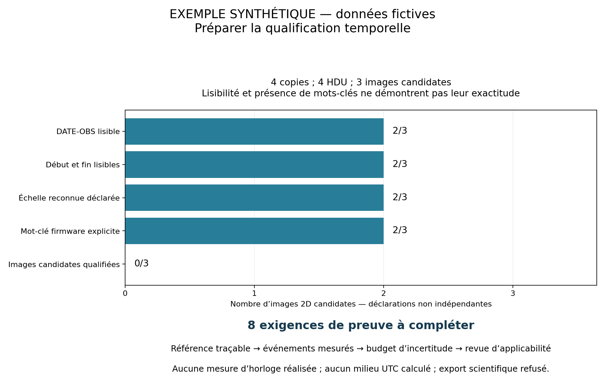

Les six fichiers produits sont expliqués dans la [section 15 du tutoriel](TUTORIEL.md#15-préparer-la-qualification-des-horodatages-sur-les-copies-locales). La [fiche de campagne](CAMPAGNE-TEMPORELLE.md) explique comment copier les cinq canevas pour préparer un essai futur. Ce ne sont pas des commandes qui pilotent le télescope.

## 13. Mission : retrouver les points qui bougent

Nous fabriquons maintenant de fausses étoiles, du bruit et des points mobiles. Le **bruit** est une petite variation inventée de la luminosité. La **trajectoire** est le chemin suivi par un point.

```powershell
.\.venv\Scripts\python.exe examples/make_moving_demo.py local/parcours/mobiles-entree
.\.venv\Scripts\gar.exe moving-synthetic local/parcours/mobiles-entree/manifest.json --truth local/parcours/mobiles-entree/truth.json --output local/parcours/mobiles-rapport
```

**À attendre :** 18 séquences, les six mobiles faciles et les trois mobiles intermittents retrouvés, zéro faux candidat dans les trois témoins. Le code est 0 si les critères enregistrés sont satisfaits. Les cinq objets manqués dans les cas faible ou très lent restent dans le rapport : ce sont des informations utiles, pas des résultats à effacer.

Le fichier `truth.json` contient les réponses parce que nous avons nous-mêmes inventé les objets. Le chercheur automatique construit ses candidats **avant** de lire ces réponses. Elles servent à compter ce qu’il a retrouvé ou manqué.

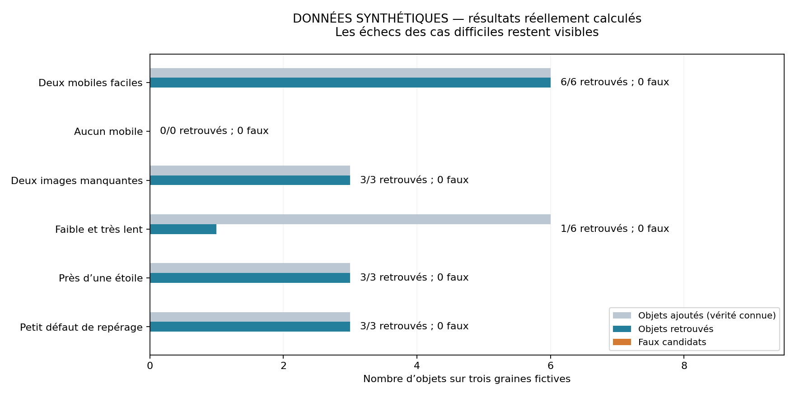

Pour fabriquer tes graphiques et ton petit film :

```powershell
.\.venv\Scripts\python.exe examples/plot_moving_demo.py local/parcours/mobiles-entree/manifest.json local/parcours/mobiles-rapport/moving.json local/parcours/mobiles-figures
```

Ouvre `moving-demo.gif` dans ce nouveau dossier. Les lignes colorées relient les positions mesurées des candidats ; les étoiles fixes restent sur place dans cet exemple.

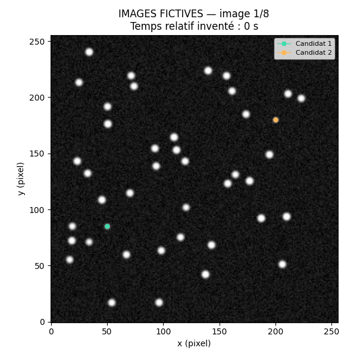

*Données entièrement synthétiques, sans capture d’écran. Les secondes et vitesses de cet exercice sont fictives. Voir un point bouger dans ce jeu n’est pas découvrir un objet astronomique réel.*

## 13 bis. Mission : trouver les limites du chercheur

Un chercheur automatique peut se tromper. Nous allons lui donner de nouvelles images inventées, sans changer ses règles pour lui donner une meilleure note. Imagine un jeu où tu caches cinq billes : **5/5** veut dire « cinq retrouvées sur cinq cachées ». **0/5** est aussi une réponse utile : nous avons trouvé une difficulté.

Prévois environ 260 Mo pour les images fictives, plus les rapports. Reste dans le dossier du projet et garde les outils de dessin installés à l’étape 4. Aucun exercice ne demande une clé USB.

### Fabriquer, mesurer, puis dessiner

Écris une ligne à la fois et attends la fin avant la suivante :

```powershell
.\.venv\Scripts\python.exe examples/moving_limits.py make local/parcours/limites-entree
.\.venv\Scripts\python.exe examples/moving_limits.py run local/parcours/limites-entree/suite.json local/parcours/limites-rapport
.\.venv\Scripts\python.exe examples/plot_moving_limits.py local/parcours/limites-entree/suite.json local/parcours/limites-rapport/limits.json local/parcours/limites-figures
```

La première ligne **fabrique** 120 petites séquences, soit 960 images. La deuxième les **examine** avec les règles inchangées et range ses observations. La troisième **dessine** quatre images et un petit film. Le nombre de retour 0 signifie ici que l’essai a été produit, pas que tous les objets ont été retrouvés.

**Tu dois voir :** un message annonçant les 120 séquences analysées, puis les figures. Ouvre `local/parcours/limites-rapport/report.md` pour lire les résultats et `local/parcours/limites-figures/limits-grid.png` pour voir la première carte.

### Lire la carte des objets retrouvés

Dans l’image suivante, les lignes changent la lumière du point et les colonnes changent sa vitesse. **ADU** est simplement le nombre utilisé ici pour la lumière dans nos images fictives : un pic de 120 est plus lumineux qu’un pic de 12. Ce n’est pas une magnitude d’étoile réelle.


*Graphique réellement calculé, entièrement synthétique. Les zéros sont conservés.*

**À remarquer :** les points à 0,03 pixel par seconde fictive ne sont jamais retrouvés. Ils bougent trop lentement pour les règles de ce chercheur. Les points les plus faibles sont aussi difficiles à retrouver. Le 1/5 ne nous permet pas de deviner ce qui arriverait dans tous les autres essais.

### Ajouter du « grain » dans l’image

Le bruit ressemble aux petits grains qui gênent la lecture d’une photo. Nous avons essayé le même point avec quatre quantités de bruit. Le mot **sigma** indique ici la taille habituelle de ces petites variations.

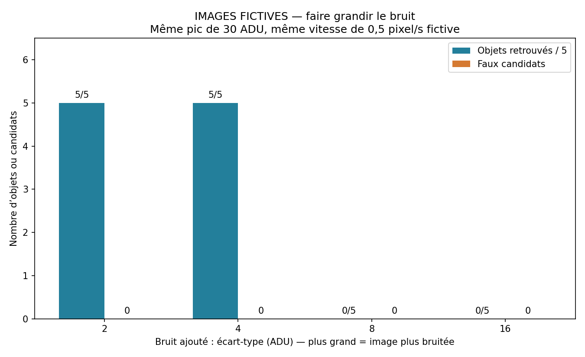

**À attendre :** 5/5 retrouvés pour les bruits 2 et 4, puis 0/5 pour 8 et 16. Ce sont les résultats de ces images inventées, pas une règle universelle pour le télescope.

### Et si toute l’image glisse ?

Imagine des étoiles dessinées sur une feuille : si tu déplaces la feuille, toutes les étoiles semblent bouger. Le chercheur peut alors les prendre pour les mobiles que nous cherchons. Nous appelons cela de **faux candidats**.

Ouvre `local/parcours/limites-figures/limits-comparison.gif` :


Le cercle vert montre le mobile que nous avons caché : c’est la réponse connue, ajoutée au dessin **après** la recherche. Les croix orange montrent les autres candidats trouvés par le programme. À droite, la dérive de 0,15 pixel/s donne 40 faux candidats sur cette séquence ; sur les cinq séquences de cette condition, il y en a 200.

**Attention à l’expérience :** le chercheur attend des images déjà alignées. Nous avons volontairement cassé cette règle pour comprendre sa limite. Il n’a pas encore remis les images en place dans cette mission. Un prochain travail pourra comparer le résultat avant et après cette remise en place, appelée **recalage**.


Les essais sans mobile donnent zéro faux candidat, mais cela ne prouve pas que le programme ne se trompera jamais. Cinq répétitions par situation restent un petit exercice. Pour tous les détails et les fichiers, lis [les limites du détecteur](LIMITES-DETECTEUR.md) ou la [section 18 du tutoriel](TUTORIEL.md#18-tester-les-limites-sans-changer-les-règles).

**Si une étape échoue :** conserve son message et le dossier créé. Le fichier `progress.json` permet de voir les lots terminés ; `incomplete` veut dire que l’exercice n’est pas fini. Choisis de nouveaux noms pour reprendre, sans effacer les résultats précédents.

## 13 ter. Mission : stabiliser les positions avant de chercher

La mission précédente montrait qu’un ciel qui glisse peut tromper le chercheur. Nous allons essayer de remettre les **positions** dans le même repère. Imagine une feuille transparente avec des points : tu la tournes et la déplaces pour remettre ses étoiles sur celles de la première photo. Cela s’appelle le **recalage**. Les photos FITS restent intactes.

### Fabriquer le nouvel exercice

Prévois environ 86 Mo pour les images, plus les rapports et dessins. Toujours depuis le dossier du projet, écris :

```powershell
.\.venv\Scripts\python.exe examples/moving_registration.py make local/parcours/recalage-mobiles-entree
.\.venv\Scripts\python.exe examples/moving_registration.py run local/parcours/recalage-mobiles-entree/manifest.json local/parcours/recalage-mobiles-entree/truth.json local/parcours/recalage-mobiles-rapport
.\.venv\Scripts\python.exe examples/plot_moving_registration.py local/parcours/recalage-mobiles-entree/manifest.json local/parcours/recalage-mobiles-entree/truth.json local/parcours/recalage-mobiles-rapport/comparison.json local/parcours/recalage-mobiles-figures
```

La première commande fabrique **40 séquences, soit 320 images fictives**. La deuxième cherche les mobiles avant et après recalage. La troisième dessine le bilan et l’animation. Attends la fin de chaque ligne avant de lancer la suivante ; choisis d’autres noms si ces dossiers existent déjà.

**Résultat attendu de la deuxième commande :** `critères exploratoires : False`, avec le code **2**. Cela signifie que le rapport est bien produit, mais que l’essai ne satisfait pas toutes les règles prévues. Tu peux alors lancer le dessin et lire `local/parcours/recalage-mobiles-rapport/report.md`. Le code 1 signifierait un travail impossible : il faudrait garder le message et demander de l’aide.

### Garder les essais que le programme refuse

Le programme utilise certaines étoiles pour trouver comment tourner et déplacer les positions. Il en garde d’autres pour **contrôler** son travail, comme des questions qui n’ont pas servi à préparer une réponse. Ces étoiles de contrôle doivent couvrir les quatre quartiers de l’image, appelés **quadrants**.


Sur les 20 séquences principales, le programme peut continuer après recalage pour 15 séquences. Il retrouve leurs 15 mobiles. Pour les cinq autres, il s’arrête : les étoiles de contrôle ne couvrent pas les quatre quartiers. Ce n’est pas une raison pour effacer les essais ou changer la règle après avoir vu les réponses.

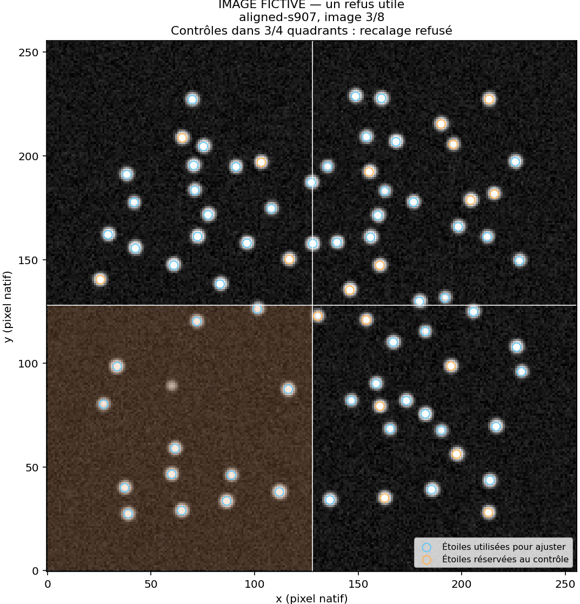

*Image fictive réellement calculée et annotée. Ici, les cercles bleus ont servi à ajuster ; les cercles orange sont les contrôles associés. La zone teintée n’a aucun contrôle associé. Ce n’est pas une capture d’écran.*

### Comparer les mêmes essais

Pour comparer deux équipes, il faut compter les mêmes joueurs des deux côtés. Ici aussi, nous comparons avant et après **les mêmes séquences disponibles**.


Dans les sept séquences comparables avec dérive ou combinaison, les faux candidats passent de **557 à zéro**, et les sept mobiles sont conservés. Cela ne nous donne pas un résultat pour les trois séquences bloquées de ces conditions. Les cinq essais avec seulement 12 étoiles sont aussi bloqués, comme prévu : trop peu d’étoiles pour vérifier correctement.

### Regarder les positions se remettre en place

Ouvre `local/parcours/recalage-mobiles-figures/registered-overlay.gif` :


**Le fond est une photo figée**, celle de la première image. Les points dessinés par-dessus racontent les positions mesurées dans les huit images. Ce ne sont pas des photos déformées : un ancien point lumineux peut rester visible dans le fond. À droite, les positions des étoiles retrouvent leur place ; le chercheur garde le mobile. Le cercle vert est la réponse connue ajoutée au dessin après la recherche, et les croix orange sont les faux candidats de cet exemple.

Cet exemple a été choisi dans le plan avant l’essai. Il passe de 79 faux candidats à zéro, mais les refus des autres séquences restent dans le bilan. Le chercheur n’a reçu ni le déplacement exact ni les réponses pour calculer le recalage.

**À retenir pour l’exercice :** un petit écart sur quelques étoiles ne garantit pas que toute l’image soit bien contrôlée. Notre prochain travail pourra étudier comment mieux répartir les étoiles de contrôle, avec un nouveau plan. Nous n’avons pas encore testé cette chaîne sur le Seestar réel. Les [détails de l’essai](RECALAGE-MOBILES-SYNTHETIQUES.md) et la [section 19 du tutoriel](TUTORIEL.md#19-relier-le-recalage-à-la-recherche-de-mobiles-fictifs) expliquent les résultats et les limites.

## 13 quater. Mission : répartir les étoiles de contrôle

Dans la mission précédente, certains recalages étaient refusés parce que les étoiles gardées pour vérifier ne couvraient pas toute l’image. Nous allons essayer de mieux répartir ces étoiles, **avant de chercher comment déplacer l’image**.

Imagine une classe où tu veux vérifier le travail dans les quatre coins de la salle. Si tu interroges seulement les enfants près de la porte, tu ne sais pas ce qui se passe ailleurs. Ici, nous faisons le tour des quatre quartiers de l’image, puis des petites cases disponibles, pour réserver des contrôles un peu partout. Les autres étoiles servent à l’ajustement.

### Fabriquer le nouveau jeu et comparer

Prévois environ 108 Mo pour les images, plus les rapports. Depuis le dossier du projet, avec les outils graphiques de l’étape 4 :

```powershell
.\.venv\Scripts\python.exe examples/compare_spatial_controls.py make local/parcours/controles-spatiaux-entree
.\.venv\Scripts\python.exe examples/compare_spatial_controls.py run local/parcours/controles-spatiaux-entree/manifest.json local/parcours/controles-spatiaux-entree/truth.json local/parcours/controles-spatiaux-rapport
.\.venv\Scripts\python.exe examples/plot_spatial_controls.py local/parcours/controles-spatiaux-entree/manifest.json local/parcours/controles-spatiaux-rapport/spatial.json local/parcours/controles-spatiaux-figures
```

Attends la fin de chaque ligne. Nous fabriquons **50 séquences, soit 400 images fictives**, puis essayons les deux sélections sur les mêmes images. Les trois commandes donnent le code **0** sur cet exercice ; l’analyse annonce `critères exploratoires : True`. Ouvre `local/parcours/controles-spatiaux-rapport/report.md` pour lire le bilan. Si tu lis `None` dans une case, cela signifie « résultat indisponible », pas « zéro erreur ».

Le code 2 de la mission précédente reste attendu sur **son ancien jeu**. Nous gardons ce résultat : les nouvelles images et les nouvelles graines ne changent pas le passé.

### Voir les étoiles réservées


*Image entièrement fictive. Les cercles bleus servent à ajuster ; les orange sont gardés pour vérifier. Le programme les réserve avant l’ajustement, sans regarder les réponses ou les erreurs du résultat.*

La nouvelle méthode prend toujours un quart des points environ, mais elle fait le tour des zones disponibles. Elle n’ajoute pas d’étoile et ne change pas les exigences de qualité.

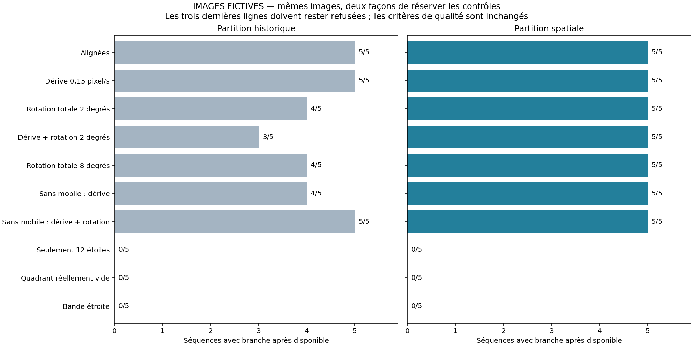

**À attendre :** sur les mêmes vingt séquences principales de ce nouveau jeu, 17 sont disponibles avec l’ancienne sélection et 20 avec la nouvelle. La nouvelle retrouve les 20 mobiles, sans faux candidat. Ce n’est pas une promesse pour toutes les images du ciel.

### Garder les vrais refus


Les quinze séquences prévues pour être insuffisantes restent refusées. S’il manque un coin du ciel, faire le tour de l’image ne crée pas les étoiles absentes. La bande étroite montre aussi qu’avoir des points de chaque côté ne suffit pas à vérifier toute la surface.

Ouvre `local/parcours/controles-spatiaux-figures/spatial-controls.gif` pour suivre la répartition :


*Les pixels viennent des images inventées, pas de captures d’écran. La première image est la référence commune ; les sept autres montrent les points sélectionnés avant ajustement.*

### Et les vraies images du Seestar ?

Nous en utilisons déjà pour certains diagnostics sur copies locales. Pour chercher des mobiles, l’échantillon actuel de trois poses et un empilement est trop court pour notre chaîne. **Le prochain jalon proposé est de préparer une série réelle compatible**, puis de réaliser un essai exploratoire : voir les points et vérifier les candidats, sans annoncer trop tôt une vitesse scientifique ou une découverte.


*Schéma conceptuel, pas un résultat de mesure. Le [passage aux images Seestar](PASSAGE-AUX-IMAGES-SEESTAR.md) explique ce qu’il faut préparer ; les [détails du contrôle spatial](CONTROLES-SPATIAUX.md) expliquent le nouvel exercice.*

Si une commande échoue, conserve le message et le dossier créé. `progress.json` indique ce qui est terminé ; un résultat indisponible n’est pas un zéro erreur. Reprends dans de nouveaux dossiers après avoir compris le problème. Cet exercice ne demande pas de clé USB et ne change aucune observation personnelle.

## Nouvelle mission : préparer huit poses Seestar

**Nous avons maintenant huit vraies poses Seestar copiées et vérifiées sur l’ordinateur.** La clé a été lue pour ces copies ; rien n’y a été écrit, déplacé ou supprimé. La mission suivante explique la recherche exploratoire maintenant réalisée sur cette série.


*Vraies observations, différentes des jeux fictifs des missions précédentes. Le mainteneur a autorisé ces deux exemples publics sous [CC0 1.0](images/reels/LICENCE.md). L’affichage est gris et étiré pour regarder les pixels ; il n’est pas calibré scientifiquement. Les fichiers FITS et leurs étiquettes privées restent locaux.*

### Comprendre les boîtes avant de copier

La boîte d’origine garde les photos du télescope. Nous préparons une **liste de copie**, puis une deuxième boîte sur l’ordinateur. Pour chaque fichier, nous comparons son **empreinte** avant et après la copie : les trois empreintes doivent être identiques. L’empreinte est calculée sur tous les octets, pas seulement sur ce que voit ton œil.

Dans l’exercice ci-dessous, les originaux sont **inventés et déjà sur l’ordinateur**. Tu peux donc tout refaire sans clé USB. N’utilise pas les chemins de tes observations personnelles pour ce petit exercice.

### 1. Fabriquer et compter douze photos inventées

```powershell
.\.venv\Scripts\python.exe examples/make_series_demo.py local/parcours/serie-archives
.\.venv\Scripts\gar.exe inventory local/parcours/serie-archives --output local/parcours/serie-inventaire
```

**Tu dois voir :** douze fichiers et aucun doublon. Ce sont de petites images fictives, avec une fausse mosaïque ressemblant à la disposition des pixels d’un capteur couleur. Elles ne reproduisent pas toute la réalité du Seestar.

### 2. Préparer une liste de huit copies

```powershell
.\.venv\Scripts\python.exe examples/prepare_seestar_series.py plan local/parcours/serie-inventaire/manifest.json --source-root local/parcours/serie-archives --output local/parcours/serie-plan
```

Le programme lit seulement l’inventaire local. Il cherche un groupe compatible et prend le premier bloc de huit photos successives qui respecte les règles prévues, sans regarder quelles images sont les plus jolies. `--source-root` indique explicitement la boîte des originaux. Cette étape ne l’ouvre pas et ne prouve pas encore qu’elle soit disponible.

**Tu dois voir :** une sélection disponible (`True`) et le fichier `local/parcours/serie-plan/selection.json`. Si aucune sélection n’existe, le code 2 indique le manque ; il faut lire le rapport plutôt qu’inventer des photos.

### 3. Faire les copies et vérifier les empreintes

```powershell
.\.venv\Scripts\gar.exe workset local/parcours/serie-plan/selection.json --output local/parcours/serie-copies
```

**Tu dois voir :** huit copies vérifiées. C’est cette commande qui lit les originaux de la liste et écrit les nouveaux fichiers dans la boîte locale. Elle refuse les fichiers qui ont changé depuis l’inventaire. Elle ne déplace pas les originaux.

### 4. Examiner les copies puis dessiner un aperçu

```powershell
.\.venv\Scripts\python.exe examples/prepare_seestar_series.py audit local/parcours/serie-plan/plan.json local/parcours/serie-copies/workset.json --output local/parcours/serie-audit
.\.venv\Scripts\python.exe examples/plot_series_preview.py local/parcours/serie-audit/series.json local/parcours/serie-apercu
```

**Tu dois voir :** huit fichiers contrôlés, préparation `True`, puis un aperçu de nature fictive `True`. Les six commandes de cette mission retournent 0 sur l’exercice. Ouvre `local/parcours/serie-apercu/series-preview.png` et le rapport `local/parcours/serie-audit/report.md`.

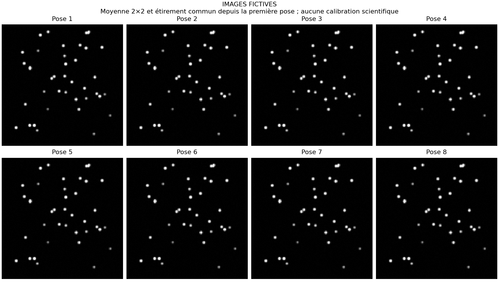

*Images synthétiques réellement calculées. Les deux mots « fictif » et « réel » dans les légendes sont importants : ils disent d’où viennent les pixels.*

L’aperçu fait la moyenne de quatre pixels voisins pour afficher en gris. Il garde le même réglage de contraste, calculé sur la première photo, pour regarder les huit. Cela ne change aucun FITS et ne transforme pas l’image en mesure scientifique.

### 5. Comprendre le résultat

« Copies préparées » veut dire que les fichiers correspondent et que leurs pixels sont lisibles avec la configuration observée. Cela ne veut pas encore dire que les étoiles sont recalées, que l’horloge est exacte ou qu’un point mobile a été trouvé. Si une erreur arrive, garde le message et les résultats partiels, puis choisis un nouveau dossier après avoir compris le problème.


*Exemple réel partagé sous [CC0](images/reels/LICENCE.md). Le grain visible n’est pas effacé pour promettre une précision ; ce rendu sert à apprendre. Les tests automatiques emploient toujours des données fictives.*

Le prochain travail pourra maintenant adapter la recherche exploratoire à la vraie série préparée : traiter correctement les pixels, recaler les positions et examiner les candidats. Les [détails de la préparation](PREPARER-SERIE-SEESTAR.md) expliquent les contrôles. L’[état du passage au Seestar](PASSAGE-AUX-IMAGES-SEESTAR.md) distingue la préparation faite et l’analyse qui reste à réaliser.

## Nouvelle mission : aligner les étoiles et chercher un mobile

**Nous avons maintenant essayé la chaîne sur les huit vraies poses : alignements acceptés, recherche terminée avec zéro candidat.** Un GIF réel existe dans les résultats locaux. Cela ne veut pas dire que tous les objets possibles auraient été visibles. Ici, tu vas apprendre avec des images inventées dont nous connaissons les réponses.

Imagine que tu photographies huit fois une feuille couverte de points. Si ta main bouge, tous les points semblent glisser. Il faut d'abord remettre les feuilles au même endroit : c'est **l'alignement**, aussi appelé recalage. Pour le calculer, nous utilisons certaines étoiles. Nous gardons les autres comme **témoins** : elles vérifient le résultat sans avoir servi au calcul. Un point qui continue à se déplacer pourrait devenir un **candidat**, à regarder de plus près.

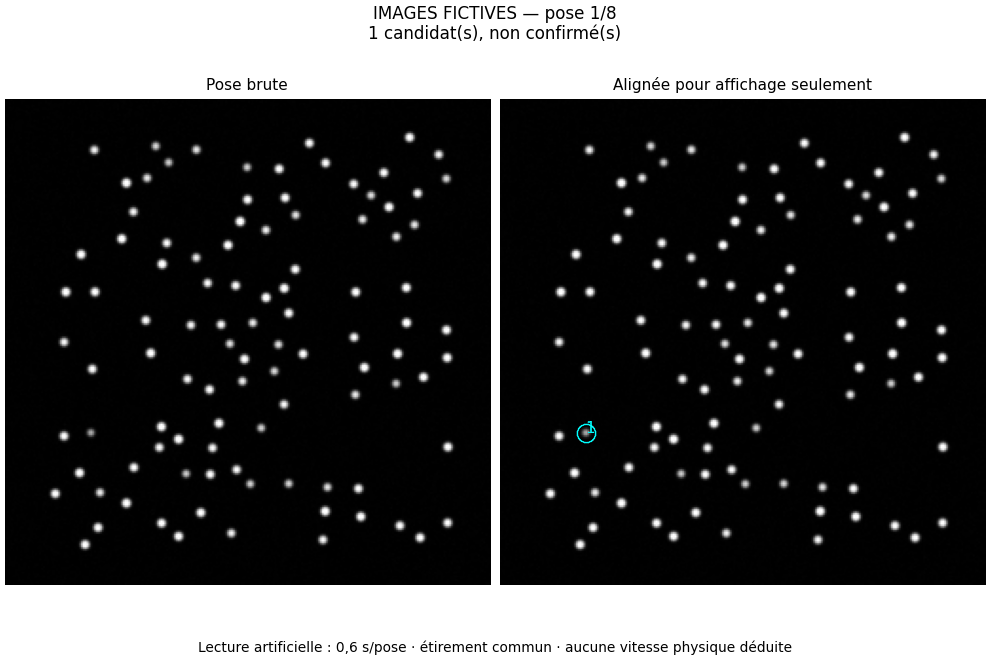

*Simulation pour apprendre, pas le GIF du Seestar réel. Les cercles viennent des positions trouvées par le programme, pas des réponses de génération. Le film change de pose toutes les 0,6 seconde ; ce n'est pas la vraie cadence du télescope.*

### 1 — Fabriquer un ciel d'entraînement

Depuis la racine du projet, dans PowerShell, après les installations déjà expliquées. Chaque dossier de sortie doit être nouveau : ajoute un autre nom si tu recommences.

```powershell
.\.venv\Scripts\python.exe examples/make_seestar_pilot_demo.py local/parcours/pilote-mobile
.\.venv\Scripts\python.exe examples/run_seestar_pilot.py local/parcours/pilote-mobile/plan/plan.json local/parcours/pilote-mobile/workset/workset.json local/parcours/pilote-mobile/audit/series.json --output local/parcours/pilote-mobile-analyse
.\.venv\Scripts\python.exe examples/plot_seestar_pilot.py local/parcours/pilote-mobile-analyse/pilot.json local/parcours/pilote-mobile-figures
```

La première commande invente huit photos, leur petit mouvement d'ensemble et un point mobile ; elle prépare des copies et les contrôle. Les réponses sont dans `truth.json`, que la deuxième commande ne lit jamais. La deuxième trouve les étoiles, calcule les alignements et cherche les trajectoires. La troisième dessine le résultat. Les fichiers de photos restent intacts.

**Tu dois voir :** trois codes 0, huit copies préparées, sept alignements acceptés et un candidat. Ouvre `local/parcours/pilote-mobile-figures/blink.gif`. À gauche sont les photos brutes ; à droite, leur affichage aligné. Le cercle cyan indique le candidat. Pour voir plus grand, ouvre `candidate-01-review.png` dans le même dossier.

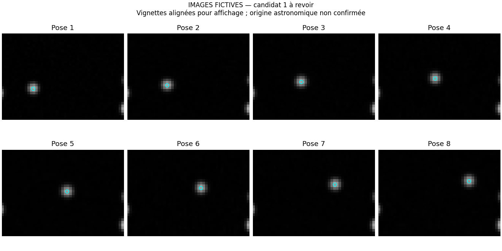

*Le même morceau du champ est montré huit fois. Le point progresse tandis que le fond d'étoiles est aligné. Ce candidat fictif nous permet de vérifier le programme ; il ne prouve pas qu'un point des vraies images serait un astéroïde.*

### 2 — Vérifier avec un ciel sans mobile

```powershell
.\.venv\Scripts\python.exe examples/make_seestar_pilot_demo.py local/parcours/pilote-temoin --case control
.\.venv\Scripts\python.exe examples/run_seestar_pilot.py local/parcours/pilote-temoin/plan/plan.json local/parcours/pilote-temoin/workset/workset.json local/parcours/pilote-temoin/audit/series.json --output local/parcours/pilote-temoin-analyse
.\.venv\Scripts\python.exe examples/plot_seestar_pilot.py local/parcours/pilote-temoin-analyse/pilot.json local/parcours/pilote-temoin-figures
```

**Tu dois voir :** trois codes 0, alignements acceptés et zéro candidat. Nous n'avons pas ajouté de mobile à ce ciel. Ce témoin aide à vérifier que le programme ne crée pas une trajectoire simplement parce que la caméra bouge.

### 3 — Comprendre un refus utile

```powershell
.\.venv\Scripts\python.exe examples/make_seestar_pilot_demo.py local/parcours/pilote-refus --case insufficient
.\.venv\Scripts\python.exe examples/run_seestar_pilot.py local/parcours/pilote-refus/plan/plan.json local/parcours/pilote-refus/workset/workset.json local/parcours/pilote-refus/audit/series.json --output local/parcours/pilote-refus-analyse
.\.venv\Scripts\python.exe examples/plot_seestar_pilot.py local/parcours/pilote-refus-analyse/pilot.json local/parcours/pilote-refus-figures
```

**Tu dois voir :** codes **0, 2, 0**. Douze étoiles ne permettent pas d'avoir assez de témoins : la recherche est bloquée. Dans `pilot.json`, `candidate_count` vaut `null` : on ne sait pas combien de candidats cette recherche aurait trouvés. Cela diffère du zéro du témoin précédent, où la recherche a bien eu lieu. Le GIF montre seulement les photos brutes, sans faire semblant de les avoir alignées.

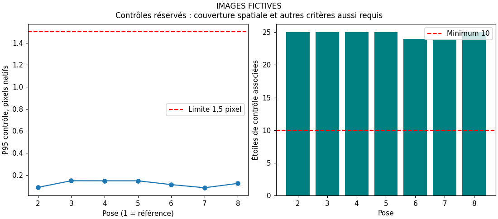

À gauche, chaque point montre une erreur mesurée sur les étoiles témoins ; il doit rester sous la ligne rouge. À droite, chaque barre compte les témoins associés ; il en faut au moins dix. Ils doivent aussi occuper les quatre coins du champ et assez de cases : ces deux graphiques ne suffisent pas à eux seuls.

### Ce qu'il faut retenir pour les vraies photos

Pour chercher les points, quatre pixels deviennent une moyenne 2×2 ; les centres trouvés reviennent ensuite dans le repère de la photo originale. Les alignements déplacent les **positions mesurées**. Seul l'affichage du GIF interpole une image pour montrer le résultat ; cette image dessinée ne sert pas à mesurer les mouvements. Les heures viennent des indications des fichiers, sans garantie d'exactitude.

Sur la vraie série, les sept alignements ont passé les contrôles et aucun candidat n'a été trouvé avec les règles fixées avant l'essai. Le propriétaire des images autorise leur publication sous CC0 : voici maintenant le vrai GIF, distinct du jeu inventé de l'exercice. Les rapports, positions et FITS restent dans `local/`. Les [détails du pilote](PILOTE-MOBILES-SEESTAR.md) expliquent les limites, les noms des fichiers et les codes de retour. Si un essai échoue, garde son message et son dossier partiel ; corrige la cause puis utilise une nouvelle sortie.


*À gauche, regarde les étoiles entre les photos. À droite, l'affichage les ramène près du même endroit. Les images restent bruitées ; aucun point mobile n'a été trouvé par cette recherche. Le film change de photo toutes les 0,6 seconde pour que nous puissions le regarder, sans reproduire la cadence du télescope. La [notice CC0](images/reels/LICENCE.md) permet de savoir quelles images sont publiques et d'où elles viennent.*

## Nouvelle mission : retrouver des points ajoutés exprès

Nous avons essayé huit vraies images et trouvé zéro candidat. Mais le programme aurait-il retrouvé un point faible s'il y en avait eu un ? Pour le vérifier, nous ajoutons exprès des points dont nous connaissons les positions. Cela s'appelle une **injection**. Les points ajoutés sont inventés, même quand leur fond vient d'une vraie photo.

Tu peux refaire cet exercice sans observations personnelles. Nous fabriquons d'abord tout le fond, puis nous gardons son alignement déjà calculé. Nous ajoutons ensuite un seul point mobile par série. Il y a trois luminosités, quatre vitesses et trois départs : `3 × 4 × 3 = 36` séries, plus un **témoin** sans point ajouté.

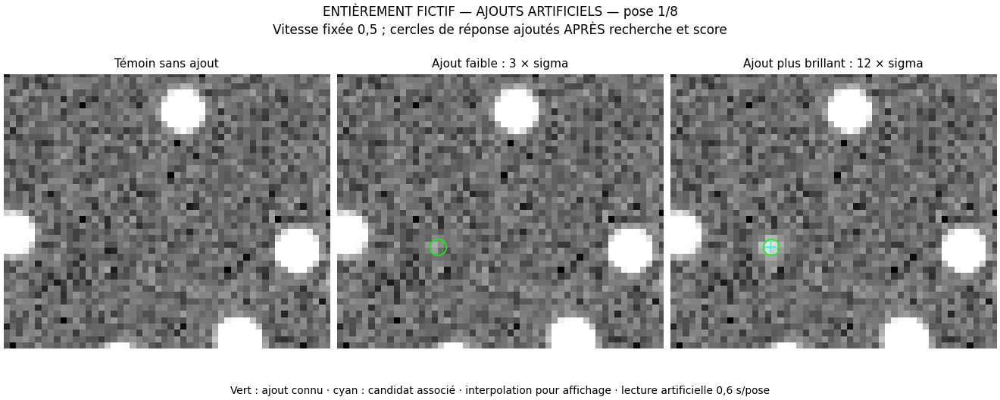

*Vert : nous révélons la position ajoutée après la recherche. Cyan : le programme a effectivement associé un candidat au point. Un cercle vert tout seul n'est pas une détection. Les trois morceaux d'image ont les mêmes limites de champ et le même contraste ; le film avance toutes les 0,6 seconde pour le regarder.*

### 1 — Préparer un fond d'entraînement

Dans PowerShell, depuis la racine du dépôt, avec les installations déjà expliquées. Prévoir environ 100 Mo pour l'exercice et choisir des noms de sortie neufs.

```powershell
.\.venv\Scripts\python.exe examples/make_injection_background.py local/parcours/injections-fond
```

Cette commande invente cent étoiles, le bruit et huit photos avec un petit mouvement de caméra. Elle prépare les copies puis calcule les alignements. Les passages des points de test sont dégagés dans cet exercice pour vérifier des cas simples ; les vraies images ne sont pas aussi faciles.

**Tu dois voir :** huit copies préparées, recherche sans mobile à zéro candidat, puis un fond fictif prêt. Les fichiers FITS sont des images inventées pour apprendre.

### 2 — Ajouter les points sans toucher aux FITS

```powershell
.\.venv\Scripts\python.exe examples/injection_recovery.py generate local/parcours/injections-fond/pilot/pilot.json local/parcours/injections-suite
```

**Tu dois voir :** 37 séquences préparées. Les dérivés sont des tableaux `.npy` dans `planes/`, des petites feuilles de nombres pour ce test. Le programme garde les photos FITS intactes. Il écrit aussi `truth.json`, la feuille des réponses.

### 3 — Laisser chercher sans montrer les réponses

```powershell
.\.venv\Scripts\python.exe examples/injection_recovery.py analyze local/parcours/injections-suite/manifest.json local/parcours/injections-analyse
```

**Tu dois voir :** 37 analyses gelées et terminées. Regarde la commande : elle ne reçoit pas `truth.json`. Le programme doit d'abord trouver ses candidats et enregistrer leurs empreintes. Nous n'utilisons pas la feuille des réponses pour l'aider à chercher.

### 4 — Compter les réussites et les manques

```powershell
.\.venv\Scripts\python.exe examples/injection_recovery.py score local/parcours/injections-suite/manifest.json local/parcours/injections-suite/truth.json local/parcours/injections-analyse/analysis.json local/parcours/injections-bilan
```

Le programme peut maintenant lire les réponses et comparer. Pour cet exercice, **tu dois voir 12 points retrouvés sur 36, 24 manqués et zéro indisponible**. Le témoin sans ajout reste sans candidat. Nous gardons les manques : il ne faut pas changer les règles seulement pour transformer tous les résultats en réussites.

Un point très lent est volontairement sous la vitesse minimale prévue par le chercheur. D'autres points sont trop faibles dans cet essai. « Indisponible » voudrait dire que le test n'a pas pu avoir lieu, par exemple parce que le point sort du champ ; cela diffère d'un point testé et manqué.

### 5 — Regarder le bilan

```powershell
.\.venv\Scripts\python.exe examples/plot_injection_recovery.py local/parcours/injections-bilan/score.json local/parcours/injections-figures
```

Les cinq commandes de cette mission retournent **0** sur l'exercice livré. Ouvre `local/parcours/injections-figures/recovery-grid.png`, puis `injection-comparison.gif`. Le rapport lisible est `local/parcours/injections-bilan/report.md`.


Chaque case compte les points retrouvés parmi trois départs fixés. Par exemple, `3/3` veut dire que les trois ajouts de cette case sont retrouvés ; cela ne promet pas de trouver tous les objets du ciel. Si des cas sont bloqués, le bilan le signale avec le code 2 et des nombres inconnus `null` ; une erreur de fichier peut donner le code 1 et un dossier incomplet à conserver. Après correction, utiliser une nouvelle sortie.

### Et sur le fond réel du Seestar ?

Le même protocole, appliqué aux dérivés des huit copies réelles, a retrouvé **10 ajouts artificiels sur 36**, avec 26 manques et aucun cas bloqué. Le témoin sans ajout reproduit exactement le premier résultat naturel, zéro candidat. Nous n'avons donc pas découvert dix objets : nous avons retrouvé dix points que nous avions nous-mêmes ajoutés. Les images, bruits et temps des deux fonds diffèrent ; leurs comptages ne constituent pas une comparaison statistique de capteurs.

Ce test garde le recalage déjà accepté et ne le recalcule pas. Il ne vérifie ni une heure exacte, ni une magnitude limite ou tous les comportements d'une vraie étoile. Les [détails des injections](INJECTIONS-SEESTAR.md) donnent les règles, les résultats individuels attendus et les limites. Les nouvelles figures publiques sont fictives ; les animations mixtes sur fond réel et leurs rapports restent locaux. Les cinq médias réels CC0 déjà autorisés restent dans la documentation.

## Nouvelle mission : comprendre les points manqués

Le chercheur n'a pas retrouvé tous nos ajouts artificiels. Nous allons regarder **à quelle étape il manque déjà des informations**, sans modifier ses règles. Pense à trois portes : les points enregistrés, le champ commun des photos, puis les points conservés après avoir retiré ceux qui semblent fixes.

Cette mission utilise le résultat de la mission précédente. Termine d'abord ses cinq commandes si tu n'as pas encore `local/parcours/injections-bilan/score.json`. Nous ne fabriquons pas de nouveaux ajouts et ne relançons pas le chercheur pour le diagnostic.

```powershell
.\.venv\Scripts\python.exe examples/diagnose_injection_misses.py local/parcours/injections-bilan/score.json local/parcours/diagnostic-manques
.\.venv\Scripts\python.exe examples/plot_miss_diagnostics.py local/parcours/diagnostic-manques/diagnostic.json local/parcours/diagnostic-figures
```

Choisis de nouvelles sorties si tu recommences. **Tu dois voir :** deux codes 0, puis le diagnostic fictif de 24 manques : neuf vitesses hors de la plage prévue et quinze cas avec trop peu de points proches dès les détections. Les douze récupérations restent inchangées. Un code 0 dit que l'opération est terminée, pas que tous les mystères du ciel sont résolus.


Ouvre `local/parcours/diagnostic-manques/report.md` pour le tableau lisible. Le fichier `diagnostic.csv` classe chaque ajout ; `diagnostic.json` garde les preuves pour chacune des huit photos. Les images sont dans `local/parcours/diagnostic-figures/`.

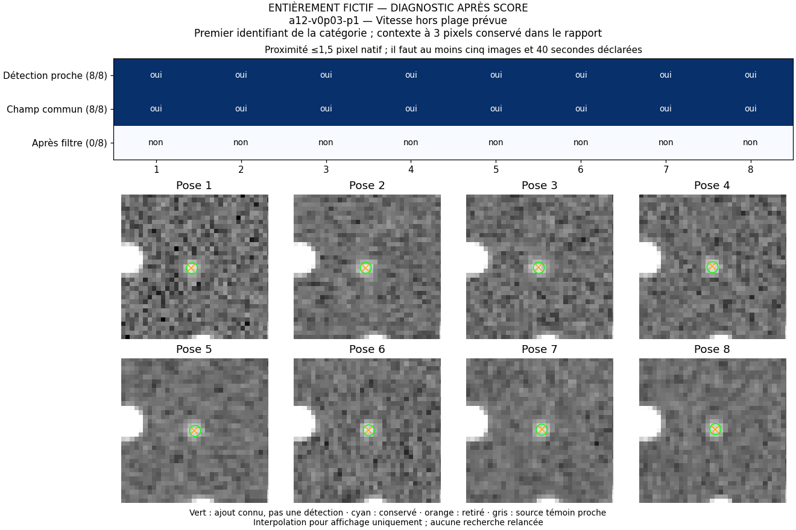

En haut, chaque colonne est une photo. Les lignes disent s'il y a un point enregistré près de l'endroit où nous avions ajouté le nôtre, avant et après les étapes. Il en faut au moins cinq pendant assez longtemps pour chercher une trajectoire. Un point proche peut pourtant être une autre source : sa proximité ne prouve pas son identité.

Le rond vert indique notre position d'ajout connue : **ce n'est pas une détection**. Une croix cyan montre un point proche conservé ; une croix orange un point proche retiré. Le gris signale une source proche dans le témoin sans ajout, seulement comme indice possible. Les pixels sont dessinés après alignement pour regarder, sans réécrire les photos ni refaire les mesures.

Nous comparons un petit voisinage de 1,5 pixel et un plus large de 3 pixels. Ces comparaisons ne changent pas les règles du chercheur. Si elles désignent des étapes différentes, le rapport garde « voisinage ambigu » ; il ne choisit pas une explication qui nous arrange. Une information inconnue reste inconnue, pas zéro.


Sur le fond réel, le bilan est **26 manques : neuf hors de la plage de vitesse et 17 autres avec moins de cinq images contenant un point proche dès les détections**. Parmi ces 17, neuf en ont zéro, quatre en ont deux, trois en ont trois et un en a quatre, aux deux voisinages. Les passages au champ commun et au filtre n'enlèvent pas de support supplémentaire dans ces cas. Nous n'avons pas prouvé que leur luminosité seule explique le manque.

Les détails sont dans [Comprendre les manques](DIAGNOSTIC-MANQUES.md). Le témoin naturel garde zéro candidat ; aucune découverte ou nouvelle recherche n'est ajoutée. Les nouvelles vues publiques sont fictives, les vues mixtes sur fond réel restent locales. Les erreurs donnent le code 1 ; garde le message et le dossier incomplet, corrige la cause puis choisis une nouvelle sortie. Aucun accès USB n'est nécessaire.

## Nouvelle mission : ouvrir le carnet du détecteur

Nous savons déjà que certains ajouts n'ont pas assez de points proches. Cette fois, nous regardons **comment un point entre dans la liste**. Le détecteur est comme un contrôleur : il propose un petit sommet lumineux, regarde sa forme et garde son centre s'il est assez loin du bord. Nous lui ajoutons un carnet pour lire ses décisions, en gardant ses règles.

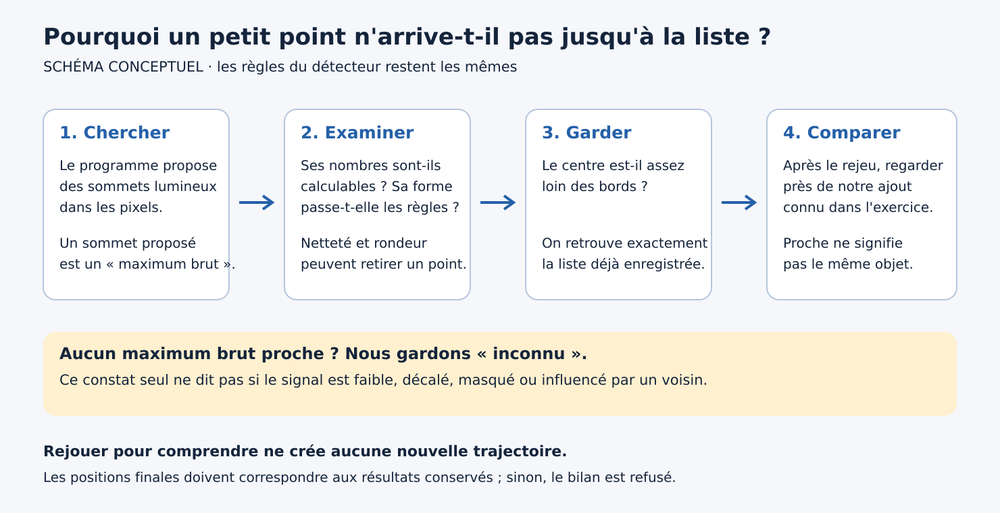

Un **maximum brut** est un sommet proposé avant les contrôles de forme. Son centre calculé peut être un peu ailleurs. La **netteté** et la **rondeur** sont des nombres décrivant le sommet. Si un nombre ne peut pas être calculé, le carnet le dit. Il ne remplace pas l'inconnu par zéro.

Pour essayer, nous fabriquons douze petites images entièrement inventées : un point brillant, un point faible, un défaut ponctuel, une source étirée, un bord et des pixels masqués, chacun avec deux bruits prévus. Les images d'une même graine partagent le même bruit ; ce ne sont pas douze expériences indépendantes. Aucun fichier Seestar ni clé USB n'est nécessaire.

```powershell
.\.venv\Scripts\python.exe examples/make_detector_trace_demo.py local/parcours/trace-images
.\.venv\Scripts\python.exe examples/trace_detector_decisions.py local/parcours/trace-images/manifest.json local/parcours/trace-images/truth.json local/parcours/trace-bilan
.\.venv\Scripts\python.exe examples/plot_detector_trace.py local/parcours/trace-bilan/trace.json local/parcours/trace-figures
```

Les trois codes attendus sont **0**. Choisis des sorties nouvelles si tu recommences. La première commande fabrique les images et range les réponses à part. La deuxième remplit le carnet sans regarder les réponses, vérifie qu'elle retrouve exactement la liste habituelle, puis compare les traces à nos points connus. La troisième dessine ce carnet, sans rappeler le détecteur.

Ouvre `local/parcours/trace-bilan/report.md`, puis `local/parcours/trace-figures/gates.png` et `examples.png`. Dans le tableau, chaque colonne est une image. Les nombres disent combien de points sont proches à chaque porte. Un sommet de départ et son centre sont comptés séparément.


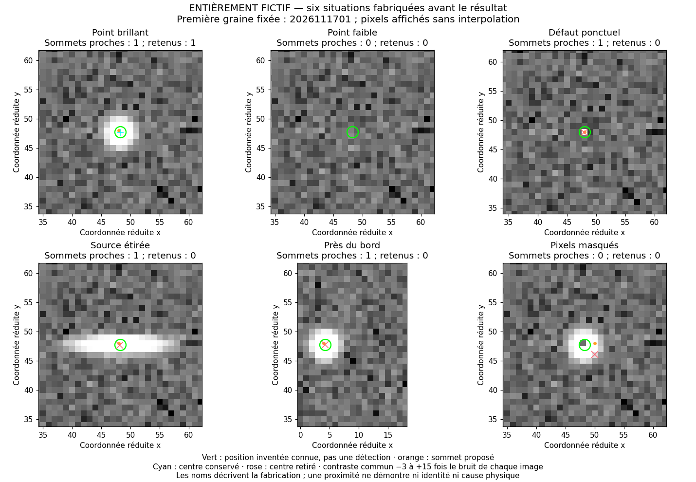

Le rond vert indique l'endroit que nous avons inventé : **ce n'est pas une détection**. Orange montre un sommet proposé ; cyan montre un centre conservé ; rose montre un centre retiré. Le même point peut ne pas passer plusieurs règles. Les noms « faible », « étiré » ou « masqué » décrivent comment nous avons fabriqué l'image : ils ne promettent pas le résultat du détecteur.

S'il n'y a aucun sommet brut proche, nous gardons cette information sans inventer sa cause. Cela ne prouve pas que le point est trop faible, qu'un voisin le cache ou que le seuil est mauvais. Une source proche n'est pas forcément notre ajout. Nous regardons aussi à trois pixels pour garder le contexte ; cela ne change aucun réglage.

Les [explications détaillées](TRACE-DETECTEUR.md) montrent comment appliquer cette trace aux résultats déjà locaux. Cette mission relit les pixels, contrairement à la mission précédente. Elle ne crée aucune nouvelle trajectoire. Une erreur, une version incompatible ou une différence avec les positions gardées doit arrêter le bilan ; conserve le message et le dossier partiel, puis utilise une nouvelle sortie après correction. Les dessins refusent une trace incomplète.

Sur les 17 ajouts manqués du fond réel, le carnet regarde huit photos pour chacun : cela fait 136 situations à observer. Il retrouve les mêmes listes finales. Dans 115 situations, aucun sommet brut n'est proposé assez près ; dans 21, un centre proche est conservé. Nous n'observons pas de rejet de forme ou de marge proche pour ce lot. Cela **ne prouve pas pourquoi les 115 sommets manquent**. Les mêmes photos servent plusieurs fois et ces 136 situations ne sont pas 136 expériences indépendantes. Aucun nouveau mobile n'est découvert.

## Nouvelle mission : comprendre pourquoi aucun sommet n'est proposé

Nous avons ajouté un carnet aux contrôles de forme. Maintenant, nous ouvrons la page d'avant : **comment le programme propose-t-il un sommet ?** Imagine une carte de montagnes en petits carrés. Un carré clair peut avoir un voisin plus haut. Un sommet peut aussi être interdit par un masque, trop près d'un bord, ou ne pas dépasser la barre demandée.


Le programme calcule une **réponse convoluée** avec son petit modèle de forme. Ce nom compliqué désigne simplement une nouvelle carte de nombres. Elle ne donne pas une luminosité calibrée. Le programme compare les voisins, enlève les centres interdits et le bord, puis exige une hauteur **plus grande** que le seuil : égale ne suffit pas. Il regroupe aussi les plateaux et départage les égalités selon ses règles.

Nous gardons les mêmes réglages et fabriquons douze images entièrement fictives : six situations pour deux graines prévues. Elles montrent un point isolé brillant, un faible, un voisin brillant, un masque, le bord et un plateau. Les noms disent ce que nous fabriquons, pas ce que le programme doit forcément répondre. Le bruit d'une même graine est partagé entre situations ; ce ne sont pas douze expériences indépendantes.

```powershell
.\.venv\Scripts\python.exe examples/make_peak_absence_demo.py local/parcours/maxima-images
.\.venv\Scripts\python.exe examples/trace_peak_creation.py local/parcours/maxima-images/manifest.json local/parcours/maxima-images/truth.json local/parcours/maxima-bilan
.\.venv\Scripts\python.exe examples/plot_peak_absences.py local/parcours/maxima-bilan/trace.json local/parcours/maxima-figures
```

Les trois codes attendus sont **0**. La première commande fabrique les images et sépare les réponses. La deuxième remplit les cartes sans recevoir ces positions, vérifie la même liste de sommets que la bibliothèque, puis regarde les réponses. La troisième dessine le carnet déjà terminé, sans rappeler le détecteur. Utilise des sorties nouvelles à chaque essai.

Ouvre `local/parcours/maxima-bilan/report.md`, puis `gates.png` et `examples.png` dans `local/parcours/maxima-figures`. Chaque colonne du tableau représente une image. Chaque ligne compte les centres proches qui passent une porte. Nous regardons dans les mêmes cercles de 1,5 puis 3 pixels natifs ; cela ne change pas le détecteur.

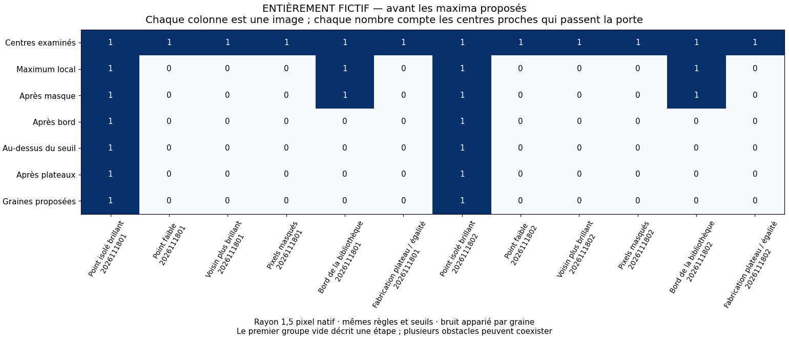


Le rond vert marque la réponse inventée, **pas une détection**. Les petits centres examinés et leurs valeurs viennent du carnet ; une graine proposée n'est pas un objet astronomique identifié. Quand une ligne devient vide, nous notons cette première porte, mais nous gardons aussi les autres obstacles. Un voisin peut être plus haut alors que la réponse est également sous le seuil.

Les petits carrés bleus dépassent le seuil ; les oranges ne le dépassent pas. Le nombre compare la meilleure valeur examinée au seuil. Plus grand que 1 ne suffit pas : regarde le voisin plus brillant, qui peut avoir une valeur plus haute ailleurs. Un nombre négatif appartient à cette carte calculée, pas à une luminosité physique négative. Les tableaux utilisent 1,5 pixel et les vignettes montrent le contexte à 3 pixels ; le rapport garde les deux.

Les [explications détaillées](ABSENCES-MAXIMA.md) reprennent les caches locaux déjà préparés. Les 115 situations sans maximum du fond réel sont fixées par le lot précédent ; ce ne sont pas 115 objets. Les 21 autres situations restent en contexte. Une erreur, une bibliothèque différente ou des listes divergentes doivent arrêter le bilan. Garde le message et la sortie partielle ; corrige la cause et choisis un nouveau dossier. Aucun accès USB ou nouveau réglage n'est nécessaire.

Sur le fond réel, le petit cercle donne 69 premières portes vides au maximum local et 46 au seuil ; le cercle plus large donne 47 et 68. Cela fait toujours 115 absences. Dans 22 situations, le nom de la première porte change quand nous regardons plus large. Pour chaque rayon, 105 situations n'ont aucun centre de carré au-dessus du seuil et dix en ont, mais aucun maximum local proche. **N'additionne pas ces deux façons de compter : elles décrivent les mêmes situations.** Nous gardons les autres obstacles et les causes physiques inconnues.

Dans ces dix situations au-dessus du seuil, le carnet trouve aussi un voisin plus haut dans la comparaison prévue. Il mesure ce voisin ; il ne sait pas pour autant quel objet c'est, ni toute l'histoire physique de l'image.

## 14. Comprendre ce que tu as reconstruit

Tu as maintenant installé l’application entière depuis ses recettes publiques et essayé les modules disponibles. Voici où regarder le code pour comprendre chaque brique :

| Recette | Sa responsabilité |
|---|---|
| `src/gar/cli.py` | Lire la commande et appeler le bon module |
| `inventory.py`, `sessions.py` | Lister puis grouper les étiquettes |
| `timing.py`, `wcs_audit.py` | Examiner les informations disponibles et leurs limites |
| `workset.py` | Vérifier les copies et conserver les en-têtes complets |
| `astrometry.py`, `registration.py`, `gaia_frames.py` | Comparer les positions et construire le recalage |
| `time_evidence.py` | Préparer les preuves sur les heures |
| `moving.py` | Détecter puis associer les points des images fictives |
| Fichiers `*_reports.py` | Écrire les carnets de résultats |
| `examples/` et `tests/` | Fabriquer les essais et vérifier les recettes |
| `examples/moving_limits.py` | Essayer les limites, en gardant le chercheur inchangé |
| `examples/moving_registration.py` | Relier les positions recalées au chercheur, en conservant les refus |
| `examples/spatial_controls.py`, `compare_spatial_controls.py` | Répartir les contrôles avant ajustement et comparer les deux méthodes |
| `examples/prepare_seestar_series.py` | Préparer la liste, puis examiner les copies locales sans rouvrir les originaux |

Le [tutoriel de référence](TUTORIEL.md) raconte les décisions et les critères avant chaque lot de code. Les contrats expliquent les formats exacts. Pour apprendre à modifier l’application, commence par une copie de travail du code et un petit changement d’explication ; fais les contrôles avant de proposer ce changement. Tu n’as pas besoin de publier des observations personnelles pour apprendre.

## 15. Si quelque chose ne marche pas

| Message ou situation | Ce que tu peux faire |
|---|---|
| `py` ou `git` introuvable | Reprendre l’installation de l’outil et rouvrir PowerShell |
| `.venv\Scripts\python.exe` introuvable | Vérifier le dossier actuel et reprendre l’étape 4 |
| `No module named gar` | Installer le projet avec le Python de `.venv` et `pip install --no-deps -e .` |
| Matplotlib ou Pillow manquant | Installer `requirements/figures-tested.txt` avec le même Python de `.venv` |
| « La sortie existe déjà » | Choisir un nouveau nom, sans effacer les essais précédents |
| « Tous les produits doivent rester dans local/ » | Reprendre les chemins de l’exemple dans le dossier du projet |
| Code 2 après `time-evidence` | C’est attendu : lire le rapport, aucune horloge n’est qualifiée |
| Code 2 après `moving_registration.py run` | C’est attendu sur cet exercice : certaines séquences sont bloquées, lire le bilan et garder les refus |
| Un autre code 2 | Lire `report.md` et les critères ; conserver le résultat même décevant |
| Une erreur d’installation ou de test | Arrêter, copier le message utile et demander de l’aide sans joindre des données privées |

L’installation initiale et la récupération du code peuvent utiliser Internet. Les exercices d’analyse ci-dessus restent locaux. Les générateurs créent de fausses images ; aucun exercice ne demande une clé USB ou une connexion au télescope. L’application portable et les usages scientifiques réels demandent encore des travaux et validations supplémentaires.

*Vérification de l’édition précédente : reconstruction depuis une copie propre du dépôt, nouvel environnement Python, 241 tests et 24 commandes réussis. Le complément « limites » ajoute 19 contrôles, soit 260 tests réussis. Les 27 commandes de cette édition ont été rejouées avec succès dans des dossiers fictifs neufs ; les 960 images du banc de limites, ses mesures et ses cinq figures sont reproduites à l’identique depuis le code committé. Cela ne remplace pas un essai par un enfant débutant sur un ordinateur vierge.*

*Le complément « recalage puis recherche » ajoute 17 contrôles, soit 277 tests réussis. Les 30 commandes du parcours ont été rejouées dans des dossiers fictifs neufs depuis le code committé : le code 2 de la nouvelle analyse est bien conservé, avec les critères non satisfaits. Les 320 images, les 40 rapports de modèles/candidats et les cinq figures de cette mission sont reproduits à l’identique. Aucun essai utilisateur avec un enfant ou sur un ordinateur vierge n’est revendiqué.*

*Le complément de contrôle spatial ajoute 20 cas, soit 297 tests réussis. Les 33 commandes de ce parcours ont été rejouées dans des dossiers fictifs neufs depuis le code committé : les codes attendus sont conservés, dont 2 pour l’ancienne mission et 0 pour la nouvelle. Les 400 images, les cinquante rapports de modèles/candidats des deux méthodes, le bilan et les cinq illustrations de ce complément sont reproduits à l’identique. Aucun essai utilisateur avec un enfant ou sur Windows vierge n’est revendiqué.*

*La préparation de série ajoute 19 cas, soit 316 tests réussis. Les six commandes de cette nouvelle mission ont été rejouées depuis le commit propre `2e57d18`, dans de nouveaux dossiers : les douze images fictives et leur aperçu sont identiques ; huit copies sont préparées. Les huit copies réelles ont été revérifiées et leurs deux rendus CC0 régénérés à l’identique, sans nouvelle lecture USB. Les 33 commandes antérieures et leurs versions restent documentées ci-dessus ; elles n’ont pas été rejouées pour ce complément. Les images réelles autorisées sont des exemples visuels CC0, pas les données des tests. Aucun essai avec un enfant ou sur un ordinateur Windows vierge n’est revendiqué.*

*Le pilote exploratoire ajoute 19 cas, soit 335 tests réussis en 83,31 secondes depuis le commit propre `80ada2e`. Ses neuf commandes ont été rejouées dans des dossiers neufs avec les codes attendus, y compris 2 pour le refus ; les modèles/positions/candidat du nominal et les trois illustrations sont identiques. L'essai réel reproduit garde sept modèles acceptés, zéro candidat, huit copies intactes et le même GIF, sans accès USB. Les 39 commandes précédentes gardent leurs preuves sans être toutes rejouées. Ce sont des vérifications de reproduction, pas un test de compréhension avec un enfant ou sur un ordinateur vierge.*

*La diffusion réelle CC0 ajoute trois tests fictifs, soit 338 tests réussis. Depuis le commit propre `305eeed`, les trois nouveaux médias réels ont été reproduits à l'identique ; les deux PNG initiaux et les trois rendus privés par défaut sont inchangés, ainsi que le rapport et les huit copies. Les cinq médias autorisés sont listés dans leur notice CC0. Aucun nouvel essai de recherche ni nouvelle exécution de tous les exercices n'est revendiqué pour cette diffusion.*

*Les injections ajoutent 19 tests fictifs, soit 357 tests réussis depuis le commit propre `7c663f7`. Les cinq nouvelles commandes ont réussi dans des dossiers neufs : mêmes 296 dérivés et 37 résultats gelés par fond, mêmes bilans et figures. Le fond fictif donne 12/36 points artificiels retrouvés, les dérivés du fond réel 10/36, avec témoin naturel inchangé et copies intactes. Les 48 commandes antérieures gardent leurs preuves, sans être toutes rejouées. Cela vérifie la reproduction de l'exercice, pas sa compréhension par un enfant ou une validation scientifique universelle.*

*Le diagnostic ajoute 24 tests fictifs, soit 381 tests réussis depuis le commit propre `234c439`. Ses deux commandes donnent 0 sur les résultats de l'exercice déjà préparé. Les diagnostics des 36 ajouts de chaque fond et les figures sont reproduits à l'identique ; les scores, candidats et photos restent intacts. Les 53 commandes précédentes gardent leurs preuves sans être toutes rejouées. Aucune recherche ou injection réelle n'est relancée et aucune compréhension par un enfant ou qualification scientifique indépendante n'est revendiquée.*

*Le carnet du détecteur ajoute 42 tests fictifs, soit **423 tests réussis** en 139,60 secondes depuis le commit propre `f6ec207`. Ses trois commandes donnent 0 dans de nouveaux dossiers : les douze images, les douze traces et les deux PNG sont identiques. Sur le fond réel déjà local, les 136 listes et traces des 17 cas sont reproduites, avec les anciens scores et candidats préservés, sans accès USB ou nouvelle injection. Les 55 commandes précédentes conservent leurs preuves sans être toutes rejouées. Les trois agents et leur coordinateur ont fait une revue interne, sans test de compréhension avec un enfant ou qualification scientifique indépendante.*
