# Construire l’application, pas à pas

Ce parcours est écrit pour une personne qui débute, y compris un enfant de 10 ans. Tu peux faire une étape, regarder son résultat, puis faire une pause. Pour installer Python ou Git, fais-toi accompagner si tu ne les connais pas encore.

**Notre but :** récupérer les recettes du projet, reconstruire l’application sur ton ordinateur et essayer **tous ses modules disponibles** avec de fausses images du ciel. C’est une application à laquelle tu parles avec des commandes dans PowerShell. Les prochaines fonctions du projet ne sont pas encore toutes construites.

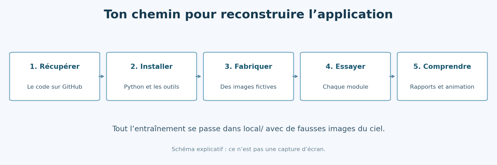

*Schéma pour apprendre, pas une capture d’écran. [Version SVG](images/debutant-parcours.svg).*

## 1. Cinq mots pour commencer

| Mot | Ce que cela veut dire ici |
|---|---|
| Code source | Les recettes écrites pour que l’ordinateur sache quoi faire |
| Dossier | Une boîte qui contient des fichiers ou d’autres dossiers |
| Commande | Une petite instruction que tu écris à l’ordinateur |
| Image FITS | Une image du ciel avec une étiquette contenant des informations |
| Synthétique | Inventé par notre programme pour nous entraîner ; aucune vraie observation |

Un **pixel** est un petit carré d’une image. Un **rapport** est un carnet de résultats. Une **erreur** est aussi une information utile : on s’arrête pour la comprendre.

## 2. Préparer Python et Git

Python permet d’exécuter les recettes. Git permet de récupérer leur version publique. Les liens de départ sont [Python pour Windows](https://www.python.org/downloads/windows/) et [Git pour Windows](https://git-scm.com/install/windows). Utilise les sites officiels. Les explications détaillées sont dans [INSTALL.md](../INSTALL.md).

Ouvre **PowerShell** depuis le menu Démarrer de Windows. Écris une ligne, puis appuie sur **Entrée**. Copie seulement le contenu des blocs de commandes ; n’ajoute pas les trois petits accents qui entourent ces blocs dans le document.

```powershell
py -3.13 --version
git --version
```

**Tu dois voir :** un numéro Python commençant par `3.13`, puis un numéro Git. Le projet a été essayé avec Python 3.13.6 ; ton numéro de correction peut être différent. Le minimum technique du projet est Python 3.12, mais ce parcours emploie le lanceur `py -3.13` pour rester simple.

**Si Windows dit que la commande est introuvable :** l’outil manque ou la fenêtre a été ouverte avant son installation. Termine son installation, ferme puis rouvre PowerShell et réessaie. Ne continue pas si les deux outils ne répondent pas.

## 3. Récupérer les recettes

Nous allons travailler dans un nouveau dossier `AtelierGAR` de tes Documents. Ces commandes ne touchent pas à une clé USB.

```powershell
Set-Location ([Environment]::GetFolderPath('MyDocuments'))
git clone https://github.com/steveprudhomme/gnu-astrophotography-recycle.git AtelierGAR
Set-Location AtelierGAR
```

**Tu dois voir :** des messages de téléchargement, puis retrouver les fichiers `README.md`, `pyproject.toml` et les dossiers ci-dessous. Le téléchargement demande Internet. Si `AtelierGAR` existe déjà, garde-le et choisis un autre nom pour un nouvel atelier ; ne supprime pas un dossier au hasard.


*Schéma simplifié, pas une capture d’écran. [Version SVG](images/debutant-dossiers.svg).*

| Tiroir | Son rôle |
|---|---|
| `src/gar/` | Les recettes de l’application |
| `tests/` | Les contrôles automatiques des recettes |
| `examples/` | Les recettes qui fabriquent nos images fictives |
| `docs/` | Les explications et images de ce carnet |
| `local/` | Les résultats de tes essais, conservés sur ton ordinateur |
| `.venv/` | La boîte à outils Python créée à l’étape suivante |

Reste à la racine de `AtelierGAR` pour les commandes suivantes. Tape `Get-Location` si tu veux savoir où tu es.

## 4. Construire ta boîte à outils et l’application

Chaque ligne attend que la précédente ait terminé. L’installation peut prendre quelques minutes et demander Internet.

```powershell
py -3.13 -m venv .venv
.\.venv\Scripts\python.exe -m pip install -r requirements/dev-tested.txt
.\.venv\Scripts\python.exe -m pip install --no-deps -e .
.\.venv\Scripts\gar.exe --version
```

**Tu dois voir :** `0.10.0a1` pour cette leçon. Une version plus récente peut apparaître si le projet a évolué ; ses nombres de tests et résultats peuvent alors changer.

La première ligne fabrique la boîte `.venv`. La deuxième y range les outils. La troisième reconstruit et installe l’application à partir de **tout son code source**. Le point final `.` signifie « ce dossier-ci » : garde-le. L’option `-e` relie l’application à ses recettes, pour que les modifications de code soient visibles pendant l’apprentissage.

Pour fabriquer aussi les graphiques et le petit film GIF de ce parcours :

```powershell
.\.venv\Scripts\python.exe -m pip install -r requirements/figures-tested.txt
```

Ces outils de dessin sont séparés des outils d’analyse. Nous appelons directement le Python de `.venv` : aucune commande d’activation PowerShell n’est nécessaire.

## 5. Vérifier la construction avant de jouer

```powershell
New-Item -ItemType Directory -Path local/parcours -Force
.\.venv\Scripts\python.exe -m pytest -q -p no:cacheprovider --basetemp="local/parcours/tests-01"
.\.venv\Scripts\python.exe -m pip check
```

**Tu dois voir :** `277 passed` pour cette édition et `No broken requirements found.` La première phrase signifie que les 277 contrôles logiciels ont réussi, y compris ceux des nouveaux bancs d’essai. Elle ne certifie pas un télescope ou son horloge. L’application reste en version 0.10.0a1 : les nouvelles recettes d’essai ne changent pas ses moteurs.

La première ligne prépare les boîtes `local` et `parcours` pour les essais. `-Force` permet de garder ces dossiers s’ils existent déjà ; cette commande ne vide pas leur contenu. Il faut les créer avant les tests : le programme de test ne crée pas tout seul les dossiers parents de son espace temporaire.

Choisis un nouveau nom de dossier de tests à chaque reprise, par exemple `tests-02` : l’outil de test peut nettoyer son dossier temporaire. Si tu vois `FAILED`, arrête-toi, conserve le message et demande de l’aide en donnant le nom du contrôle en échec.

## 6. Comprendre les trois réponses de l’application

Après une commande de l’application, tu peux écrire :

```powershell
$LASTEXITCODE
```

| Réponse | Traduction simple |
|---|---|
| `0` | Le travail a été produit et les critères de cette commande sont satisfaits |
| `2` | Le rapport existe, mais il contient une limite, une exclusion ou un critère non satisfait à lire |
| `1` | Le travail n’a pas pu être terminé ; lis le message d’erreur |

**Le nombre 2 n’est pas toujours une panne.** Pour les heures, c’est même la réponse attendue : un en-tête ne prouve pas la précision d’une horloge. Nous allons l’indiquer dans chaque mission.

Tous les noms `local/parcours/...` ci-dessous sont nouveaux. Si un dossier de sortie existe déjà, choisis un autre nom et adapte aussi les commandes qui le relisent. Le programme protège les résultats précédents.

## 7. Mission : faire l’inventaire des images

Un inventaire est une liste de ce que nous avons, comme compter les pièces d’un jeu.

```powershell
.\.venv\Scripts\python.exe examples/make_demo.py local/parcours/inventaire-images
.\.venv\Scripts\gar.exe inventory local/parcours/inventaire-images --output local/parcours/inventaire-rapport
```

**À regarder :** `local/parcours/inventaire-rapport/report.md`. Les fichiers détaillés et leur empreinte sont dans `manifest.json`. Une empreinte SHA-256 est comme une étiquette calculée : si les octets du fichier changent, cette étiquette permet de s’en apercevoir.

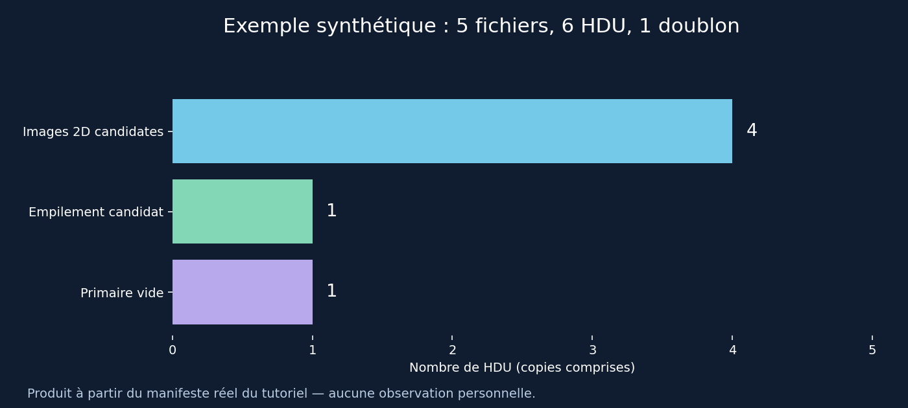

*Graphique d’un exemple fictif réellement calculé, pas des observations personnelles. La [section 3 du tutoriel de référence](TUTORIEL.md#3-comprendre-les-résultats) explique les colonnes.*

## 8. Mission : ranger les séances et examiner les heures

Une séance est un groupe d’images qui pourraient aller ensemble. L’application utilise les étiquettes ; elle ne déplace pas les images.

```powershell
.\.venv\Scripts\python.exe examples/make_sessions_demo.py local/parcours/seances-images
.\.venv\Scripts\gar.exe inventory local/parcours/seances-images --output local/parcours/seances-inventaire
.\.venv\Scripts\gar.exe sessions local/parcours/seances-inventaire/manifest.json --output local/parcours/seances-rapport
```

**À attendre :** cinq groupes dans cet exemple. Le code 2 signale les exclusions à lire, pas des fichiers perdus.

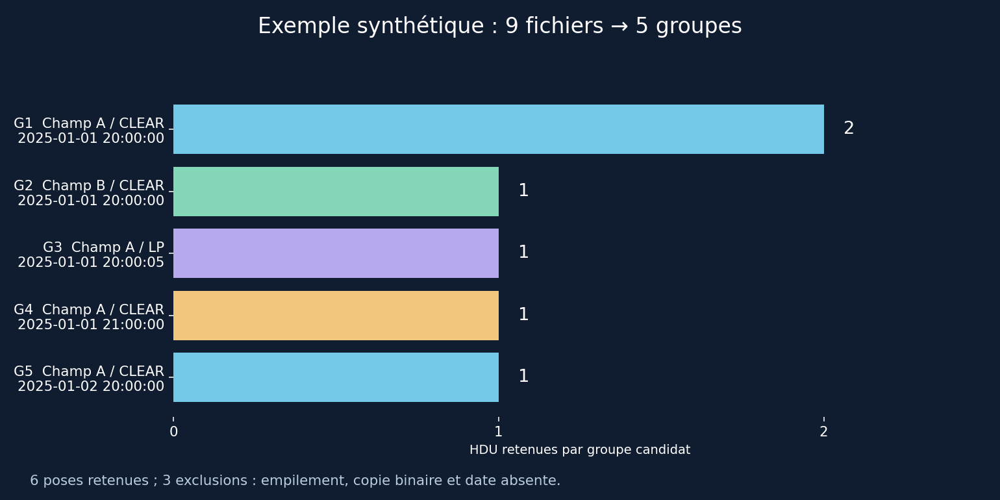

Pour essayer le diagnostic des heures sur un exemple prévu pour cela :

```powershell
.\.venv\Scripts\python.exe examples/make_timing_demo.py local/parcours/heures-images
.\.venv\Scripts\gar.exe inventory local/parcours/heures-images --output local/parcours/heures-inventaire
.\.venv\Scripts\gar.exe timing local/parcours/heures-inventaire/manifest.json --output local/parcours/heures-rapport
```

**À attendre :** le rapport existe et le code est 2. Une suite régulière d’étiquettes ne prouve pas que l’heure soit juste.

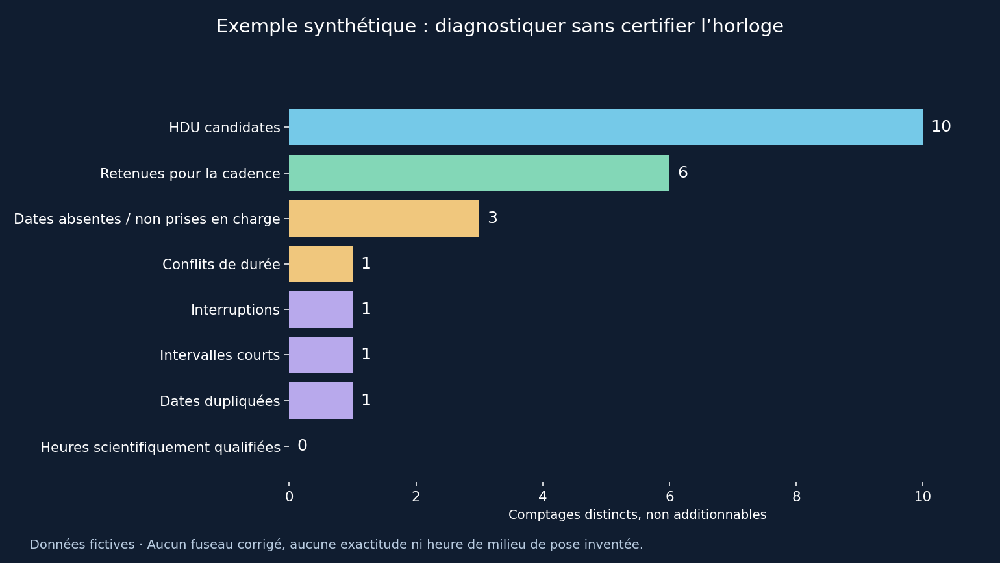

*Les deux graphiques sont des exemples synthétiques. Lis `report.md` dans chaque dossier de rapport.*

## 9. Mission : examiner la carte du ciel et préparer des copies

Une **WCS** est une recette qui transforme une position dans l’image en position sur le ciel. Vérifier qu’une recette est écrite ne prouve pas encore qu’elle soit juste.

```powershell
.\.venv\Scripts\python.exe examples/make_wcs_demo.py local/parcours/wcs-images
.\.venv\Scripts\gar.exe inventory local/parcours/wcs-images --output local/parcours/wcs-inventaire
.\.venv\Scripts\gar.exe wcs local/parcours/wcs-inventaire/manifest.json --output local/parcours/wcs-rapport
.\.venv\Scripts\python.exe examples/make_workset_demo.py local/parcours/copies-entree
.\.venv\Scripts\gar.exe workset local/parcours/copies-entree/selection.json --output local/parcours/copies-rapport
```

**À attendre :** code 2 pour `wcs`, car la première liste d’étiquettes est incomplète ; code 0 et trois copies vérifiées pour `workset`. Les fichiers inventés restent sur l’ordinateur.

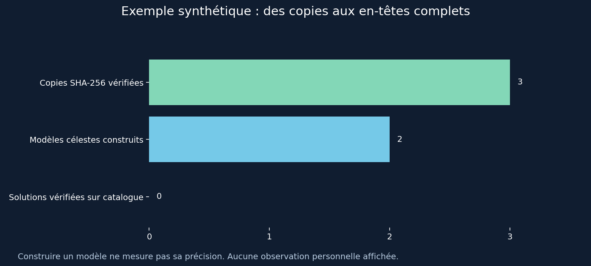

## 10. Mission : comparer des étoiles à une liste de référence

Une liste de référence ressemble à une fiche de réponses préparée à l’avance. Dans cette mission, elle est entièrement inventée. Le programme mesure les écarts sans changer la carte pour obtenir une meilleure note.

```powershell
.\.venv\Scripts\python.exe examples/make_astrometry_demo.py local/parcours/etoiles-entree
.\.venv\Scripts\gar.exe astrometry local/parcours/etoiles-entree/workset/workset.json --file-index 1 --catalog local/parcours/etoiles-entree/catalog.csv --output local/parcours/etoiles-rapport
```

**À attendre :** 36 associations, un écart médian voisin de 0,5 seconde d’arc et le code 0. Une seconde d’arc est une petite unité d’angle sur le ciel ; elle n’est pas une seconde de temps. Le décalage a été ajouté volontairement et doit rester visible.

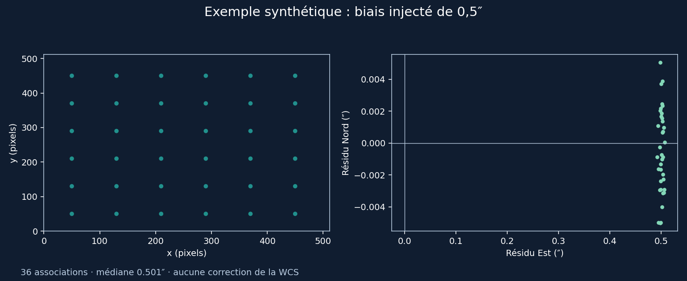

## 11. Mission : remettre trois images dans le même repère

**Recaler** signifie trouver comment tourner et déplacer les coordonnées d’une image pour les comparer à une autre. Des étoiles sont mises de côté : elles servent ensuite à contrôler le résultat.

```powershell
.\.venv\Scripts\python.exe examples/make_gaia_frames_demo.py local/parcours/poses-entree
.\.venv\Scripts\gar.exe register local/parcours/poses-entree/workset.json --reference-index 4 --frame-indices 1 2 3 --output local/parcours/poses-recalage
.\.venv\Scripts\gar.exe gaia-frames local/parcours/poses-entree/workset.json --registration local/parcours/poses-recalage/registration.json --catalog local/parcours/poses-entree/catalog.csv --output local/parcours/poses-gaia
```

**À attendre :** trois résultats satisfaisant les critères de l’exemple, code 0 pour les deux commandes. Le catalogue imite les colonnes de Gaia, mais ses étoiles sont fictives : aucun téléchargement d’observations Gaia n’est fait ici.

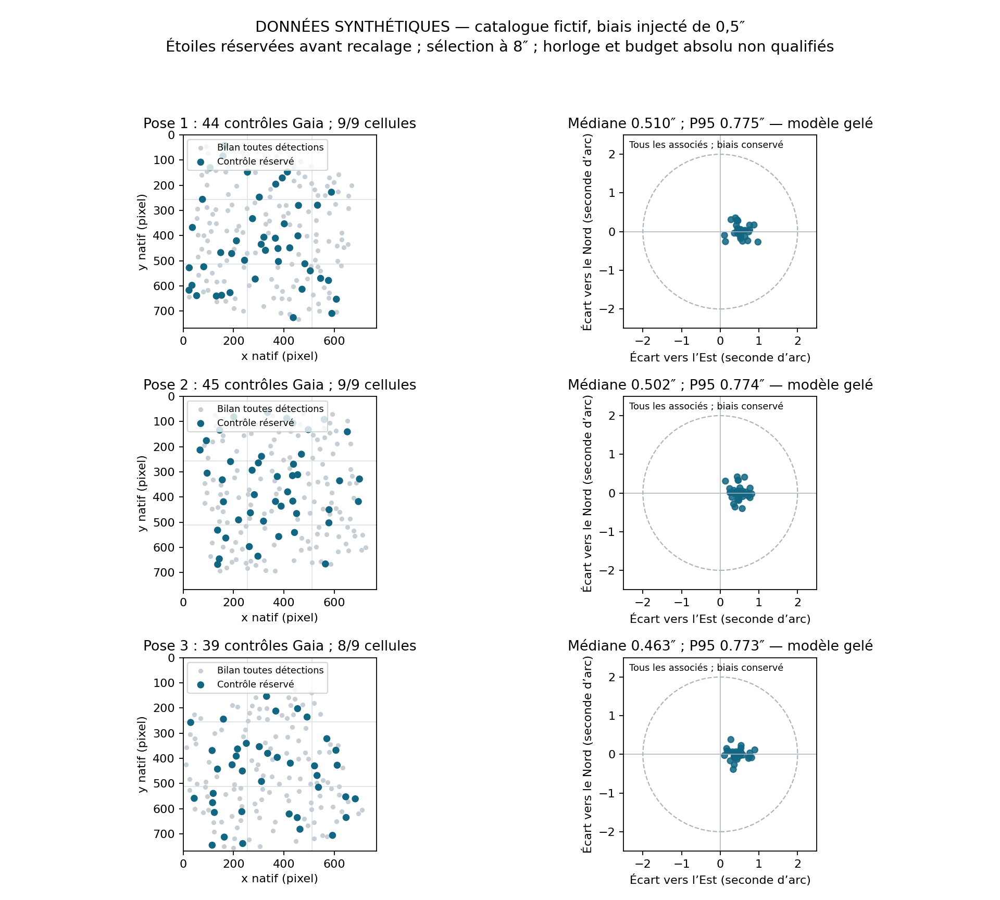

## 12. Mission : préparer les questions sur l’horloge

L’étiquette d’une photo peut dire « image créée » sans expliquer l’instant réel de l’exposition. Cette mission fabrique un dossier des choses connues et des preuves à chercher.

```powershell
.\.venv\Scripts\python.exe examples/make_time_evidence_demo.py local/parcours/preuves-entree
.\.venv\Scripts\gar.exe time-evidence local/parcours/preuves-entree/workset.json --output local/parcours/preuves-rapport
```

**À attendre :** code 2, quatre fichiers, trois images candidates et zéro heure qualifiée. Même l’exemple contenant beaucoup d’étiquettes ne prouve pas la justesse de l’horloge.


Les six fichiers produits sont expliqués dans la [section 15 du tutoriel](TUTORIEL.md#15-préparer-la-qualification-des-horodatages-sur-les-copies-locales). La [fiche de campagne](CAMPAGNE-TEMPORELLE.md) explique comment copier les cinq canevas pour préparer un essai futur. Ce ne sont pas des commandes qui pilotent le télescope.

## 13. Mission : retrouver les points qui bougent

Nous fabriquons maintenant de fausses étoiles, du bruit et des points mobiles. Le **bruit** est une petite variation inventée de la luminosité. La **trajectoire** est le chemin suivi par un point.

```powershell
.\.venv\Scripts\python.exe examples/make_moving_demo.py local/parcours/mobiles-entree
.\.venv\Scripts\gar.exe moving-synthetic local/parcours/mobiles-entree/manifest.json --truth local/parcours/mobiles-entree/truth.json --output local/parcours/mobiles-rapport
```

**À attendre :** 18 séquences, les six mobiles faciles et les trois mobiles intermittents retrouvés, zéro faux candidat dans les trois témoins. Le code est 0 si les critères enregistrés sont satisfaits. Les cinq objets manqués dans les cas faible ou très lent restent dans le rapport : ce sont des informations utiles, pas des résultats à effacer.

Le fichier `truth.json` contient les réponses parce que nous avons nous-mêmes inventé les objets. Le chercheur automatique construit ses candidats **avant** de lire ces réponses. Elles servent à compter ce qu’il a retrouvé ou manqué.


Pour fabriquer tes graphiques et ton petit film :

```powershell
.\.venv\Scripts\python.exe examples/plot_moving_demo.py local/parcours/mobiles-entree/manifest.json local/parcours/mobiles-rapport/moving.json local/parcours/mobiles-figures
```

Ouvre `moving-demo.gif` dans ce nouveau dossier. Les lignes colorées relient les positions mesurées des candidats ; les étoiles fixes restent sur place dans cet exemple.


*Données entièrement synthétiques, sans capture d’écran. Les secondes et vitesses de cet exercice sont fictives. Voir un point bouger dans ce jeu n’est pas découvrir un objet astronomique réel.*

## 13 bis. Mission : trouver les limites du chercheur

Un chercheur automatique peut se tromper. Nous allons lui donner de nouvelles images inventées, sans changer ses règles pour lui donner une meilleure note. Imagine un jeu où tu caches cinq billes : **5/5** veut dire « cinq retrouvées sur cinq cachées ». **0/5** est aussi une réponse utile : nous avons trouvé une difficulté.

Prévois environ 260 Mo pour les images fictives, plus les rapports. Reste dans le dossier du projet et garde les outils de dessin installés à l’étape 4. Aucun exercice ne demande une clé USB.

### Fabriquer, mesurer, puis dessiner

Écris une ligne à la fois et attends la fin avant la suivante :

```powershell
.\.venv\Scripts\python.exe examples/moving_limits.py make local/parcours/limites-entree
.\.venv\Scripts\python.exe examples/moving_limits.py run local/parcours/limites-entree/suite.json local/parcours/limites-rapport
.\.venv\Scripts\python.exe examples/plot_moving_limits.py local/parcours/limites-entree/suite.json local/parcours/limites-rapport/limits.json local/parcours/limites-figures
```

La première ligne **fabrique** 120 petites séquences, soit 960 images. La deuxième les **examine** avec les règles inchangées et range ses observations. La troisième **dessine** quatre images et un petit film. Le nombre de retour 0 signifie ici que l’essai a été produit, pas que tous les objets ont été retrouvés.

**Tu dois voir :** un message annonçant les 120 séquences analysées, puis les figures. Ouvre `local/parcours/limites-rapport/report.md` pour lire les résultats et `local/parcours/limites-figures/limits-grid.png` pour voir la première carte.

### Lire la carte des objets retrouvés

Dans l’image suivante, les lignes changent la lumière du point et les colonnes changent sa vitesse. **ADU** est simplement le nombre utilisé ici pour la lumière dans nos images fictives : un pic de 120 est plus lumineux qu’un pic de 12. Ce n’est pas une magnitude d’étoile réelle.

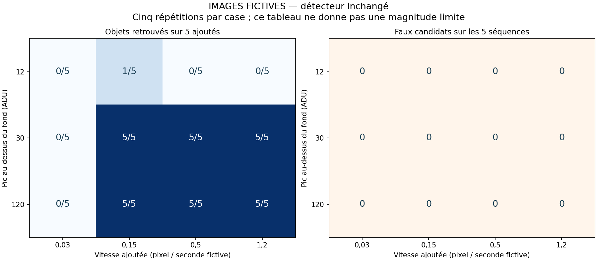

*Graphique réellement calculé, entièrement synthétique. Les zéros sont conservés.*

**À remarquer :** les points à 0,03 pixel par seconde fictive ne sont jamais retrouvés. Ils bougent trop lentement pour les règles de ce chercheur. Les points les plus faibles sont aussi difficiles à retrouver. Le 1/5 ne nous permet pas de deviner ce qui arriverait dans tous les autres essais.

### Ajouter du « grain » dans l’image

Le bruit ressemble aux petits grains qui gênent la lecture d’une photo. Nous avons essayé le même point avec quatre quantités de bruit. Le mot **sigma** indique ici la taille habituelle de ces petites variations.


**À attendre :** 5/5 retrouvés pour les bruits 2 et 4, puis 0/5 pour 8 et 16. Ce sont les résultats de ces images inventées, pas une règle universelle pour le télescope.

### Et si toute l’image glisse ?

Imagine des étoiles dessinées sur une feuille : si tu déplaces la feuille, toutes les étoiles semblent bouger. Le chercheur peut alors les prendre pour les mobiles que nous cherchons. Nous appelons cela de **faux candidats**.

Ouvre `local/parcours/limites-figures/limits-comparison.gif` :

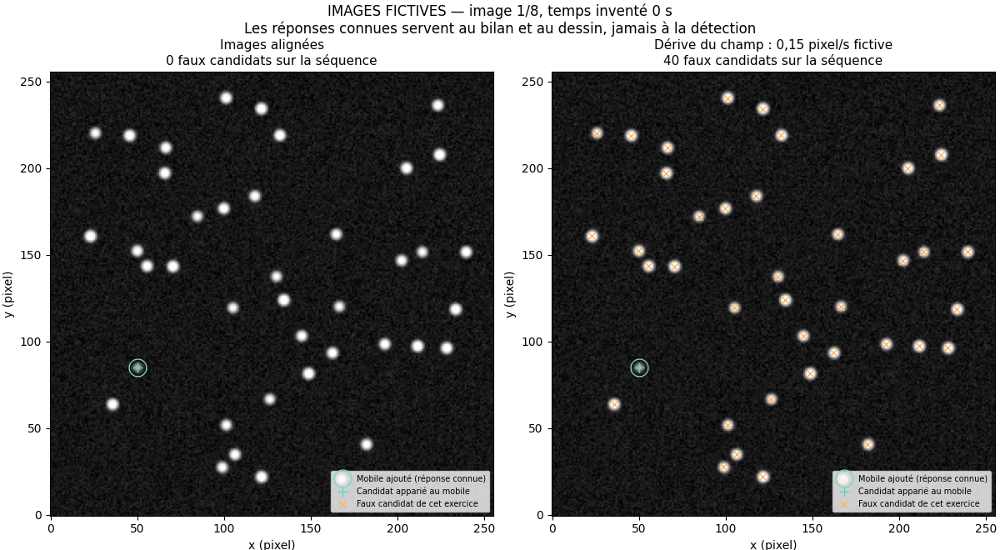

Le cercle vert montre le mobile que nous avons caché : c’est la réponse connue, ajoutée au dessin **après** la recherche. Les croix orange montrent les autres candidats trouvés par le programme. À droite, la dérive de 0,15 pixel/s donne 40 faux candidats sur cette séquence ; sur les cinq séquences de cette condition, il y en a 200.

**Attention à l’expérience :** le chercheur attend des images déjà alignées. Nous avons volontairement cassé cette règle pour comprendre sa limite. Il n’a pas encore remis les images en place dans cette mission. Un prochain travail pourra comparer le résultat avant et après cette remise en place, appelée **recalage**.

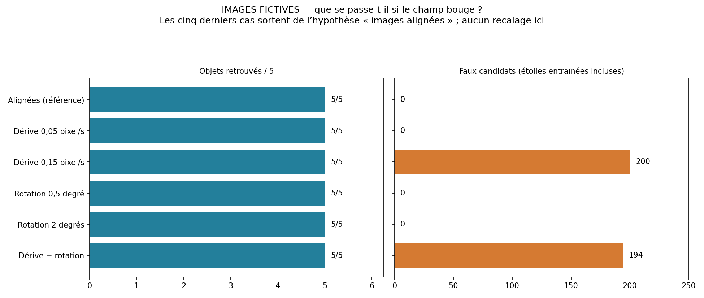

Les essais sans mobile donnent zéro faux candidat, mais cela ne prouve pas que le programme ne se trompera jamais. Cinq répétitions par situation restent un petit exercice. Pour tous les détails et les fichiers, lis [les limites du détecteur](LIMITES-DETECTEUR.md) ou la [section 18 du tutoriel](TUTORIEL.md#18-tester-les-limites-sans-changer-les-règles).

**Si une étape échoue :** conserve son message et le dossier créé. Le fichier `progress.json` permet de voir les lots terminés ; `incomplete` veut dire que l’exercice n’est pas fini. Choisis de nouveaux noms pour reprendre, sans effacer les résultats précédents.

## 13 ter. Mission : stabiliser les positions avant de chercher

La mission précédente montrait qu’un ciel qui glisse peut tromper le chercheur. Nous allons essayer de remettre les **positions** dans le même repère. Imagine une feuille transparente avec des points : tu la tournes et la déplaces pour remettre ses étoiles sur celles de la première photo. Cela s’appelle le **recalage**. Les photos FITS restent intactes.

### Fabriquer le nouvel exercice

Prévois environ 86 Mo pour les images, plus les rapports et dessins. Toujours depuis le dossier du projet, écris :

```powershell
.\.venv\Scripts\python.exe examples/moving_registration.py make local/parcours/recalage-mobiles-entree
.\.venv\Scripts\python.exe examples/moving_registration.py run local/parcours/recalage-mobiles-entree/manifest.json local/parcours/recalage-mobiles-entree/truth.json local/parcours/recalage-mobiles-rapport
.\.venv\Scripts\python.exe examples/plot_moving_registration.py local/parcours/recalage-mobiles-entree/manifest.json local/parcours/recalage-mobiles-entree/truth.json local/parcours/recalage-mobiles-rapport/comparison.json local/parcours/recalage-mobiles-figures
```

La première commande fabrique **40 séquences, soit 320 images fictives**. La deuxième cherche les mobiles avant et après recalage. La troisième dessine le bilan et l’animation. Attends la fin de chaque ligne avant de lancer la suivante ; choisis d’autres noms si ces dossiers existent déjà.

**Résultat attendu de la deuxième commande :** `critères exploratoires : False`, avec le code **2**. Cela signifie que le rapport est bien produit, mais que l’essai ne satisfait pas toutes les règles prévues. Tu peux alors lancer le dessin et lire `local/parcours/recalage-mobiles-rapport/report.md`. Le code 1 signifierait un travail impossible : il faudrait garder le message et demander de l’aide.

### Garder les essais que le programme refuse

Le programme utilise certaines étoiles pour trouver comment tourner et déplacer les positions. Il en garde d’autres pour **contrôler** son travail, comme des questions qui n’ont pas servi à préparer une réponse. Ces étoiles de contrôle doivent couvrir les quatre quartiers de l’image, appelés **quadrants**.

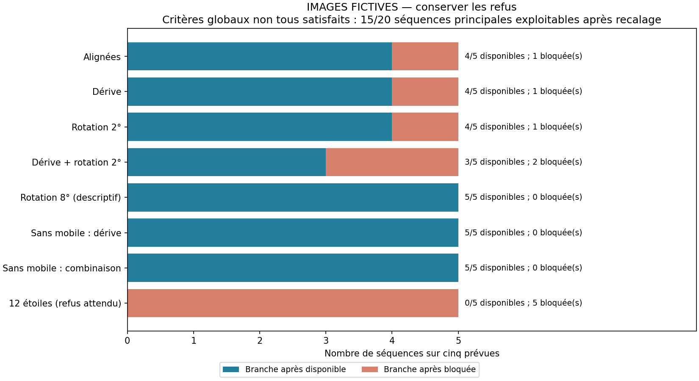

Sur les 20 séquences principales, le programme peut continuer après recalage pour 15 séquences. Il retrouve leurs 15 mobiles. Pour les cinq autres, il s’arrête : les étoiles de contrôle ne couvrent pas les quatre quartiers. Ce n’est pas une raison pour effacer les essais ou changer la règle après avoir vu les réponses.


*Image fictive réellement calculée et annotée. Ici, les cercles bleus ont servi à ajuster ; les cercles orange sont les contrôles associés. La zone teintée n’a aucun contrôle associé. Ce n’est pas une capture d’écran.*

### Comparer les mêmes essais

Pour comparer deux équipes, il faut compter les mêmes joueurs des deux côtés. Ici aussi, nous comparons avant et après **les mêmes séquences disponibles**.

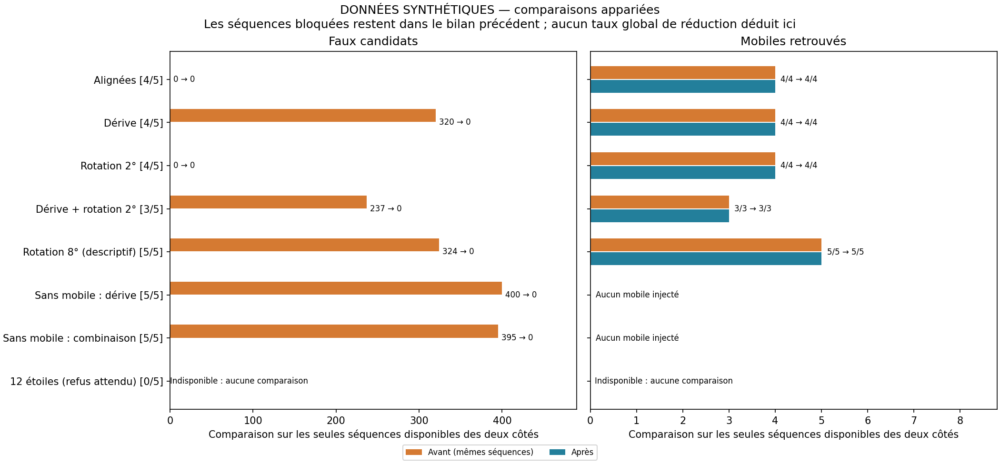

Dans les sept séquences comparables avec dérive ou combinaison, les faux candidats passent de **557 à zéro**, et les sept mobiles sont conservés. Cela ne nous donne pas un résultat pour les trois séquences bloquées de ces conditions. Les cinq essais avec seulement 12 étoiles sont aussi bloqués, comme prévu : trop peu d’étoiles pour vérifier correctement.

### Regarder les positions se remettre en place

Ouvre `local/parcours/recalage-mobiles-figures/registered-overlay.gif` :

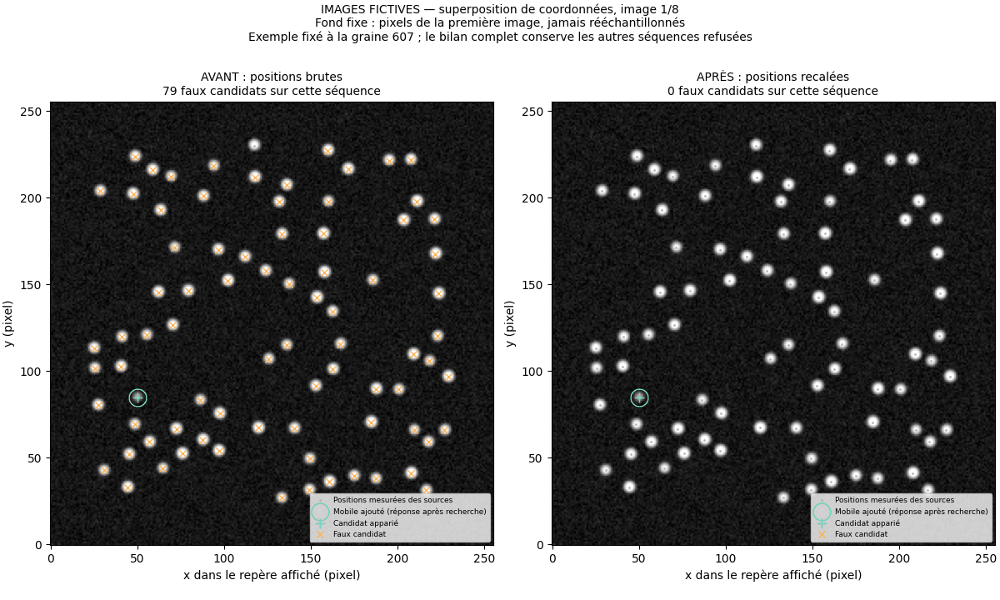

**Le fond est une photo figée**, celle de la première image. Les points dessinés par-dessus racontent les positions mesurées dans les huit images. Ce ne sont pas des photos déformées : un ancien point lumineux peut rester visible dans le fond. À droite, les positions des étoiles retrouvent leur place ; le chercheur garde le mobile. Le cercle vert est la réponse connue ajoutée au dessin après la recherche, et les croix orange sont les faux candidats de cet exemple.

Cet exemple a été choisi dans le plan avant l’essai. Il passe de 79 faux candidats à zéro, mais les refus des autres séquences restent dans le bilan. Le chercheur n’a reçu ni le déplacement exact ni les réponses pour calculer le recalage.

**À retenir pour l’exercice :** un petit écart sur quelques étoiles ne garantit pas que toute l’image soit bien contrôlée. Notre prochain travail pourra étudier comment mieux répartir les étoiles de contrôle, avec un nouveau plan. Nous n’avons pas encore testé cette chaîne sur le Seestar réel. Les [détails de l’essai](RECALAGE-MOBILES-SYNTHETIQUES.md) et la [section 19 du tutoriel](TUTORIEL.md#19-relier-le-recalage-à-la-recherche-de-mobiles-fictifs) expliquent les résultats et les limites.

## 14. Comprendre ce que tu as reconstruit

Tu as maintenant installé l’application entière depuis ses recettes publiques et essayé les modules disponibles. Voici où regarder le code pour comprendre chaque brique :

| Recette | Sa responsabilité |
|---|---|
| `src/gar/cli.py` | Lire la commande et appeler le bon module |
| `inventory.py`, `sessions.py` | Lister puis grouper les étiquettes |
| `timing.py`, `wcs_audit.py` | Examiner les informations disponibles et leurs limites |
| `workset.py` | Vérifier les copies et conserver les en-têtes complets |
| `astrometry.py`, `registration.py`, `gaia_frames.py` | Comparer les positions et construire le recalage |
| `time_evidence.py` | Préparer les preuves sur les heures |
| `moving.py` | Détecter puis associer les points des images fictives |
| Fichiers `*_reports.py` | Écrire les carnets de résultats |
| `examples/` et `tests/` | Fabriquer les essais et vérifier les recettes |
| `examples/moving_limits.py` | Essayer les limites, en gardant le chercheur inchangé |
| `examples/moving_registration.py` | Relier les positions recalées au chercheur, en conservant les refus |

Le [tutoriel de référence](TUTORIEL.md) raconte les décisions et les critères avant chaque lot de code. Les contrats expliquent les formats exacts. Pour apprendre à modifier l’application, commence par une copie de travail du code et un petit changement d’explication ; fais les contrôles avant de proposer ce changement. Tu n’as pas besoin de publier des observations personnelles pour apprendre.

## 15. Si quelque chose ne marche pas

| Message ou situation | Ce que tu peux faire |
|---|---|
| `py` ou `git` introuvable | Reprendre l’installation de l’outil et rouvrir PowerShell |
| `.venv\Scripts\python.exe` introuvable | Vérifier le dossier actuel et reprendre l’étape 4 |
| `No module named gar` | Installer le projet avec le Python de `.venv` et `pip install --no-deps -e .` |
| Matplotlib ou Pillow manquant | Installer `requirements/figures-tested.txt` avec le même Python de `.venv` |
| « La sortie existe déjà » | Choisir un nouveau nom, sans effacer les essais précédents |
| « Tous les produits doivent rester dans local/ » | Reprendre les chemins de l’exemple dans le dossier du projet |
| Code 2 après `time-evidence` | C’est attendu : lire le rapport, aucune horloge n’est qualifiée |
| Code 2 après `moving_registration.py run` | C’est attendu sur cet exercice : certaines séquences sont bloquées, lire le bilan et garder les refus |
| Un autre code 2 | Lire `report.md` et les critères ; conserver le résultat même décevant |
| Une erreur d’installation ou de test | Arrêter, copier le message utile et demander de l’aide sans joindre des données privées |

L’installation initiale et la récupération du code peuvent utiliser Internet. Les exercices d’analyse ci-dessus restent locaux. Les générateurs créent de fausses images ; aucun exercice ne demande une clé USB ou une connexion au télescope. L’application portable et les usages scientifiques réels demandent encore des travaux et validations supplémentaires.

*Vérification de l’édition précédente : reconstruction depuis une copie propre du dépôt, nouvel environnement Python, 241 tests et 24 commandes réussis. Le complément « limites » ajoute 19 contrôles, soit 260 tests réussis. Les 27 commandes de cette édition ont été rejouées avec succès dans des dossiers fictifs neufs ; les 960 images du banc de limites, ses mesures et ses cinq figures sont reproduites à l’identique depuis le code committé. Cela ne remplace pas un essai par un enfant débutant sur un ordinateur vierge.*

*Le complément « recalage puis recherche » ajoute 17 contrôles, soit 277 tests réussis. Les 30 commandes du parcours ont été rejouées dans des dossiers fictifs neufs depuis le code committé : le code 2 de la nouvelle analyse est bien conservé, avec les critères non satisfaits. Les 320 images, les 40 rapports de modèles/candidats et les cinq figures de cette mission sont reproduits à l’identique. Aucun essai utilisateur avec un enfant ou sur un ordinateur vierge n’est revendiqué.*
