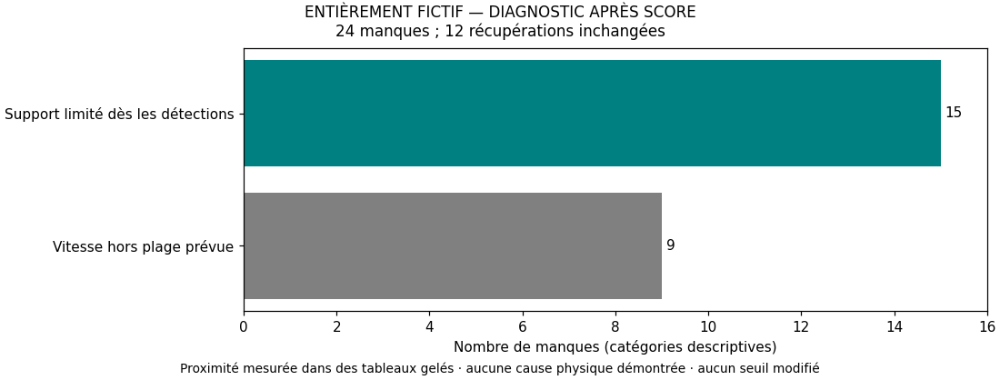
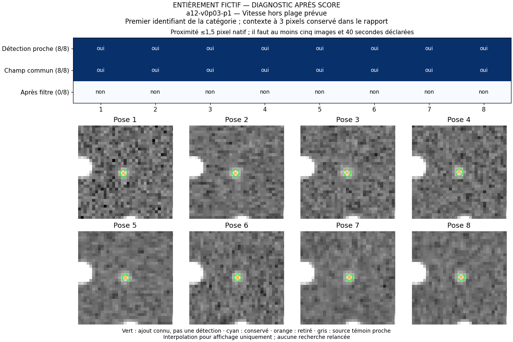
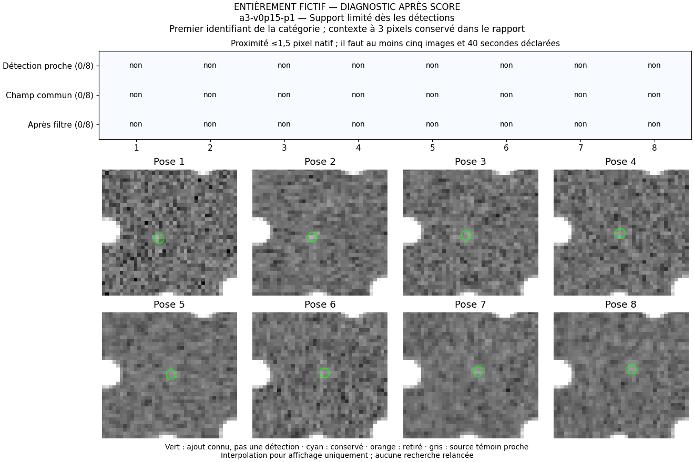

# Suivre les 26 ajouts manqués sans changer les seuils

**Le diagnostic réconcilie les 26 manques du fond réel : neuf ajouts sont hors de la plage de vitesse prévue ; les 17 autres ont trop peu d'images avec une position enregistrée proche dès les détections.** Aucun seuil, résultat ou candidat n'est modifié. Le bilan reste 10 ajouts artificiels retrouvés, 26 manqués et zéro indisponible ; le pilote naturel reste à zéro candidat.

Le plan [**`b69ca08`**](https://github.com/steveprudhomme/gnu-astrophotography-recycle/commit/b69ca0894acb40c404856ecf482eaf014e799332) a été committé, publié et vérifié sur `codex/diagnostic-manques` avant le code. Les moteurs, le pilote et la recette d'injection sont gelés. Le diagnostic lit les rapports existants : il ne rappelle ni détecteur, filtre stationnaire, recherche de trajectoires, génération ou recalage. Les pixels servent uniquement aux vignettes dessinées ensuite.

## Comprendre dès 10 ans

Imagine trois portes. À la première, le programme a enregistré des petits points dans les photos. À la deuxième, il garde ceux qui sont dans le champ partagé par toutes les photos. À la troisième, il enlève ceux qui ressemblent à des points fixes. Pour chercher une trajectoire, il faut ensuite assez de points pendant assez longtemps.

Nous suivons les tableaux déjà enregistrés à ces portes. Nous regardons s'il reste un point près de la position que nous avions ajoutée. Le point le plus proche peut pourtant être une étoile ou un autre signal : **proche ne veut pas dire identique**. Le rond vert des images marque notre réponse d'injection, pas une détection.



*Figure calculée sur le fond entièrement fictif du parcours. Ce jeu a 24 manques, avec neuf vitesses hors plage et quinze supports limités dès les détections. Le fond réel a 26 manques et un bilan différent, résumé plus bas.*

## Les rapports utilisés et préservés

Le seul argument d'entrée est le `score.json` complet du [lot d'injections](INJECTIONS-SEESTAR.md). Il contient les chemins locaux du manifeste, de la vérité et de l'analyse, avec leurs empreintes. Nous vérifions ces liens, les 37 résultats individuels gelés, les dérivés et les copies. Les réponses ne sont ouvertes qu'après validation des candidats et du score terminé. L'appariement mathématique enregistré est contrôlé, sans relancer une recherche.

Pour chaque pose, les détections brutes sont ramenées dans la référence par le modèle gelé. Les points du champ commun doivent être un sous-ensemble ordonné de ces positions, et les points restants un sous-ensemble du tableau précédent. Les nombres de points retirés doivent correspondre. La tolérance de 10⁻⁹ pixel vérifie la cohérence numérique ; elle ne déplace pas les positions et ne change aucun seuil de détection.

« Détections brutes » désigne ici les positions sorties de la fonction du pilote, avant transformation et champ commun. Ce n'est pas la liste de tous les maxima avant les critères internes du détecteur. Le diagnostic ne rejoue pas ces critères et ne peut donc pas départager à lui seul seuil de détection, forme du signal, position du centre, bruit ou voisinage lumineux.

## Deux voisinages pour garder les ambiguïtés visibles

Le rayon principal est **1,5 pixel natif**, déjà utilisé par l'association. Le contexte utilise **3 pixels**, rayon déjà présent dans le recalage stellaire. Ce sont des comparaisons après coup sur des positions gelées : les paramètres du moteur restent inchangés. Nous conservons les distances au point le plus proche, même quand aucun n'entre dans le rayon.

À chaque étape et pour chaque rayon, le rapport indique les images où existe un point proche, leur nombre et leur durée déclarée. Le support est suffisant pour ce diagnostic seulement avec **au moins cinq images et 40 secondes déclarées**, critères déjà requis par le moteur. Ce support de proximité n'établit pas qu'une trajectoire valide existe : les points proches peuvent provenir de sources différentes.

Le classement principal suit les règles publiées avant le diagnostic :

| Constat | Ce qu'il signifie, sans preuve de cause physique |
|---|---|
| Retrouvée | Le score gelé avait déjà apparié l'ajout ; il n'est pas reclassé comme manqué |
| Indisponible | Le test n'avait pas abouti ; les informations inconnues restent inconnues |
| Vitesse ou durée hors domaine | Une condition du protocole suffit à empêcher la récupération prévue ; d'autres pertes peuvent aussi exister |
| Support limité dès les détections | Trop peu d'images ou durée trop courte avec un point enregistré proche |
| Support perdu au champ commun | Le support de proximité devient insuffisant après cette restriction |
| Support perdu au filtre stationnaire | Il devient insuffisant après les retraits enregistrés du filtre |
| Association non résolue | Le support reste suffisant, mais aucun candidat accepté n'est apparié ; raison interne non établie |
| Voisinage ambigu | Les rayons 1,5 et 3 désignent des étapes limitantes différentes ; les deux constats sont gardés |

Nous relevons aussi les points proches dans le témoin sans ajout. Ils constituent un indice de confusion possible, pas une étoile identifiée ni une cause prouvée. Un témoin indisponible garde ce renseignement à `null`, et non zéro voisin. Une absence de point témoin à trois pixels n'exclut pas l'influence lumineuse d'une source plus éloignée.

## Deux commandes après l'exercice d'injection

Depuis PowerShell à la racine, avec l'[exercice précédent](INJECTIONS-SEESTAR.md#cinq-commandes-pour-refaire-lexercice-public) déjà terminé et des sorties neuves :

```powershell
.\.venv\Scripts\python.exe examples/diagnose_injection_misses.py local/exercice-injections-bilan/score.json local/exercice-diagnostic-manques
.\.venv\Scripts\python.exe examples/plot_miss_diagnostics.py local/exercice-diagnostic-manques/diagnostic.json local/exercice-diagnostic-figures
```

Les deux codes attendus sont **0** : cela signifie diagnostic et dessin terminés, pas validation scientifique. Résultat fictif : 24 manques, neuf vitesses hors plage et quinze supports limités dès les détections. Les douze récupérations restent inchangées. Les tests publics utilisent uniquement des images ou tableaux inventés.

La sortie du diagnostic contient `diagnostic.json` (preuves par image, distances et supports aux deux rayons), `diagnostic.csv` (classement par injection), `report.md` (tableau lisible). Les dessins contiennent `overview.png`, une vignette en huit vues par catégorie et leur journal `figures.json`. Un exemple est choisi par le premier identifiant lexical de sa catégorie, règle fixée avant résultat ; aucune sélection selon la beauté des images.



*En haut, chaque colonne est une photo et chaque ligne une étape. « Oui » signifie point enregistré proche à 1,5 pixel, pas identité certaine. Vert : position ajoutée connue ; cyan : point proche conservé ; orange : point proche retiré ; gris : source proche du témoin. La vitesse hors plage reste le constat principal, avec la perte au filtre également visible. Une catégorie n'efface pas les autres preuves.*



*L'ajout connu reste marqué en vert, même sans détection proche. Les pixels sont interpolés pour le dessin seulement ; ils ne sont pas réanalysés. Le rond vert n'indique ni taille physique, ni récupération ou découverte.*

## Bilan des 26 manques du fond réel

| Constat principal | Manques |
|---|---|
| Vitesse 0,03, sous la borne 0,1 prévue | 9 |
| Support limité dès les positions de détection enregistrées | 17 |
| Total | 26 |

Pour les 17 autres manques, les deux rayons donnent les mêmes nombres d'images avec un point proche :

| Images avec point proche, sur huit | Nombre d'ajouts manqués |
|---|---|
| 0 | 9 |
| 2 | 4 |
| 3 | 3 |
| 4 | 1 |

Aucun n'atteint les cinq images requises. Dans ces 17 cas, les nombres restent les mêmes au champ commun puis après filtrage : ces étapes n'enlèvent pas de support supplémentaire observé. Aucun point du témoin n'est enregistré à moins de trois pixels de leurs positions injectées. Ce n'est pas une preuve d'absence de confusion, ni d'une luminosité seule responsable. Les raisons internes du détecteur ne sont pas établies par ces seuls tableaux.

Le témoin naturel et les dix récupérations restent inchangés. Il n'y a pas de nouvelle recherche ou de nouveau candidat. Les rapports et vignettes mixtes sur fond réel restent sous `local/`, explicitement étiquetés ; les trois nouvelles figures publiques sont entièrement fictives. Les cinq médias réels CC0 déjà autorisés restent inchangés. Les gardes d'exécution relèvent zéro appel de recherche, zéro analyse de pixels pour le diagnostic, zéro accès externe/réseau et zéro écriture FITS ou NPY.

## Vérifications et limites

Les 24 nouveaux tests couvrent les catégories sur tableaux connus, les durées, les deux rayons, les ambiguïtés, les exclusions de protocole, les indices de confusion seulement possibles, les sous-ensembles corrompus, les scores incohérents, le refus d'entrées externes ou modifiées et la conservation des états incomplets. Des fonctions de recherche et d'analyse des pixels sont remplacées par des gardes qui échoueraient si le diagnostic les appelait. La suite compte **381 tests réussis**, exécutés localement.

Deux premiers cas de test partageaient par erreur les mêmes listes de positions entre étapes. Leurs copies ont été isolées pour tester correctement les différences ; les moteurs, mesures et résultats n'ont pas été changés. Les 24 tests du nouveau lot et la suite complète passent ensuite. Une erreur d'entrée ou une incohérence donne le code 1 ; un diagnostic interrompu garde `incomplete`, son progrès et ses inconnues et ne peut pas être dessiné comme complet. Les dossiers existants ne sont pas écrasés.

## Reproduction contrôlée

Depuis le commit propre **`234c439`**, les **381 tests** ont réussi en **120,42 secondes**. Les deux nouvelles commandes ont abouti aux codes 0 dans de nouveaux dossiers, sur le score fictif déjà disponible. Les diagnostics des **36 injections de chaque fond** sont identiques aux premiers constats, avec 24 manques fictifs et 26 sur fond réel. Les trois figures publiques fictives et les trois vues mixtes locales sont identiques par empreinte.

Les scores, candidats, dérivés, copies et cinq médias CC0 restent intacts. Les gardes relèvent zéro appel de recherche ou d'analyse de pixels pour le diagnostic, zéro accès externe/réseau et zéro écriture FITS/NPY. La revue porte sur 193 fichiers publics et 43 ancres Markdown, sans tableaux privés suivis par Git. Les 53 anciennes commandes conservent leurs preuves sans être toutes rejouées ; aucune injection réelle n'est régénérée pour ce lot. Les traces détaillées restent locales. Aucun essai avec un enfant ou sur un ordinateur vierge n'est revendiqué.

Ce bilan indique où le support est déjà insuffisant dans les enregistrements. Il ne démontre pas toutes les causes physiques, ne produit pas de nouvelles trajectoires et ne change ni seuil, profil d'injection ou budget d'erreur. Toute exploration interne du détecteur ou amélioration devra être planifiée séparément, en conservant ces constats et un jeu distinct pour sa vérification. Aucune qualification scientifique indépendante n'est revendiquée.

Intégration par la [PR nº 2](https://github.com/steveprudhomme/gnu-astrophotography-recycle/pull/2) vers `main`, après revue interne des 20 fichiers. La fusion conserve le commit de planification publié avant code et fait l'objet d'un contrôle distant. Les 381 tests sont locaux ; aucun contrôle automatique GitHub n'est configuré.
