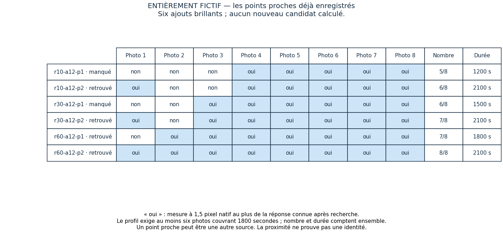
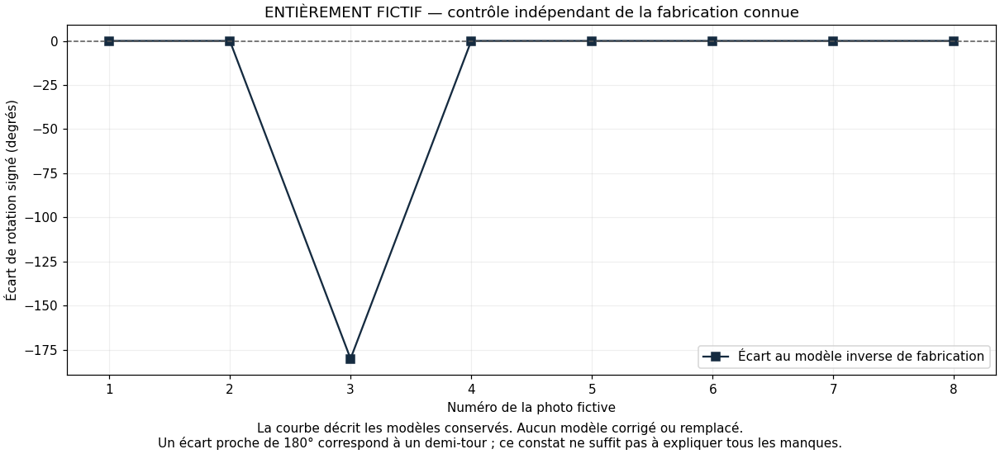
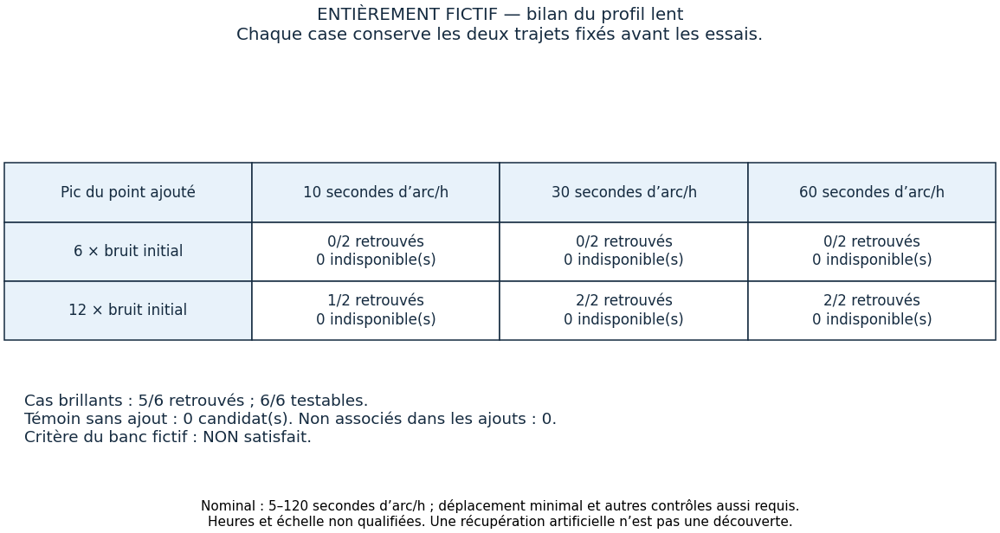

# Comprendre les points lents manqués

Ce parcours explique les trois ajouts brillants manqués du lot 23.
Il utilise leurs mesures conservées. Il ne change aucun ancien candidat, modèle ou seuil.
Le [plan publié avant le code](https://github.com/steveprudhomme/gnu-astrophotography-recycle/commit/13ded75ad3f0020316a230647e2c12dfeb655ff8) décrit le lot 24.

## Comprendre avec une promenade

Imagine huit photos d'une personne qui marche. Pour mesurer son trajet, il faut la retrouver sur plusieurs photos.
Il faut aussi assez de temps entre la première photo utile et la dernière.
Six photos prises trop près les unes des autres peuvent donc être insuffisantes.

Le **support** désigne ici les photos avec une mesure proche du point ajouté.
La **durée du support** va de la première de ces photos à la dernière.
Le profil exige au moins six photos et 1800 secondes de support, soit 30 minutes.

Une **mesure proche** est un point déjà enregistré à moins de 1,5 pixel natif de la réponse connue.
Un pixel natif est une case de l'image d'origine. Une autre étoile peut aussi produire une mesure proche.
Ce diagnostic de voisinage ne prouve donc pas une identité.

## Préparer les outils et les résultats précédents

Suivre d'abord [Construire l'application, pas à pas](DEMARRER-DE-ZERO.md), puis l'[exercice du profil lent](MOBILES-LENTS.md).
Les deux anciens bilans doivent exister dans `local/exercice-lents-score-1/` et `local/exercice-lents-score-2/`.
Les deux codes 2 de cet exercice sont attendus : les critères fictifs n'étaient pas satisfaits.
Les candidats et les fichiers de réponses restent conservés.

Ouvrir PowerShell dans le dossier du projet. Garder les dépendances de dessin déjà installées.
Choisir des noms de sorties encore inutilisés. Ne pas effacer un ancien essai pour réutiliser son nom.
Toutes les images de cet exercice sont inventées ; aucun support USB n'est nécessaire.

## 1. Lire les mesures du premier fond

```powershell
.\.venv\Scripts\python.exe examples/diagnose_slow_misses.py local/exercice-lents-score-1/score.json local/exercice-diagnostic-lents-1
.\.venv\Scripts\python.exe examples/plot_slow_diagnostic.py local/exercice-diagnostic-lents-1/diagnostic.json local/exercice-diagnostic-lents-figures-1
```

La première commande vérifie les candidats et leurs empreintes avant de lire les réponses.
Une empreinte est un code calculé à partir du contenu d'un fichier.
Elle compare les mesures enregistrées aux positions ajoutées, après la recherche.
Elle produit `diagnostic.json` et le tableau `support.csv`.

La seconde commande dessine les résultats vérifiés. Elle ne cherche aucun nouveau point ou trajet.
Elle produit `support.png`, `orientation.png` et `figures.json`.

**Vérifier :** le premier fond conserve un manque brillant, nommé `r10-a12-p1`.
Le nom signifie vitesse 10, amplitude 12 fois le bruit initial, premier trajet.
Il possède cinq photos proches, de la photo 4 à la photo 8 : seulement 1200 secondes.
Le code 0 signifie que le diagnostic est terminé. Il ne transforme pas le manque en réussite.

## 2. Lire les mesures du second fond

```powershell
.\.venv\Scripts\python.exe examples/diagnose_slow_misses.py local/exercice-lents-score-2/score.json local/exercice-diagnostic-lents-2
.\.venv\Scripts\python.exe examples/plot_slow_diagnostic.py local/exercice-diagnostic-lents-2/diagnostic.json local/exercice-diagnostic-lents-figures-2
```

**Vérifier :** ce fond conserve deux manques brillants.
Le premier possède cinq photos sur 1200 secondes. Le second possède six photos, mais seulement sur 1500 secondes.

| Fond fictif | Ajout manqué | Photos avec point proche | Durée | Limite observée |
|---|---|---|---:|---|
| Premier | `r10-a12-p1` | 4, 5, 6, 7, 8 | 1200 s | Nombre et durée insuffisants |
| Second | `r10-a12-p1` | 4, 5, 6, 7, 8 | 1200 s | Nombre et durée insuffisants |
| Second | `r30-a12-p1` | 3, 4, 5, 6, 7, 8 | 1500 s | Durée insuffisante |

Les rayons de 1,5 et 3 pixels donnent ici les mêmes supports.
Ces supports sont déjà insuffisants dans les mesures brutes. Le champ commun ne retire aucun point proche supplémentaire dans ces trois cas.
Cette observation situe une limite du traitement. Elle ne départage pas toutes les causes physiques d'une mesure absente.



**Lire sans image.** Les lignes indiquent six ajouts brillants. Les colonnes indiquent les huit photos.
« oui » signifie qu'une mesure proche existe. Les lignes marquées « manqué », première et troisième, ont cinq et six « oui ».
Leurs durées sont 1200 et 1500 secondes. Les autres lignes donnent le contexte retrouvé, sans remplacer les manques.

Le rayon du moteur entoure son trajet ajusté. Notre rayon de diagnostic entoure les réponses connues après coup.
Ces voisinages peuvent donc différer. Le diagnostic ne retrace pas toutes les hypothèses internes et ne prouve pas chaque rejet.

## 3. Examiner l'orientation des photos

Le **recalage** place les photos dans un même repère. Sa rotation indique de combien l'image doit tourner.
Le générateur invente une rotation connue. Nous pouvons comparer son inverse au modèle conservé.
Neuf repères fixes permettent aussi de comparer les positions dans l'image.

La troisième photo du premier fond possède un écart proche de 180 degrés : presque un demi-tour.
Le modèle accepte environ +179,859°, alors que l'inverse attendu vaut environ −0,143°.
Le second fond ne présente pas ce demi-tour. Il possède pourtant aussi des manques.
Nous conservons donc les deux constats sans attribuer tous les manques à l'orientation.



**Lire sans image.** Les huit numéros de photos vont de gauche à droite.
Les écarts restent proches de zéro sauf pour la troisième photo, presque à −180°.
La courbe compare les modèles conservés à l'inverse de la fabrication. Elle ne corrige aucun modèle.

## 4. Fabriquer deux nouveaux fonds irréguliers

Nous changeons la fabrication du ciel fictif. Les moteurs et leurs seuils restent identiques.
Chaque étoile de départ peut se déplacer de neuf pixels dans chaque direction autour de sa case prévue.
La graine fixe les nombres tirés. Elle permet de refaire exactement le même ciel.
Les deux graines réservées sont 2026112401 et 2026112402. Aucun résultat ne sert à choisir une autre graine.

```powershell
.\.venv\Scripts\python.exe examples/make_asymmetric_slow_demo.py local/exercice-asym-fonds
```

Le programme crée huit poses fictives par fond, avec une photo toutes les cinq minutes.
Il prépare leurs copies et les modèles, puis vérifie l'orientation à partir de la fabrication connue.
Il ne remplace aucun modèle avec la réponse attendue.

**Vérifier :** lire `local/exercice-asym-fonds/contexts.json` et les fichiers `registration-audit.json` de chaque contexte.
Le champ `all_contexts_admissible` doit valoir `true` pour poursuivre toutes les commandes ci-dessous.
Un code 2 indique un contexte refusé : conserver son dossier et son motif. Ne pas remplacer la graine ou forcer le modèle.

Le nouveau contrôle exige un écart de rotation d'au plus 0,05°.
L'écart RMS des neuf repères doit rester au plus égal à 0,75 pixel ; leur écart maximal, à 1,5 pixel.
Le RMS résume la taille des écarts. Ce contrôle s'applique à une fabrication connue, pas aux images réelles sans cette vérité.

## 5. Ajouter, chercher, comparer et dessiner

Pour le premier fond :

```powershell
.\.venv\Scripts\python.exe examples/slow_motion_profile.py generate local/exercice-asym-fonds/context-s2026112401/baseline/baseline.json local/exercice-asym-injections-1
.\.venv\Scripts\python.exe examples/slow_motion_profile.py analyze local/exercice-asym-injections-1/manifest.json local/exercice-asym-analyse-1
.\.venv\Scripts\python.exe examples/slow_motion_profile.py score local/exercice-asym-injections-1/manifest.json local/exercice-asym-injections-1/truth.json local/exercice-asym-analyse-1/analysis.json local/exercice-asym-score-1
.\.venv\Scripts\python.exe examples/plot_slow_motions.py local/exercice-asym-score-1/score.json local/exercice-asym-figures-1
```

Pour le second fond :

```powershell
.\.venv\Scripts\python.exe examples/slow_motion_profile.py generate local/exercice-asym-fonds/context-s2026112402/baseline/baseline.json local/exercice-asym-injections-2
.\.venv\Scripts\python.exe examples/slow_motion_profile.py analyze local/exercice-asym-injections-2/manifest.json local/exercice-asym-analyse-2
.\.venv\Scripts\python.exe examples/slow_motion_profile.py score local/exercice-asym-injections-2/manifest.json local/exercice-asym-injections-2/truth.json local/exercice-asym-analyse-2/analysis.json local/exercice-asym-score-2
.\.venv\Scripts\python.exe examples/plot_slow_motions.py local/exercice-asym-score-2/score.json local/exercice-asym-figures-2
```

Ces quatre étapes gardent les mêmes recettes que le lot 23. Leurs mots et fichiers sont expliqués dans le [guide du profil lent](MOBILES-LENTS.md).
Un témoin ne reçoit aucun point ajouté. Douze séries reçoivent chacune un ajout différent, avec réponse conservée à part.
La recherche se termine et conserve les empreintes des candidats avant l'ouverture des réponses.

**Vérifier :** chaque score indique les ajouts retrouvés, manqués et indisponibles.
Le critère prévu demande les six cas brillants retrouvés et un témoin sans candidat.
Un code 2 conserve un critère manqué ou une indisponibilité. Les figures restent utiles pour expliquer cet échec.
Garder aussi les candidats non associés. Sur fond fictif, ils décrivent les fausses propositions de cet exercice.

## Comprendre les limites

### Résultats du nouveau banc réservé

| Fond irrégulier | Ajouts retrouvés | Brillants retrouvés | Faibles retrouvés | Témoin | Non associés |
|---|---:|---:|---:|---:|---:|
| Premier | 5/12 | 5/6 | 0/6 | 0 | 0 |
| Second | 6/12 | 5/6 | 1/6 | 0 | 0 |

Les deux contrôles de fabrication passent. Les écarts de rotation maximaux restent sous 0,003°.
Les erreurs spatiales maximales des neuf repères restent sous 0,024 pixel natif.
Les douze ajouts sont disponibles dans chaque fond. Les deux critères brillants échouent ; les scores gardent le code 2.



**Lire sans image.** À faible amplitude, aucun des six ajouts n'est retrouvé dans ce fond.
À forte amplitude, le profil retrouve un trajet sur deux à 10 secondes d'arc par heure.
Il retrouve les deux trajets à 30 et à 60. Le témoin reste sans candidat.

Le manque brillant concerne `r10-a12-p1` dans chacun des nouveaux fonds.
Les deux diagnostics supplémentaires trouvent cinq photos proches sur 1200 secondes, aux deux rayons.
Une orientation conforme à la fabrication ne suffit donc pas à satisfaire le critère de ce banc.

Les nouveaux fonds ont des positions et des bruits différents. Ils ne constituent pas une comparaison contrôlée de la seule symétrie.
Un meilleur résultat ne prouverait donc pas que la symétrie expliquait chaque ancien manque.
Les anciens scores, modèles et figures restent intacts.

Si six mesures proches sont disponibles, le diagnostic peut ajuster leur trajet après coup.
Il indique les règles non satisfaites. Cet ajustement utilise les réponses connues ; il ne devient jamais un candidat du moteur.
Lorsque le voisinage ne permet pas d'expliquer l'association, le rapport conserve cette inconnue.

Les images réelles du lot 23 servent seulement de contexte relu. Aucun nouveau point n'y est ajouté dans ce lot.
Les copies locales suffisent. Aucune lecture du support, nouvelle image réelle publiée ou requête de catalogue n'est nécessaire.

## Si une étape échoue

- Sortie déjà présente : choisir un autre nom. Garder les anciens fichiers.
- Ancien score absent : terminer d'abord l'exercice du profil lent.
- Empreinte différente : conserver les fichiers et examiner la modification. Ne pas fabriquer une nouvelle empreinte pour contourner le contrôle.
- Fabrication refusée : conserver le contexte ; ne pas corriger son orientation avec la vérité.
- Critère manqué : lire les comptes et les figures ; ne pas baisser un seuil après le résultat réservé.

Le parcours suit les [règles de rédaction accessible](REDACTION-ACCESSIBLE.md).
Il vise les débutants dès 10 ans. Aucun essai de compréhension avec un enfant ou audit WCAG complet n'est revendiqué.

## Vérifications réalisées

Les 26 nouveaux tests fictifs passent en 20,69 secondes. Ils utilisent une graine de développement distincte.
La suite complète donne **620 tests réussis en 298,92 secondes**.
Les tests vérifient notamment les corruptions, les états inconnus et des dessins reproduits sans appel de recherche.

Les treize commandes du parcours sont exécutées dans des dossiers locaux neufs.
Leurs codes sont `0,0,0,0,0,0,0,2,0,0,0,2,0`.
Quatre diagnostics supplémentaires relisent les nouveaux fonds et les anciens bilans réels ; aucune nouvelle recherche réelle n'est lancée.
Les 1892 anciens fichiers surveillés restent intacts. Les gardes d'accès externe, réseau et écriture d'ancien dérivé restent à zéro.

Un premier essai protégé s'interrompt avant l'analyse réservée : la garde bloque aussi une copie de fichier fictif.
Le dossier incomplet reste conservé. La garde est précisée pour les seules nouvelles copies fictives, puis l'exercice reprend dans un nouveau dossier.
Les moteurs, le générateur et les critères ne changent pas. Aucun réglage ne suit l'essai réservé achevé.
