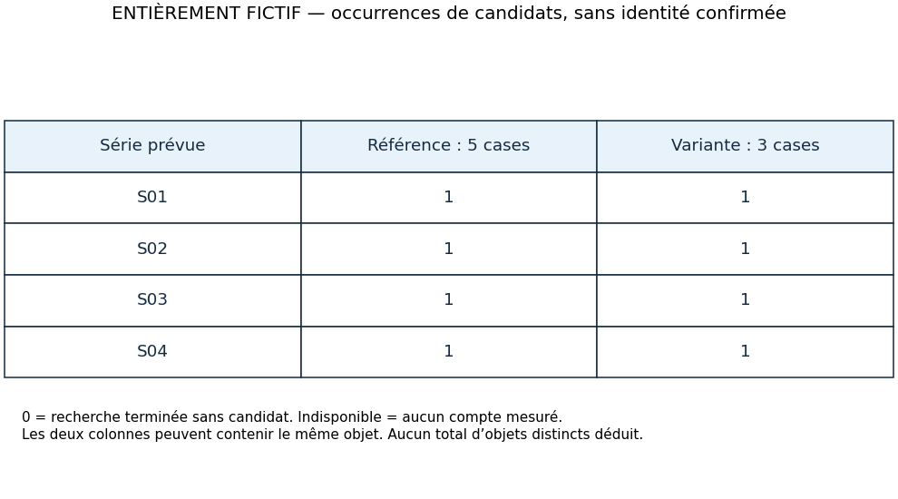
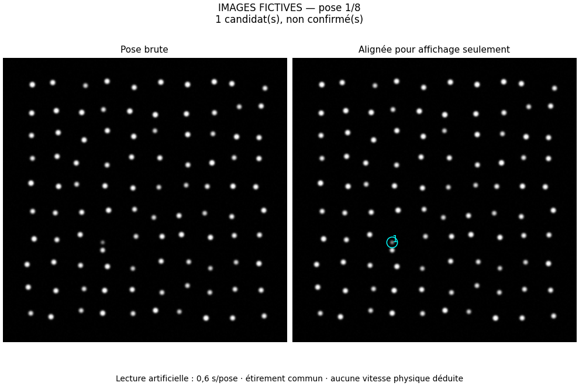
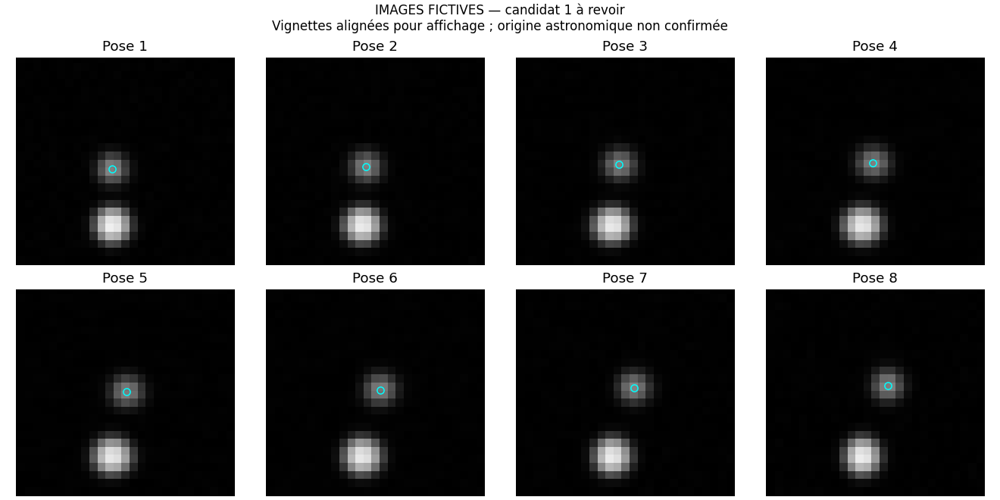

# Examiner plusieurs séries Seestar

Cet atelier apprend à traiter plusieurs séries avec les mêmes règles.
Une **pose** est une image prise pendant une exposition. Une **série** contient ici huit poses choisies.
Un **candidat** est une proposition de trajet. Il reste à vérifier ; son identité n'est pas connue automatiquement.

Le [plan initial](https://github.com/steveprudhomme/gnu-astrophotography-recycle/commit/29665f336818ed048701ad0f0bb1c185101b8b68) fixe les sélections avant les recherches.
Un [complément publié avant son code](https://github.com/steveprudhomme/gnu-astrophotography-recycle/commit/4d3f67741de71c448d955bd5a32c0e376a273272) ajoute la commande publique de copie.

## Comprendre la comparaison

Imagine quatre petits films du ciel. Le programme cherche des points qui changent de place entre leurs images.
Il utilise deux profils, c'est-à-dire deux ensembles de règles identifiés.
La référence compare les sommets dans un voisinage de cinq cases réduites. La variante en utilise trois.
Une case réduite regroupe 2 × 2 pixels d'origine. Le [guide du voisinage](VOISINAGE-REDUIT.md) explique cette différence.
Le seuil de luminosité reste à cinq fois le bruit. Les autres règles des profils restent inchangées.

Une **fenêtre** est une portion de séance. Nous fixons deux débuts : zéro et 2400 secondes depuis la première pose.
Dans chaque fenêtre, nous choisissons les poses les plus proches des huit repères espacés de cinq minutes.
La même pose ne peut pas appartenir aux deux fenêtres d'une séance.
Un refus reste conservé. Le programme ne choisit pas une fenêtre plus favorable après le résultat.

## Préparer les outils

Suivre le [parcours d'installation dès le début](DEMARRER-DE-ZERO.md), avec les outils de dessin.
Ouvrir PowerShell dans le projet. Employer des noms de sorties encore inutilisés, dans `local/`.
Ce dossier garde les données de travail hors de GitHub.
Une **empreinte** est un code calculé depuis un fichier. Elle permet de vérifier qu'une copie possède le même contenu.

## 1. Fabriquer un exercice entièrement fictif

```powershell
.\.venv\Scripts\python.exe examples/make_survey_demo.py local/atelier-series-entree
```

La commande fabrique deux séances de seize images. Elle prépare quatre séries et leurs copies vérifiées.
Les étoiles et le point mobile sont inventés. Le déplacement prévu vaut 30 secondes d'arc par heure.
Une seconde d'arc est une très petite unité d'angle sur le ciel.
La hauteur du point ajouté vaut 240 dans les pixels natifs. Ce nombre n'est pas une magnitude astronomique.

**Vérifier :** les dossiers contiennent `plan/plan.json`, `worksets.json` et les copies.
Un **workset** est un lot de copies vérifiées avec ses en-têtes conservés.
Les graines 2026112701 et 2026112702 fixent les nombres aléatoires de cet exercice.

## 2. Rechercher les trajets

```powershell
.\.venv\Scripts\python.exe examples/seestar_survey.py run local/atelier-series-entree/plan/plan.json local/atelier-series-entree/worksets.json local/atelier-series-analyse
```

Le programme aligne les images à partir des étoiles, puis conserve les modèles d'alignement.
Les deux profils utilisent les mêmes images et modèles. Ils ne reçoivent aucune position attendue du point fictif.
Chaque série produit un rapport candidat et une empreinte. Le bilan conserve aussi les refus.

**Vérifier :** `survey.json` indique `status: complete` et `inputs_unchanged: true`.
Un code de retour 2 signale une sélection ou recherche indisponible. Un code 1 signale une erreur.
Un code 0 indique que les recherches prévues ont terminé, même sans candidat.

## 3. Dessiner les résultats

```powershell
.\.venv\Scripts\python.exe examples/plot_seestar_survey.py local/atelier-series-analyse/survey.json local/atelier-series-figures
```

Le dessin vérifie les fichiers liés. Il ne relance pas la détection, l'alignement ou la recherche de trajectoire.
Les images alignées sont calculées pour l'affichage. Les mesures restent issues des pixels de travail d'origine.



**Lire sans image.** Les lignes S01 à S04 ont chacune un candidat dans les deux colonnes.
Le même objet peut figurer dans les deux profils et plusieurs fenêtres. Ces huit occurrences ne sont pas huit objets distincts.



**Lire sans image.** Les deux panneaux montrent la même pose. Le cercle numéroté désigne une mesure retenue dans un trajet.
Le contraste commun aide la lecture. Il ne transforme pas la luminosité en mesure calibrée.



**Lire sans image.** Le point du haut se déplace au fil des poses. Le point plus fort situé dessous reste presque fixe après alignement.
Le cercle suit la mesure candidate. Cette illustration est calculée sur des images inventées, sans capture d'écran fabriquée.

[Ouvrir le GIF fictif des huit poses](images/exemple-essai-elargi-animation.gif).
L'animation est facultative. Les vues fixes et les descriptions donnent aussi le résultat.
Une vue dure 600 millisecondes dans le GIF ; les poses fictives sont espacées de cinq minutes.

**Petite question.** Pourquoi ne peut-on pas additionner les deux colonnes pour compter les objets ?
**Réponse.** Les deux profils examinent les mêmes images et peuvent proposer le même point mobile.

## 4. Préparer de vraies copies depuis un manifeste existant

Un **manifeste** est une liste de fichiers avec leurs métadonnées et empreintes.
Cette commande consulte cette liste locale. Elle n'explore pas le support original.
Remplacer `local/mon-inventaire/manifest.json` par le manifeste de vos archives.

```powershell
.\.venv\Scripts\python.exe examples/seestar_survey.py plan local/mon-inventaire/manifest.json local/mes-series-plan
```

Le plan classe les deux premières séances par nombre de poses décroissant, puis par identifiant.
Dans chaque fenêtre, il choisit la pose la plus proche de chaque repère.
Il départage une égalité par date puis identifiant de pose.
Il exige huit images primaires individuelles, des contenus distincts et des espacements de 240 à 360 secondes.
La durée totale doit rester entre 1800 et 2700 secondes déclarées.

**Vérifier :** `selection_available` vaut `true` pour les fenêtres utilisables.
Cette sélection ne prouve pas encore que les sources sont présentes ou que leur alignement réussira.

Pour réutiliser des copies existantes, créer le fichier `local/mes-copies-connues.json`.
Ce fichier local peut contenir :

```json
{
  "survey_copy_cache_version": "1.0",
  "worksets": ["local/une-serie-verifiee/workset.json"]
}
```

La commande suivante copie seulement les chemins sélectionnés. Elle ouvre les sources en lecture seule.
Elle vérifie leur contenu avant et après copie. Elle écrit les résultats uniquement dans le nouveau dossier local.

```powershell
.\.venv\Scripts\python.exe examples/copy_survey_worksets.py local/mes-series-plan/plan.json local/mes-series-copies --cache local/mes-copies-connues.json
```

Si vous n'avez aucune copie connue, retirer `--cache local/mes-copies-connues.json` de cette commande.
Le programme préfère une copie locale de même empreinte. Il ne remplace pas silencieusement une copie locale modifiée.
Sans copie connue correspondante, il lit seulement le chemin exact de la source sélectionnée.
Ne pas créer ce fichier ou un rapport sur l'USB.

## 5. Analyser les séries réelles et conserver leurs figures privées

```powershell
.\.venv\Scripts\python.exe examples/seestar_survey.py run local/mes-series-plan/plan.json local/mes-series-copies/worksets.json local/mes-series-analyse
.\.venv\Scripts\python.exe examples/plot_seestar_survey.py local/mes-series-analyse/survey.json local/mes-series-figures
```

Ces deux commandes travaillent sur les copies locales. Le support original n'est plus nécessaire.
Les nouveaux rapports, coordonnées, en-têtes et images réels restent dans `local/`.
Les cinq anciens médias réels autorisés sous CC0 gardent leur notice ; cette exception ne couvre pas de nouveaux fichiers.

## Résultat du premier essai réel

Les quatre fenêtres prévues contiennent 32 poses distinctes de deux séances du même champ.
Les quatre alignements et les recherches des deux profils sont disponibles.
Chaque série donne **zéro candidat dans chaque profil**. Aucun point artificiel n'a été ajouté aux images réelles.

Ce résultat ne démontre pas que les archives ne contiennent aucun objet mobile.
Nous examinons huit poses espacées dans chaque fenêtre, pas toutes les poses du manifeste.
Les deux séances ne fournissent pas une preuve sur plusieurs champs ou nuits indépendantes.
Aucun objet mobile naturel connu n'a servi de contrôle positif. Nous ne pouvons donc pas mesurer ici la sensibilité réelle.
Sans référence indépendante, nous ne mesurons pas non plus le taux de fausses alertes.
Le profil cherche des vitesses nominales de 5 à 120 secondes d'arc par heure.
Il exige notamment six mesures couvrant au moins 1800 secondes. Tous les types de mouvement ne sont donc pas couverts.

## Lire les rapports et résoudre une erreur

Dans `summary.csv`, un compte `0` signifie une recherche terminée sans candidat.
Une case vide correspond à un compte inconnu. Consulter le motif du refus dans le rapport JSON.
`elapsed_seconds` donne le temps mesuré pour préparer et comparer une paire de profils.
`input_bytes` donne la taille cumulée des huit copies. Il ne compte pas toutes les lectures répétées ni le trafic du disque.
Ces mesures locales ne permettent pas encore de prédire le coût de toute une archive.

- Destination existante : choisir un nouveau nom ; conserver les anciens résultats.
- Source absente ou empreinte différente : garder la série indisponible ; vérifier la source sans la modifier.
- Alignement refusé : conserver ses contrôles ; ne pas remplacer le modèle avec la position attendue d'un objet.
- Plafond dépassé : garder le refus ; ne pas tronquer les sources ou augmenter la limite après le résultat.
- Candidat présent : examiner ses vignettes et autres preuves. Un GIF seul ne confirme pas une identité astronomique.

Le parcours applique le [guide de rédaction accessible](REDACTION-ACCESSIBLE.md).
Les heures, l'échelle et la photométrie restent à qualifier. Aucun audit complet ou essai avec un enfant n'est revendiqué.

## Vérifications et reproduction

La suite complète donne **689 tests réussis en 367,19 secondes**, dont 21 nouveaux tests fictifs.
Les sept commandes du guide rendent zéro. Les trois images fixes sont inspectées ; le GIF possède huit vues de 600 ms.

La reproduction depuis le commit propre `86410ab` confirme les mêmes sélections et modèles.
Les 32 sources fictives, leurs 32 copies et les 32 nouvelles copies réelles sont identiques.
Les huit rapports de comparaison donnent les mêmes mesures et propositions pour les seize recherches.
Leur contenu complet diffère par les chemins et les temps de calcul ; aucune égalité des durées n'est exigée.
Les 58 médias sont identiques, dont les quatre fichiers publics.
Les 461 anciens fichiers surveillés et les cinq médias CC0 restent intacts.
Cette reproduction ne lit pas l'USB et ne réécrit aucun pixel réel.

L'audit contrôle 271 fichiers publics, leurs avis et leurs liens, ainsi que les sept commandes.
Les 102 anciens fichiers Python vérifiés restent inchangés, hors métadonnée de version.
Quatre sources Photutils restent épinglées. Les versions publique, Python et installée concordent.
La revue est effectuée par le coordinateur ; elle ne constitue pas une validation indépendante.
