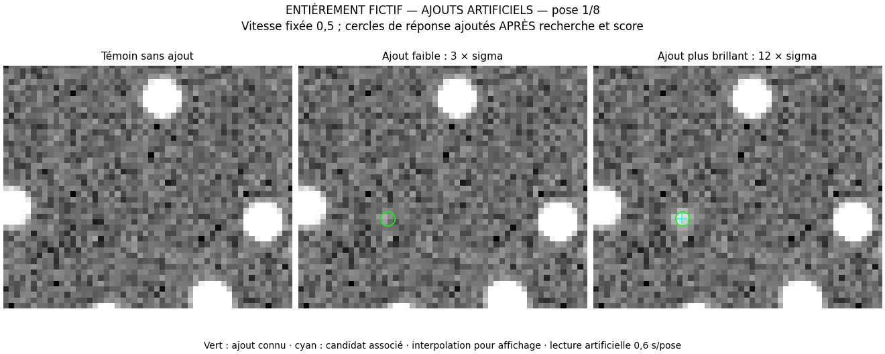
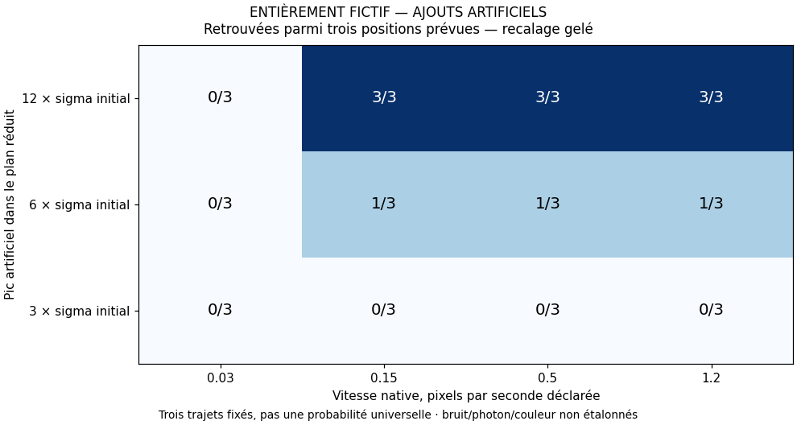

# Retrouver des points ajoutés au fond Seestar

**Sur les dérivés du fond réel, 10 mobiles artificiels sur 36 ont été retrouvés, 26 manqués et aucun cas bloqué.** Le témoin sans ajout reproduit exactement le pilote naturel : zéro candidat. Ce sont des ajouts de test, pas dix objets astronomiques découverts. Les huit FITS et le rapport du premier pilote restent intacts.

Le plan [**`9344495`**](https://github.com/steveprudhomme/gnu-astrophotography-recycle/commit/9344495d49d8051e74663ab41e49de6ce05286eb) a été publié sur `codex/injections-seestar` avant le code. Le recalage est **déjà accepté et gelé** : cet essai teste la détection et l'association conditionnellement à ces modèles. Il ne teste pas à nouveau la capacité à trouver le bon recalage quand un mobile est présent. La version reste 0.10.0a1 et les moteurs historiques sont inchangés.

## Comprendre dès 10 ans

Imagine une photo du ciel. Nous ajoutons exprès un petit point, puis le faisons avancer dans les photos suivantes. C'est une **injection** : un objet inventé dont nous connaissons les positions. Nous demandons au chercheur de points de travailler sans lui montrer les réponses. Ensuite seulement, nous comparons ce qu'il a trouvé avec ce que nous avions ajouté.

Le **témoin** est la même série sans point ajouté. Il permet de voir ce que le programme trouve déjà dans le fond. Un point ajouté peut être **retrouvé**, **manqué**, ou ne pas pouvoir être testé si le traitement est bloqué. Ces trois situations sont différentes.



*Fond et points entièrement fictifs dans cet exercice public. Vert : position ajoutée, révélée au dessin après recherche et score. Cyan : candidat effectivement associé à l'ajout. La cadence de 0,6 seconde par pose est artificielle. Un cercle vert n'est donc pas une détection.*

## Ce qui est réellement varié

Nous gardons les huit images, les heures déclarées, les modèles d'alignement et les seuils du pilote. Nous faisons varier le pic du point et sa vitesse, avec trois départs/directions fixés avant les résultats.

| Élément | Choix du protocole |
|---|---|
| Pic dans le plan réduit | 3, 6 ou 12 fois le bruit sigma mesuré dans la première pose du pilote |
| Vitesse | 0,03 ; 0,15 ; 0,5 ; 1,2 pixel natif par seconde déclarée |
| Départs relatifs dans la référence | `(0,3L;0,3H)`, `(0,5L;0,5H)`, `(0,7L;0,7H)` |
| Directions respectives | 30°, 150°, 270° |
| Largeur du point | Gaussienne circulaire, sigma 2,2 pixels natifs, arrêt à cinq sigma |
| Effectifs | Un point par série ; 3 pics × 4 vitesses × 3 départs = 36 séries, plus un témoin |

Les trois trajets sont réutilisés pour comparer les luminosités. Ils ne représentent pas trois nuits indépendantes. Nous ne déplaçons pas un point parce qu'il est caché par une étoile, du bruit ou un masque. Si son voisinage sort du champ commun, la série est consignée comme indisponible, sans nouveau tirage.

Le pic exprimé en multiples du sigma initial **n'est pas une magnitude ou un rapport signal/bruit étalonné**. Les secondes proviennent des dates déclarées, sans qualification d'horloge. La vitesse 0,03 est volontairement sous la borne 0,1 du moteur : un manque à cette vitesse n'est pas une panne surprise.

## Comment les copies sont préservées

L'entrée est le `pilot.json` complet du [premier pilote](PILOTE-MOBILES-SEESTAR.md). Ses huit copies, les entrées de préparation et les modèles sont contrôlés par empreintes. Les en-têtes, configuration et dimensions sont vérifiés ; le lot demande exactement huit poses de dimensions natives paires au moins 512×512 et de durée déclarée au plus 120 secondes. Le code refuse un modèle non accepté et garde la première pose comme référence relative.

Les ajouts sont faits dans des **dérivés d'intensité moyenne 2×2**, en float32, enregistrés en `.npy` sous `local/`. Aucun FITS n'est écrit. La position ajoutée dans chaque pose est calculée avec l'inverse de son modèle gelé ; la recherche transforme ensuite les positions mesurées vers la référence. Utiliser les mêmes modèles dans ces deux opérations signifie que l'essai ne mesure pas leur erreur astrophysique.

La gaussienne est échantillonnée aux centres du plan réduit ; elle ne simule pas les réponses couleur Bayer, la PSF instrumentale exacte, le bruit de photons supplémentaire ou la traînée pendant une pose. Le masque d'origine reste en place. La génération garde les voisinages dans tous les champs avec marge native 32 pixels. L'analyse reprend le domaine commun et sa marge native 16 pixels, le détecteur, la suppression stationnaire et l'association du pilote, sans régler les seuils sur les résultats.

Le lot réel génère environ 650 Mo de dérivés et produits locaux. Une reproduction dans une nouvelle sortie demande de nouveau cet espace. L'exercice fictif est plus petit, de l'ordre de 100 Mo avec son fond et ses copies. Aucun chemin USB enregistré dans un ancien manifeste n'est consulté.

## Cinq commandes pour refaire l'exercice public

Dans PowerShell, depuis la racine du dépôt, après l'[installation](../INSTALL.md), avec des sorties neuves :

```powershell
.\.venv\Scripts\python.exe examples/make_injection_background.py local/exercice-injections-fond
.\.venv\Scripts\python.exe examples/injection_recovery.py generate local/exercice-injections-fond/pilot/pilot.json local/exercice-injections-suite
.\.venv\Scripts\python.exe examples/injection_recovery.py analyze local/exercice-injections-suite/manifest.json local/exercice-injections-analyse
.\.venv\Scripts\python.exe examples/injection_recovery.py score local/exercice-injections-suite/manifest.json local/exercice-injections-suite/truth.json local/exercice-injections-analyse/analysis.json local/exercice-injections-bilan
.\.venv\Scripts\python.exe examples/plot_injection_recovery.py local/exercice-injections-bilan/score.json local/exercice-injections-figures
```

Les cinq codes attendus sont **0** sur cet exercice. Le générateur invente cent étoiles, le bruit, la mosaïque et un petit mouvement de caméra ; les étoiles sont placées hors des trois couloirs pour vérifier les cas isolés. Il n'ajoute aucun mobile naturel. Il prépare huit copies et un pilote accepté. Ce fond dégagé ne prétend pas reproduire toute la complexité d'une observation.

La deuxième commande écrit le témoin et 36 séries dérivées, leur manifeste et les réponses séparées dans `truth.json`. La troisième ne reçoit **pas** ce fichier de réponses. Elle fige les 37 résultats individuels et leurs empreintes avant la commande de score. La quatrième peut alors apparier les candidats aux ajouts ; la cinquième dessine les cas préchoisis, sans choisir après coup les plus réussis.

Attendu dans l'exercice livré : **12/36 retrouvées, 24 manquées, zéro indisponible**, témoin sans candidat. Les trois ajouts brillants à vitesse 0,5 sont retrouvés ; aucun des ajouts à vitesse 0,03 n'est récupéré. Les manques faibles restent visibles. Ouvrir `recovery-grid.png`, `injection-comparison.gif` et `injection-comparison-first.png` dans le dossier des figures, puis `report.md` dans celui du bilan.



*Chaque case compte les récupérations parmi les trois positions prévues. Ce n'est pas une probabilité de succès sur le vrai ciel. Les éventuels cas bloqués sont indiqués séparément ; ils ne deviennent pas des recherches à zéro candidat.*

## Comment une récupération est reconnue

Après gel des candidats, un seul peut être associé à l'unique injection : au moins cinq points communs, erreur RMS de position au plus un pixel natif et erreur vectorielle de vitesse au plus 0,05 pixel par seconde déclarée. En cas de plusieurs correspondances, nous choisissons la plus petite erreur, puis l'identifiant. Les autres candidats restent non associés ; les candidats ne sont pas modifiés par cette comparaison.

Sur le fond fictif sans mobile naturel, les candidats non associés peuvent être comptés comme faux candidats. **Sur le fond réel, leur origine reste inconnue** : le rapport ne les appelle pas automatiquement faux positifs. Un objet réel non prévu par la vérité d'injection pourrait théoriquement s'y trouver. Dans ce lot, le témoin et les séries injectées n'ont produit aucun candidat non associé.

## Résultats sur les dérivés du fond réel

Toutes les séries sont disponibles, trois positions par case. Le tableau résume uniquement les effectifs, sans publier les positions, dates ou rapports privés.

| Pic / sigma initial | 0,03 pixel/s déclarée | 0,15 | 0,5 | 1,2 |
|---|---|---|---|---|
| 3 | 0/3 | 0/3 | 0/3 | 0/3 |
| 6 | 0/3 | 0/3 | 1/3 | 1/3 |
| 12 | 0/3 | 2/3 | 3/3 | 3/3 |

Soit **10 retrouvées et 26 manquées sur 36**, sans cas bloqué. Le témoin reproduit exactement les détections et trajectoires du pilote naturel, avec zéro candidat. Les ajouts brillants à vitesse nominale sont retrouvés, mais certains signaux moins visibles échappent à la recherche. Aucun seuil n'a été changé après ce résultat.

Les nouveaux dérivés et animations sur fond réel restent locaux, clairement marqués « fond réel + ajouts artificiels ». Les cinq médias réels déjà autorisés [CC0](images/reels/LICENCE.md) restent disponibles dans le tutoriel ; les trois nouvelles figures publiques de cette expérience sont entièrement fictives. Un point ajouté à une vraie image n'est pas un objet découvert.

## Fichiers, erreurs et limites

La génération produit `manifest.json`, `truth.json` et `planes/`. L'analyse produit `analysis.json` et les résultats gelés sous `cases/`. Le score produit `score.json`, `recovery.csv` et `report.md`. Les dessins ont leur journal `figures.json`. Tous ces jeux et rapports restent dans les dossiers ignorés ; seules les figures publiques sélectionnées sont suivies par Git.

Un résultat individuel bloqué garde `candidate_count: null`. L'analyse peut finir avec des cas indisponibles et le code **2** ; le score les compte séparément, sans les déclarer manqués par une recherche qui n'a pas eu lieu. Si tout est bloqué, les comptes de candidats inconnus restent `null`, y compris les faux candidats. Une erreur de lecture, empreinte, chemin ou interruption donne le code **1** et peut conserver `incomplete`. Garder ce dossier, lire le message et choisir une nouvelle sortie après correction, sans effacer automatiquement les essais.

Les fichiers NumPy sont chargés avec `allow_pickle=False`, type float32, forme et masque contrôlés. Les empreintes du manifeste, des modèles, des dérivés et des résultats gelés sont recontrôlées. L'analyse n'ouvre pas la vérité ; un score refuse une analyse incomplète ou modifiée. L'exécution réelle a bloqué réseau, accès aux volumes externes et écritures FITS ; les huit copies et le rapport naturel restent intacts.

Les **356 tests** incluent 18 nouveaux cas entièrement fictifs : récupération connue, vitesse sous la borne, masque/amplitude, transformations, appariement unique, vérité non lue, déterminisme, entrées refusées, chemins/empreintes/pickle, limites et sorties partielles. La suite a réussi en 123,53 secondes. Le contraste des premières vignettes rendait les ajouts peu visibles ; il a été amélioré pour l'affichage seulement, avec des bornes fixes depuis le fond et le bruit de la première pose témoin (fond −3 sigma à fond +15 sigma). Les mesures et résultats ne changent pas ; les figures sont revérifiées et reproduites avant publication.

Le résultat reste descriptif et conditionnel à un modèle de point, trois trajets et huit poses. Il ne permet pas d'interpoler une frontière de détection, annoncer une magnitude limite, qualifier la chronologie ou extrapoler un taux universel. Le prochain protocole devra être fixé avant tout changement de PSF, seuil, trajet ou conditions d'observation.

Sources primaires consultées le 17 novembre 2026 : [NumPy load](https://numpy.org/doc/stable/reference/generated/numpy.load.html), [NumPy save](https://numpy.org/doc/stable/reference/generated/numpy.save.html), moteurs et contrats du projet. La documentation `stable` décrit NumPy 2.5 ; l'exécution conserve NumPy 2.4.1 et les autres dépendances installées.
