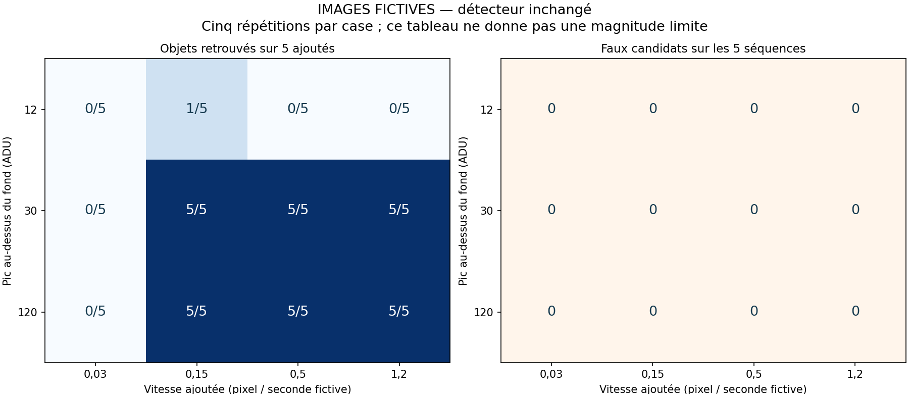
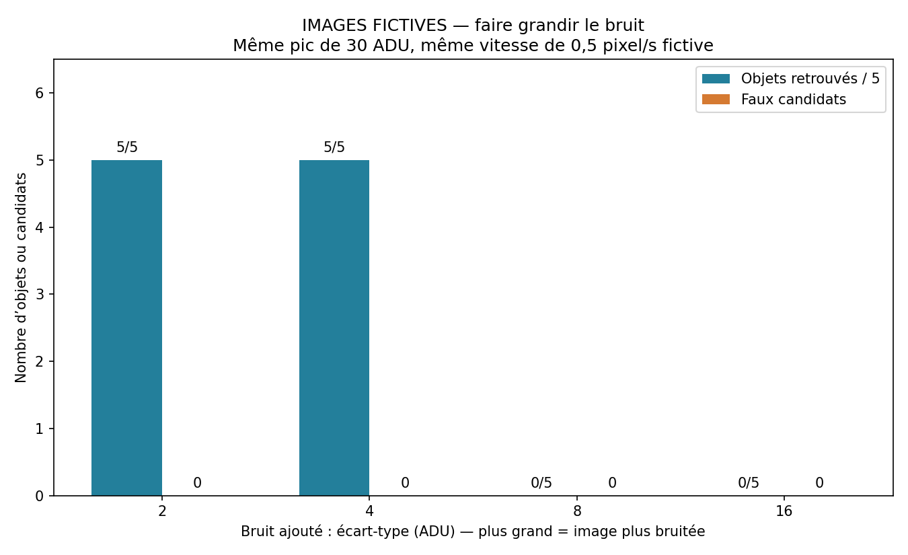
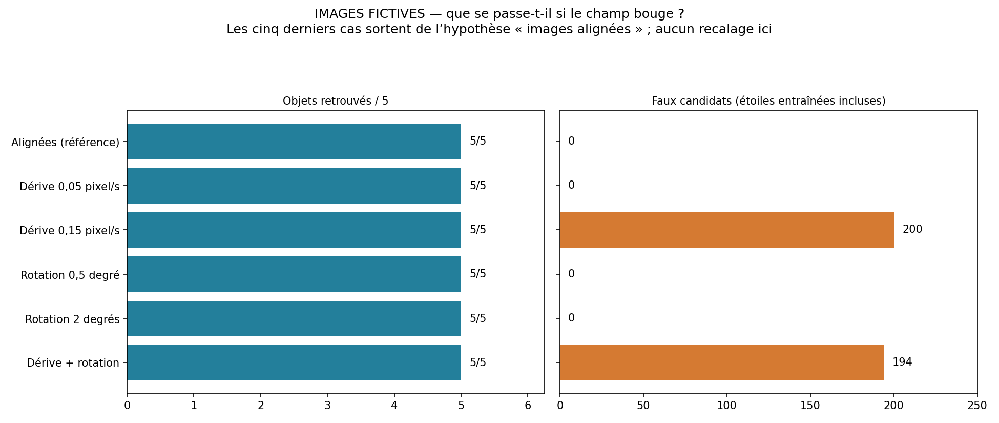
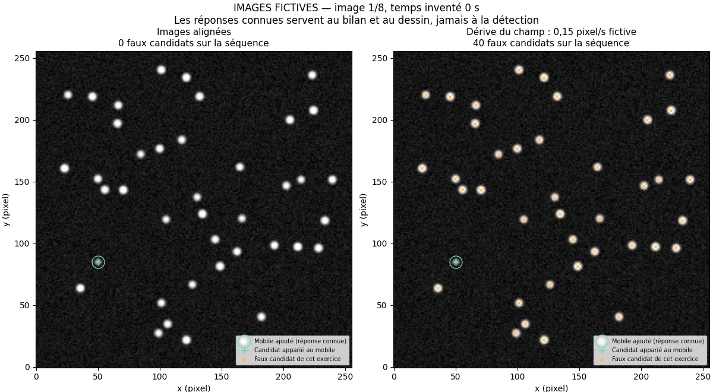

# Mesurer les limites du détecteur, sans le modifier

Le plan **[`6f3e6c5`](https://github.com/steveprudhomme/gnu-astrophotography-recycle/commit/6f3e6c524cb3678fea43e42f32e83b651ebca684)** a été committé, publié et vérifié sur GitHub **avant le code et les essais** du lot 12. Le moteur reste celui de l’Alpha **0.10.0a1** ; seules les recettes du banc d’essai, leurs contrôles et les documents évoluent. Les seuils du [contrat initial](CONTRAT-MOBILES-SYNTHETIQUES.md) ne sont pas ajustés sur ces résultats.

## Question et périmètre

Que manque le détecteur lorsque le point devient faible, trop lent ou noyé dans le bruit ? Prend-il des étoiles pour des mobiles lorsque le champ entier bouge ? Les réponses ci-dessous concernent **120 séquences synthétiques**, pas les performances du Seestar S50. Aucun FITS réel, catalogue, en-tête privé ou support USB n’est consulté. L’autorisation de lecture USB reste limitée à la lecture ; elle n’est pas nécessaire à cette expérience.

Les cinq graines **101, 211, 307, 401 et 503** diffèrent des graines 17, 23 et 41 du premier prototype. Les champs et les réalisations de bruit sont identiques entre conditions pour une même graine, afin de comparer des changements contrôlés. Les cellules du tableau ne sont donc pas statistiquement indépendantes entre elles. Il ne s’agit pas non plus d’une validation par une équipe indépendante : générateur et détecteur restent ceux du projet, sur un modèle simplifié.

## Protocole gelé

Chaque séquence contient huit images monoplans 256×256, aux temps relatifs fictifs 0, 10, …, 70 s. Fond 100 ADU, sources gaussiennes de sigma 1,3 pixel, 40 étoiles de pics compris entre 500 et 1 500 ADU au-dessus du fond. Le trajet initial du mobile est `(50 + v × t, 85)` ; les étoiles sont à plus de 14 pixels du trajet maximal allant de x=50 à x=134. Pas de Bayer, de bruit de photons calibré, de traînée pendant la pose ou de foule réaliste d’étoiles.

| Lot | Conditions, chacune répétée cinq fois | Séquences |
|---|---|---:|
| Grille | Pics 12, 30, 120 ADU × vitesses 0,03 ; 0,15 ; 0,5 ; 1,2 pixel/s ; bruit sigma 2 | 60 |
| Bruit | Sigma 2, 4, 8, 16 ADU ; pic 30 ; vitesse 0,5 | 20 |
| Géométrie | Alignées ; dérives 0,05 et 0,15 pixel/s ; rotations totales 0,5 et 2 degrés ; dérive 0,15 + rotation 2 | 30 |
| Témoins | Aucun mobile : étoiles/bruit seuls, puis avec défauts | 10 |

Soit **960 images et 110 injections mobiles**, réparties en quatre manifestes pour respecter la limite de 64 séquences par appel du moteur. Les répétitions identiques présentes dans plusieurs lots servent de références appariées ; ne pas additionner les lots pour annoncer un rappel global représentatif du ciel.

Les défauts témoins sont deux pixels chauds persistants, un flash ponctuel de position indépendante à chaque image et une trace présente seulement sur deux images. La vitesse 0,03 est volontairement sous la borne de recherche 0,1 pixel/s ; un échec y décrit le domaine du moteur, sans présumer une panne de détection des pixels.

Pour la géométrie, les centres exacts des sources sont tournés autour de `(127,5 ; 127,5)`, puis translatés. La rotation progresse linéairement de zéro à la valeur totale, la translation vaut `(dérive × t, 0)`. Les pixels sont générés directement à ces centres ; ils ne sont pas rééchantillonnés. Les cas non alignés **sortent volontairement de l’hypothèse d’entrée du prototype** et aucun recalage n’est exécuté ici. La vérité donne les positions dans chaque image. Sa vitesse de comparaison est la pente du meilleur ajustement linéaire des positions exactes ; une rotation peut rendre la trajectoire légèrement courbe. Le bilan mélange alors limite du modèle rectiligne et limite de recherche : ne pas attribuer tous les manqués au seuil de luminosité.

## Gel du moteur et intégrité

`examples/moving_limits.py` vérifie les empreintes SHA-256 du texte UTF-8, après normalisation des fins de ligne en LF :

| Source gelée | SHA-256 |
|---|---|
| `src/gar/moving.py` | `f492032e0188310484faaf372db4c96597fd7910ecd3821629edb8365f27be67` |
| `src/gar/moving_reports.py` | `b3b543591ad7cbe35dd0c08a92a8aee67b89888a1488f6b80fdbb354a0b6be0c` |

Un changement de ce moteur arrête le banc d’essai et demande un nouveau plan. Les bibliothèques restent celles de `requirements/dev-tested.txt`, les figures utilisent `requirements/figures-tested.txt`. Les empreintes ne gèlent pas à elles seules un autre environnement de bibliothèques : versions et provenance d’exécution sont aussi consignées.

Les sorties sont nouvelles et sous `local/`, sans lien ni jonction. Les fichiers d’entrée sont lus seulement ; le moteur contrôle les empreintes avant/après chaque lot, et l’orchestrateur les revérifie avant le bilan final. Les candidats sont construits avant que le moteur lise les coordonnées de vérité. Le protocole, les manifestes, la vérité et les rapports natifs sont également hachés. Aucun accès réseau d’analyse ou matériel.

## Reproduire l’expérience

Depuis la racine du projet, après le [parcours d’installation](DEMARRER-DE-ZERO.md#4-construire-ta-boîte-à-outils-et-lapplication), choisir des dossiers neufs :

```powershell
.\.venv\Scripts\python.exe examples/moving_limits.py make local/limites-entree
.\.venv\Scripts\python.exe examples/moving_limits.py run local/limites-entree/suite.json local/limites-rapport
.\.venv\Scripts\python.exe examples/plot_moving_limits.py local/limites-entree/suite.json local/limites-rapport/limits.json local/limites-figures
```

La génération demande environ 260 Mo pour les FITS seuls, auxquels s’ajoutent rapports et figures. `make` crée les données ; `run` mesure ; le dernier programme dessine. Les commandes abouties renvoient 0 pour le travail demandé, **sans verdict scientifique de réussite**. Une entrée impossible ou une sortie existante produit un code non nul ; ne pas effacer les essais pour les remplacer.

### Fichiers produits

- `suite.json` : protocole exact, conditions, graines, quatre couples manifeste/vérité et leurs empreintes.
- Chaque sous-dossier du rapport : `moving.json`, `candidates.csv`, `moving.svg`, `report.md` natifs. Leurs verdicts `frozen_suite_complete` et `exploratory_criteria_passed` sont faux : ces lots ne sont pas la suite initiale de 18 séquences. Cela est attendu ; aucun verdict initial n’est détourné pour déclarer ces nouveaux essais réussis.
- `limits.json` : bilan descriptif complet, résultats par condition **et par graine**, erreurs sur les appariés, candidats manqués/faux, taux par image, mégapixel-image et heure fictive, provenance et versions. Les erreurs ne décrivent pas les objets manqués ; une absence d’apparié donne une erreur indéfinie, enregistrée comme `null`.
- `sequences.csv` : comptages par condition/graine ; `report.md` : tableau lisible et limites.
- `progress.json` : lots terminés et état. Un arrêt laisse l’état `incomplete`, les résultats partiels sont conservés ; aucun bilan complet n’est fabriqué. Une erreur d’écriture peut laisser un dossier incomplet : conserver ce dossier et reprendre dans une nouvelle sortie.
- Figures : `limits-grid.png`, `limits-noise.png`, `limits-geometry.png`, `limits-comparison.png` et `limits-comparison.gif`. Les deux panneaux de l’animation sont fixés à la graine 101, référence alignée et dérive 0,15, sans sélection ultérieure d’un meilleur cas.

`suite_complete: true` signifie que les 120 séquences prévues sont présentes, **pas que le détecteur a tout retrouvé**. Le bilan porte `descriptive_only: true` ; aucun seuil de réussite globale n’est ajouté après observation.

## Résultats conservés, y compris les échecs

Dans la grille, chaque case contient le nombre d’objets retrouvés sur cinq injections :

| Pic au-dessus du fond | 0,03 pixel/s | 0,15 pixel/s | 0,5 pixel/s | 1,2 pixel/s |
|---|---:|---:|---:|---:|
| 12 ADU | 0/5 | 1/5 | 0/5 | 0/5 |
| 30 ADU | 0/5 | 5/5 | 5/5 | 5/5 |
| 120 ADU | 0/5 | 5/5 | 5/5 | 5/5 |

Zéro faux candidat dans ces 60 séquences. Le filtrage stationnaire et la plage de vitesse expliquent une limite structurelle pour les objets très lents. Les points faibles ne sont pas retrouvés régulièrement ; le 1/5 à 12 ADU ne définit pas une frontière fiable ou monotone. Le rapport pic/bruit n’est pas un rapport signal/bruit photométrique, et aucune magnitude limite n’est calculée.



*Résultats calculés, données entièrement fictives ; chaque case reste un petit échantillon de cinq répétitions.*

| Bruit sigma, pic fixé à 30 ADU | Retrouvés | Faux candidats |
|---|---:|---:|
| 2 ADU | 5/5 | 0 |
| 4 ADU | 5/5 | 0 |
| 8 ADU | 0/5 | 0 |
| 16 ADU | 0/5 | 0 |



| Géométrie | Retrouvés | Faux candidats sur cinq séquences |
|---|---:|---:|
| Alignées | 5/5 | 0 |
| Dérive 0,05 pixel/s | 5/5 | 0 |
| Dérive 0,15 pixel/s | 5/5 | 200 |
| Rotation totale 0,5 degré | 5/5 | 0 |
| Rotation totale 2 degrés | 5/5 | 0 |
| Dérive 0,15 + rotation 2 degrés | 5/5 | 194 |

Un candidat non apparié à l’injection mobile compte comme faux candidat dans cet exercice. Les étoiles entraînées par le déplacement commun en font partie : elles existent dans les images fictives, mais ne sont pas les objets mobiles recherchés. La dérive 0,15 donne 40 faux candidats par séquence, soit les 40 étoiles du champ. La vitesse des étoiles entraînées est dans la plage de recherche ; la rotation seule de ces essais ne donne pas la même vitesse apparente. **Le zéro observé en rotation ne prouve pas une tolérance générale aux rotations.**





*Les réponses de vérité servent seulement au bilan et à l’annotation verte, après la recherche. Les croix orange montrent les faux candidats mesurés, pas des annotations inventées. Le GIF comprend huit images à deux images par seconde.*

Les dix témoins sans mobile, propres ou avec défauts, produisent zéro faux candidat. Leur rappel est indéfini (0/0), et dix témoins ne démontrent pas un taux universel de faux positifs nul. Les taux de temps sont rapportés à la couverture fictive de 70 secondes par séquence, pas à un temps d’exposition instrumentale.

## Vérifications et décision suivante

Les 19 nouveaux cas couvrent géométrie connue, pixels appariés et génération déterministe, étoiles entraînées, gel du moteur, protocole altéré, campagnes manquantes/dupliquées/incohérentes et arrêt conservant les produits partiels. **260 tests logiciels passent** au total. Ces contrôles sont distincts des comptages expérimentaux et d’une validation astrométrique ou photométrique réelle.

Les premiers cadrages de figures coupaient des légendes d’axes : les figures concernées ont été refaites avec mise en page contrainte, sans changer les données ou le moteur. Le bilan initial est conservé localement ; la reproductibilité et les commandes pédagogiques sont contrôlées avant publication.

La priorité suggérée par ce jeu est de tester une chaîne **recalage puis recherche de mobiles**, d’abord sur des images fictives avec géométrie connue et étoiles de contrôle réservées. Ce serait un nouveau lot, à planifier avant de coder, sans réutiliser ces résultats pour annoncer une performance sur le ciel réel. Les objets faibles et très lents demanderaient ensuite des recherches distinctes avec leurs propres témoins. L’horloge réelle reste non qualifiée et aucune soumission scientifique n’est produite.

Références primaires consultées le 17 novembre 2026 : [Photutils DAOStarFinder](https://docs.astropy.org/projects/photutils/en/stable/api/photutils.detection.DAOStarFinder.html) pour la détection, [NumPy Generator](https://numpy.org/doc/stable/reference/random/generator.html) pour les tirages. La page NumPy `stable` décrit une version plus récente ; les essais restent avec NumPy 2.4.1. Le dessin des conditions, les seuils et les conclusions limitées sont propres au projet.
