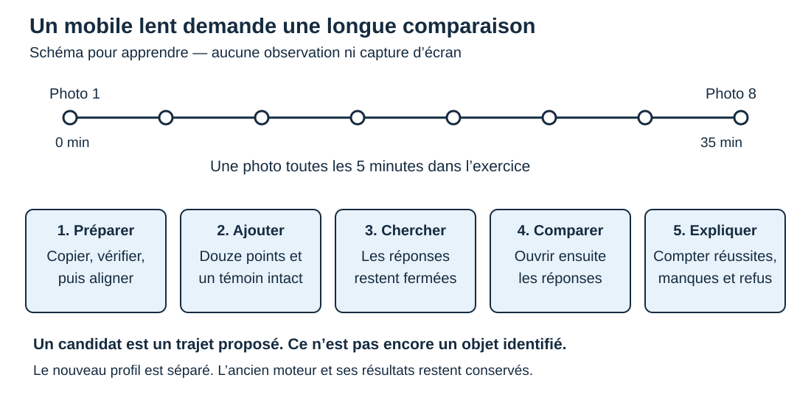
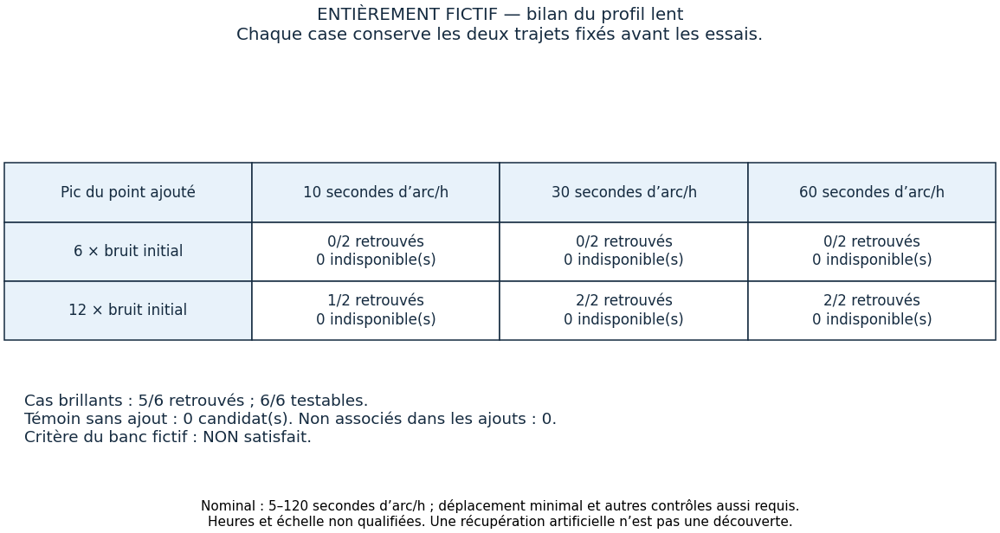
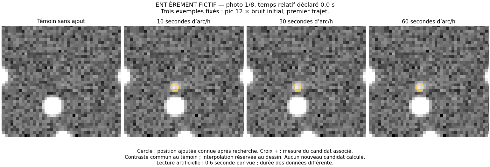
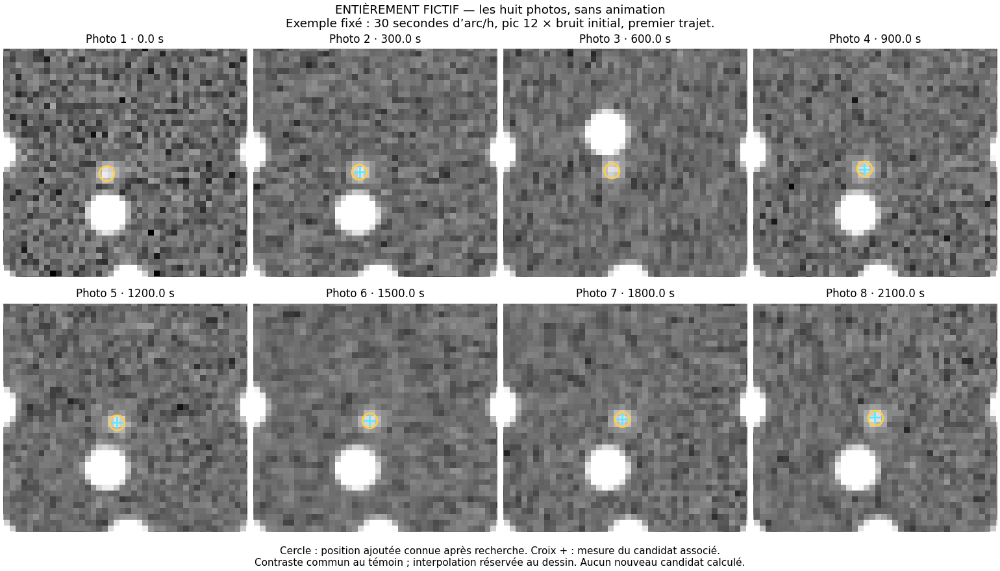

# Essayer le profil pour les mobiles lents

Ce parcours ajoute une nouvelle recherche expérimentale. Il garde l'ancien moteur et ses résultats.
Le plan [0f06368](https://github.com/steveprudhomme/gnu-astrophotography-recycle/commit/0f063684ec85495f4497348d18cbac566d41a2ea) précède le code.
Trois agents préparent le profil, ses contrôles et ses explications. Leur revue reste interne au projet.

## Comprendre le but dès 10 ans

Imagine une tortue sur huit photos. Si les photos sont presque simultanées, sa position change très peu.
En espaçant les photos, tu peux mieux comparer son départ et son arrivée.
Pour les points du ciel, nous essayons ici huit photos réparties sur environ 35 minutes.



**Description du schéma.** L'exercice comporte une photo toutes les cinq minutes.
Le programme aligne les étoiles et conserve cet alignement.
Il fabrique ensuite des ajouts dont nous connaissons le trajet.
La recherche garde les réponses fermées. Le calcul du bilan les ouvre après la fin des recherches.

Ce schéma explique une méthode. Il ne représente aucune observation ou capture d'écran.

## Apprendre les mots utiles

| Mot | Son sens dans cet exercice |
|---|---|
| Pixel natif | Une case de l'image d'origine |
| Plan réduit | Une image de travail : chaque bloc de 2 × 2 cases devient une case moyenne |
| Recalage | Calcul qui place les étoiles des différentes photos dans le même repère |
| Candidat | Un trajet que le programme propose, avant de connaître son identité |
| Témoin | Une série sans point ajouté, analysée avec les mêmes règles |
| Injection | Ajout artificiel d'un point dans une copie de travail |
| Réponses | Positions et vitesses connues des points ajoutés |
| Empreinte | Code calculé à partir d'un fichier pour vérifier son contenu |

Une **seconde d'arc** mesure un angle très petit dans le ciel. Le symbole `″` la représente.
La vitesse `30″/h` signifie trente secondes d'arc en une heure.
Ici, l'échelle nominale relie l'angle à l'image : environ **2,393″ par pixel natif**.
Elle provient de la taille de pixel et de la focale déclarées. Ce calcul ne calibre pas les observations.

En 35 minutes, les déplacements prévus sont environ 2,44 pixels à 10″/h, 7,31 à 30″/h et 14,63 à 60″/h.
Ces nombres expliquent le choix d'une longue comparaison. Ils ne garantissent pas la détection d'un point faible ou caché près d'une étoile.

## Ce qui change dans le nouveau profil

Le détecteur qui mesure les points brillants reste identique. Le recalage stellaire garde aussi ses règles.
La nouvelle association cherche des trajets lents entre ces mesures. Elle ne retire pas d'abord les points proches d'une position fixe.
Elle compare plutôt deux explications : « reste au même endroit » et « avance régulièrement ».

Le modèle en mouvement doit expliquer suffisamment mieux les positions. Des écarts aléatoires ne deviennent pas automatiquement un déplacement.
Un résultat peut rester ambigu. Une erreur de recalage peut aussi ressembler à un déplacement.

| Règle du nouveau profil | Valeur fixée avant les essais |
|---|---|
| Nombre de photos | Huit, distinctes et dans l'ordre du temps |
| Durée entre première et dernière | De 1800 à 2700 secondes déclarées |
| Intervalle entre deux photos | De 240 à 360 secondes déclarées |
| Vitesse proposée | De 5 à 120″/h, selon l'échelle nominale |
| Mesures nécessaires | Au moins six photos et 1800 secondes de support |
| Déplacement ajusté | Au moins 1,5 pixel natif |
| Rayon de recherche autour du trajet | 1,5 pixel natif |
| Limites des écarts au trajet | RMS ≤ 0,75 pixel et P95 ≤ 1,5 pixel |
| Nombre maximal d'hypothèses | 100 000 ; un dépassement produit un refus |

Le **RMS** résume la taille des écarts au trajet. Le **P95** est la valeur que 95 % des écarts ne dépassent pas.
Le support est l'ensemble des photos où le candidat possède une mesure.
La plage de vitesse ne suffit pas : les règles de déplacement et d'écart doivent aussi être satisfaites.
Ainsi, l'annonce 5–120″/h n'est pas une garantie sur toute cette plage.
À 5″/h sur 35 minutes, le déplacement nominal vaut environ 1,22 pixel natif.
Ce cas ne franchit pas la limite de 1,5 pixel et reste refusé par cette règle.

### Pour approfondir le calcul

Le programme forme des hypothèses avec deux photos séparées d'au moins la moitié de la durée totale.
Il associe la mesure la plus proche dans chaque photo, puis réajuste deux fois les associations.
Un ajustement final sert ensuite à mesurer les écarts au trajet.
Il conserve les hypothèses acceptées selon un ordre déterministe. Les points partagés servent au dédoublonnage.

Pour `n` mesures, `SSE_fixe` additionne les écarts carrés au modèle fixe.
`SSE_linéaire` additionne les écarts carrés au trajet ajusté.
La nouvelle règle exige :

```text
(SSE_fixe - SSE_linéaire) / max(0,25² ; SSE_linéaire / (2*n - 4)) >= 25
```

Le plancher 0,25 pixel est un choix expérimental fixé avant les essais.
Cette formule n'est pas une mesure calibrée de l'incertitude du télescope.
Elle n'élimine pas tous les effets de confusion ou de recalage.

## Préparer l'atelier fictif

Commencer par les étapes d'installation de [Construire l'application, pas à pas](DEMARRER-DE-ZERO.md).
Ouvrir PowerShell dans le dossier du projet. Utiliser le Python de `.venv`, avec les dépendances des figures déjà installées.
Toutes les sorties ci-dessous restent dans `local/`. Aucun branchement USB n'est nécessaire.

Choisir des noms de sorties encore inutilisés. Garder les anciens essais pour pouvoir les comparer.
Copier une ligne de commande, puis appuyer sur Entrée.

### 1. Fabriquer les deux fonds

```powershell
.\.venv\Scripts\python.exe examples/make_slow_motion_demo.py local/exercice-lents-fonds
```

Le programme crée deux ensembles de huit images FITS entièrement fictives.
Les graines 2026112301 et 2026112302 fixent leurs nombres inventés.
Les étoiles, le bruit, la petite rotation et la dérive ne proviennent pas des observations privées.
Le programme prépare aussi les copies et les modèles de recalage dans chaque dossier `baseline/`.

**Vérifier :** ouvrir `local/exercice-lents-fonds/contexts.json`.
Le bilan doit conserver l'état de chaque contexte. Un recalage refusé reste visible ; ne pas le remplacer par une autre graine.

### 2. Ajouter les points et garder les réponses

```powershell
.\.venv\Scripts\python.exe examples/slow_motion_profile.py generate local/exercice-lents-fonds/context-s2026112301/baseline/baseline.json local/exercice-lents-injections-1
```

Cette commande prépare treize séries : un témoin et douze ajouts séparés.
Les douze cas combinent trois vitesses, deux amplitudes et deux trajets fixés.
Les vitesses sont 10, 30 et 60″/h. Les amplitudes valent six ou douze fois le bruit initial du plan réduit.

Une amplitude plus grande produit un point plus brillant dans ce modèle. Ce nombre n'est pas une magnitude astronomique calibrée.
Le modèle partage le point entre sept positions pendant l'exposition déclarée.
Il représente une traînée approximative et conserve le flux du modèle avant les masques.
Il ne simule pas exactement la couleur, le bruit de photons ou la forme des étoiles du Seestar.

**Vérifier :** le dossier contient `manifest.json` et `truth.json`.
Le premier décrit les séries. Le second contient les réponses ; la recherche suivante ne le lit pas.

### 3. Chercher sans lire les réponses

```powershell
.\.venv\Scripts\python.exe examples/slow_motion_profile.py analyze local/exercice-lents-injections-1/manifest.json local/exercice-lents-analyse-1
```

La recherche mesure les points, applique les modèles gelés et propose des candidats.
Toutes les listes sont terminées et leurs empreintes conservées avant l'ouverture des réponses.
Le fichier `analysis.json` décrit les séries analysées ou indisponibles.

**Vérifier :** consulter ce fichier. Garder les refus et leurs motifs.
Un candidat reste une proposition de trajet, même lorsque la recherche se termine sans erreur.

### 4. Comparer les candidats aux réponses

```powershell
.\.venv\Scripts\python.exe examples/slow_motion_profile.py score local/exercice-lents-injections-1/manifest.json local/exercice-lents-injections-1/truth.json local/exercice-lents-analyse-1/analysis.json local/exercice-lents-score-1
```

Le bilan ouvre les réponses après le gel des candidats.
Pour retrouver un ajout, le candidat doit posséder au moins six mesures.
L'écart RMS aux positions connues doit rester au plus égal à un pixel natif.
L'erreur vectorielle de vitesse doit rester au plus égale à 0,0005 pixel natif par seconde déclarée.

**Vérifier :** lire `score.json` et son bilan.
Compter séparément les ajouts retrouvés, manqués et indisponibles. Lire aussi le nombre de candidats dans le témoin.
Un candidat sans correspondance connue compte séparément. Sur fond réel, son absence de correspondance ne prouve pas qu'il soit faux.

### 5. Dessiner les résultats conservés

```powershell
.\.venv\Scripts\python.exe examples/plot_slow_motions.py local/exercice-lents-score-1/score.json local/exercice-lents-figures-1
```

Le dessinateur vérifie les liens et les empreintes. Il ne recherche aucun nouveau candidat.
Il produit un bilan fixe, une première vue, une animation et le journal `figures.json`.
Une comparaison statique complète les huit vues de l'animation.

**Vérifier :** comparer les comptes de la figure à ceux de `score.json`.
La vitesse de lecture de l'animation est artificielle. Une vue dure 0,6 seconde ; les photos fictives restent espacées de cinq minutes.

### 6. Refaire les étapes avec le second fond

Les deux fonds existent déjà. Exécuter ces quatre lignes dans l'ordre :

```powershell
.\.venv\Scripts\python.exe examples/slow_motion_profile.py generate local/exercice-lents-fonds/context-s2026112302/baseline/baseline.json local/exercice-lents-injections-2
.\.venv\Scripts\python.exe examples/slow_motion_profile.py analyze local/exercice-lents-injections-2/manifest.json local/exercice-lents-analyse-2
.\.venv\Scripts\python.exe examples/slow_motion_profile.py score local/exercice-lents-injections-2/manifest.json local/exercice-lents-injections-2/truth.json local/exercice-lents-analyse-2/analysis.json local/exercice-lents-score-2
.\.venv\Scripts\python.exe examples/plot_slow_motions.py local/exercice-lents-score-2/score.json local/exercice-lents-figures-2
```

**Petite vérification personnelle :** expliquer pourquoi nous gardons une série sans ajout.
Réponse : elle montre ce que la recherche propose déjà dans le fond, sans recevoir notre point mobile.
Zéro candidat dans ce témoin ne garantit pas que le programme retrouve tous les mobiles.

## Comprendre les états et corriger une erreur

| Situation | Ce qu'elle signifie | Action utile |
|---|---|---|
| Sortie déjà présente | Un essai utilise déjà ce nom | Choisir un nouveau nom ; conserver le premier essai |
| Série trop courte | Le profil lent ne possède pas la durée nécessaire | Garder le refus ; préparer une série conforme au nouveau contrat |
| Recalage refusé | Les contrôles ne permettent pas d'utiliser ce contexte | Lire le motif ; ne pas diminuer les limites pour obtenir un résultat |
| Empreinte différente | Un fichier lié au résultat change | Arrêter ; retrouver les entrées intactes ou recommencer dans une nouvelle sortie |
| Ajout indisponible | L'essai ne permet pas de mesurer sa récupération | Le compter à part ; ne pas écrire « manqué » ou « aucun objet » |
| Ajout manqué | L'ajout testable ne reçoit pas de candidat associé | Garder l'échec dans le bilan |
| Candidat non associé | Le candidat ne correspond à aucun ajout selon les règles | L'examiner séparément ; ne pas lui attribuer une identité |

Un code de sortie `1` signale une erreur d'entrée ou d'intégrité.
Le code `2` conserve un refus ou un critère fictif non satisfait aux étapes concernées.
Le code `0` indique l'achèvement de la procédure et de ses contrôles applicables. Il ne certifie pas une aptitude scientifique.

## Lire les résultats sans conclure trop vite

Les critères prévus visent six ajouts brillants retrouvés par fond réservé et un témoin sans candidat.
Les essais faibles et réels restent descriptifs. Un échec de ce critère reste dans le bilan, sans modification des paramètres après résultat.
Deux fonds fictifs ne donnent pas une probabilité universelle de détection.

### Résultats des deux fonds fictifs réservés

Les neuf commandes aboutissent aux codes `0, 0, 0, 2, 0, 0, 0, 2, 0`.
Les deux codes `2` viennent du bilan : le critère des six ajouts brillants n'est pas satisfait.
Les douze ajouts restent testables dans chaque fond. Aucun paramètre ne change après ces résultats.

| Fond réservé | Ajouts retrouvés | Brillants retrouvés | Faibles retrouvés | Manqués | Indisponibles | Témoin | Candidats non associés |
|---|---:|---:|---:|---:|---:|---:|---:|
| Graine 2026112301 | 5/12 | 5/6 | 0/6 | 7 | 0 | 0 | 0 |
| Graine 2026112302 | 5/12 | 4/6 | 1/6 | 7 | 0 | 0 | 0 |



**Lire le tableau sans image.** Pour le premier fond, les deux ajouts faibles restent manqués à chacune des trois vitesses.
Parmi les brillants, le profil retrouve un ajout sur deux à 10″/h, deux à 30″/h et deux à 60″/h.
Dans le second fond, les comptes brillants sont 1/2, 1/2 et 2/2.
Les comptes faibles sont 0/2, 0/2 et 1/2.

Le nouveau profil retrouve donc certains déplacements lents. Il ne satisfait pas le critère fixé sur les fonds réservés.
Le résultat représente une capacité partielle, sans validation positive globale.
Les témoins sans candidat ne compensent pas les ajouts manqués.

### Observer les exemples préchoisis



Les quatre panneaux montrent le témoin et les trois vitesses, pour le premier trajet brillant.
Un cercle indique la position ajoutée connue après la recherche.
Une croix `+` marque une mesure du candidat associé par le bilan.
L'absence de croix dans une photo ne prouve pas à elle seule pourquoi une mesure manque.



**Description des huit vues.** Les photos vont de 0 à 2100 secondes fictives, dans l'ordre des lignes.
Les cercles suivent le petit déplacement ajouté. Le candidat associé possède des mesures sur certaines photos, marquées par des croix.
Les étoiles devraient garder leur place après un bon recalage.
La troisième vue montre cependant un voisinage différent : ce point est conservé et expliqué ci-dessous.

[Ouvrir l'animation fictive des huit photos](images/exemple-lents-animation.gif).
Ce lien est facultatif. Les images fixes et les comptes précédents donnent les informations nécessaires sans animation.
La lecture utilise 600 millisecondes par vue, sans représenter la vraie durée des poses.

Le dessinateur conserve les empreintes des quatre médias dans `figures.json`.
La publication copie exactement les médias du premier fond réservé. Aucun exemple ne remplace le trajet fixé après le résultat.

### Une ambiguïté visible du recalage

Le premier fond fictif contient une grille régulière d'étoiles. Sa symétrie permet une autre correspondance des positions.
Pour la troisième photo, le recalage gelé accepte une rotation d'environ **179,859°**.
Le générateur ne tourne pourtant cette photo que d'environ **+0,143°**.
La transformation inverse attendue est donc proche de **−0,143°**, pas d'un demi-tour.

Ce constat compare le modèle conservé à la fabrication connue, après l'analyse.
Il montre qu'un recalage accepté par les contrôles internes peut avoir une orientation erronée sur cette grille.
Le second fond ne présente pas ce demi-tour dans ses sept modèles.
Nous ne corrigeons ni les modèles ni le banc après résultat.

La récupération reste conditionnelle aux modèles gelés utilisés pour les ajouts et la recherche.
Ce défaut limite l'interprétation du banc. Il ne prouve pas, seul, la cause de chaque ajout manqué.
Un prochain protocole devra mieux contrôler cette ambiguïté, sans réécrire les présents résultats.

Le coordinateur prépare aussi deux séries réelles à partir du manifeste local existant.
La sélection choisit huit temps proches de `début + 300*k` secondes, avant de voir les recherches.
Seuls les fichiers choisis peuvent être copiés en lecture seule. Les empreintes avant, copie et après doivent correspondre.
Aucun rapport, dossier ou cache n'est écrit sur le support. Toutes les analyses suivantes utilisent les copies locales.

Un contexte réel peut être refusé par la durée ou le recalage. Ce refus reste un résultat.
Les nouveaux détails réels et les figures mixtes restent privés. Les illustrations publiques de ce parcours sont entièrement fictives.
Les deux séances du même champ ne représentent pas deux nuits indépendantes.

### Résultats sur les deux fonds réels

| Contexte local | Ajouts retrouvés | Brillants retrouvés | Faibles retrouvés | Manqués | Indisponibles | Témoin naturel | Non associés |
|---|---:|---:|---:|---:|---:|---:|---:|
| A | 6/12 | 6/6 | 0/6 | 6 | 0 | 0 | 0 |
| B | 9/12 | 6/6 | 3/6 | 3 | 0 | 0 | 0 |

Dans B, le profil retrouve un ajout faible sur deux à chacune des trois vitesses.
Les témoins sont identiques à la recherche de départ de chaque contexte.
Les deux recalages sont acceptés. Ces résultats sur ajouts artificiels n'identifient aucun objet naturel.
Ils ne remplacent pas le critère fictif manqué, une calibration ou un contrôle positif naturel.

Les seize copies sélectionnées conservent leurs empreintes et leurs dates de modification source.
Les analyses protégées ne touchent pas au support. Les 838 anciens fichiers surveillés restent intacts.
Aucune écriture FITS, modification d'ancien dérivé NPY ou connexion d'analyse externe n'est relevée par les gardes.
Les figures mixtes réelles restent locales ; aucun nouveau média réel n'est publié.

Aucun contrôle positif naturel connu n'est présumé disponible. Aucun objet ajouté n'est une découverte.
La datation, l'échelle et l'identité des candidats ne sont pas qualifiées par cet exercice.
Le nouveau profil reste expérimental ; une recherche générale dans les archives demande encore une décision fondée sur les résultats.

Les règles de rédaction et leurs sources figurent dans [Écrire une documentation facile à suivre](REDACTION-ACCESSIBLE.md).
Le parcours vise les débutants dès 10 ans. Aucun essai de compréhension avec un enfant ou audit WCAG complet n'est annoncé.

## Vérifications du nouveau parcours

Les 77 tests ciblés passent en 23,37 secondes.
Le dessin de développement réussit avec les appels de détection et d'association bloqués.
Les trois PNG publics sont inspectés : titres, comptes, marqueurs et légendes restent visibles.
Le GIF possède huit vues de 600 millisecondes chacune.
Les textes foncés des nouveaux tableaux présentent un contraste calculé supérieur à 12:1 sur leurs deux fonds.
Ce contrôle local des couleurs ne constitue pas un audit WCAG de la page entière.

Les liens des nouveaux guides et le XML du schéma sont vérifiés.
Le premier dessin de développement conserve son bilan négatif ; il ne remplace pas les deux fonds réservés.
Les essais réservés restent séparés du développement. Aucun réglage postérieur ne vise à transformer leur échec en réussite.

La suite complète passe : **594 tests en 230,44 secondes**.
La reproduction depuis le commit propre `6f9950f` conserve les neuf codes, les résultats et les quatre médias de chaque fond.
Elle compare aussi seize FITS fictifs, 104 dérivés et treize rapports candidats par contexte.
Les deux fonds réels reproduisent 6/12 et 9/12, sans accès au support ou répétition des copies source.
Les 571 fichiers du premier essai et les 838 anciens fichiers surveillés restent intacts.
Ces preuves de logiciel reproductible ne certifient pas la détection scientifique de tous les mobiles lents.
