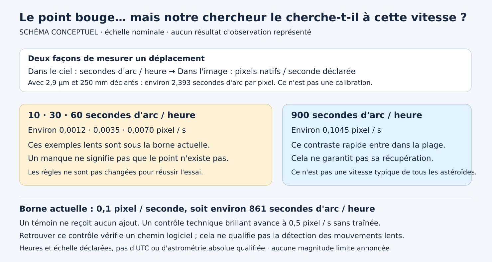
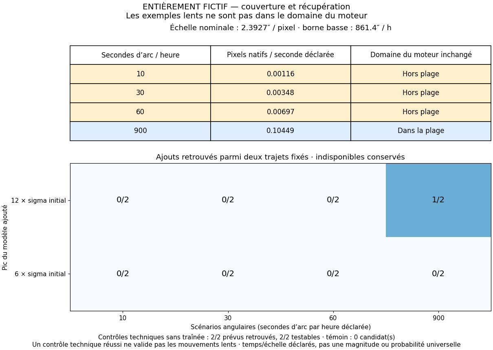
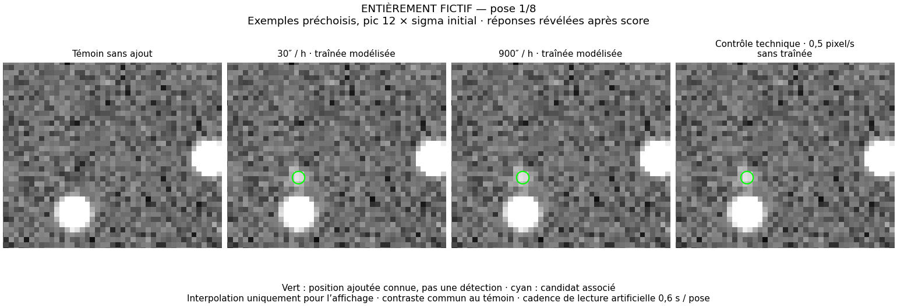

# Éprouver le détecteur avec des mouvements représentatifs

Le programme sait retrouver certains points ajoutés artificiellement. Il faut maintenant vérifier si les déplacements qu'il accepte correspondent à ceux que nous voulons étudier. Le plan [**`082e162`**](https://github.com/steveprudhomme/gnu-astrophotography-recycle/commit/082e1623b6881eebb4c6903dd24f9964643c80ff) a été committé, publié et contrôlé avant le code. Trois agents travaillent sur l'expérience, ses vérifications et la pédagogie ; leur revue reste interne.

## Comprendre dès 10 ans

Imagine un point qui avance d'un minuscule bout de case entre deux photos. Un programme qui cherche seulement des points avançant beaucoup plus vite peut le manquer, même s'il est brillant. Pour le vérifier, nous ajoutons des points dont nous connaissons le déplacement, sans montrer leurs réponses au chercheur.



Une **seconde d'arc** est une toute petite mesure d'angle dans le ciel. Un **pixel** est une case de l'image. Pour passer de l'un à l'autre, il faut connaître l'échelle. Ici nous calculons une échelle **nominale**, depuis les valeurs déclarées : taille du pixel de 2,9 micromètres et focale de 250 millimètres donnent environ **2,393 secondes d'arc par pixel natif**. Ce calcul ne remplace pas une calibration sur les étoiles.

Le moteur gelé cherche de **0,1 à 1,5 pixel natif par seconde déclarée**. Avec cette échelle, sa borne basse vaut environ **861 secondes d'arc par heure**. Les scénarios 10, 30 et 60 sont donc en dehors de sa plage ; 900 est un contraste rapide, pas la vitesse typique de tous les astéroïdes. Les [notes de SkyBoT](https://ssp.imcce.fr/webservices/skybot/) décrivent des déplacements allant de quelques à plusieurs dizaines de secondes d'arc par heure pour la ceinture principale, ainsi que l'importance de l'exactitude de l'époque. Nos quatre vitesses sont des choix d'essai, pas les éphémérides d'un objet observé.

## Ce que nous fabriquons et ce que nous conservons

Chaque contexte comporte huit poses, les modèles de recalage déjà acceptés et gelés, puis **19 séries** :

- un **témoin** sans aucun point ajouté ;
- seize ajouts : quatre vitesses angulaires, deux pics et deux trajets fixés avant le résultat ;
- deux **contrôles techniques brillants** à 0,5 pixel natif par seconde, sans traînée.

Les pics valent six ou douze fois le bruit initial du plan réduit. Ce nombre n'est ni une magnitude ni un rapport signal/bruit photométrique étalonné. Les départs et directions restent fixés ; nous ne déplaçons pas un ajout après avoir vu qu'une étoile le gêne. Les masques d'origine restent en place.

Pour les seize cas angulaires, nous partageons le modèle de point entre sept petites positions pendant l'exposition déclarée. Cela représente approximativement la **traînée** d'un objet en mouvement, à flux du modèle conservé. La couleur Bayer, le bruit de photons supplémentaire, la véritable forme instrumentale et l'exactitude des heures ne sont pas simulés. Les contrôles sans traînée sont explicitement techniques : ils ne remplacent pas ces cas astronomiques approximatifs.

Le chemin reste **générer → analyser sans réponses → scorer → dessiner**. Toutes les listes de candidats sont gelées avant que le score ouvre les réponses. Les originaux FITS, anciens scores et seuils restent inchangés. Un résultat hors domaine, manqué, indisponible ou avec candidats non associés conserve son état ; aucun zéro n'est inventé pour masquer un refus.

## Deux contextes fictifs et plusieurs contextes réels

Le nouvel exercice utilise deux contextes entièrement fictifs, avec graines **2026111901 et 2026111902**, huit poses Bayer, dérive et rotation. Le bruit, les étoiles et les positions sont fabriqués indépendamment des observations. Deux contrôles techniques retrouvés et un témoin sans candidat vérifient le chemin logiciel de chaque contexte fictif ; les cas lents sont attendus manqués puisqu'ils sont hors de la plage. Les autres résultats restent descriptifs, avec leurs échecs.

Le coordinateur examine aussi les copies réelles du pilote et deux autres blocs préchoisis depuis le manifeste existant. Le support peut être lu pour les copies explicitement sélectionnées, avec empreintes avant/copie/après ; aucune écriture ou création de dossier n'y est autorisée. Les analyses suivantes n'utilisent que les copies locales. Un audit ou recalage refusé bloque ce contexte, sans assouplir ses critères. Des blocs différents d'un même champ ne deviennent pas des nuits indépendantes.

Le [complément de plan `e823f6c`](https://github.com/steveprudhomme/gnu-astrophotography-recycle/commit/e823f6c) conserve le troisième contexte prévu comme refus : son recalage naturel est accepté et sa recherche naturelle garde zéro candidat, mais les huit temps relatifs couvrent **139,4 secondes déclarées**, au-delà du contrat d'entrée d'injection existant de 120 secondes. Les deux autres couvrent 88,3 et 87,6 secondes et sont admissibles. Le troisième n'est ni raccourci, remplacé ou présenté comme 18 injections manquées : ses 18 injections sont **indisponibles**. Le lot comprend donc deux contextes réels analysables et un contexte prévu refusé. Les seize nouvelles copies restent conservées et intactes ; aucune analyse après copie ne relit le support.

Aucun catalogue d'objets connus applicable n'est disponible localement pour cette expérience : le **contrôle positif naturel reste non réalisé**. Aucun point ajouté n'est présenté comme un astéroïde identifié. Aucune date, position ou image privée n'est envoyée à SkyBoT ou Horizons pour ce lot.

## Refaire le nouvel exercice fictif

Depuis la racine du projet, avec les dépendances installées et des sorties neuves :

```powershell
.\.venv\Scripts\python.exe examples/make_realistic_motion_demo.py local/exercice-realistes-fonds
.\.venv\Scripts\python.exe examples/realistic_motions.py generate local/exercice-realistes-fonds/context-s2026111901/pilot/pilot.json local/exercice-realistes-injections-1
.\.venv\Scripts\python.exe examples/realistic_motions.py analyze local/exercice-realistes-injections-1/manifest.json local/exercice-realistes-analyse-1
.\.venv\Scripts\python.exe examples/realistic_motions.py score local/exercice-realistes-injections-1/manifest.json local/exercice-realistes-injections-1/truth.json local/exercice-realistes-analyse-1/analysis.json local/exercice-realistes-score-1
.\.venv\Scripts\python.exe examples/plot_realistic_motions.py local/exercice-realistes-score-1/score.json local/exercice-realistes-figures-1
```

La première commande fabrique les deux fonds fictifs et leurs pilotes. La deuxième crée de nouveaux dérivés et garde les réponses à part. La troisième recherche sans lire ces réponses. La quatrième ouvre les réponses après gel des candidats et écrit les comptes. La dernière dessine seulement les résultats déjà terminés, sans rappeler la détection ou l'association.

Le second contexte utilise les mêmes étapes après la fabrication commune :

```powershell
.\.venv\Scripts\python.exe examples/realistic_motions.py generate local/exercice-realistes-fonds/context-s2026111902/pilot/pilot.json local/exercice-realistes-injections-2
.\.venv\Scripts\python.exe examples/realistic_motions.py analyze local/exercice-realistes-injections-2/manifest.json local/exercice-realistes-analyse-2
.\.venv\Scripts\python.exe examples/realistic_motions.py score local/exercice-realistes-injections-2/manifest.json local/exercice-realistes-injections-2/truth.json local/exercice-realistes-analyse-2/analysis.json local/exercice-realistes-score-2
.\.venv\Scripts\python.exe examples/plot_realistic_motions.py local/exercice-realistes-score-2/score.json local/exercice-realistes-figures-2
```

Choisir une nouvelle sortie si un essai existe déjà. Une erreur d'entrée ou d'intégrité donne le code 1 et peut conserver un état incomplet. Un code 2 garde les indisponibilités ou un contrôle fictif non satisfait. Un code 0 signifie que l'étape et ses contrôles logiciels ont abouti ; il ne rend pas le moteur apte aux mouvements lents exclus de sa plage. Les résultats et refus réels doivent rester visibles.



*En haut, la conversion utilise l'échelle déclarée du contexte. En bas, chaque case compte les ajouts retrouvés parmi deux trajets fixés ; les indisponibles sont indiqués séparément. Le témoin et les contrôles techniques sont à part. Ce sont des comptes descriptifs sur un fond fictif, pas une probabilité de détection universelle.*




*Données entièrement fictives. Les quatre exemples sont fixés : témoin, pic 12 à 30″/h, pic 12 à 900″/h, contrôle technique brillant sans traînée, premier trajet. Rond vert : position ajoutée connue, pas une détection ; cyan : candidat associé par le score. Les réponses servent au dessin après gel et score, jamais à la recherche. Interpolation pour l'affichage seulement, contraste commun depuis le premier témoin ; lecture artificielle de 0,6 seconde par pose, distincte de la cadence des données. Le contrôle technique peut avancer visiblement alors que le point lent bouge à peine.*

Le dessin valide les entrées, candidats, réponses et comptes liés au score, puis lit les pixels pour l'affichage. Il ne rappelle ni détecteur ni association. Ses sorties sont `coverage-recovery.png`, `comparison-first.png`, `comparison.gif` et `figures.json`. Sur fond réel, le titre est explicitement privé et les nouvelles figures restent locales.

## Interpréter un bilan négatif

### Premiers constats sur les contextes réels

| Contexte préchoisi | Ajouts retrouvés | Manqués | Indisponibles | Lents 10/30/60″/h | Contrôles techniques |
|---|---:|---:|---:|---:|---:|
| A, pilote local initial | 5/18 | 13 | 0 | 0/12 retrouvés | 2/2 retrouvés |
| B, autre bloc admissible | 4/18 | 14 | 0 | 0/12 retrouvés | 2/2 retrouvés |
| C, bloc prévu refusé | Non mesuré | Non mesuré | 18 | Non mesuré | Non mesuré |

Au contraste rapide 900″/h, A retrouve trois des quatre ajouts (pic 6 : 1/2 ; pic 12 : 2/2), et B en retrouve deux (pic 6 : 0/2 ; pic 12 : 2/2). Les témoins A/B restent exactement identiques aux pilotes naturels sans candidat, et aucun candidat non associé n'est relevé dans ces deux expériences. Cela ne constitue pas une probabilité universelle ni une validation sur des astéroïdes naturels.

Les essais montrent une **aptitude négative pour les mouvements lents visés avec les règles actuelles** : aucun des douze ajouts lents par contexte n'est retrouvé, et ces vitesses sont sous la borne prévue. Retrouver les contrôles rapides n'efface pas ce constat. Les nouveaux blocs ne représentent pas toute la diversité des archives, et le contrôle positif naturel reste à réaliser.

Des tests logiciels réussis peuvent démontrer que le programme respecte ses règles tout en montrant qu'il n'est pas apte aux mouvements lents visés. Il faut lire séparément :

- le contrôle technique : le chemin de détection et d'association fonctionne-t-il dans son domaine ?
- la couverture : les mouvements visés entrent-ils dans le domaine ?
- les récupérations et manques parmi les cas testables ;
- les candidats non associés, qui ne sont pas automatiquement des faux signaux sur fond réel ;
- les refus ou indisponibilités, qui ne sont jamais renommés « rien trouvé ».

Zéro candidat naturel ne prouve pas l'absence d'objet. Une récupération artificielle ne constitue pas une découverte. Cette étude est conditionnelle au recalage gelé et à un modèle simplifié ; elle ne fournit ni probabilité universelle, limite en magnitude ou qualification scientifique complète. Les nouvelles figures publiques sont fictives ; les nouveaux détails et médias réels restent locaux, avec les cinq médias CC0 existants inchangés.

## Vérifications et reproduction

Les **46 nouveaux tests fictifs** passent en **37,02 s** : unités et domaine, traînée/flux du modèle, masques, réponses séparées, intégrité, refus de durée et de sorties existantes, inconnues `None`, mutation de candidats et dessins sans recherche. La revue interne a renforcé les empreintes finales des 19 candidats et la cohérence des groupes. Les deux contextes fictifs donnent 3/18 et 2/18 récupérations, 2/2 contrôles et 0/12 lents chacun, avec témoins identiques à zéro ; les critères logiciels sont vrais, la couverture lente et l'aptitude scientifique restent fausses.

Depuis le commit propre **`61cac96`**, **517 tests réussissent en 210,82 secondes**. Les neuf commandes du parcours donnent 0 dans de nouveaux dossiers. Les seize FITS fictifs et, pour chacun des quatre fonds analysés, les 152 dérivés, 19 rapports de candidats, scores et trois figures sont reproduits à l'identique. Les résultats réels restent A5/18, B4/18, contrôles 2/2 et lents 0/12 chacun, C refusé avec 18 indisponibles. Les 379 entrées et anciens dérivés surveillés, les 24 copies réelles et les cinq médias CC0 sont préservés.

La copie initiale des seize sources autorisées a vérifié les empreintes historique/avant/copie/après et la taille/date de modification, sans écriture du support. Les analyses et la reproduction bloquent ensuite tout accès externe/réseau, écriture FITS et écriture d'ancien dérivé NPY ; les nouveaux dérivés locaux sont les seuls NPY écrits. Les gardes restent à zéro. La reproduction ne répète pas les copies et ne relit pas le support. Les 220 fichiers publics et 46 ancres sont contrôlés, sans FITS/NPY privés dans Git.

Les 61 anciennes commandes conservent leurs preuves sans réexécution générale. Publication par branche dédiée et PR, revue interne et contrôle distant/local ; tests locaux, aucun contrôle automatique GitHub configuré. Version et moteurs inchangés. Aucun objet naturel connu, précision d'horloge, essai enfant/Windows vierge ou validation scientifique indépendante n'est annoncé ; le résultat négatif d'aptitude lente n'est pas effacé par les tests réussis.

La [PR nº 5](https://github.com/steveprudhomme/gnu-astrophotography-recycle/pull/5) réunit l'expérience et la [politique SemVer](../VERSIONING.md) demandée pendant sa finalisation : version publique `0.10.0-alpha.1`, équivalent Python inchangé `0.10.0a1`. Les 27 fichiers sont revus, puis `main` distant et local contrôlés après fusion. Aucun tag ou release n'est créé, ni ancienne preuve réécrite.
