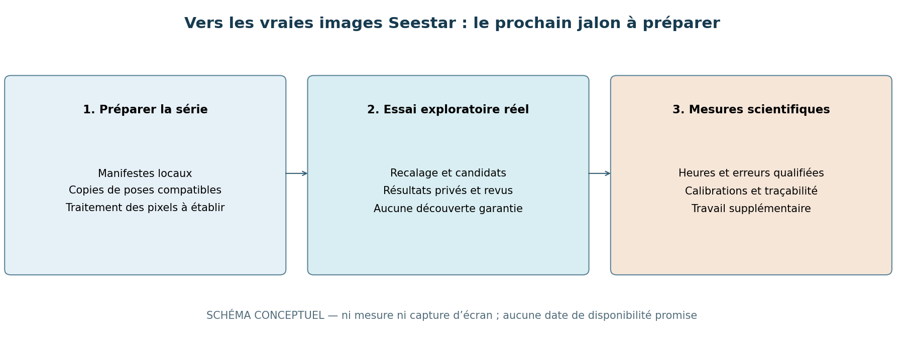

# Quand essayer les images du Seestar S50 ?

**Une série de huit poses Seestar réelles est désormais préparée en copies locales vérifiées.** Le [lot 15](PREPARER-SERIE-SEESTAR.md) a réalisé la sélection, la copie en lecture seule et l’audit local. Le prochain jalon est d’adapter puis exécuter le recalage et la recherche exploratoire sur cette série. Il n’est pas nécessaire d’attendre la photométrie, les exports ou le portable ; le pilote réel n’a pas encore été lancé et aucune date ou découverte n’est promise.

*Schéma conceptuel, pas une mesure ou une capture d’écran. La première étape est maintenant réalisée pour huit poses ; la deuxième reste à adapter et exécuter.*

## Ce qui utilise déjà les observations

Le projet a déjà utilisé des données Seestar pour l’inventaire, les diagnostics de métadonnées, le recalage et les comparaisons sur étoiles, avec rapports privés et fichiers sources préservés. L’échantillon antérieur de **trois poses et un empilement** reste conservé ; il est complété par une nouvelle série de **huit poses individuelles**. Ces préparations ne constituent pas une recherche validée d’objets mobiles ; les contrôles précédents sont décrits dans le [protocole pilote](VALIDATION-PILOTE.md).

Le lot 14 de répartition des contrôles n’avait lu que le manifeste et les documents. Le lot 15 a ensuite utilisé l’autorisation de lecture du support pour les huit copies sélectionnées ; les audits et aperçus ont travaillé sur ces copies, sans écrire sur le support.

## Deux étapes concrètes pour arriver au premier essai réel

| Étape | Travail | Condition pour avancer |
|---|---|---|
| Préparer la série — fait | Huit poses sélectionnées depuis le manifeste, copiées et contrôlées localement | Identité des octets et configuration observée vérifiées ; qualité scientifique non déduite |
| Pilote exploratoire réel — prochain lot | Adapter les entrées réelles, la voie de détection et l’ordre des images, puis exécuter et revoir les candidats | Alignement contrôlé, limites explicites et rapports privés ; un résultat sans candidat reste utile |

La série préparée lève le manque initial d’images locales pour ce premier essai. Le démarrage de la seconde étape dépend encore d’un traitement réel adapté, notamment au Bayer et à la taille des images, pas d’une promesse de succès sur un objet astronomique.

## Série à préparer

Pour un premier essai, viser **au moins huit poses individuelles successives du même champ**, avec dimensions, mode et configuration compatibles, plutôt qu’un assemblage de belles images ou de seuls empilements. Huit est ici une cible de départ du projet, pas une norme scientifique. Le moteur d’association actuel exige au moins cinq détections temporelles pour former une trajectoire, et la recette fictive travaille avec huit images ; trois poses ne suffisent donc pas à reproduire cette chaîne.

Il faudra vérifier sur les copies locales :

- présence de toutes les poses sélectionnées, empreintes et intégrité ; doublons et images exclues conservés dans le rapport ;
- cohérence du champ et du repère, nombre et couverture des étoiles d’ajustement et de contrôle ;
- nature réelle des pixels : mosaïque Bayer, mono ou RGB, saturation et traitements déjà appliqués ; définir la voie de détection et le retour aux coordonnées natives ;
- ordre des prises de vue et cadences déclarées, interruptions, heures ambiguës et exclusions, sans inventer une heure de milieu de pose ;
- lecture des candidats en images successives, artefacts et objets connus, avant toute interprétation astronomique.

L’inventaire local peut indiquer qu’une séance plus complète existe dans les archives ; il ne prouve pas que ses fichiers soient déjà copiés et utilisables. Aucune source historique sur USB ne doit être ouverte automatiquement à partir d’un chemin mémorisé. Une éventuelle préparation de nouvelles copies doit être prévue dans un lot distinct, avec destination locale neuve et support source strictement en lecture seule, sans cache ou rapport sur celui-ci.

## Essai exploratoire et mesure scientifique sont deux usages différents

| Usage | Ce que l’on pourra examiner | Limites à garder |
|---|---|---|
| Exploration locale | Déplacements dans les images, candidats, faux signaux, positions en pixels et ordre de la série | Aucun candidat garanti ; origine du signal à revoir humainement |
| Mesures de vitesse et positions célestes destinées à la science | Astrométrie et chronologie qualifiées, incertitudes, calibration et traçabilité | Preuves temporelles indépendantes et budget d’erreur encore nécessaires |

Un premier essai peut exprimer un déplacement en pixels par image ou selon des intervalles **déclarés**, avec les réserves correspondantes. Il ne doit pas annoncer une vitesse physique ou une date UTC exacte à partir d’une horloge non qualifiée. La [campagne temporelle](CAMPAGNE-TEMPORELLE.md) reste nécessaire aux usages exigeant cette précision ; elle n’est pas remplacée par les essais fictifs.

La commande actuelle pour images synthétiques **ne doit pas recevoir de véritables observations réétiquetées**. Il faudra un chemin d’analyse réel distinct, avec provenance et limites adaptées ; ne pas ajouter `GARSYNTH` ou des temps fictifs aux fichiers Seestar pour contourner les protections. Le [bilan de contrôle spatial](CONTROLES-SPATIAUX.md) éclaire le recalage, mais ne valide pas Bayer, le bruit, les calibrations ou l’horloge du télescope.

## Ce que l’on décide après ce lot

Planifier maintenant un module d’essai exploratoire réel pour la série locale préparée, avec son plan avant code. Vérifier la voie de pixels et le recalage, puis examiner les candidats sans qualifier artificiellement l’heure. Les rapports, coordonnées, FITS et en-têtes restent sous `local/`.

Le mainteneur a explicitement autorisé deux images rendues comme exemples publics sous [CC0 1.0](images/reels/LICENCE.md). Elles figurent dans le tutoriel, sans en-têtes ou métadonnées privées. Cette exception n’est pas une diffusion des archives FITS ou rapports. L’autorisation USB reste exclusivement en lecture pour les outils du projet ; aucun fichier source n’a été réécrit.
