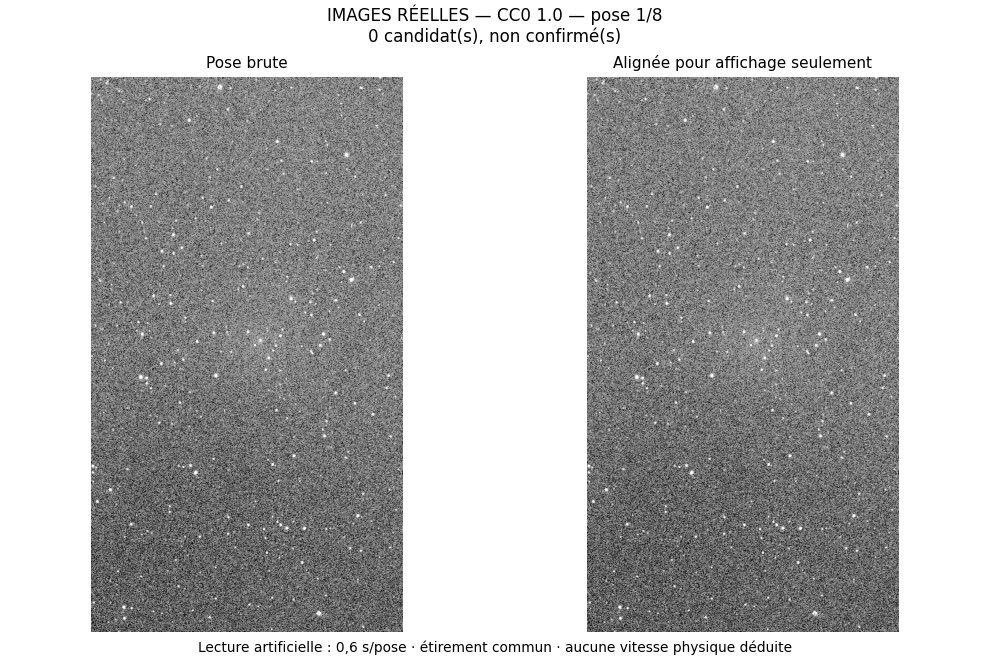
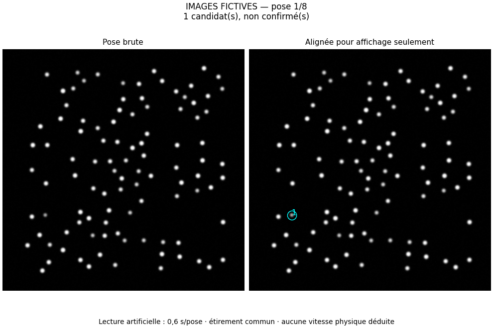
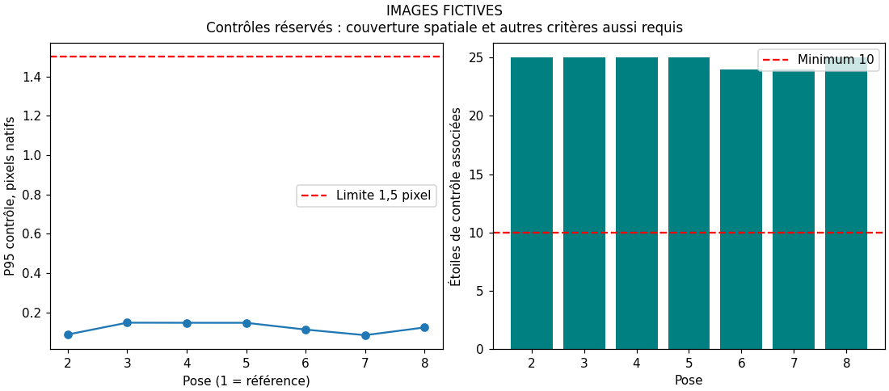
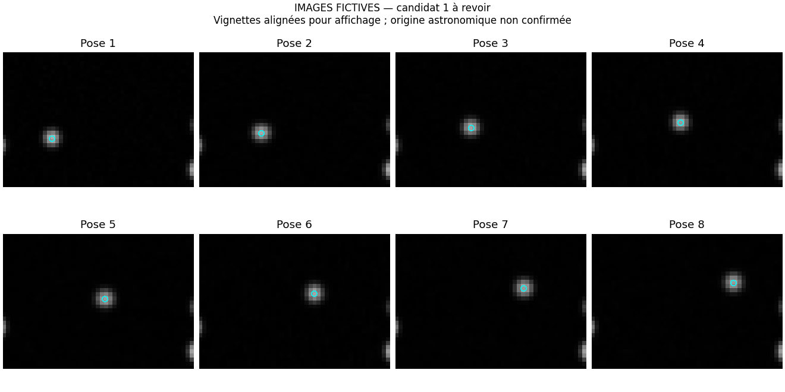
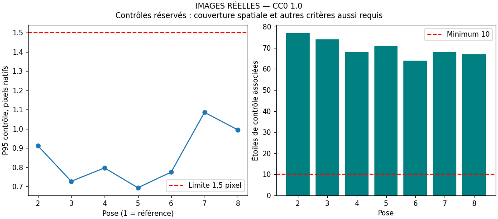

# Premier pilote exploratoire sur les copies Seestar

**Les huit poses réelles ont été analysées : sept recalages vers la première pose acceptés, recherche terminée avec zéro candidat aux seuils prévus.** Le GIF réel avant/après est maintenant publié sous CC0 avec l'autorisation réaffirmée du mainteneur. Ce résultat concerne une seule petite série et ne prouve pas qu'aucun mobile soit présent. Il ne mesure pas la sensibilité réelle du détecteur.



*Observation réelle, sans mobile détecté. Huit vues à 600 ms, cadence de lecture artificielle ; interpolation réservée à l'affichage. [Provenance, licence et fichiers couverts](images/reels/LICENCE.md).*

Le plan du lot 16, [commit `8f5a64b`](https://github.com/steveprudhomme/gnu-astrophotography-recycle/commit/8f5a64b819d301f7c495b5e9903f3c622cf30639), a été publié et contrôlé avant le code ou les résultats. Les moteurs historiques, le chemin réservé aux images synthétiques et la version 0.10.0a1 restent inchangés. La nouvelle recette réutilise leurs fonctions mathématiques dans un chemin expérimental distinct. Elle n'ajoute aucun marqueur fictif aux observations.

## Comprendre l'essai dès 10 ans

Imagine huit photos du même ciel. Le télescope peut bouger un peu entre deux photos : toutes les étoiles semblent alors glisser ensemble. **Aligner**, c'est calculer comment remettre les positions des étoiles au même endroit. Le programme cherche ensuite un point qui continue à se déplacer par rapport à elles.

Une **étoile témoin**, ou étoile de contrôle, sert à vérifier le travail : sa position n'a pas servi à calculer l'alignement. Si ces témoins ne sont pas assez nombreux, bien répartis ou assez proches après alignement, la recherche s'arrête. On ne sait alors pas dire combien de candidats la recherche aurait trouvés.

Un **candidat** est seulement une suite de points qui respecte les règles du programme. Un défaut du capteur, un mélange d'étoiles ou une mauvaise association peut tromper la recherche. Il faut regarder les images et établir l'origine du signal avant de parler d'objet astronomique. Un GIF nous aide à regarder ; ce n'est pas une preuve de découverte.



*Images entièrement inventées pour l'exercice public. Le cercle cyan suit le candidat mesuré, sans lire les réponses de génération. La cadence du GIF est artificielle : 0,6 seconde par pose. Le GIF réel CC0 plus haut est un autre fichier.*

## Entrées vérifiées, sans accès à la clé

La recette reçoit les trois fichiers locaux `plan.json`, `workset.json` et `series.json` issus de la [préparation de série](PREPARER-SERIE-SEESTAR.md). Les chemins doivent rester sous `local/`, sans liens/jonctions. Les copies doivent être dans le workset, distinctes et identiques aux empreintes de préparation. Le programme refait l'audit des copies et compare son résultat à l'audit fourni : un simple indicateur `copies_prepared: true` ne suffit pas.

Il faut de huit à 64 primaires 2D, de dimensions paires au moins 64×64, une configuration constante, des pixels finis et des dates/durées concordantes. La voie par défaut exige une mosaïque déclarée GRBG, RGGB, GBRG ou BGGR. `--pixel-mode mono` est un choix explicite réservé à des images sans déclaration Bayer ; le programme refuse de traiter une mosaïque déclarée comme du mono. Les cubes RGB et les dimensions impaires sont refusés par ce pilote. Les déclarations d'échelle de temps doivent aussi être identiques, y compris lorsqu'elles sont toutes absentes.

Les chemins historiques des archives peuvent rester écrits dans le plan et le workset ; ils ne sont pas consultés. L'exécution réelle de ce lot a bloqué les ouvertures/sondages de volumes externes, les écritures FITS et les connexions réseau. Tous les nouveaux rapports et dessins restent locaux.

## Pixels et coordonnées : deux usages différents

Pour chercher des points, nous faisons la moyenne de chaque carré de quatre pixels, soit **2×2**. Un bloc contenant une valeur non finie ou ≥65 000 est masqué. Ce seuil de travail ne constitue pas un étalonnage de saturation du capteur. La moyenne mélange les réponses Bayer : ce n'est pas une correction couleur ni une mesure photométrique. Aucun dark, flat, dématriçage scientifique ou calibration absolue n'est ajouté.

La détection de mobiles garde les paramètres prévus : 5 sigma, FWHM 3 pixels réduits, séparation minimale 5 pixels réduits, marge de bord 8 pixels réduits, au plus 500 sources par image. Une limite dépassée bloque la recherche, sans ne garder que les plus jolies sources. Un centre réduit est converti en centre natif par `x_natif = 2*x_réduit + 0,5`, et pareil pour y. Un pixel natif désigne un pixel de la copie FITS, avec origine zéro.

Les étoiles d'alignement sont détectées séparément avec `registration.detect` : moyenne interne 2×2, FWHM 2 pixels réduits et retour aux coordonnées natives. La partition spatiale réserve environ un quart des étoiles **avant** les triangles, associations et ajustements. Rotation et translation sont calculées avec les autres étoiles. La première pose est une référence relative mesurée, pas une vérité absolue.

Les sept poses suivantes doivent chacune avoir au moins 20 associations d'ajustement et 10 de contrôle ; médiane des résidus de contrôle ≤0,75 pixel natif, P95 ≤1,5, au moins six cellules de la grille 3×3 et les quatre quadrants. Le rayon d'association de trois pixels sélectionne les résidus observables ; ce contrôle n'est pas un budget d'erreur absolue. Une pose refusée bloque toute la recherche alignée : pas de pose supprimée ou d'alignement de secours inventé.

Pour mesurer le mouvement, seules les **positions** sont transformées. Un point n'est conservé que s'il reste dans le champ de toutes les poses, avec une marge native de 16 pixels, vérifiée par chaque transformation inverse. Les pixels FITS ne sont pas rééchantillonnés pour cette recherche.

## Temps et trajectoires exploratoires

Les temps sont les différences entre `DATE-OBS` déclarés, calculées sans changement d'échelle, correction d'horloge ou milieu de pose supposé. Ils servent au repérage relatif ; leur exactitude physique reste inconnue. Les critères d'association gelés sont :

- supprimer les positions présentes à moins de deux pixels natifs dans au moins la moitié des poses ;
- vitesse de 0,1 à 1,5 pixel natif par seconde **déclarée**, association à 1,5 pixel ;
- au moins cinq poses et 40 secondes déclarées, RMS ≤0,75 et P95 ≤1,5 pixel natif ;
- au plus 100 000 hypothèses, sans troncature silencieuse.

Les champs de sortie parlent de secondes déclarées ; les anciennes étiquettes « secondes fictives » des fonctions mathématiques ne sont pas copiées dans les trajectoires réelles. La recette n'annonce aucune vitesse physique, position céleste ou identification. `clock_qualified`, `scientific_submission_certified` et `real_data_performance_validated` restent faux, même si un alignement est accepté.

## Refaire le nouvel exercice

Depuis PowerShell, à la racine du dépôt, après l'[installation](../INSTALL.md). Choisir des sorties neuves ; ne pas supprimer automatiquement un essai interrompu.

```powershell
.\.venv\Scripts\python.exe examples/make_seestar_pilot_demo.py local/exercice-pilote-mobile
.\.venv\Scripts\python.exe examples/run_seestar_pilot.py local/exercice-pilote-mobile/plan/plan.json local/exercice-pilote-mobile/workset/workset.json local/exercice-pilote-mobile/audit/series.json --output local/exercice-pilote-mobile-analyse
.\.venv\Scripts\python.exe examples/plot_seestar_pilot.py local/exercice-pilote-mobile-analyse/pilot.json local/exercice-pilote-mobile-figures
```

Attendu : trois codes 0, huit poses fictives préparées, sept modèles acceptés, un candidat. Ouvrir `blink.gif`, `controls.png` et `candidate-01-review.png` dans le dossier de figures. `truth.json` contient les réponses inventées, dans un fichier séparé que l'analyse ne lit jamais.

Pour le témoin sans mobile :

```powershell
.\.venv\Scripts\python.exe examples/make_seestar_pilot_demo.py local/exercice-pilote-temoin --case control
.\.venv\Scripts\python.exe examples/run_seestar_pilot.py local/exercice-pilote-temoin/plan/plan.json local/exercice-pilote-temoin/workset/workset.json local/exercice-pilote-temoin/audit/series.json --output local/exercice-pilote-temoin-analyse
.\.venv\Scripts\python.exe examples/plot_seestar_pilot.py local/exercice-pilote-temoin-analyse/pilot.json local/exercice-pilote-temoin-figures
```

Attendu : trois codes 0, modèles acceptés, recherche terminée avec zéro candidat.

Pour voir un refus utile :

```powershell
.\.venv\Scripts\python.exe examples/make_seestar_pilot_demo.py local/exercice-pilote-refus --case insufficient
.\.venv\Scripts\python.exe examples/run_seestar_pilot.py local/exercice-pilote-refus/plan/plan.json local/exercice-pilote-refus/workset/workset.json local/exercice-pilote-refus/audit/series.json --output local/exercice-pilote-refus-analyse
.\.venv\Scripts\python.exe examples/plot_seestar_pilot.py local/exercice-pilote-refus-analyse/pilot.json local/exercice-pilote-refus-figures
```

Attendu : codes **0, 2, 0**. Les douze étoiles de cet exemple ne suffisent pas aux contrôles ; la recherche est bloquée, le nombre de candidats vaut `null`, pas zéro. Le GIF montre seulement les poses brutes. Le rapport terminé avec refus reste un résultat. Une erreur de lecture/intégrité donne le code 1 et peut conserver un dossier `incomplete` : lire le message, garder le constat et choisir une nouvelle sortie après correction.





*Figures calculées sur les pixels inventés, pas des captures d'écran. Les vignettes sont alignées pour l'affichage, avec les positions mesurées ; les réponses de génération ne servent pas à placer les cercles.*

## Ce que contient le résultat local

`pilot.json` garde progression, provenance du code, empreintes, détections, huit modèles dont la référence, contrôles, recouvrement et trajectoires. `inputs-audit/` garde le nouvel audit, `candidates.csv` les points des candidats et `report.md` la synthèse. Une analyse bloquée a `candidate_count: null` ; une analyse achevée sans trajectoire a `candidate_count: 0`. Une candidature porte le statut non revu, pas une découverte.

Le dessin produit `blink.gif`, `blink-first.png`, `controls.png`, éventuellement des vignettes de candidat et `figures.json`. L'affichage aligné interpole seulement des dérivés en mémoire ; il n'alimente jamais la recherche. L'étirement asinh est fixé aux percentiles 5 et 99,7 de la première pose. La cadence de lecture de 600 ms ne reproduit pas les intervalles d'acquisition. Les empreintes sont vérifiées avant/après analyse et dessin. Le rapport original de préparation reste inchangé : son ancien champ `motion_searched: false` décrit le lot 15 ; le nouveau verdict est dans `pilot.json`.

## Premier constat réel et limites

Les sept recalages ont été acceptés. Selon la pose, **64 à 77 étoiles réservées** sont associées ; elles couvrent neuf cellules et les quatre quadrants. Les P95 vont d'environ **0,69 à 1,09 pixel natif**, sous le seuil préenregistré de 1,5 pixel. La recherche est terminée avec **zéro candidat**, sans changement de seuil après le résultat. Le GIF montre donc un alignement réel, pas un objet mobile découvert. Il n'y a aucun candidat de cette série à identifier ou soumettre.

La série est courte, les seuils limitent les vitesses et luminosités accessibles, les étoiles proches peuvent masquer des objets lents et le traitement Bayer/bruit n'est pas étalonné. Les biais de détection, sources saturées, masques, limites de taille/effectif et recouvrement peuvent laisser des objets non détectés. Un résultat zéro ne prouve donc pas l'absence d'objet. Le [lot 18 d'injections contrôlées](INJECTIONS-SEESTAR.md) a ensuite mesuré une récupération conditionnelle au recalage gelé : 10/36 points artificiels retrouvés sur ce fond, sans modifier le pilote naturel. Il ne constitue pas une qualification des performances réelles de bout en bout.

Les rapports, positions et FITS réels restent sous `local/`. L'autorisation réaffirmée permet de publier les cinq médias de la [notice CC0](images/reels/LICENCE.md), dont le GIF avant/après, sa première vue et le graphique des contrôles. Les exercices et tests restent fictifs ; les médias réels sont étiquetés comme tels. Aucun accès USB, catalogue ou service externe n'est nécessaire à l'analyse ou au rendu.

## Publier un rendu réel autorisé

Les rendus réels restent privés par défaut. Si le titulaire a autorisé leur diffusion sous CC0, utiliser le rapport déjà local, sans relancer la recherche :

```powershell
.\.venv\Scripts\python.exe examples/plot_seestar_pilot.py local/mon-pilote/pilot.json local/mon-pilote-cc0 --public-cc0
```

Ces chemins sont des exemples à remplacer par ses propres résultats, pas un exercice fictif. Le mode refuse les rapports fictifs et les images marquées `GARSYNTH`. Il crée des titres CC0, des PNG sans métadonnées et un GIF conservant seulement ses informations de lecture/couleurs/boucle. Le fichier `figures.json` reste un journal local ; seules les images expressément autorisées vont dans la liste publique de la notice. Le mode ne donne pas lui-même une autorisation de diffusion.



*À gauche, P95 des résidus des étoiles réservées, sous la limite prévue ; à droite, leur nombre. Les exigences de couverture spatiale restent aussi nécessaires. Cette figure réelle n'est pas une calibration absolue.*

## Reproduction vérifiée

Depuis le commit propre **`80ada2e`**, les **335 tests** ont réussi en **83,31 secondes**. Les neuf nouvelles commandes du parcours ont été rejouées dans des dossiers neufs : mobile retrouvé, témoin sans candidat, refus de contrôle avec code 2 et compte `null`. Les huit FITS du nominal, ses modèles/positions/trajectoire et les trois figures publiques sont identiques aux premiers produits. Les 39 commandes antérieures gardent leurs preuves précédentes sans réexécution générale revendiquée.

Le pilote réel a également été reproduit depuis les mêmes copies : sept modèles et positions identiques, zéro candidat, huit copies intactes et trois figures privées identiques, dont le GIF de huit poses à 600 ms. Aucune tentative d'accès externe ou d'écriture FITS n'est enregistrée par les gardes. Le rapport conserve la nouvelle provenance de code ; ce n'est pas une affirmation d'identité octet pour octet de tous les rapports. Les preuves détaillées restent locales. Aucun essai avec un enfant débutant ou sur un ordinateur Windows vierge n'est revendiqué.

Sources primaires consultées le 17 novembre 2026 : [Astropy FITS](https://docs.astropy.org/en/stable/io/fits/api/files.html), [Photutils DAOStarFinder](https://docs.astropy.org/projects/photutils/en/stable/api/photutils.detection.DAOStarFinder.html) et [SciPy map_coordinates](https://docs.scipy.org/doc/scipy/reference/generated/scipy.ndimage.map_coordinates.html). Les API sont réutilisées avec les versions installées, sans mise à jour ; les seuils et le protocole sont des choix du projet.
