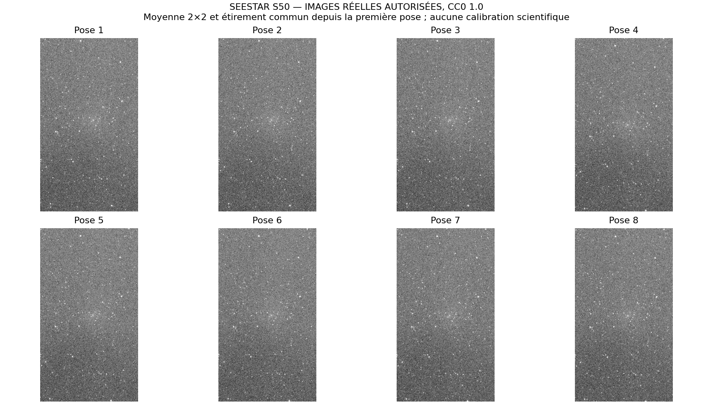
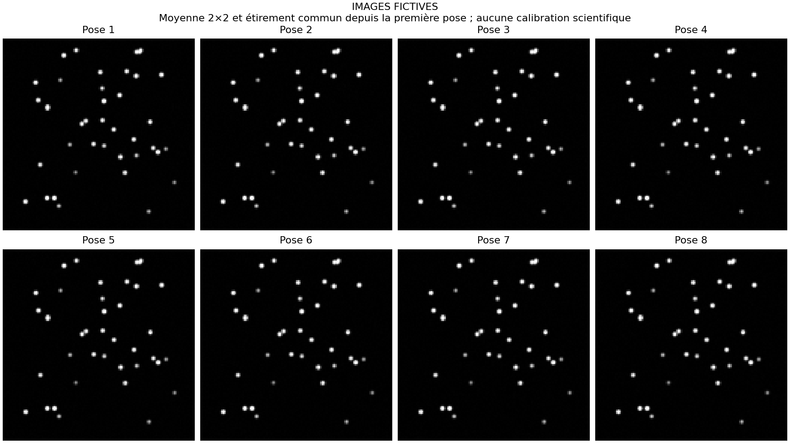
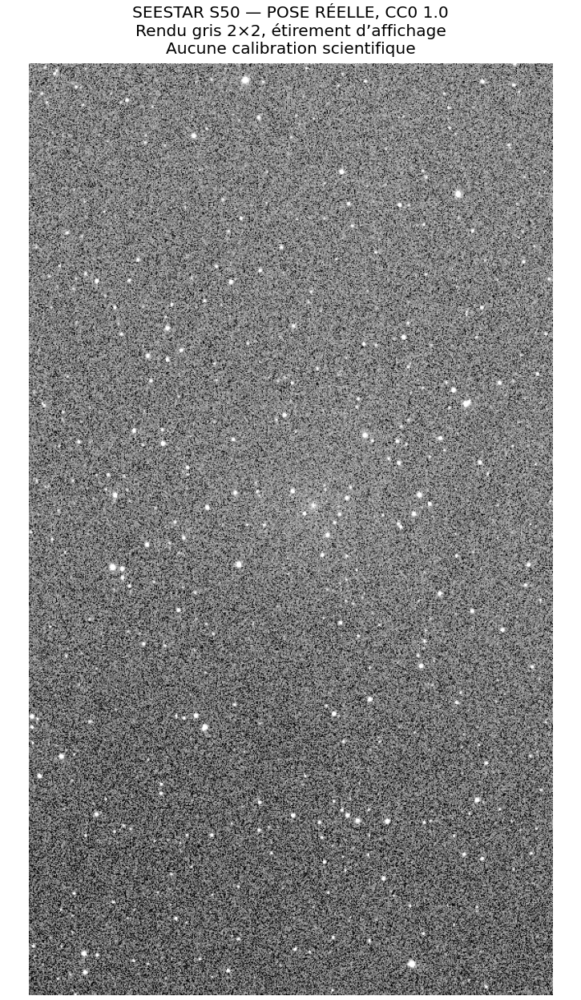

# Préparer une série Seestar réelle en copies locales

Plan **[`594c19e`](https://github.com/steveprudhomme/gnu-astrophotography-recycle/commit/594c19ede1e38a227e966f09ae7fc9588e6768ce)** committé, publié et vérifié avant le code et la copie du lot 15. Huit poses réelles ont été préparées en copies locales vérifiées ; les fichiers sources n’ont été ouverts que pour lecture et aucune écriture n’a été faite sur le support. L’audit et les aperçus travaillent ensuite uniquement sur les copies.

Le complément **[`ae07304`](https://github.com/steveprudhomme/gnu-astrophotography-recycle/commit/ae07304f2daf057aedfab6dba61a16a18632cde7)** précède le code de diffusion. Il consigne l’autorisation explicite du mainteneur de publier des images réelles sous **CC0 1.0**, à titre d’exemple. Les deux PNG listés dans la [notice CC0](images/reels/LICENCE.md) sont l’exception autorisée ; les FITS, en-têtes, chemins, coordonnées et rapports restent locaux.



*Vraies observations, pas un jeu synthétique ou une capture d’écran. Rendu gris 2×2 et étirement commun d’affichage ; aucune calibration ou détection de mobile validée. [Conditions CC0 et provenance](images/reels/LICENCE.md).*

## Ce que cette préparation apporte

La série actuelle a maintenant servi au [premier essai exploratoire réel](PILOTE-MOBILES-SEESTAR.md) du lot 16 : sept alignements acceptés, recherche terminée avec zéro candidat et GIF réel local. Le petit échantillon antérieur de trois poses et un empilement est conservé. La préparation décrite ici vérifie seulement les octets, les en-têtes attendus, la configuration observée et la lecture des pixels ; son rapport historique n'est pas modifié par l'analyse suivante.

Les scripts du lot sont des recettes supplémentaires utilisant les outils existants ; l’application reste 0.10.0a1. Aucun moteur gelé ou dépendance n’est modifié. Les images réelles ne reçoivent ni marqueur synthétique ni temps fictif.

## Sélection déterministe depuis l’inventaire local

`prepare_seestar_series.py plan` lit un manifeste **déjà local** et appelle le regroupement existant, seuil de 1 800 secondes déclarées. Il n’inventorie pas à nouveau le support et ne sonde aucun chemin source.

Il classe les groupes par nombre de membres décroissant, puis par identifiant. Dans le premier groupe admissible, il retient le premier bloc chronologique de huit poses primaires 2D, de fichiers/empreintes distincts, sans compteur d’empilement incompatible, avec dates strictement croissantes et écarts consécutifs d’au plus 30 secondes **déclarées**. La configuration de regroupement conserve instrument, cible, filtre, gain, Bayer, mode, dimensions et autres distinctions du [contrat des séances](CONTRAT-SEANCES.md). Il n’examine pas les pixels pour choisir de belles images ou favoriser une détection.

Le nombre demandé peut aller de 8 à 64 ; ce lot utilise huit poses. Ce nombre est un départ de pilote, pas une norme scientifique ou une garantie de détection. Les fenêtres rejetées et les groupes candidats sont conservés. Si aucun bloc n’est disponible, le plan l’indique, retourne 2 et ne fabrique pas de sélection.

La racine source doit être donnée explicitement. Le programme la lie lexicalement aux chemins relatifs validés de l’inventaire : pas de remontées `..`, chemins absolus incorporés ou séparateurs dangereux. Il ne réutilise pas silencieusement le chemin historique du manifeste et ne prouve pas la présence de la clé par une simple liste. Les produits de planification contiennent des informations privées et restent sous `local/`.

## Copie contrôlée puis audit local

La copie réutilise [gar workset](CONTRAT-WORKSET.md), avec une liste explicite de huit chemins et leurs empreintes historiques. Ouverture source en `rb`, destination locale neuve en `xb`, comparaison des empreintes avant/copie/après et de la taille/date de modification source. Les en-têtes complets sont capturés sur les copies, dont les octets sont revérifiés. Aucun parcours récursif, rapport, cache, dossier ou fichier n’est créé sur la clé ; aucune source n’est déplacée, réparée, supprimée ou réenregistrée.

`prepare_seestar_series.py audit` ne consulte plus les sources historiques. Il exige un plan et un workset correspondants, avec huit copies distinctes, empreintes cohérentes et chemins intérieurs au dossier local prévu. Il lit les FITS locaux en mode `readonly` et contrôle :

- HDU primaire 2D, dimensions physiques et forme décodée cohérentes avec la sélection ;
- instrument, cible, filtre, gain, mode, Bayer, BITPIX, BSCALE, BZERO observés conformes au manifeste et constants dans la série ;
- dates/durées déclarées identiques au plan, ordre strict et écarts déclarés ≤30 s ; doublons de cartes critiques signalés ;
- lecture des pixels, nombre fini, minimum/maximum/médiane et comptage descriptif des valeurs ≥65 000.

Le dernier comptage n’est **pas une saturation instrumentale étalonnée**. Une carte absente reste inconnue ; `TIMESYS` absent ne devient pas une mesure d’horloge. Les déclarations d’axes célestes sont notées, sans résoudre ou valider une WCS.

Le rapport conserve `clock_qualified: false`, `common_field_validated_on_stars: false`, `motion_searched: false`, `science_validated: false` et `pixels_rewritten: false`. `copies_prepared: true` signifie préparation technique terminée, pas aptitude scientifique. Les problèmes de compatibilité sont signalés (code 2) ; une erreur de lecture/intégrité peut laisser un dossier `incomplete` avec `copies_prepared: false` (code 1). Garder les produits partiels, choisir une nouvelle sortie après résolution et ne rien nettoyer automatiquement sur le support.

## Refaire le parcours sans clé USB

L’exercice public fabrique douze poses fictives de mosaïque de type GRBG, pas un capteur étalonné. Avec les dépendances et outils graphiques installés, depuis la racine du projet et avec de nouveaux noms :

```powershell
.\.venv\Scripts\python.exe examples/make_series_demo.py local/serie-demo-archives
.\.venv\Scripts\gar.exe inventory local/serie-demo-archives --output local/serie-demo-inventaire
.\.venv\Scripts\python.exe examples/prepare_seestar_series.py plan local/serie-demo-inventaire/manifest.json --source-root local/serie-demo-archives --output local/serie-demo-plan
.\.venv\Scripts\gar.exe workset local/serie-demo-plan/selection.json --output local/serie-demo-copies
.\.venv\Scripts\python.exe examples/prepare_seestar_series.py audit local/serie-demo-plan/plan.json local/serie-demo-copies/workset.json --output local/serie-demo-audit
.\.venv\Scripts\python.exe examples/plot_series_preview.py local/serie-demo-audit/series.json local/serie-demo-apercu
```

Résultats attendus : douze fichiers inventoriés, huit sélectionnés/copiés/contrôlés, préparation vraie et aperçu de nature fictive. Les six commandes retournent 0 sur cet exercice. Elles ne touchent aucune clé et n’exécutent pas de recherche de mobile.



*Images synthétiques, à distinguer de l’exemple Seestar réel CC0 en haut de page. La moyenne 2×2 et l’étirement asinh, fixé aux percentiles 5 et 99,7 de la première pose, servent seulement à l’affichage ; les FITS restent exacts.*

## Produits et diffusion autorisée

Le plan crée `plan.json`, `selection.json` si un bloc existe et `report.md`. Le workset crée les copies, `workset.json` et `headers/`. L’audit crée `series.json`, `series.csv` et `report.md`. L’aperçu crée `series-preview.png` et un journal privé `preview.json`, avec paramètres et empreintes utiles. Tous ces produits sont locaux et ignorés par Git.

Le mode d’aperçu est privé par défaut pour des données réelles. L’option explicite `--public-cc0` ne doit être utilisée que lorsque le titulaire a autorisé cette diffusion et la dédicace CC0. Dans ce lot, le mainteneur l’a expressément fait. Elle produit le montage et `first-pose.png`, avec titres neutres et réencodage RGB sans EXIF, texte ou métadonnées PNG héritées. Ces deux PNG seulement sont copiés dans le répertoire public [images/reels](images/reels/LICENCE.md) avec leur notice ; aucun journal contenant une empreinte FITS ou un chemin privé n’est copié.



Les pixels célestes sont autorisés à être partagés ; ce n’est pas une promesse d’anonymisation du champ. La notice CC0 couvre uniquement les deux images listées. Le code et les autres documents conservent leur régime GPL-3.0-or-later.

## Vérifications et prochaine étape

Les tests publics emploient exclusivement des fichiers fictifs : planification sans sondage source, ordre déterministe, groupes incompatibles, doublons, dates/gaps, effectif insuffisant, chemins dangereux, changement de source, copies/audit en lecture seule, en-têtes divergents, interruption et export CC0 sans métadonnées. Les tests d’un mode d’entrée réelle utilisent eux aussi des pixels inventés ; aucun FITS personnel ne fait partie des tests.

Les **316 tests** ont réussi en 56,97 secondes, dont 19 nouveaux cas. Depuis le commit propre **`2e57d18`**, les six nouvelles commandes du parcours ont réussi dans des dossiers neufs : douze images fictives identiques par empreinte, huit copies préparées et aperçu identique. Le plan réel et l’audit des huit copies ont été reproduits à l’identique sans nouvel accès au support source ; les deux PNG CC0 sont identiques et sans métadonnées intégrées. Les anciennes commandes du parcours gardent leurs vérifications antérieures, sans nouvelle exécution revendiquée ici.

**Avons-nous trouvé des candidats ou des GIF de mouvement réels ?** Le [lot 16](PILOTE-MOBILES-SEESTAR.md) a maintenant achevé la recherche sur les huit copies : zéro candidat aux seuils prévus et GIF réel avant/après alignement disponible localement. Ce GIF montre l'alignement des étoiles, sans déplacement de mobile détecté. Le rapport de préparation garde son ancien `motion_searched: false`, tandis que le nouveau `pilot.json` porte le résultat de recherche. Les GIF des exercices restent fictifs ; l'autorisation réaffirmée au lot 17 permet aussi la publication du GIF réel et de ses illustrations, selon la notice CC0.

Le pilote utilise un chemin d'analyse réel distinct, avec moyenne 2×2 d'intensité, coordonnées natives, contrôles réservés et temps déclarés non qualifiés. La commande historique fictive ne reçoit pas les FITS Seestar et aucun marqueur inventé ne leur est ajouté. Les heures physiques, calibrations, sensibilité réelle et budgets d'erreur restent à qualifier avant un usage scientifique.

Le [lot 18](INJECTIONS-SEESTAR.md) utilise ensuite le pilote et ses modèles gelés pour tester des points ajoutés à des dérivés, sans changer ces huit copies ou l'audit de préparation. Il retrouve 10/36 ajouts artificiels, avec témoin identique au pilote naturel. Il n'ajoute aucune découverte ou validation de bout en bout aux contrôles techniques de cette page.

Sources : [Astropy FITS, ouverture en lecture seule](https://docs.astropy.org/en/stable/io/fits/api/files.html), contrats du projet et [CC0 1.0 officiel](https://creativecommons.org/publicdomain/zero/1.0/), consulté le 17 novembre 2026. Les règles de sélection sont celles du projet, pas une prescription du constructeur.
