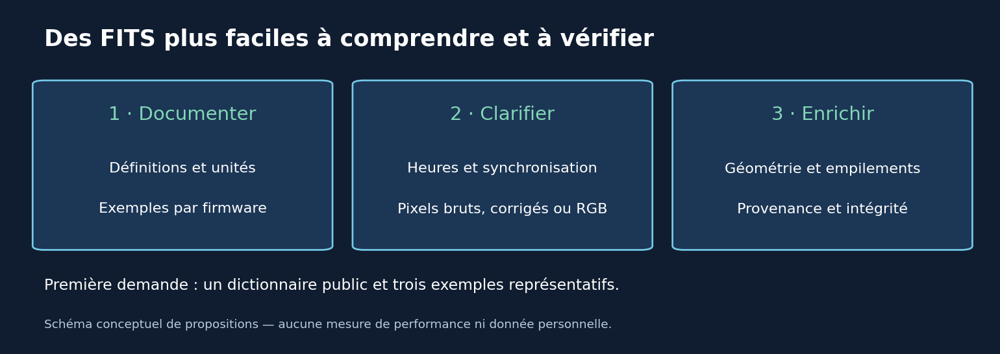

# FITS du Seestar S50 : propositions pour faciliter leur réutilisation scientifique

**Note de discussion — 15 novembre 2026.** Préparée dans le cadre de GNU Astrophotography Recycle, projet indépendant de ZWO. Destinée au partage par son fondateur avec la communauté ; aucun message n’a été envoyé automatiquement.

## L’idée en quelques mots

Le Seestar permet de conserver des observations qui pourraient servir au-delà de la belle image : suivi d’objets mobiles, variations stellaires et comparaison de séances. Ma proposition serait de rendre leurs FITS **plus faciles à interpréter et à vérifier**, en commençant par une documentation publique des métadonnées.

Trois demandes prioritaires :

1. **Une définition précise et vérifiable des heures enregistrées.**
2. **Une description des corrections déjà appliquées aux pixels.**
3. **Une distinction explicite entre pose mosaïquée, image dématricée RGB et empilement.**

*Schéma conceptuel de recommandations, pas une capture d’écran ni une mesure des performances du S50. Une [version vectorielle](images/priorites-seestar.svg) est aussi disponible.*

## Sur quels constats repose cette note ?

Nous avons examiné des en-têtes d’archives locales et leurs manifestes, sans modifier les originaux. Dans le pilote :

| Constat limité à cet échantillon | Ce que cela permet de dire |
|---|---|
| `DATE-OBS` porte le commentaire « Image created time » ; `TIMESYS` n’est pas déclaré | La relation exacte à l’exposition mérite une clarification ; cela ne prouve pas une heure fausse ni une non-conformité FITS |
| Les poses individuelles du pilote n’indiquent pas `CTYPE1`/`CTYPE2` ; certains empilements en possèdent | Une solution WCS des empilements n’est pas nécessairement disponible pour chaque pose ; sa validité n’a pas été contrôlée ici |
| `BAYERPAT` est présent sur des poses 2D et sur des empilements à trois plans | Il faut distinguer le motif du capteur d’origine de l’organisation actuelle des pixels |
| Les coordonnées de site déclarées varient dans une série | L’origine et la précision de ces valeurs seraient utiles ; cela ne démontre pas un déplacement réel |

Ces constats ne valent pas pour tous les appareils, tous les fichiers ou tous les firmwares. Notre manifeste ne reproduit qu’une sélection des en-têtes : un champ non collecté n’est **pas** déclaré absent du FITS. Aucune archive personnelle, position, date d’observation réelle ou identité d’instrument n’est jointe à cette note.

## 1. Publier un dictionnaire des métadonnées — priorité immédiate

**Demande à ZWO :** publier une page versionnée par modèle, firmware et mode d’acquisition, avec pour chaque mot-clé sa définition, son unité, sa provenance et les cas où il est absent ou non applicable. Distinguer les mots-clés normalisés, conventions d’interopérabilité et extensions propres à ZWO.

La page devrait notamment préciser : type de fichier, durée, date, filtre, gain, matrice couleur, mode de monture, coordonnées et nombre de poses combinées. Fournir quelques petits exemples fictifs ou anonymisés : pose individuelle, empilement, image RGB et fichier avec extensions.

**Bénéfice :** une amélioration documentaire peut lever des ambiguïtés sans changer les données ni alourdir le traitement embarqué. **Vérification :** un développeur peut comprendre chaque exemple sans deviner le sens d’un mot-clé à partir de son nom.

## 2. Rendre les horodatages non ambigus — priorité scientifique

**Demande :** expliquer pour chaque mode si `DATE-OBS` correspond au début, au milieu, à la fin de pose ou à un autre événement. Si l’appareil utilise une date de création, distinguer celle-ci des dates d’acquisition. Utiliser les champs temporels appropriés et des commentaires sans ambiguïté.

Le standard FITS définit notamment `DATE`, `DATE-OBS`, `DATE-BEG`, `DATE-END`, `DATE-AVG` et `TIMESYS`. Ses valeurs par défaut sont des règles d’interprétation ; elles ne mesurent pas l’exactitude d’une horloge instrumentale. [Référence : FITS 4.0, sections 4.4.2 et 9.](https://fits.gsfc.nasa.gov/standard40/fits_standard40aa-le.pdf)

Demander aussi une description de la source d’heure : téléphone, horloge interne ou autre mécanisme, instant de synchronisation, comportement hors connexion et lors d’un changement de fuseau. Donner une estimation d’erreur seulement si elle a été mesurée, avec méthode et conditions. Une erreur inconnue ne devrait pas être présentée comme nulle.

**Vérification :** comparer l’événement d’exposition à une référence indépendante et publier le protocole et l’incertitude. Six décimales dans une chaîne de date ne suffisent pas. Le [guide officiel Seestar sur l’usage distant](https://www.seestar.com/blogs/tutorial/seestar-telescope-network-remote-guide) souligne l’importance des réglages horaires, sans constituer cette validation spécifique des FITS S50.

## 3. Décrire ce que signifie « brut » et préserver une voie linéaire

**Demande :** indiquer explicitement les étapes déjà appliquées avant l’enregistrement : soustraction de dark, correction de pixels chauds, flat, dématriçage, réduction de bruit, rééchantillonnage, normalisation, balance couleur ou étirement.

Il ne s’agit pas de supprimer les traitements utiles à la photographie. Il serait précieux de conserver, lorsque possible, un export de poses individuelles aux pixels linéaires, avec son historique et ses unités, distinct de l’image de présentation. Si des corrections ont déjà été faites, le dire clairement plutôt que laisser croire à une sortie directe du capteur.

**Bénéfice :** éviter de soustraire deux fois un dark, d’appliquer une calibration inadaptée ou de mesurer un flux sur une image étirée. **Vérification :** le stade de traitement est identifiable et reproductible à partir de la documentation et des fichiers associés.

## 4. Clarifier Bayer, RGB, orientation et filtres

**Demande :** documenter le motif couleur dans l’orientation des pixels enregistrés, l’ordre des lignes, les décalages de mosaïque, les effets du recadrage et l’ordre des plans RGB. Après dématriçage, distinguer le motif historique du capteur du type réel de l’image actuelle.

Des logiciels comme Siril documentent l’interaction entre `BAYERPAT`, `ROWORDER`, `XBAYROFF` et `YBAYROFF`. Ce sont des conventions d’interopérabilité à décrire précisément, pas une raison d’imposer un motif unique à tous les exports. [Documentation FITS de Siril.](https://siril.readthedocs.io/en/stable/file-formats/FITS.html)

Pour `IRCUT` et `LP`, fournir une définition du filtre réellement actif et, idéalement, ses courbes de transmission et leur version matérielle. Distinguer ces filtres du canal couleur extrait. Le vert d’un capteur couleur ne devient pas automatiquement une bande Johnson V ; l’AAVSO distingue notamment le canal vert non transformé. [Guide DSLR de l’AAVSO.](https://www.aavso.org/sites/default/files/publications_files/dslr_manual/AAVSO_DSLR_Observing_Manual_V1-4.pdf)

**Vérification :** une image de test donne les mêmes couleurs et positions de pixels dans plusieurs logiciels ; l’utilisateur sait quel système spectral il mesure.

## 5. Faciliter l’astrométrie des poses individuelles

**Demande :** lorsqu’une solution astrométrique existe, permettre son export sur chaque pose concernée, avec catalogue, époque, méthode et indicateurs de résidus. Sinon, indiquer honnêtement qu’il ne s’agit que du pointage approximatif.

Une WCS doit correspondre à la géométrie des pixels de l’image concernée. Copier celle de l’empilement sur toutes les poses serait insuffisant en présence de décalage, rotation ou recadrage. Les coordonnées de pointage seules ne décrivent pas cette transformation. [Référence : FITS 4.0, section 8.](https://fits.gsfc.nasa.gov/standard40/fits_standard40aa-le.pdf)

Cette demande peut rester optionnelle si son coût embarqué est trop élevé : une documentation claire et les informations nécessaires à une résolution locale constituent déjà un progrès. **Vérification :** les étoiles d’une pose se projettent correctement sur un catalogue indépendant, y compris aux bords du champ.

## 6. Expliquer les empilements et leurs durées

**Demande :** définir séparément durée d’une pose, nombre acquis, nombre retenu, intégration cumulée et intervalle temporel couvert. Documenter précisément `EXPTIME`, `EXPOSURE`, `STACKCNT` et `TOTALEXP` lorsqu’ils sont présents, sans les présenter tous comme des mots-clés universels du cœur FITS.

Conserver si possible la liste des poses sources, leurs rejets, poids, transformations, méthode de combinaison et normalisations. Pour une série à durées variables, fournir les durées réelles plutôt que laisser calculer un total supposé par une simple multiplication.

**Bénéfice :** relier un empilement à ses sources et distinguer temps cumulé et couverture de la séance. **Vérification :** la liste des poses retenues et leurs durées permettent de retrouver les totaux déclarés, avec les conventions de pondération expliquées.

## 7. Documenter les paramètres utiles aux incertitudes

**Demande :** préciser l’unité et le sens du gain enregistré. Un réglage numérique de gain n’est pas automatiquement un facteur de conversion en électrons par ADU. Documenter, si mesurés, conversion, bruit de lecture, offset, saturation et domaine de linéarité, avec conditions et version matérielle.

Associer les calibrations utilisées à leur exposition, température et mode ; préciser la représentativité de la température enregistrée. Une mesure inconnue peut rester inconnue : il vaut mieux éviter une précision ou un étalonnage inventés.

Pour les positions de site, indiquer source, unités, référentiel et précision connue, et proposer un identifiant de site stable distinct des relevés GPS. Ne pas lisser ou arrondir silencieusement les coordonnées scientifiques pour obtenir artificiellement une série constante.

**Vérification :** un utilisateur peut construire un budget d’erreur documenté sans assimiler un réglage interne à une grandeur physique étalonnée.

## 8. Renforcer traçabilité, intégrité et partage prudent

**Demande :** conserver modèle, versions pertinentes, mode de monture, identifiant de séance et de pose, ainsi qu’un historique des opérations. Prévoir un jeu public de référence anonymisé et un journal des changements du format.

Ajouter, lorsque possible, les sommes de contrôle `CHECKSUM`/`DATASUM` par HDU, et un manifeste d’export avec empreintes pour vérifier les copies. Elles contrôlent l’intégrité, pas la qualité scientifique ni l’authenticité d’une observation. [Convention documentée par la NASA.](https://science.data.nasa.gov/fits/documentation/conventions)

Prévoir un export de partage clairement identifié pour masquer les coordonnées précises et identifiants personnels dans une **copie distincte**, tout en conservant l’archive originale intacte. Une copie anonymisée n’a pas forcément toutes les informations nécessaires à une soumission scientifique.

## Proposition concrète à la communauté

Commencer par demander à ZWO un **dictionnaire public des en-têtes accompagné de trois exemples représentatifs** : pose individuelle, image RGB et empilement. Prioriser ensuite la convention temporelle et l’historique de traitement. Les fonctions plus coûteuses, comme une WCS complète pour chaque pose, peuvent être discutées dans un second temps.

Les utilisateurs pourraient aider en comparant des exemples anonymisés par modèle, firmware et mode, sans modifier leurs originaux ni publier leurs coordonnées privées. L’objectif est une clarification constructive et testable, pas un constat global de défaillance du S50.

Les priorités de cette note reflètent les besoins d’un projet de réutilisation scientifique ; elles ne sont pas une comparaison générale des télescopes. Une meilleure documentation faciliterait l’évaluation de données pour l’AAVSO ou le MPC, sans garantir leur acceptation.
