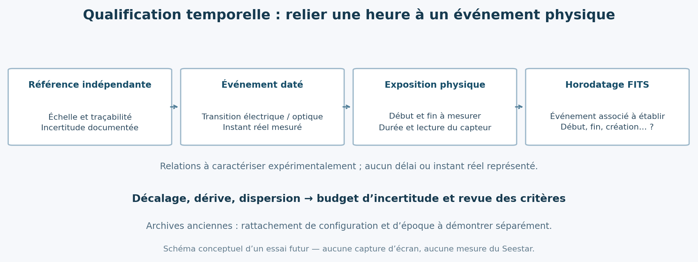

# Protocole préparatoire de qualification temporelle

**État : protocole proposé, aucun essai instrumental réalisé par ce lot.** Les copies locales servent à préparer le dossier ; aucune acquisition, action sur le télescope ou consultation du support USB n’est effectuée. Une future campagne demandera son propre plan préalable, un matériel de référence caractérisé et une revue des résultats.

*Schéma d’un essai futur, sans instant ni latence mesurés et sans capture d’écran. Les flèches indiquent des relations à caractériser, pas une chaîne déjà validée. [Version SVG](images/schema-qualification-temps.svg).*

## 1. Fixer l’usage avant de mesurer

Décrire la mesure visée : début ou fin d’exposition physique, milieu défini par un modèle explicite, ou relation du timestamp enregistré à cet événement. Définir l’échelle, les unités, la tolérance requise et ce qui sera considéré comme échec avant de consulter les résultats. Pour un mobile, séparer la contribution temporelle de l’erreur de position du modèle astrométrique.

Exemples de sensibilité **hypothétiques**, avec un déplacement uniforme et un décalage temporel de grandeur donnée :

| Vitesse supposée (″/s) | Décalage 1 s | Décalage 0,1 s | Décalage 0,01 s |
|---:|---:|---:|---:|
| 0,1 | 0,1″ | 0,01″ | 0,001″ |
| 1 | 1″ | 0,1″ | 0,01″ |
| 10 | 10″ | 1″ | 0,1″ |

Ces produits `v × Δt` illustrent un modèle de planification, sans performance mesurée du S50 ni seuil universel. Choisir un budget angulaire admissible et une gamme de vitesses avant de déduire une exigence temporelle. Ne pas confondre borne maximale, écart-type, biais et intervalle de couverture.

## 2. Identifier le périmètre applicable

Consigner modèle, identifiant privé de l’appareil, firmware explicitement vérifié, version de l’application, mode de monture/acquisition, durées disponibles, paramètres de synchronisation et date de l’essai. `PROGRAM` ou un numéro dans un en-tête ne suffit pas à établir toute cette chaîne. Conserver les sources documentaires et leurs versions avec un avis sur leur applicabilité exacte.

Pour les anciennes archives, rassembler les éléments contemporains : configuration enregistrée, journaux de synchronisation, référence externe, historique firmware et traitements déjà appliqués. S’ils manquent, marquer le rattachement historique **non démontré**. Un résultat obtenu aujourd’hui sur un appareil reconfiguré ne corrige ni ne certifie rétroactivement ces fichiers.

## 3. Définir une référence indépendante

Choisir une référence dont le lien à l’échelle de temps et l’incertitude sont documentés. Vérifier le chemin complet : horloge de référence → événement électrique/optique → détection enregistrée. Une heure affichée par l’application ou un téléphone partageant sa synchronisation ne démontre pas une indépendance ; les délais d’affichage, transmission et capture doivent être caractérisés.

Un dispositif lumineux daté est une méthode candidate, à concevoir et valider avant utilisation. Enregistrer indépendamment l’instant réel de ses transitions et leur incertitude ; ne pas assimiler une commande logicielle à l’émission optique. Préciser comment les transitions observées permettent de borner début et fin d’exposition, ainsi que les ambiguïtés de cadence. Le choix du matériel et la validation du dispositif restent ouverts ; ce document ne déclare aucun montage prêt à qualifier une horloge.

## 4. Préenregistrer le plan d’acquisition

Proposition de base à adapter puis figer **avant essai** : au moins 30 répétitions par configuration retenue, réparties en blocs au début, au milieu et à la fin d’une séance couvrant la durée d’usage visée. Inclure les durées d’exposition effectivement supportées/utilisées, les redémarrages et conditions de synchronisation pertinentes. Toute dérogation doit être justifiée, sans présenter ce nombre comme un standard de certification.

Définir les critères de qualité de la référence, saturation, détection des transitions, associations ambiguës et pertes de fichiers. Conserver les échecs et exclusions ; ne pas sélectionner seulement les mesures favorables. Les essais réels futurs auront des copies de travail et des sorties locales distinctes des originaux ; aucune modification d’archive n’est une méthode de qualification.

## 5. Mesurer les relations temporelles

Relier chaque fichier aux événements de référence. Tester séparément les hypothèses « début », « fin », « moyenne » et « création/enregistrement », sans choisir une convention à partir de la seule régularité des dates. Examiner le décalage absolu, son évolution avec le temps, la dispersion des écarts et la durée effective.

Documenter les effets possibles de lecture/séquencement du capteur et la position des sources dans l’image ; ne pas supposer un comportement de capteur non établi. Distinguer durée d’exposition, temps écoulé entre observations et intégration cumulée d’un empilement. Conserver les valeurs brutes et toute correction dans un produit dérivé traçable, jamais dans les FITS d’origine.

## 6. Construire et revoir le budget d’incertitude

Pour chaque contribution, indiquer valeur/unité, origine, modèle/distribution, nature de l’incertitude et sensibilité : référence, émission/détection de transition, quantification, déclenchement, durée, dérive et dépendances pertinentes. Décrire les biais et corrections séparément de la dispersion aléatoire. La granularité écrite dans un timestamp n’est pas à elle seule une incertitude de déclenchement.

La propagation doit tenir compte des covariances significatives ; une somme quadratique simple exige des hypothèses d’absence de corrélation justifiées. Distinguer incertitude-type composée et incertitude élargie avec facteur/couverture annoncés. Le [GUM, sections 5–6](https://www.bipm.org/documents/20126/2071204/JCGM_100_2008_E.pdf) fournit le cadre métrologique ; le projet ne calcule pas encore ce budget instrumental.

Évaluer les limites de validité selon configuration, durée de séance, température/conditions pertinentes et qualité de synchronisation. Un faible résidu moyen ou une dispersion faible n’exclut pas un décalage systématique commun. La précision astrométrique ne sert pas de preuve de synchronisation.

## 7. Décider séparément pour chaque usage et époque

Préparer un dossier avec données brutes, empreintes, journal de référence, configuration, méthode, exclusions, analyses reproductibles, budget et confrontation aux critères préenregistrés. Une revue devra distinguer : preuve insuffisante, usage exploratoire ou aptitude justifiée pour un usage/configuration/époque précisément bornés. L’acceptation d’un organisme scientifique reste une question distincte.

Le rattachement aux anciennes archives est une décision séparée. En son absence, conserver leurs heures non qualifiées même si le nouvel essai est satisfaisant. Ne pas produire de vitesse scientifique, milieu UTC certifié ou soumission sur la seule base du dossier préparatoire.

## 8. Produits disponibles dès maintenant

Le [contrat de préparation](CONTRAT-PREUVES-TEMPS.md) décrit `gar time-evidence`. Il produit les déclarations collectées, leurs limites, un canevas de preuves et un plan à compléter. Le logiciel n’ingère pas le canevas complété et ne délivre aucune qualification automatique. Les preuves et rapports réels restent privés ; les illustrations publiques sont conceptuelles ou synthétiques.

Les distinctions de champs temporels s’appuient sur [FITS 4.0](https://fits.gsfc.nasa.gov/standard40/fits_standard40aa-le.pdf) et [Rots et al.](https://arxiv.org/abs/1409.7583). La procédure, le nombre proposé de répétitions et les critères à préenregistrer sont des choix préparatoires du projet ; ils ne sont pas une norme instrumentale du Seestar.
