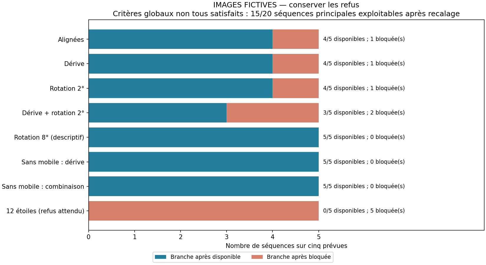
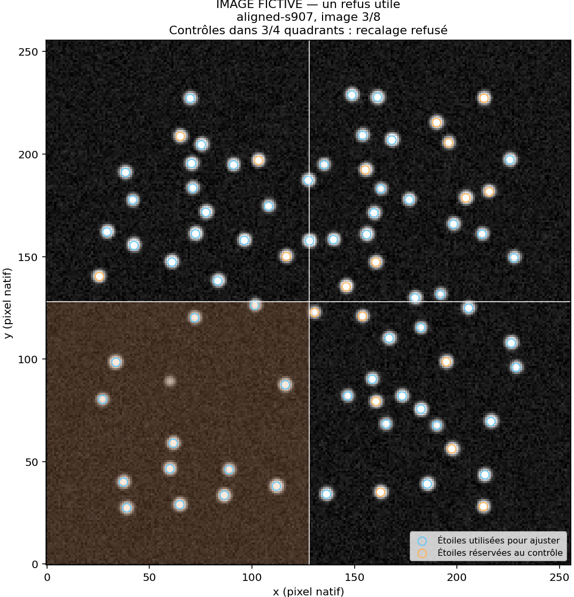
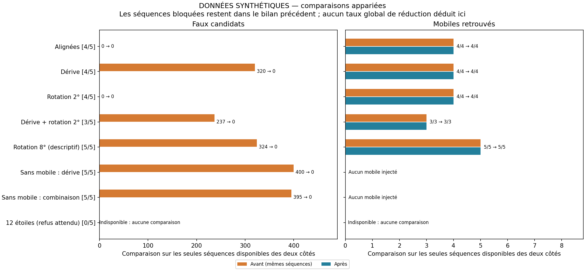
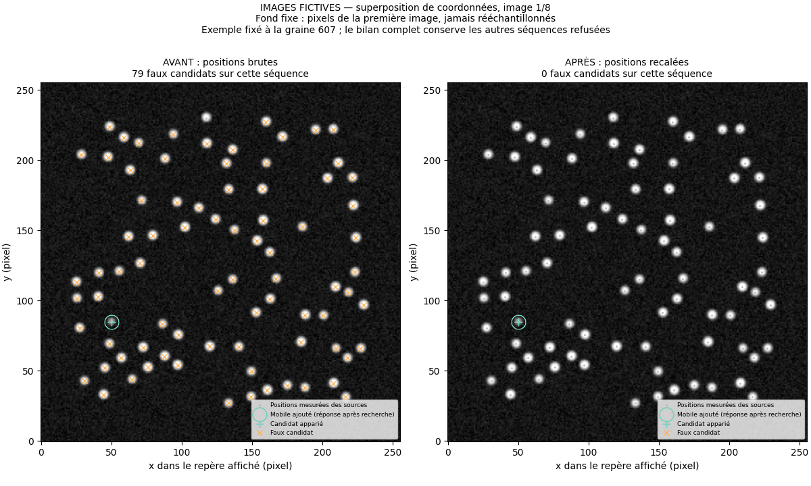

# Recaler les positions puis chercher les mobiles — essai synthétique

Le plan **[`286af43`](https://github.com/steveprudhomme/gnu-astrophotography-recycle/commit/286af43976e85140a663e1019779731c40153262)** a été committé, publié et vérifié sur GitHub avant de coder le lot 13. Cette recette relie les fonctions existantes des [mobiles](CONTRAT-MOBILES-SYNTHETIQUES.md) et du [recalage](CONTRAT-RECALAGE.md), **sans changer leurs moteurs ou seuils**. L’application reste 0.10.0a1, avec de nouveaux exemples et tests. Aucun pixel FITS n’est rééchantillonné ou réécrit, aucune clé USB n’est consultée.

**Résultat : les critères exploratoires globaux ne sont pas tous satisfaits.** Quinze des vingt séquences principales sont exploitables après recalage et leurs quinze mobiles sont retrouvés, sans faux candidat. Les cinq autres séquences sont bloquées par une couverture insuffisante des étoiles de contrôle ; elles ne sont pas comptées comme des réussites. Ce résultat incomplet est conservé sans relâcher les critères.

## Jeu fixé avant les essais

Les cinq nouvelles graines sont **607, 701, 809, 907, 1009**. Chaque condition reprend les mêmes étoiles et bruits par graine : comparaisons appariées, sans indépendance statistique entre toutes les cellules. Il ne s’agit pas d’une validation par une autre équipe ou sur des observations réelles.

Huit images monoplans 256×256 par séquence, temps fictifs 0, 10, …, 70 s, fond 100 ADU, bruit gaussien sigma 2, sources gaussiennes sigma 1,3 pixel. Les 80 étoiles ont un pic entre 500 et 1 500 ADU, des centres initiaux entre 25 et 231, une séparation minimale de 10 pixels et un dégagement de 14 pixels autour du trajet mobile. Le mobile a un pic de 120 ADU et suit `(50 + 0,5t ; 85 + 0,2t)` avant transformation commune du champ. Les témoins n’ont aucun mobile ; le contrôle négatif n’a que 12 étoiles. Le modèle ne représente ni Bayer, ni calibrations, ni bruit de photons étalonné, ni traînée pendant une pose réelle.

| Condition, cinq répétitions chacune | Dérive horizontale fictive | Rotation totale autour de (127,5 ; 127,5) | Rôle |
|---|---:|---:|---|
| Alignées | 0 | 0 | Principal |
| Dérive | 0,15 pixel/s | 0 | Principal |
| Rotation | 0 | 2 degrés | Principal |
| Combinaison | 0,15 pixel/s | 2 degrés | Principal |
| Rotation plus forte | 0 | 8 degrés | Descriptif |
| Sans mobile, dérive | 0,15 pixel/s | 0 | Témoin |
| Sans mobile, combinaison | 0,15 pixel/s | 2 degrés | Témoin |
| Douze étoiles et mobile | 0,15 pixel/s | 2 degrés | Refus attendu |

Soit **40 séquences, 320 images et 30 injections mobiles**. Les centres exacts sont tournés puis translatés lors de la génération. Aucun jeu n’est trié après coup pour retenir les graines favorables.

## Chaîne réellement exécutée

1. Mesurer une seule fois les détections natives avec `moving.detect_sources` dans chaque image.
2. Branche **avant** : retirer les sources stationnaires puis rechercher les trajectoires avec les fonctions gelées.
3. Prendre les étoiles mesurées de la première image comme référence commune, sans catalogue ou WCS. Cette image a une transformation identité de référence ; ce n’est pas un recalage ajusté et validé sur elle-même.
4. Pour les sept autres images, appeler `registration.detect` et `register_points`. Le module sépare un quart des détections de chaque pose avant les hypothèses et l’ajustement. Les contrôles sont réservés **par pose** ; leurs identités ne constituent pas un groupe stellaire indépendant fixe sur toute la série. La référence mesurée partagée introduit des erreurs corrélées. La détection stellaire emploie ses moyennes 2×2 habituelles ; elle est distincte de la détection native des mobiles et ne modifie pas les FITS.
5. Si les sept modèles sont acceptés, appliquer leurs rotations/translations aux **mêmes positions natives**. Garder le domaine de recouvrement dans la référence, avec marge de 8 pixels ; conserver le nombre de points exclus. Utiliser ensuite le même filtre stationnaire et la même recherche de trajectoires.
6. Si une seule pose est refusée, la branche après de toute la séquence est **indisponible**. Aucun remplacement par identité ou transformation exacte, aucune suppression discrète de pose.
7. Après gel de tous les modèles et candidats des 40 séquences, lire la vérité pour le bilan un-à-un. Les positions brutes transformées servent à l’avant ; les positions initiales dans le repère de référence servent à l’après. La pente linéaire de la vérité brute tient compte de son éventuelle courbure sous rotation. Les modèles exacts ne servent qu’au diagnostic géométrique final, jamais à l’ajustement.

Les listes stellaires ne sont pas nettoyées des mobiles grâce à la vérité. Un mobile peut se trouver parmi ces détections : les associations, leur rayon et les contrôles restent ceux de l’algorithme existant. L’expérience ne démontre pas une séparation parfaite des étoiles et des mobiles.

## Gel, protections et provenance

Empreintes SHA-256 du texte UTF-8 avec fins de ligne LF, vérifiées avant/après :

| Source | Empreinte |
|---|---|
| `src/gar/registration.py` | `23828292730f324a4a06ba5b247187fd21aa1eeb01bd8e4dfda90c46d3d709da` |
| `src/gar/moving.py` | `f492032e0188310484faaf372db4c96597fd7910ecd3821629edb8365f27be67` |
| `src/gar/moving_reports.py` | `b3b543591ad7cbe35dd0c08a92a8aee67b89888a1488f6b80fdbb354a0b6be0c` |

Les mêmes dépendances sont réutilisées. Empreintes des images, du manifeste, de la vérité et des rapports de candidats, version des bibliothèques, recette et révision Git sont consignées. La vérité est hachée au départ mais ses coordonnées ne sont lues qu’après le gel. Les sorties doivent être nouvelles, sous `local/`, sans liens/jonctions ; chemins extérieurs refusés avant lecture. FITS ouverts en lecture seule, aucune requête réseau d’analyse, aucun accès au support externe. Les marqueurs synthétiques ne prouvent pas l’origine d’un fichier arbitrairement réétiqueté ; ne jamais les ajouter à une vraie observation pour contourner ce périmètre.

## Reproduire et comprendre le code 2

Après l’[installation pédagogique](DEMARRER-DE-ZERO.md), outils graphiques facultatifs inclus, depuis la racine du projet et avec des dossiers neufs :

```powershell
.\.venv\Scripts\python.exe examples/moving_registration.py make local/recalage-mobiles-entree
.\.venv\Scripts\python.exe examples/moving_registration.py run local/recalage-mobiles-entree/manifest.json local/recalage-mobiles-entree/truth.json local/recalage-mobiles-rapport
.\.venv\Scripts\python.exe examples/plot_moving_registration.py local/recalage-mobiles-entree/manifest.json local/recalage-mobiles-entree/truth.json local/recalage-mobiles-rapport/comparison.json local/recalage-mobiles-figures
```

Prévoir environ 86 Mo pour les FITS seuls, plus les rapports et figures. La génération et le dessin aboutis retournent 0. **L’analyse retourne 2 sur ce jeu** : le rapport est complet mais les critères globaux ne sont pas tous satisfaits. Le message final annonce `critères exploratoires : False`. On peut alors lire le rapport et produire les figures. Un code 1 signifie que le travail n’a pas pu aboutir ; garder le message et les produits partiels, reprendre dans une nouvelle sortie après résolution.

`comparison.json` contient les deux branches, les modèles, contrôles, détections, candidats, erreurs de position/vitesse sur les appariés, taux par image/mégapixel-image/heure fictive, blocs indisponibles, provenance et critères. `comparison.csv` et `report.md` donnent les comptages ; une valeur absente après refus n’est pas remplacée par zéro. Les quarante fichiers individuels sont les modèles et candidats gelés **avant évaluation** ; leurs empreintes sont conservées dans le rapport final. `progress.json` conserve les séquences achevées : `complete` signifie que le calcul prévu est terminé, pas que les critères sont satisfaits. Une interruption donne `incomplete` et ne fabrique pas de bilan complet.

## Bilan intégral

| Condition | Avant : retrouvés/injectés | Avant : faux candidats, 5 séquences | Après disponible | Après : retrouvés/injectés disponibles | Après : faux candidats disponibles |
|---|---:|---:|---:|---:|---:|
| Alignées | 5/5 | 0 | 4/5 | 4/4 | 0 |
| Dérive | 5/5 | 400 | 4/5 | 4/4 | 0 |
| Rotation 2 degrés | 5/5 | 0 | 4/5 | 4/4 | 0 |
| Combinaison | 5/5 | 395 | 3/5 | 3/3 | 0 |
| Rotation 8 degrés, descriptive | 5/5 | 324 | 5/5 | 5/5 | 0 |
| Témoin dérive | 0/0 | 400 | 5/5 | 0/0 | 0 |
| Témoin combinaison | 0/0 | 395 | 5/5 | 0/0 | 0 |
| Douze étoiles | 5/5 | 60 | 0/5 | Indisponible | Indisponible |



*Graphique calculé sur données synthétiques. Un 4/4 après sur quatre séquences disponibles ne se transforme pas en réussite 5/5 sur la condition complète. Les témoins 0/0 ont un rappel indéfini.*

Les cinq refus principaux sont `aligned-s907`, `drift-s907`, `rotation-s907`, `combined-s809`, `combined-s907`. Dans chaque modèle concerné, les contrôles associés couvrent trois quadrants au lieu des quatre exigés, malgré des résidus sous les seuils. Les cinq négatifs sont refusés pour effectifs insuffisants : neuf associations d’ajustement et trois de contrôle, contre vingt et dix requis. Ces refus restent dans les résultats.



*Premier refus principal dans l’ordre du manifeste : image 3/8 de la séquence alignée 907. Bleu : étoiles d’ajustement ; orange : contrôles associés. La zone teintée ne contient aucun contrôle associé. C’est une annotation de pixels synthétiques effectivement générés, pas une capture d’écran.*

### Comparer les mêmes séquences

Une comparaison utile garde le **même sous-ensemble des deux côtés**. Parmi les séquences disponibles après recalage :

| Condition | Séquences comparables | Faux candidats avant → après | Mobiles avant → après |
|---|---:|---:|---:|
| Alignées | 4/5 | 0 → 0 | 4/4 → 4/4 |
| Dérive | 4/5 | 320 → 0 | 4/4 → 4/4 |
| Rotation 2 degrés | 4/5 | 0 → 0 | 4/4 → 4/4 |
| Combinaison | 3/5 | 237 → 0 | 3/3 → 3/3 |
| Rotation 8 degrés | 5/5 | 324 → 0 | 5/5 → 5/5 |
| Témoin dérive | 5/5 | 400 → 0 | Aucun mobile injecté |
| Témoin combinaison | 5/5 | 395 → 0 | Aucun mobile injecté |
| Douze étoiles | 0/5 | Indisponible | Indisponible |



Les sept séquences comparables de dérive/combinaison principales passent de **557 à zéro faux candidat**, avec sept mobiles conservés. **La réduction globale sur les dix séquences prévues reste indéfinie**, puisque trois branches après sont indisponibles ; le total avant de ces dix séquences est 795. Ne pas annoncer « 795 → 0 », ni un taux global de 100 %. La disponibilité dépend de la sélection de contrôle : ce sous-ensemble n’est pas une population aléatoire indépendante. Le succès descriptif à 8 degrés ne prouve pas qu’une rotation plus grande améliore le recalage.

### Critères fixés et verdict

| Critère du plan | Résultat |
|---|---|
| 20 séquences principales avec sept modèles acceptés | Non : 15/20 |
| 20 mobiles principaux retrouvés après | Non démontré : 15 retrouvés dans les 15 disponibles, cinq indisponibles |
| Zéro faux candidat après sur les 20 principales | Non démontré sur l’ensemble ; zéro dans les 15 disponibles |
| P95 de position ≤0,3 pixel sur les appariés principaux | Oui : environ 0,0761 pixel |
| Erreur vectorielle maximale de vitesse ≤0,02 pixel/s | Oui : environ 0,000895 pixel/s fictive |
| Dix témoins acceptés sans candidat après | Oui |
| Cinq contrôles négatifs bloqués | Oui |
| Réduction globale ≥90 % sur dérive/combinaison principales | Non démontrée : réduction indéfinie |

Les erreurs numériques sont conditionnelles aux appariements disponibles ; elles ne décrivent ni les branches bloquées ni un budget absolu céleste. Ces critères sont ceux du projet, sans certification instrumentale ou norme de soumission.

## Lire l’animation sans confondre pixels et coordonnées



Le plan fixe l’exemple `combined-s607` : 79 faux candidats avant, zéro après, mobile conservé. **Le fond reste les pixels de la première image dans les deux panneaux.** Ce sont les positions mesurées qui changent au fil des huit images ; ce GIF n’est pas une série de FITS rééchantillonnés. Gris : détections ; orange : faux candidats ; bleu : candidat apparié ; vert : réponse connue ajoutée au dessin après recherche. Le bilan complet et les refus des autres graines restent publiés à côté de cet exemple accepté.

## Vérifications et suite

Les tests couvrent transformations et recouvrement, refus sans identité de secours, mesure native unique, séparation des contrôles, intégrité des pixels, réseau interdit, vérité seulement après tous les candidats, campagnes interrompues, comptages appariés et critères non satisfaits. Un premier cas de test du P95 ne modifiait que 5 % des erreurs et ne forçait donc pas le percentile au-dessus du seuil ; l’exemple de test a été corrigé, **sans changer le critère ni les résultats expérimentaux**. Les légendes qui gênaient la lecture des premières figures ont été déplacées ; aucun jeu de données n’a été ajusté pour améliorer son bilan.

Les **17 nouveaux cas** et la suite existante passent, soit **277 tests logiciels en 26,55 secondes** lors du contrôle de ce lot. Ils ne constituent pas une qualification astrométrique, photométrique ou temporelle du Seestar. Les commandes pédagogiques, jeux régénérés, mesures et figures sont reproduits depuis le code committé avant publication ; les rapports de contrôle restent sous `local/`.

La vérification finale part du commit **`6235af5`**, sans modification suivie et avec le même environnement : **30 commandes pédagogiques** aboutissent aux codes attendus, dont 2 pour cette analyse. Les **320 images régénérées** ont les mêmes empreintes ; les **40 rapports gelés**, modèles et candidats évalués sont identiques. Les comptages appariés explicites du bilan final sont réconciliés avec ces mêmes séquences mesurées. Les **quatre PNG et le GIF** sont identiques aux illustrations publiques ; le GIF comprend huit images, avec inspection visuelle au début, au milieu et à la fin. La provenance du rapport final change avec le commit propre, sans amélioration artificielle du verdict : cinq principales restent bloquées et les critères globaux restent faux. Ce n’est pas une nouvelle installation de Windows ou une validation indépendante.

Le prochain problème identifié est la disponibilité du contrôle spatial : étudier une sélection de contrôles mieux répartis, avec un nouveau protocole et un nouveau jeu avant tout changement. Il faudra conserver des contrôles réellement réservés et les exigences de couverture ; on ne peut pas simplement déclarer les modèles refusés acceptables parce que leurs résidus sont petits. Les limites faible/lent, le temps réel, les calibrations et le budget céleste restent ouverts.

Ce suivi est documenté dans le [lot 14 de contrôles spatiaux](CONTROLES-SPATIAUX.md) : nouvelle recette, nouveaux jeux et comparaison appariée, sans modifier les sources gelées de ce lot 13. Son résultat 15/20 et son code 2 restent conservés. La [préparation du pilote réel](PASSAGE-AUX-IMAGES-SEESTAR.md) est le prochain jalon proposé après cette comparaison, sous réserve d’une série locale adaptée.

Références primaires consultées le 17 novembre 2026 : [Photutils DAOStarFinder](https://docs.astropy.org/projects/photutils/en/stable/api/photutils.detection.DAOStarFinder.html) et [SciPy cKDTree](https://docs.scipy.org/doc/scipy/reference/generated/scipy.spatial.cKDTree.html). Les algorithmes existants, seuils et critères de cet essai sont documentés dans les contrats du projet. Ces sources décrivent les bibliothèques ; elles ne valident pas les performances du Seestar.
