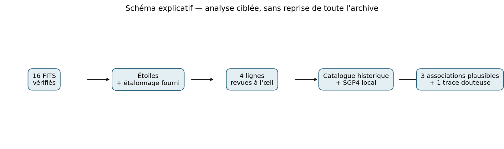
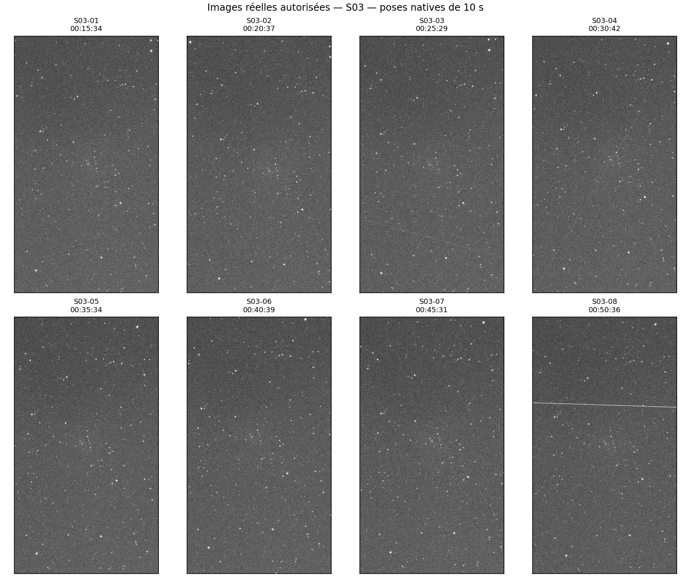
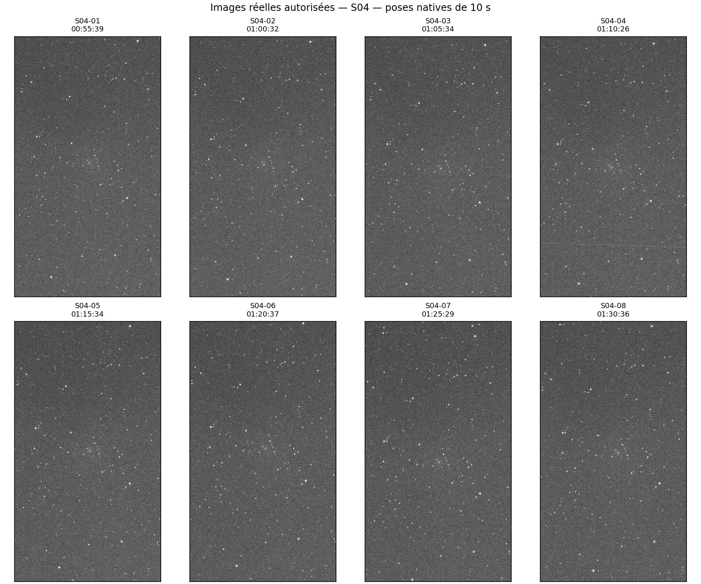
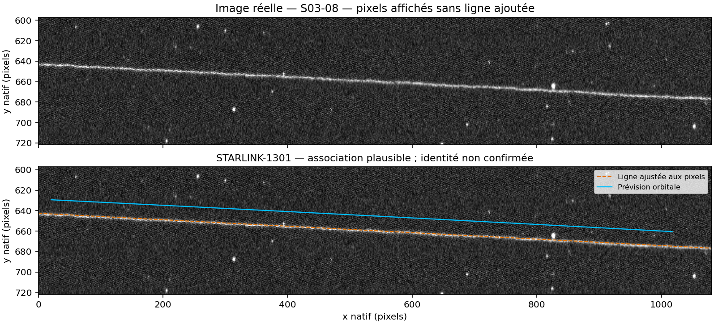
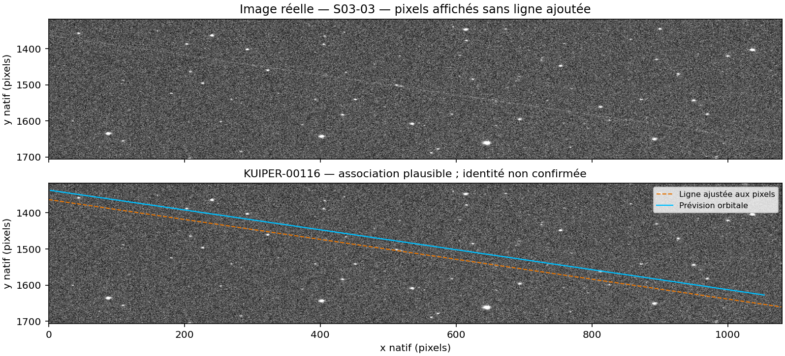
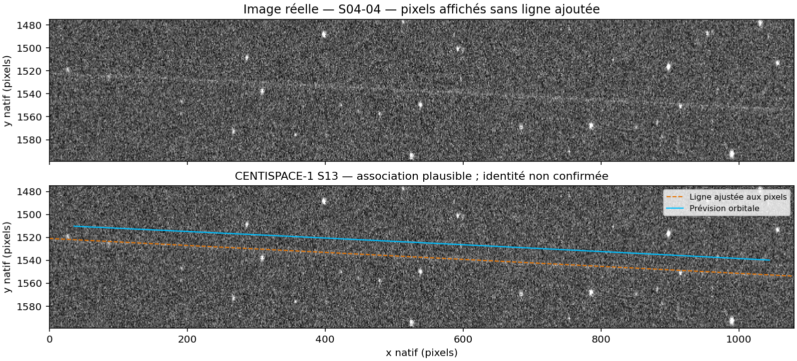
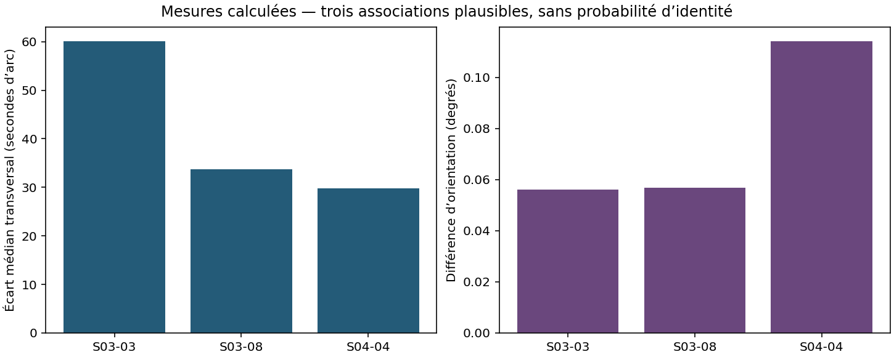
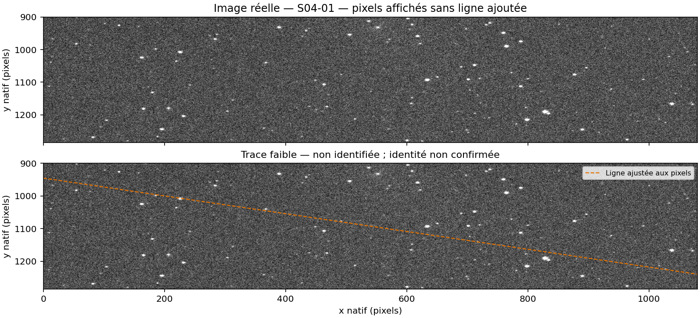
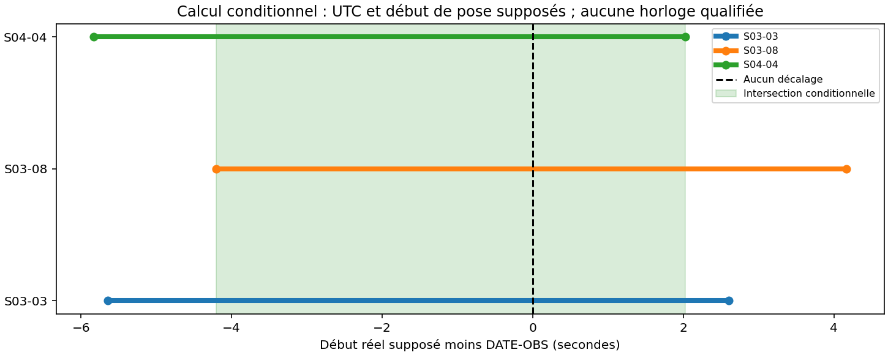

# Retrouver les trois passages possibles, depuis zéro

Tu vas examiner **de vraies photos**. Tu vas reproduire trois associations possibles avec des satellites connus.
Une **association** rapproche une trace photographiée d’un passage calculé. Elle reste à vérifier.
Ce guide ne promet ni découverte nouvelle, ni identification certaine.

Ce parcours vise les débutants, dès 10 ans, avec de l’aide pour installer les outils.
Sa compréhension par des enfants n’a pas encore été testée.
Tu peux faire une pause entre deux missions. Tu n’as pas besoin de toucher à une clé USB.
La fouille de toute l’archive reste en pause.



**Lire sans image.** On vérifie seize copies. Les étoiles servent à aligner leurs repères.
On mesure quatre traces choisies à l’œil. On cherche ensuite les orbites proches.
Trois rapprochements sont plausibles. La quatrième trace reste douteuse et non identifiée.
Cette figure est un schéma explicatif, pas une capture d’écran.

## Mission 1 — comprendre ce que tu cherches

Une **pose** est une photo prise pendant une exposition. Ici, chaque exposition dure dix secondes.
Un **pixel** est une case de l’image. Une traînée traverse plusieurs cases pendant une pose.
Le satellite peut sortir du champ avant la fin de l’exposition.
La longueur visible divisée par dix ne donne donc pas forcément sa vitesse.

Un **FITS** contient les pixels et un **en-tête**. L’en-tête donne des renseignements sur la photo.
`DATE-OBS` contient une date. `EXPTIME` contient la durée d’exposition.
Le nom du fichier et sa date interne ne constituent pas deux horloges indépendantes.

Le jeu contient deux séries de huit poses. Les poses sont espacées d’environ cinq minutes.
Les trois satellites proposés sont différents. Ils ne forment pas une seule trajectoire entre les photos.



**Lire sans image.** Chaque case montre une pose différente de S03, dans l’ordre de 01 à 08.
Les étoiles et le fond sont réels. L’affichage gris augmente le contraste pour aider la lecture.
L’étirement change l’affichage, pas les fichiers FITS.



**Petite vérification.** Compte huit cases par série. Tu dois obtenir seize poses au total.

## Mission 2 — préparer l’ordinateur

Il te faut Windows 10 ou 11, Internet pour les installations et assez d’espace libre.
Prévois environ 2 Go libres pour les outils et plusieurs essais. Le calcul utilise quelques centaines de Mo de mémoire.
La durée dépend de ton ordinateur et du service distant. Le téléchargement peut être temporairement indisponible.

Installe [Python 3.13](https://www.python.org/downloads/windows/) depuis le site officiel.
Installe aussi [Git pour Windows](https://git-scm.com/downloads/win).
Ces outils sont gratuits. Fais-toi aider pour l’installation si nécessaire.

Ouvre le menu Démarrer. Cherche **PowerShell**. Ouvre-le avec ton compte habituel.
Un **terminal** est une fenêtre où tu donnes des instructions écrites à l’ordinateur.
Copie une commande à la fois. Appuie sur Entrée après chaque commande.
Ne copie pas les trois accents graves qui entourent les exemples.

Vérifie Python puis Git :

```powershell
py -3.13 --version
git --version
```

**Résultat attendu.** Deux numéros de version apparaissent, dont Python 3.13.
Si une commande est inconnue, termine son installation puis rouvre PowerShell.

Crée une nouvelle copie du projet dans ton dossier personnel :

```powershell
Set-Location $env:USERPROFILE
git clone https://github.com/steveprudhomme/gnu-astrophotography-recycle.git GAR-satellites
Set-Location GAR-satellites
```

`Set-Location` change le dossier courant. `git clone` copie le dépôt GitHub.
Si `GAR-satellites` existe déjà, choisis un nouveau nom pour cette première reproduction.
Ne supprime pas un dossier qui contient ton travail.

Vérifie que tu es au bon endroit :

```powershell
Get-Item .\ROADMAP.md
Get-Item .\examples\data\seestar-series34\manifest.json
```

**Résultat attendu.** PowerShell affiche les deux fichiers.
Une erreur « introuvable » signifie souvent que le dossier courant est incorrect.

## Mission 3 — installer une boîte à outils séparée

Un **environnement Python** garde les outils de ce projet ensemble.
Il évite de mélanger leurs versions avec celles d’un autre projet.

```powershell
py -3.13 -m venv .venv
.\.venv\Scripts\python.exe -m pip install -r requirements/satellite-tutorial.txt
```

La première commande crée `.venv`. La deuxième installe les outils listés dans le fichier.
Les versions scientifiques utilisées pour la reproduction sont fixées dans ce fichier.
La recette utilise aussi le code historique du dépôt ; tu n’as pas besoin d’activer l’environnement.

Vérifie les imports :

```powershell
.\.venv\Scripts\python.exe -c "import numpy, astropy, sgp4, pyproj; print('Outils prêts')"
```

**Résultat attendu.** `Outils prêts` apparaît.
`ModuleNotFoundError` signifie qu’un outil manque dans cet environnement.
Relance l’installation avec le même chemin Python, puis conserve le message complet si elle échoue.

## Mission 4 — choisir les seize fichiers et vérifier les copies

Tu peux commencer avec les FITS fournis dans le dépôt. Ils sont identiques aux seize copies sélectionnées sur disque.
Le [manifeste](../examples/data/seestar-series34/manifest.json) relie chaque nom court à son nom d’origine.
Il contient aussi une **empreinte SHA-256** : un code calculé à partir du contenu du fichier.
Deux empreintes différentes signalent des contenus différents.

```powershell
.\.venv\Scripts\python.exe examples/reproduce_series34.py prepare --run local/mon-essai
```

**Résultat attendu.** Le bilan indique `copies: 16` et `hashes_equal: true`.
Les copies de travail apparaissent dans `local/mon-essai/fits`.
Le dossier `local` garde tes essais hors des fichiers publiés automatiquement par Git.
Les fichiers d’entrée sont seulement lus. La recette ne les déplace pas et ne les corrige pas.

Pour employer tes fichiers d’origine déjà présents sur ton disque dur, rassemble des **copies** dans un dossier local.
Ce dossier doit contenir les seize noms d’origine du manifeste, ou les seize noms courts publiés.
La commande ne parcourt aucun sous-dossier et ne cherche pas automatiquement dans ton disque.
Exemple, si tu as préparé `mes-fits` dans le projet :

```powershell
.\.venv\Scripts\python.exe examples/reproduce_series34.py prepare --run local/mon-essai-disque --fits .\mes-fits
```

Cette variante crée un autre essai. Pour suivre la suite sans changer les commandes, utilise `local/mon-essai`.
Un fichier retouché ou différent est refusé par son empreinte.
Un essai existant est refusé par `prepare`. Choisis un nouveau nom pour recommencer depuis zéro.

Tu peux vérifier une empreinte toi-même :

```powershell
Get-FileHash .\examples\data\seestar-series34\S03-03.fit -Algorithm SHA256
```

Compare le code avec l’entrée `S03-03` du manifeste. Les majuscules ne changent pas sa valeur.

## Mission 5 — récupérer les références

Une **orbite** décrit le mouvement d’un satellite autour de la Terre.
Un **TLE** est un court jeu de nombres utilisé pour prévoir ce mouvement avec SGP4.
Une orbite actuelle ne remplace pas une orbite historique proche de la photo.

La commande suivante demande à SatChecker le catalogue associé au **20 septembre 2025 à minuit**.
Elle transmet seulement cette date et les numéros des pages demandées.
Elle ne transmet ni les FITS, ni le site terrestre, ni les directions célestes, ni les heures précises des poses.
Elle télécharge aussi une grille géodésique officielle depuis PROJ, sans transmettre de coordonnées.
Ces deux téléchargements sont les seuls accès Internet de la recette, après l’installation.

```powershell
.\.venv\Scripts\python.exe examples/reproduce_series34.py references --run local/mon-essai --download-references
```

**Résultat historique.** Le catalogue contenait 27 779 lignes, dont 27 764 jeux orbitaux distincts.
Toutes les pages doivent être reçues. La commande garde les pages déjà obtenues pour une reprise.
Le reçu `reference-receipt.json` conserve les empreintes et le nombre de lignes.
Le service peut évoluer. Un nouveau téléchargement peut donc différer du cache historique.

Si la connexion s’interrompt, conserve les messages. Tu peux relancer cette même commande plus tard.
La recette ne remplace pas un échec réseau par une absence de satellite.
Elle n’invente aucune orbite manquante.

Pour reproduire exactement le cache historique déjà conservé sur ton disque, utilise plutôt :

```powershell
.\.venv\Scripts\python.exe examples/reproduce_series34.py references --run local/mon-essai --catalog .\mes-references\catalogue-complete.json --geoid .\mes-references\ca_nrc_HT2_2010v70.tif
```

Cet exemple suppose que tu as placé ces deux références dans `mes-references`, avant cette mission.
Ne relance pas la variante de copie si ses destinations existent déjà.
Le catalogue tiers n’est pas inclus dans GitHub : ses droits sont distincts des droits de tes photos.
La notice [SOURCES-SATELLITES.md](SOURCES-SATELLITES.md) donne les liens, la provenance et les empreintes attendues.

## Mission 6 — placer les étoiles dans un même repère

Les photos tournent légèrement entre les poses. On aligne leurs étoiles pour comparer les images.
Le **recalage** calcule cette rotation et ce déplacement.
Des étoiles réservées contrôlent les ajustements ; elles ne servent pas à les choisir.
La première image de chaque série garde exactement son propre repère.

Un **étalonnage WCS** est une carte reliant les pixels à des directions dans le ciel.
Ici, cette carte et 696 centres d’étoiles de référence sont **fournis avec l’exercice**.
Ils proviennent d’un empilement antérieur dont l’empreinte est indiquée.
Le FITS empilé n’est pas nécessaire à cette recette et n’est pas publié avec les seize poses.
Tu recalcules les transformations vers cette référence. Tu ne reconstruis pas indépendamment sa première carte céleste.
La précision absolue complète de cette carte reste à établir.

```powershell
.\.venv\Scripts\python.exe examples/reproduce_series34.py images --run local/mon-essai
```

**Résultat attendu avec les versions vérifiées.** Seize recalages acceptés et **935 propositions** de lignes.
La commande moyenne des blocs de 4 × 4 pixels pour le repérage.
Elle soustrait une référence médiane de chaque série pour réduire les étoiles fixes.
Le calcul de lignes garde ses paramètres fixés : pas angulaire 0,5°, support minimal 100 cases et score empirique 8.
Ce score n’est pas une probabilité. Ces règles sont séparées des anciens moteurs de mobiles.

Ouvre `proposals.json` dans un éditeur de texte. Il conserve toutes les propositions, y compris les fausses alertes.
Les bords et les restes d’étoiles peuvent ressembler à des lignes.
Le nombre 935 ne prouve ni 935 objets, ni la sensibilité du détecteur.

**Erreur expliquée.** « Recalage refusé » signifie qu’un contrôle manque ou dépasse ses limites.
Garde ce refus. Ne baisse pas les seuils pour obtenir le résultat annoncé.

## Mission 7 — mesurer les quatre traces choisies

La revue initiale a retenu `S03-03`, `S03-08`, `S04-01` et `S04-04`.
Le fichier `review-selection.json` donne les positions de départ de ces lignes.
Il ne contient aucun nom de satellite. Les choix précèdent le nouveau classement orbital.
Cet exercice refait une sélection humaine déjà connue ; il ne teste pas une découverte aveugle.

```powershell
.\.venv\Scripts\python.exe examples/reproduce_series34.py measure --run local/mon-essai
```

**Résultat attendu.** Quatre mesures sont enregistrées dans `measurements.json`.
La mesure revient aux pixels natifs, avant le rééchantillonnage d’affichage.
Elle ajuste une ligne proche du tracé initial et compare six lignes parallèles décalées.
Ce contrôle aide à repérer un signal local. Il ne donne pas une probabilité d’identification.



**Lire sans image.** Le trait discontinu suit la mesure guidée. Le trait continu montre une prévision orbitale.
Le rapprochement est calculé après la mesure. Aucune ligne n’est ajoutée aux pixels du FITS.
Tu verras la comparaison complète après la mission suivante.

## Mission 8 — comparer toutes les orbites admissibles

```powershell
.\.venv\Scripts\python.exe examples/reproduce_series34.py orbits --run local/mon-essai
```

Le calcul se fait localement, sans transmettre le site au service orbital.
Il écarte les éléments âgés de plus de sept jours au début de S03 et garde leurs comptes.
Le cache historique donne **27 228 jeux admissibles**. Plusieurs jeux peuvent concerner un même satellite.
Le calcul conserve les erreurs de propagation.

Une première recherche vérifie les alentours du champ à quatre instants.
La recherche fine couvre ensuite de −10 à +20 secondes autour de la date déclarée, par pas de 0,1 seconde.
Cette présélection limitée n’est pas une recherche exhaustive de toutes les vitesses possibles.

Le programme classe les hypothèses selon l’écart transversal médian, puis l’orientation.
Un **écart transversal** mesure la distance angulaire entre l’orbite prévue et la ligne photographiée.
Une **seconde d’arc** est une petite unité d’angle : un degré contient 3 600 secondes d’arc.
L’orientation décrit la direction de la ligne. Aucun nom attendu n’entre dans ce classement.

La hauteur de terrain fournie est 68 m dans le repère CGVD28, issue du relevé RNCan documenté.
La grille HT2_2010v70 donne environ 36,7 m au-dessus de l’ellipsoïde NAD83(CSRS).
Un **ellipsoïde** est une forme mathématique qui approche la Terre.
La hauteur réelle du télescope et le repère horizontal exact restent inconnus.
La recette ne change pas cette hauteur pour rapprocher artificiellement les lignes.

## Mission 9 — ouvrir les résultats et les comprendre

```powershell
.\.venv\Scripts\python.exe examples/reproduce_series34.py report --run local/mon-essai
Start-Process .\local\mon-essai\index.html
```

La première commande crée les figures et la page locale. La seconde ouvre cette page dans ton navigateur.
Le navigateur affiche des fichiers de ton ordinateur. Aucune publication automatique n’a lieu.
Le rapport consulte les réponses historiques seulement après l’enregistrement du classement.

| Pose | Hypothèse historique | Numéro NORAD | Écart médian | Orientation |
|---|---|---:|---:|---:|
| S03-03 | KUIPER-00116 | 65153 | 60,1″ | 0,056° |
| S03-08 | STARLINK-1301 | 45361 | 33,7″ | 0,057° |
| S04-04 | CENTISPACE-1 S13 | 62582 | 29,7″ | 0,114° |

Ces trois associations sont **plausibles et non confirmées**. Elles concernent des satellites déjà catalogués.
Le rapport `summary.json` doit indiquer `all_historical_results_reproduced: true` avec les références vérifiées.
Un résultat différent doit être conservé, puis expliqué par les versions, les données ou le catalogue.
Ne modifie pas les réponses attendues pour masquer une différence.





**Lire sans ces images.** Les deux traces suivent presque la même orientation que les prévisions indiquées.
Leurs distances restent non nulles. Le budget complet des erreurs instrumentales et orbitales n’est pas établi.
La proximité soutient une hypothèse ; elle ne suffit pas à certifier l’identité.



**Lire sans graphique.** Les écarts sont 60,1″, 33,7″ et 29,7″ ; les orientations diffèrent de moins de 0,12°.
Les barres représentent des écarts, pas des probabilités ni des intervalles de confiance.



**Ne force pas une réponse.** S04-01 reste non identifiée et douteuse.
Sa première hypothèse numérique présente environ 73,6° de différence d’orientation et 2 904″ d’écart.
Elle ne constitue pas une association plausible.
Une ligne isolée peut provenir d’un satellite, d’un avion, d’un météore ou d’un défaut.
Les douze autres poses n’ont pas montré de trace supplémentaire nette lors de cette revue.
Cela ne démontre pas leur absence de tout objet mobile.

## Mission 10 — comprendre la limite de l’heure

Le calcul suppose `DATE-OBS` exprimé en UTC et placé au début de la pose.
**UTC** est une référence de temps internationale. Cette hypothèse ne prouve pas la justesse de l’horloge.
Sous les identités et la géométrie retenues, les trois passages admettent une intersection de −4,2 à +2,0 secondes.
Le décalage signifie « début réel supposé moins date enregistrée ».



**Lire sans graphique.** Chaque intervalle permet au passage de tenir dans l’exposition de dix secondes.
L’intersection est conditionnelle. Ce n’est ni une erreur certifiée de l’horloge ni une correction à appliquer.
S04 apporte un contrôle de cohérence supplémentaire déjà examiné, avec le même catalogue et la même géométrie.
Il ne constitue pas une validation temporelle indépendante ou aveugle.
Les conventions milieu et fin restent indissociables d’un décalage inconnu sans référence indépendante.

## Mission 11 — garder une trace de ton travail

Conserve tout le dossier `local/mon-essai`, y compris ses références et ses reçus.
Le [journal public](../JOURNAL-CANDIDATS.md) garde les trois entrées historiques et leur statut.
N’écris pas « satellite découvert » quand tu veux dire « passage retrouvé dans mes images ».
Si tu proposes une nouvelle interprétation, ajoute une entrée datée avec les raisons et les preuves.
Conserve les hypothèses rejetées et les inconnues.

| Fichier de sortie | Ce que tu peux vérifier |
|---|---|
| `inputs.json` | Les seize identifiants et empreintes |
| `environment.json` | Les versions réellement installées |
| `reference-receipt.json` | La provenance des références et leurs empreintes |
| `registration.json` | Les rotations, déplacements et contrôles d’étoiles |
| `proposals.json` | Toutes les propositions automatiques, y compris les fausses alertes |
| `measurements.json` | Les quatre lignes guidées et leurs positions célestes |
| `orbital-results.json` | Tous les classements, sans identité déclarée certaine |
| `summary.json` | La comparaison finale et les limites |
| `index.html` et `figures` | Les résultats visuels locaux |

## Si quelque chose ne fonctionne pas

| Message ou problème | Explication et action |
|---|---|
| `prepare` refuse un dossier existant | Choisis un nouveau dossier et garde l’ancien essai |
| Empreinte différente | Vérifie le nom du fichier ; repars d’une copie intacte |
| Fichier introuvable | Vérifie le dossier courant et le nom exact ; ne lance pas un parcours du support |
| Téléchargement arrêté | Le service ou la connexion n’a pas répondu ; conserve les pages et réessaie plus tard |
| Grille différente | Conserve le refus ; ne remplace pas son empreinte attendue |
| Recalage refusé | Ne mesure pas avec une transformation refusée ; conserve le diagnostic |
| Moins de trois hypothèses reproduites | Compare versions, catalogue et empreintes avant toute conclusion |
| Photo sombre | Le rendu de contraste diffère de la valeur brute ; utilise les figures calculées |
| Accents incorrects dans le terminal | Les fichiers UTF-8 restent lisibles dans un éditeur compatible |

## Pour aller plus loin

Le [manuscrit scientifique](article-satellites/README.md) explique les hypothèses et leurs limites avec un résumé français et anglais.
Les [références UQAM-APA](SOURCES-SATELLITES.md) relient la méthode à ses sources primaires.
Le [guide de rédaction](REDACTION-ACCESSIBLE.md) précise les choix pédagogiques et leurs limites.
Le présent parcours ne qualifie pas l’instrument pour toute recherche de satellites, d’astéroïdes ou de comètes.
