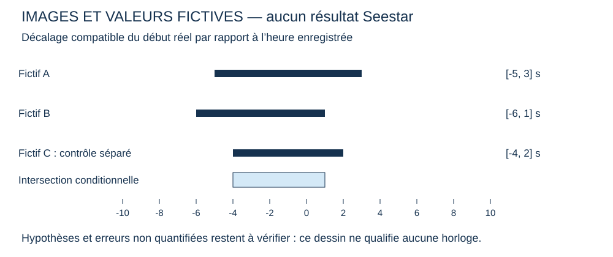

# Examiner deux séries avant de traiter toute l'archive

Cette page explique l'examen ciblé des séries 3 et 4. Le travail sur les 16 poses est terminé.
La grande fouille reste arrêtée. Les résultats réels détaillés et les images restent dans le dossier privé du mainteneur.

Tu peux reproduire l'exemple fictif ci-dessous avec Python et le code du projet.
Tu n'as besoin ni du télescope, ni des photos personnelles, ni d'un compte sur un service astronomique.

## 1. Comprendre ce que nous cherchons

Une **trace** est une forme allongée visible dans une image.
Une **correspondance plausible** est un passage calculé qui ressemble à cette trace par sa direction, sa position et son heure possible.
Cela ne suffit pas à confirmer l'identité de l'objet.

Le bilan ciblé contient quatre traces retenues après lecture visuelle des 16 poses.
Trois donnent des correspondances orbitales plausibles. La quatrième est très faible et reste non identifiée.
Les douze autres poses n'ont pas de trace additionnelle nette dans cette revue. Cela ne prouve pas une absence de passage.

## 2. Séparer propositions et objets réels

Le complément de recherche additionne le signal le long de plusieurs lignes possibles.
Il conserve les paramètres publiés avant l'essai : angles tous les 0,5 degré, support minimal et seuil robuste de l'accumulateur.
Son score exprime un contraste interne au calcul ; il n'est pas une probabilité.

Les contrôles fictifs retrouvent les lignes brillante et faible. Leur image de bruit seule ne propose aucune ligne.
Sur les données réelles, le complément produit pourtant 935 propositions, avec des bordures et des résidus d'étoiles.
Ce ne sont pas 935 objets. La sélection visuelle et la mesure native restent nécessaires.
Les paramètres ne sont pas ajustés pour faire disparaître ces propositions après examen des résultats.

## 3. Mesurer dans les vrais pixels

Les vues alignées aident à repérer les changements. Les mesures des quatre traces utilisent ensuite les pixels natifs.
Les étoiles réservées vérifient le lien entre les deux séries ; elles ne servent pas à ajuster ce modèle.
Les lignes initiales sont choisies visuellement avant la nouvelle comparaison orbitale.
Ces mesures guidées ne constituent pas une validation aveugle du détecteur.

Une trace coupée par le bord du champ n'indique pas forcément le début ou la fin de l'exposition.
Sa longueur visible ne doit donc pas être divisée automatiquement par la durée de la pose pour calculer une vitesse.

## 4. Comparer avec une hauteur cohérente

Une altitude cartographique et une hauteur utilisée dans un calcul orbital peuvent avoir des références différentes.
La conversion de cet essai utilise localement une grille HT2 de RNCan distribuée par PROJ.
Aucune coordonnée privée n'est envoyée au distributeur : la grille complète est téléchargée, puis interrogée sur l'ordinateur.

L'aller-retour de conversion est vérifié. Cela ne mesure pas l'altitude exacte du terrain ou la hauteur du télescope.
Le repère horizontal précis des coordonnées reste aussi à confirmer.
Les orbites, coordonnées, noms des hypothèses et figures réelles restent privés.

## 5. Comprendre une plage temporelle compatible

Imagine une caméra ouverte pendant dix secondes.
Un objet traverse tout son champ entre la troisième et la cinquième seconde après l'heure inscrite dans le fichier.
Si le début réel est trop tard, la caméra manque l'entrée. S'il est trop tôt, elle ferme avant la sortie.

Appelons **décalage** le début réel de l'exposition moins l'heure enregistrée.
Dans cet exemple fictif, le décalage compatible va de moins cinq à plus trois secondes.
Cette plage suppose que l'identité, le trajet et la géométrie sont corrects.
Elle ne représente pas une marge d'erreur certifiée de l'horloge.



**Lire sans image.** Le cas fictif A accepte de −5 à +3 secondes ; B accepte de −6 à +1.
Leur partie commune est de −5 à +1. Le cas distinct C accepte de −4 à +2.
Les trois cas laissent donc de −4 à +1 seconde. Ces nombres sont fictifs, sans résultat d'observation Seestar.
La couleur n'est pas nécessaire pour comprendre : chaque barre porte ses bornes écrites.

## 6. Refaire cet exemple sur ton ordinateur

Ouvre PowerShell à la racine du projet. Vérifie que le dossier `examples` est présent.
Utilise un nouveau nom de sortie si tu as déjà exécuté la commande.

```powershell
.\.venv\Scripts\python.exe examples/trace_time_intervals.py local/mon-exemple-intervalles-01.svg
```

Le programme affiche les trois plages, leur intersection et `clock_qualified: false`.
Il crée le schéma SVG demandé. Ouvre ce fichier pour lire les barres et leurs bornes.
Les résultats attendus sont :

| Étape fictive | Plage commune |
|---|---|
| A et B | De −5 à +1 seconde |
| A, B et C | De −4 à +1 seconde |

Le code utilise seulement la bibliothèque standard de Python. Il ne consulte aucune image ou orbite réelle.
Il vérifie aussi le cas d'un passage trop long pour tenir dans la pose.
Si la sortie existe, il demande un nouveau fichier au lieu de remplacer le précédent.

## 7. Interpréter les heures des séries réelles

Les trois passages plausibles permettent un calcul conditionnel analogue, conservé dans le rapport privé.
Deux passages servent au premier calcul ; un troisième passage distinct vérifie sa cohérence.
Ce contrôle partage le catalogue et la géométrie. Il a déjà été examiné : il n'est pas une validation aveugle ou indépendante de l'horloge.

L'hypothèse UTC et début de pose reste compatible avec ces passages.
Les conventions milieu et fin sont aussi calculées, sans supposer que les heures du firmware sont déjà exactes.
Les erreurs orbitales, la géométrie, les heures et les données de site empêchent une qualification temporelle complète.
Le nom d'un fichier et l'heure du FITS peuvent partager la même horloge ; leur concordance ne fournit pas une référence indépendante.

## 8. S'arrêter au bon endroit

La galerie privée contient les 16 poses, les quatre fiches, les lignes mesurées et les prévisions éventuelles.
Les figures distinguent les vraies photos des annotations calculées. Les empreintes des 16 FITS restent identiques.
Les prototypes et leurs limites sont conservés ; le moteur historique et l'implémentation générale en pause ne sont pas modifiés par cet examen.

**Arrêt effectué avant la grande fouille.** Ce bilan ne la lance pas et ne délivre ni identité confirmée ni qualification d'horloge.
Le lot applicatif général reste inachevé. Aucune nouvelle version publiée, aucun tag et aucune release ne sont créés par cette clôture documentaire.

Consulter le [tutoriel](TUTORIEL.md#41-terminer-la-revue-ciblée-avant-la-grande-fouille),
les [sources géodésiques](SOURCES.md#hauteurs-et-intervalles-de-la-revue-ciblée)
et le [protocole temporel](PROTOCOLE-QUALIFICATION-TEMPS.md) pour les étapes futures.
