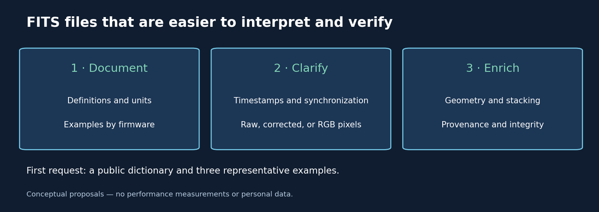

# Seestar S50 FITS files: proposals to support scientific reuse

[Version française](PROPOSITIONS-SEESTAR-S50.md)

**Discussion note — November 15, 2026.** Prepared as part of GNU Astrophotography Recycle, a project independent of ZWO. Intended for its founder to share with the community; no message has been sent automatically.

## The idea in brief

Seestar observations could be useful beyond producing attractive images: tracking moving objects, studying stellar variability, and comparing observing sessions. My suggestion is to make their FITS files **easier to interpret and verify**, starting with public documentation of the metadata.

Three priorities:

1. **A precise, verifiable definition of the recorded timestamps.**
2. **A description of the corrections already applied to the pixels.**
3. **An explicit distinction between a CFA-mosaicked exposure, a demosaiced RGB image, and a stack.**

*Conceptual diagram of recommendations, not a screenshot or a measurement of S50 performance. A [vector version](images/seestar-priorities.en.svg) is also available.*

## What observations support this note?

We examined headers from local archives and their manifests without modifying the originals. In the pilot sample:

| Observation limited to this sample | What it supports |
|---|---|
| `DATE-OBS` has the comment “Image created time”; `TIMESYS` is not declared | The exact relationship to the exposure deserves clarification; this does not prove that the time is wrong or that the FITS file is noncompliant |
| Individual pilot exposures do not declare `CTYPE1`/`CTYPE2`; some stacks do | A WCS solution available in a stack is not necessarily available for each individual exposure; its validity was not checked here |
| `BAYERPAT` appears in both 2D exposures and three-plane stacks | The original sensor pattern needs to be distinguished from the current organization of the pixels |
| Declared site coordinates vary within a series | Their source and precision would be useful to know; this does not demonstrate actual movement |

These observations do not apply to every device, file, or firmware version. Our manifest contains only selected header fields: a field that was not collected is **not** claimed to be absent from the FITS file. No personal archive, location, actual observation date, or instrument identifier is attached to this note.

## 1. Publish a metadata dictionary — the immediate priority

**Request to ZWO:** publish documentation versioned by model, firmware, and acquisition mode. For each keyword, provide its definition, units, origin, and the circumstances in which it is absent or not applicable. Distinguish standardized keywords, interoperability conventions, and ZWO-specific extensions.

The documentation should cover file type, exposure duration, date, filter, gain, color pattern, mount mode, coordinates, and number of combined exposures. Include small fictional or anonymized examples: an individual exposure, a stack, an RGB image, and a file with extensions.

**Benefit:** better documentation can resolve ambiguities without changing the data or increasing onboard processing. **Verification:** a developer can understand each example without guessing a keyword’s meaning from its name.

## 2. Make timestamps unambiguous — the scientific priority

**Request:** explain, for each mode, whether `DATE-OBS` represents the start, midpoint, or end of an exposure, or another event. If the device records a creation time, distinguish it from acquisition times. Use the appropriate time fields and unambiguous comments.

The FITS standard defines fields including `DATE`, `DATE-OBS`, `DATE-BEG`, `DATE-END`, `DATE-AVG`, and `TIMESYS`. Its defaults are interpretation rules; they do not measure the accuracy of an instrument’s clock. [Reference: FITS 4.0, Sections 4.4.2 and 9.](https://fits.gsfc.nasa.gov/standard40/fits_standard40aa-le.pdf)

Also describe the time source: phone, internal clock, or another mechanism; when synchronization occurs; and behavior offline or during time-zone changes. Provide an error estimate only if it has been measured, together with the method and conditions. An unknown error should not be presented as zero.

**Verification:** compare the exposure event with an independent reference and publish the procedure and uncertainty. Six decimal places in a timestamp are not sufficient. The [official Seestar remote-use guide](https://www.seestar.com/blogs/tutorial/seestar-telescope-network-remote-guide) emphasizes the importance of time settings, but does not provide this specific validation of S50 FITS timestamps.

## 3. Explain what “raw” means and preserve a linear-data export

**Request:** explicitly identify the processing already applied before saving: dark subtraction, hot-pixel correction, flat-fielding, demosaicing, noise reduction, resampling, normalization, color balancing, or stretching.

The aim is not to remove processing that is useful for photography. Where possible, it would be valuable to retain an export of individual exposures with linear pixel values, processing history, and units, separate from the presentation image. If corrections have already been applied, state this clearly rather than implying a direct sensor output.

**Benefit:** avoid subtracting a dark twice, applying unsuitable calibration, or measuring flux in a stretched image. **Verification:** the processing stage is identifiable and reproducible from the documentation and associated files.

## 4. Clarify Bayer, RGB, orientation, and filters

**Request:** document the color pattern relative to the stored pixel orientation, row order, mosaic offsets, cropping effects, and RGB plane order. After demosaicing, distinguish the historical sensor pattern from the actual type of the current image.

Software such as Siril documents the interaction between `BAYERPAT`, `ROWORDER`, `XBAYROFF`, and `YBAYROFF`. These are interoperability conventions to describe precisely, not a reason to impose one pattern on every export. [Siril FITS documentation.](https://siril.readthedocs.io/en/stable/file-formats/FITS.html)

For `IRCUT` and `LP`, define the filter actually in use and, ideally, provide its transmission curves and corresponding hardware version. Distinguish these filters from the extracted color channel. The green channel of a color sensor is not automatically equivalent to Johnson V; AAVSO distinguishes untransformed green-channel measurements. [AAVSO DSLR manual.](https://www.aavso.org/sites/default/files/publications_files/dslr_manual/AAVSO_DSLR_Observing_Manual_V1-4.pdf)

**Verification:** a test image yields consistent colors and pixel positions in different applications, and the user knows which spectral response is being measured.

## 5. Facilitate astrometry of individual exposures

**Request:** when an astrometric solution exists, allow it to be exported for each relevant exposure, including the catalog, epoch, method, and residual statistics. Otherwise, clearly identify the coordinates as approximate pointing information.

A WCS must match the pixel geometry of the image it describes. Copying the stack’s WCS onto every exposure would be insufficient when shifts, rotation, or cropping are involved. Pointing coordinates alone do not describe that transformation. [Reference: FITS 4.0, Section 8.](https://fits.gsfc.nasa.gov/standard40/fits_standard40aa-le.pdf)

This request could remain optional if the onboard processing cost is too high: clear documentation and the information needed for local plate solving would already be useful. **Verification:** stars in an exposure map correctly onto an independent catalog, including near the edges of the field.

## 6. Explain stacks and their exposure times

**Request:** separately define individual exposure duration, number acquired, number retained, cumulative integration, and elapsed time coverage. Precisely document `EXPTIME`, `EXPOSURE`, `STACKCNT`, and `TOTALEXP` when present, without presenting all of them as universal keywords in the core FITS standard.

Where possible, retain the list of source exposures, rejection decisions, weights, transformations, combination method, and normalizations. For a series with varying exposure times, provide the actual durations rather than inviting an assumed total based on simple multiplication.

**Benefit:** connect a stack to its inputs and distinguish cumulative integration from session coverage. **Verification:** the retained-exposure list and its durations reproduce the reported totals, with weighting conventions explained.

## 7. Document the parameters needed for uncertainty estimates

**Request:** specify the meaning and units of the recorded gain. A numerical gain setting is not automatically a conversion factor in electrons per ADU. Where measured, document conversion gain, read noise, offset, saturation, and the linearity range, including conditions and hardware version.

Associate the calibration data used with their exposure duration, temperature, and mode; clarify what the recorded temperature represents. Unknown measurements can remain unknown: avoid implying precision or calibration that has not been established.

For site positions, specify the source, units, reference frame, and known precision, and offer a stable site identifier separate from individual GPS readings. Do not silently smooth or round scientific coordinates to make a series appear constant.

**Verification:** a user can build a documented uncertainty budget without treating an internal setting as a calibrated physical quantity.

## 8. Strengthen traceability, integrity, and careful sharing

**Request:** retain the model, relevant versions, mount mode, session and exposure identifiers, and processing history. Provide an anonymized public reference dataset and a changelog for the format.

Where possible, add `CHECKSUM`/`DATASUM` per HDU and an export manifest with hashes to verify copies. These check integrity, not scientific quality or the authenticity of an observation. [NASA documentation of the convention.](https://science.data.nasa.gov/fits/documentation/conventions)

Provide a clearly identified sharing export that hides precise coordinates and personal identifiers in a **separate copy**, while keeping the original archive intact. An anonymized copy may not contain all the information needed for a scientific submission.

## A practical proposal for the community

Start by asking ZWO for a **public header dictionary with three representative examples**: an individual exposure, an RGB image, and a stack. Then prioritize the timing convention and processing history. More demanding features, such as a complete WCS for every exposure, can be discussed later.

Users could help by comparing anonymized examples by model, firmware, and mode, without modifying originals or publishing private coordinates. The aim is constructive, testable clarification, not a blanket claim that the S50 is defective.

The priorities in this note reflect the needs of a scientific-reuse project; they are not a general comparison of telescopes. Better documentation would make it easier to assess data for AAVSO or MPC use, without guaranteeing acceptance.
