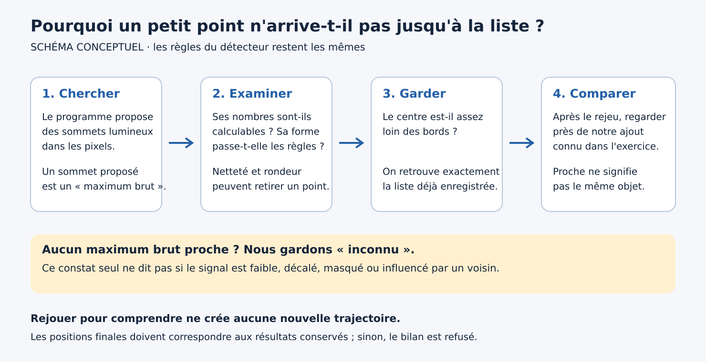
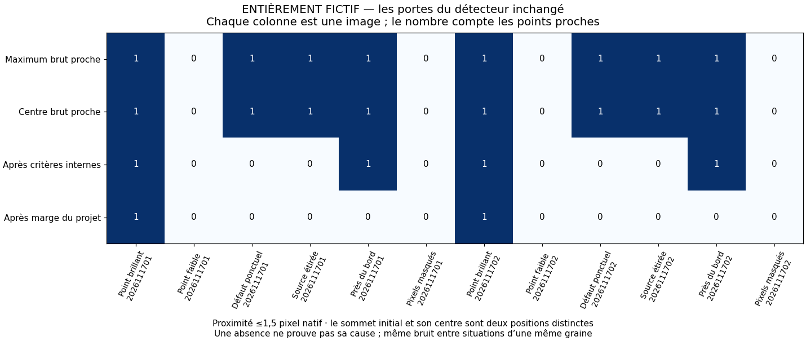
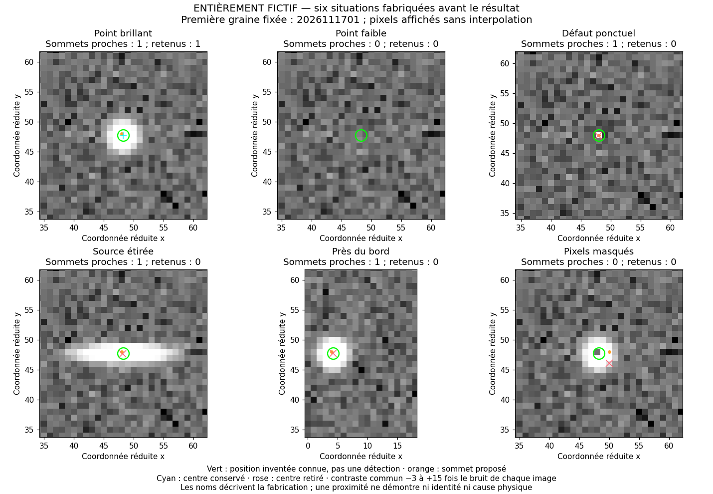

# Regarder les décisions internes du détecteur

Le [diagnostic précédent](DIAGNOSTIC-MANQUES.md) a trouvé où le support manquait déjà : 17 ajouts artificiels du fond réel n'avaient un point proche que dans zéro à quatre images, au lieu des cinq nécessaires. Il ne regardait pas les pixels et ne départageait pas les critères internes du détecteur. Cette nouvelle recette **rejoue le détecteur inchangé pour tracer ses décisions** ; elle ne recherche aucune nouvelle trajectoire et ne remplace aucun candidat.

Le plan [**`08219f0`**](https://github.com/steveprudhomme/gnu-astrophotography-recycle/commit/08219f018968d05479248fab4277144f8c93d45a), avec le mandat des trois agents, a été committé et publié avant le code. Le coordinateur réunit diagnostic, vérification et pédagogie, avec des fichiers distincts. Leur revue est interne : elle n'est pas une qualification scientifique indépendante.

## Comprendre dès 10 ans

Imagine un contrôleur qui examine une photo sans savoir où nous avons dessiné notre point. Il propose d'abord de petits sommets lumineux, les **maxima bruts**. Il calcule ensuite un centre et des nombres décrivant leur forme. La **netteté** décrit à quel point le sommet ressort de son voisinage ; la **rondeur** décrit sa symétrie selon les règles de ce programme. Un nombre impossible à calculer reste inconnu. Enfin, le projet garde les centres assez loin des bords.



*Schéma conceptuel : ce n'est pas une capture d'écran ni une observation. Les tests numériques restent ceux du détecteur existant ; nous ajoutons un carnet, pas de nouvelles règles.*

Ce carnet doit retrouver la même liste finale que le détecteur et, sur les caches existants, la même liste que le pilote avait enregistrée. Sinon, l'opération s'arrête : nous ne fabriquons pas une explication à partir d'un autre résultat.

## Ce que la trace mesure

La recette conserve le masque des pixels non finis ou saturés, le calcul robuste du fond et du bruit, le seuil d'entrée de cinq fois ce bruit, FWHM de trois pixels réduits et séparation de cinq pixels réduits, ainsi que les autres paramètres déjà utilisés. Le seuil effectif interne de DAOStarFinder est également enregistré : il ne faut pas le confondre avec le pic du pixel d'une source. Les critères de forme par défaut de **Photutils 3.1.1** restent inchangés. La marge finale reste de huit pixels réduits ; la limite de 500 points reste un refus explicite.

La liste brute provient des maxima proposés par cette bibliothèque, sans lui fournir les positions des réponses. Les valeurs et rejets cumulés sont conservés : valeurs non finies, centre hors image, netteté, rondeurs et marge du projet. L'usage d'une interface interne est isolé et lié à la version et aux empreintes des sources installées ; il ne prétend pas fonctionner silencieusement avec une autre version.

Nous comparons ensuite ces traces aux positions connues des ajouts. Le petit rayon reste **1,5 pixel natif**, le contexte reste **3 pixels natifs**. Le passage des coordonnées réduites aux natives reste `2*x + 0,5`. Une graine de maximum brut et son centre calculé sont deux positions différentes ; leurs distances sont conservées séparément. Un centre déplacé ne devient pas automatiquement l'ajout recherché.

| Constat enregistré | Ce qu'il permet de dire |
|---|---|
| Aucun maximum brut proche | Aucun sommet proposé n'est proche selon ce rayon ; sa cause n'est pas établie. |
| Valeurs non finies | Une mesure interne ne passe pas le contrôle numérique. |
| Forme rejetée | Un ou plusieurs critères de netteté ou rondeur ne passent pas. |
| Marge rejetée | Le centre est trop près d'un bord pour la règle finale du projet. |
| Point retenu proche | Un point passe les portes près de l'ajout ; cela ne démontre pas son identité. |
| Voisinages ou positions discordants | Les preuves gardent la distinction ou l'ambiguïté, sans choisir la cause qui nous arrange. |

L'absence de maximum brut proche **ne prouve pas à elle seule** un seuil trop élevé, un signal trop faible, un rejet par séparation ou une confusion. Une proximité est descriptive. Plusieurs critères peuvent échouer ensemble ; ils ne sont pas transformés en causes physiques exclusives.

## Un nouveau petit banc entièrement fictif

Le banc indépendant du lot 20 utilise douze images de 96 × 96 pixels : six situations pour chacune des graines `2026111701` et `2026111702`. Le bruit, les positions et les sources sont inventés, sans recours aux observations. Les situations sondent un point faible, un point brillant, un défaut ponctuel, une source étirée, le bord et des pixels masqués. Une intention de scénario ne garantit pas un rejet particulier : le rapport conserve ce que le détecteur produit réellement.

Depuis la racine du projet, avec les dépendances du parcours installées et de nouvelles sorties :

```powershell
.\.venv\Scripts\python.exe examples/make_detector_trace_demo.py local/exercice-trace-images
.\.venv\Scripts\python.exe examples/trace_detector_decisions.py local/exercice-trace-images/manifest.json local/exercice-trace-images/truth.json local/exercice-trace-bilan
.\.venv\Scripts\python.exe examples/plot_detector_trace.py local/exercice-trace-bilan/trace.json local/exercice-trace-figures
```

Le générateur écrit les images NumPy et leurs empreintes, un manifeste et des réponses séparées. La trace examine les pixels de toutes les images avant de lire les réponses. Les dessins lisent les traces terminées et les images pour l'affichage ; ils ne relancent pas le détecteur. Les trois codes attendus sont **0** pour ce banc complet. Le rapport lisible est `local/exercice-trace-bilan/report.md` ; les preuves détaillées sont dans `trace.json`.



*Chaque colonne représente une image inventée, chaque ligne une étape. Les nombres comptent les points à moins de 1,5 pixel natif de la position connue. La graine du maximum brut et son centre sont suivis séparément ; leurs présences ne constituent pas une suite forcément décroissante dans ce voisinage.*



*Première graine fixée avant résultat, sans sélection selon la beauté. Vert : position inventée connue, pas une détection ; orange : sommet proposé ; cyan : centre conservé ; rose : centre retiré. Les pixels sont affichés sans interpolation, avec le même étirement en unités du bruit de chaque image. Le rond vert n'est pas la taille physique d'un objet.*

Les trois commandes ont abouti sur ce banc : les douze rejeux reproduisent la liste finale habituelle. Aux deux rayons, les deux points brillants sont retenus ; les deux défauts ponctuels ont un rejet de netteté, les deux sources étirées un rejet de rondeur, les deux bords un rejet de marge. Les deux faibles et les deux masqués n'ont aucun maximum brut proche. Ces quatre absences ne sont pas transformées en causes physiques prouvées. Le même bruit est partagé entre les six situations d'une graine ; ces comptages ne sont pas douze répétitions indépendantes.

## Tracer les résultats déjà gelés

Le lot réel reprend uniquement les scores complets, le diagnostic du lot 19, les dérivés et les copies sous `local/`. La commande accepte explicitement les deux rapports déjà préparés :

```powershell
.\.venv\Scripts\python.exe examples/trace_scored_misses.py local/exercice-injections-bilan/score.json local/exercice-diagnostic-manques/diagnostic.json local/exercice-trace-manques
```

Cet exemple utilise les noms du parcours fictif de référence ; les chemins propres aux observations restent privés. Aucun support externe n'est consulté. Les 37 résultats individuels et leurs empreintes sont vérifiés avant la lecture des réponses. Les nouveaux rapports détaillés et les vues mixtes sur fond réel restent locaux.

Ce rejeu relit les pixels pour comprendre les détections : il se distingue du diagnostic du lot 19 qui ne les analysait pas. Il ne recalcule ni recalage, filtrage stationnaire ou association et ne génère aucune nouvelle injection réelle. Les neuf vitesses hors domaine, les dix récupérations et le témoin naturel à zéro candidat restent des résultats historiques conservés.

## Bilan descriptif des 17 manques du fond réel

Les 17 ajouts artificiels sont suivis sur les huit images, soit **136 situations image-ajout**. Chaque liste finale rejouée correspond aux positions précédemment enregistrées. Aux deux rayons de comparaison, le carnet compte **115 situations sans maximum brut proche** et **21 avec un centre retenu proche**. Aucun rejet de forme ou de marge proche n'est observé dans ces voisinages pour ce lot.

Cela situe la plupart des absences **avant les critères de forme observés**, sans dire quelle cause amont les produit. Nous n'avons pas prouvé un seuil trop haut, une luminosité seule insuffisante, un effet de séparation ou une absence de confusion. Le maximum proposé et son centre restent des mesures différentes ; un point proche retenu n'est pas nécessairement l'ajout. Les 136 situations réutilisent les mêmes huit fonds : elles ne constituent pas 136 essais indépendants.

Les scores restent inchangés : dix ajouts retrouvés, 26 manqués dont neuf hors plage de vitesse ; le témoin naturel reste à zéro candidat. Les nouveaux rapports individuels ne sont pas publiés. Ces constats ne créent aucune nouvelle trajectoire et ne démontrent pas une cause physique unique.

## Erreurs et limites à conserver

Choisir un nouveau dossier à chaque essai : les sorties existantes ne sont pas écrasées. Une erreur d'entrée, une version incompatible, une empreinte différente ou des positions de rejeu divergentes donnent un refus. Les sorties partielles, si produites, restent incomplètes et ne doivent pas être dessinées comme un bilan terminé. Corriger la cause puis choisir une nouvelle sortie ; ne pas effacer les traces de l'essai décevant.

Le diagnostic est descriptif, par image et par ajout. Les huit images d'un ajout ne sont pas huit expériences indépendantes ; les nouveaux nombres n'estiment pas une probabilité universelle de détection. Aucun nouveau candidat, magnitude limite, heure qualifiée ou découverte n'est annoncé. Le banc fictif et la revue interne ne remplacent pas une validation instrumentale ou scientifique indépendante.

## Vérifications du nouveau lot

Les **42 nouveaux tests entièrement fictifs** réussissent en **25,32 secondes** : égalité au moteur, portes observables et absences inconnues, coordonnées natives/réduites, tolérance native à 10⁻⁹ pixel, divergences, protocoles et diagnostics altérés, intégrité, sorties partielles et dessins sans redétection. La revue interne a renforcé les contrôles du protocole complet, la comparaison en pixels natifs et la validation des preuves dessinées. Un refus Windows sur les dossiers temporaires a nécessité une relance autorisée, sans changement des seuils. Les figures calculées ont été inspectées ; aucun test de compréhension avec un enfant n'est revendiqué.

## Reproduction depuis le code committé

Depuis le commit propre **`f6ec207`**, la suite complète compte **423 tests réussis en 139,60 secondes**. Les trois commandes du parcours donnent 0 dans des sorties neuves : douze images fictives, douze traces et deux PNG identiques. Le rejeu protégé des 17 cas locaux reproduit les 136 traces et les positions gelées, avec le même bilan 115/21 aux deux rayons. Les 360 entrées et notices/médias surveillés restent intacts, dont les cinq médias réels CC0. Aucun appel d'association, filtre stationnaire ou injection, aucun accès externe/réseau ou écriture FITS/NPY n'est enregistré. Les pixels sont bien relus par la trace du détecteur ; ce contrôle ne prétend pas les bloquer comme au lot 19.

La revue publique couvre 202 fichiers et 44 ancres Markdown, sans FITS/NPY privés suivis par Git. Les 55 anciennes commandes conservent leurs preuves sans réexécution générale ; aucune injection réelle n'est régénérée. Seules les figures fictives nouvelles sont publiées. La version reste 0.10.0a1, avec revue logicielle interne et tests locaux ; aucun contrôle automatique GitHub n'est configuré. La publication passe par une branche dédiée et une PR, avec contrôle de `main` après intégration.

La [PR nº 3](https://github.com/steveprudhomme/gnu-astrophotography-recycle/pull/3) rassemble les 24 fichiers modifiés, avec le plan préalable conservé dans l'historique. L'intégration à `main` est suivie d'une vérification du commit distant et de la synchronisation locale.
