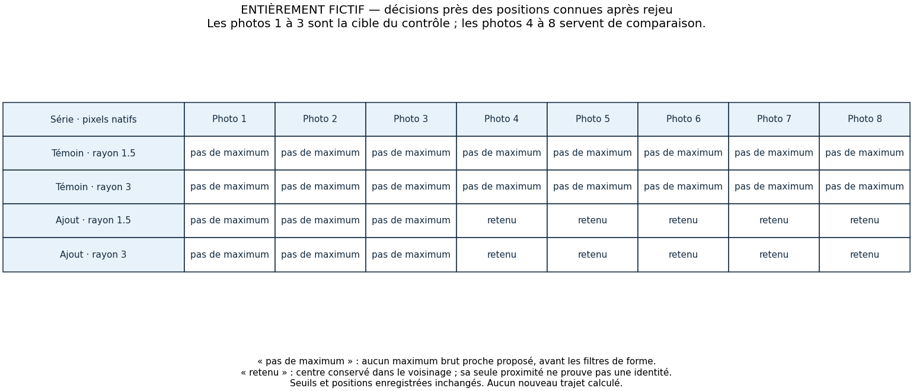
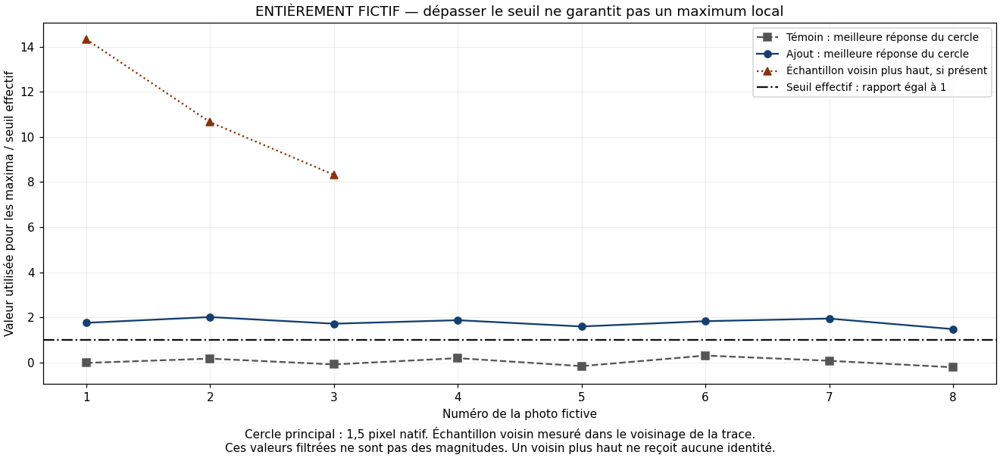
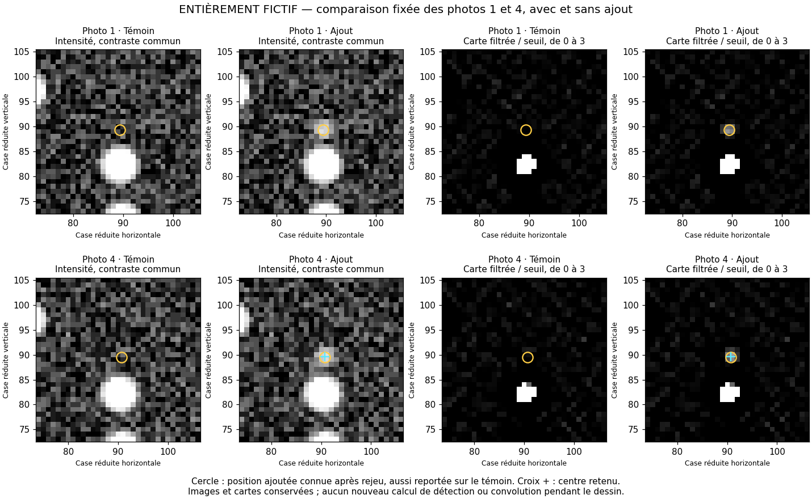

# Voir pourquoi le détecteur ne propose pas un point

Ce parcours examine six absences : les trois premières photos de chacun des deux fonds fictifs irréguliers.
Les photos suivantes et leurs témoins servent de comparaison. Les anciens résultats restent conservés.
Le [plan publié avant le code](https://github.com/steveprudhomme/gnu-astrophotography-recycle/commit/61fc2b8181cfae8f851471cce55004f1cc995ead) décrit le lot 25.

Le cas fixé est `r10-a12-p1` : vitesse nominale de 10 secondes d'arc par heure, amplitude 12 fois le bruit initial, premier trajet.
Les treize rapports de séries sont vérifiés en entrée. Le rejeu porte sur ce cas et son témoin dans chacun des deux fonds.

## Comprendre avec un relief

Imagine une petite bosse près d'une grande colline. La petite bosse peut dépasser un niveau tracé sur le dessin.
Elle n'est pourtant pas forcément plus haute que tout le voisinage que le programme compare.

Le détecteur cherche des **maxima locaux** : des positions plus hautes que leurs voisins selon ses règles.
Il compare aussi la valeur au **seuil**, un niveau minimal.
Un point doit passer plusieurs étapes. Dépasser le seuil ne suffit pas à devenir une position mesurée.

| Mot | Son sens dans cet exercice |
|---|---|
| Carte filtrée | Image calculée pour faire ressortir certaines formes de points |
| Maximum brut | Position proposée avant les filtres de forme |
| Centre ajusté | Position plus précise calculée autour d'un maximum proposé |
| Forme | Mesures numériques de la netteté et de la symétrie du point |
| Témoin | Même photo sans l'ajout artificiel |
| Rejeu | Nouvelle exécution du détecteur avec les mêmes pixels et règles |
| Empreinte | Code calculé à partir du contenu d'un fichier |

Une case de travail regroupe ici 2 × 2 pixels de l'image d'origine.
Les rayons de 1,5 et 3 pixels natifs décrivent les voisinages autour des positions ajoutées connues après le rejeu.
Ils ne changent pas les paramètres du détecteur.

## Préparer les fichiers

Installer les outils avec le [parcours débutant](DEMARRER-DE-ZERO.md), y compris les outils de dessin.
Terminer ensuite le [diagnostic des manques et le banc irrégulier](DIAGNOSTIC-MOBILES-LENTS.md).
Les scores `local/exercice-asym-score-1/score.json` et `local/exercice-asym-score-2/score.json` doivent exister.
Leurs deux codes 2 sont attendus : les critères de récupération restent manqués, mais les scores sont complets.

Garder tous leurs fichiers liés : copies, manifestes, dérivés, candidats et réponses.
Un fichier `score.json` isolé ne suffit pas. Ouvrir PowerShell dans le dossier du projet.
Utiliser des noms de sorties encore inutilisés. Aucun branchement USB n'est nécessaire.

## 1. Tracer le premier fond

```powershell
.\.venv\Scripts\python.exe examples/trace_slow_detector.py local/exercice-asym-score-1/score.json local/exercice-trace-lents-1
```

Le programme vérifie d'abord les treize rapports candidats et les dérivés conservés.
Il rejoue ensuite huit photos avec ajout et leurs huit témoins, sans fournir de position attendue au détecteur.
Les positions obtenues doivent être identiques aux positions enregistrées, à un milliardième de pixel près.
Une divergence refuse le bilan.

Les seize traces brutes sont terminées et leurs empreintes sont conservées avant l'ouverture des réponses.
Le programme peut alors rapprocher les décisions des positions connues du point ajouté.
Il conserve huit preuves supplémentaires pour ces comparaisons et un tableau `evidence.csv`.

**Vérifier :** `trace.json` indique `status: complete`, `replay_count: 16` et `all_saved_points_equal: true`.
Le dossier `frames/` contient seize traces brutes et huit preuves après rejeu.
Le code 0 signifie que le diagnostic est terminé. Il ne transforme pas une absence en récupération.

Le cas était déjà choisi à partir des anciens résultats.
L'ordre de lecture protège le calcul du rejeu ; ce n'est pas un nouvel essai de performance sur des objets inconnus.

## 2. Dessiner les traces conservées

```powershell
.\.venv\Scripts\python.exe examples/plot_slow_detector.py local/exercice-trace-lents-1/trace.json local/exercice-trace-lents-figures-1
```

Le programme vérifie les traces, leurs empreintes et le score lié.
Il dessine trois images : `timeline.png`, `response.png` et `comparison.png`.
Il ne rejoue ni le détecteur, ni le filtrage des pixels, ni l'association des trajets.
Les petites vues nécessaires ont été conservées pendant la trace.

**Vérifier :** `figures.json` donne les empreintes des trois PNG.
La comparaison des photos 1 et 4 est fixée dans le plan. Nous ne choisissons pas de meilleures photos après résultat.

## 3. Refaire avec le second fond

```powershell
.\.venv\Scripts\python.exe examples/trace_slow_detector.py local/exercice-asym-score-2/score.json local/exercice-trace-lents-2
.\.venv\Scripts\python.exe examples/plot_slow_detector.py local/exercice-trace-lents-2/trace.json local/exercice-trace-lents-figures-2
```

Les mêmes règles s'appliquent. Garder les deux dossiers, même si les comptes diffèrent.
Les quatre commandes attendent ici le code 0 : les traces sont complètes, même si les absences demeurent.

## Lire les décisions



**Lire sans image.** Le tableau contient quatre lignes : témoin et ajout, chacun aux rayons de 1,5 et 3 pixels.
Pour l'ajout, les photos 1 à 3 indiquent « pas de maximum » ; les photos 4 à 8 indiquent « retenu ».
Les témoins n'ont aucun maximum proche aux positions comparées.
Les deux rayons donnent ici la même lecture.

Sur les deux fonds, les six absences initiales n'ont aucun maximum brut proche.
La première porte vide est celle du maximum local. Aucun rejet de forme ou de marge proche n'est observé à ces endroits.
Les dix photos suivantes possèdent un centre retenu dans le voisinage.
Les seize témoins ne proposent aucun maximum proche dans le cercle principal.

Le rapport conserve aussi les autres portes et les obstacles simultanés.
Une première porte vide ne décrit pas à elle seule toute la cause physique.

## Comparer la réponse au seuil



**Lire sans image.** La ligne horizontale du seuil vaut 1.
Les cercles représentent la meilleure réponse près du point ajouté. Ils restent au-dessus de cette ligne.
Les carrés du témoin restent en dessous. Dans les trois premières photos, des triangles montrent des valeurs voisines encore plus hautes.
Une valeur voisine absente n'est pas remplacée par zéro.

Sur les six images initiales, la meilleure réponse du cercle principal vaut environ **1,72 à 2,03 fois le seuil effectif**.
Un échantillon voisin plus haut est présent dans chacune des six traces.
La présence d'un signal dépassant le seuil ne suffit donc pas, ici, à obtenir un maximum local proposé.

Le « voisin » est une valeur de la carte calculée. Ce mot ne désigne pas automatiquement une autre étoile ou un objet identifié.
Ces valeurs ne sont pas des magnitudes astronomiques ou des mesures de flux calibrées.

## Comparer les photos 1 et 4



**Lire sans image.** La première ligne montre la photo 1 ; la seconde, la photo 4.
Chaque ligne compare le témoin, l'ajout, la carte filtrée du témoin et celle de l'ajout.
Le cercle marque la position connue après le rejeu. Une croix indique un centre retenu.
Le point ajouté est visible dans la première photo, sans centre retenu proche. Dans la quatrième, une croix apparaît sur l'ajout.
Les croix sont limitées aux centres à moins de six cases réduites du cercle. La vignette ne marque pas toutes les détections du fond.

À partir de la quatrième photo de chaque fond, la trace propose un maximum proche et conserve son centre.
La règle du détecteur n'a pas changé. Les pixels comparés et leur voisinage ont changé entre les photos.
Le rapport conserve les seuils, le bruit et les positions entre les cases pour aider à lire cette différence.
Ces positions entre les cases ne prouvent pas, seules, une cause unique des manques.

Les vues utilisent un contraste commun au témoin pour l'intensité.
La carte filtrée affiche un rapport au seuil, limité de 0 à 3 pour le dessin.
Les valeurs plus hautes restent présentes dans les traces et dans le graphique numérique.

## Fichiers, erreurs et limites

`trace.json` contient le bilan. `frames/` conserve les traces brutes et les preuves après rapprochement.
`evidence.csv` résume les décisions, le bruit, le seuil et les rapports de réponse.
Les métriques de forme sont disponibles dans les traces brutes lorsqu'un maximum existe.
Une mesure inexistante reste inconnue ; elle ne devient pas une valeur nulle.

- Sortie existante : choisir un autre nom et conserver l'ancien dossier.
- Fichier lié absent ou modifié : examiner l'entrée ; ne pas inventer une empreinte pour continuer.
- Positions différentes au rejeu : conserver le refus. Ne pas corriger les anciennes positions.
- Version Photutils incompatible : utiliser l'environnement prévu ; les outils de trace exigent la version 3.1.1 et ses sources épinglées.
- Exécution interrompue : conserver l'état incomplet. Le dessinateur refuse un bilan incomplet.

Les résultats sont descriptifs et postérieurs à l'ancien essai.
Ils expliquent une décision numérique observée, sans désigner un objet réel ou garantir la sensibilité scientifique.
Les scores, les candidats et les six absences restent inchangés.
Ce lot ne crée aucune injection, trajectoire ou nouvelle recherche réelle. Les copies locales suffisent.

La rédaction suit le [guide accessible](REDACTION-ACCESSIBLE.md).
Les figures sont entièrement fictives et calculées, avec des descriptions suffisantes sans percevoir les couleurs.
Le parcours vise les débutants dès 10 ans ; aucun essai enfant ou audit WCAG complet n'est revendiqué.

## Vérifications réalisées

Les 18 nouveaux tests fictifs passent en 31,10 secondes. La suite complète donne **638 tests réussis en 375,49 secondes**.
Les quatre commandes des deux contextes rendent 0. Les 32 traces reproduisent toutes les positions enregistrées.
Les six absences initiales et les dix présences suivantes restent conservées.
Les 2554 anciens fichiers surveillés et les cinq médias CC0 gardent leurs empreintes.
Aucune écriture FITS/NPY, connexion d'analyse externe, nouvelle injection, association ou recalage n'est relevé par les gardes.

Les dessins sont testés avec les appels du détecteur et de convolution bloqués.
Les seize sources applicatives historiques et les quatre sources Photutils épinglées restent inchangées.
La revue du coordinateur ne constitue pas une validation indépendante ou une preuve de sensibilité sur des mobiles réels.

La reproduction depuis le commit propre `c7230a0` donne les mêmes quatre codes 0.
Les 32 traces brutes, seize preuves après rejeu, deux bilans, deux CSV et six PNG sont identiques.
Les trois PNG publiés correspondent exactement aux fichiers reproduits.
Les six absences et dix présences restent conservées, avec tous les anciens scores.
La revue porte sur 252 fichiers publics, leurs avis, leurs liens et les quatre commandes du guide.
