# Tutoriel illustré — de l’inventaire au contrôle Gaia des poses

Ce guide suit les modules livrés jusqu’à l’Alpha 0.8. Les figures publiques sont des schémas explicitement identifiés ou des résultats calculés sur des données synthétiques ; les observations et rapports réels restent privés.

Accès direct : [installation](#2-installation-et-exécution), [recalage des poses](#12-recaler-trois-poses-locales-avec-un-contrôle-réservé), [comparaison Gaia](#13-comparer-les-trois-poses-à-gaia-sans-réajuster-les-modèles), [publication GitHub](#14-mettre-à-jour-github-et-vérifier-la-publication).

## 1. Planifier avant de coder

Le premier lot transforme le relevé exploratoire en une commande réutilisable. Les sous-étapes P1-A à P1-I sont consignées dans [ROADMAP.md](../ROADMAP.md). Le plan a été enregistré dans le commit **`6c79043` avant l’implémentation**. Les règles de suivi figurent dans [AGENTS.md](../AGENTS.md).

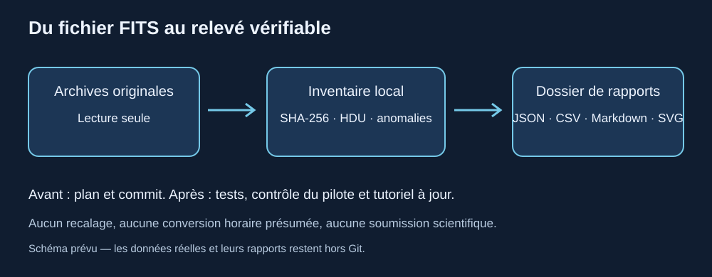

*Schéma d’architecture, pas une capture d’écran ni un résultat scientifique.*

L’inventaire parcourt les fichiers, calcule leurs empreintes, relève chaque HDU et produit des rapports dans un dossier distinct. Les heures restent brutes tant que leur convention n’est pas validée. Les données personnelles ne font pas partie de ce tutoriel public.

## 2. Installation et exécution

Installer les dépendances avec les instructions de [INSTALL.md](../INSTALL.md). La combinaison retenue est Python 3.13.6, Astropy 7.2.0, NumPy 2.4.1 et pytest 7.4.4. Les premiers essais utilisaient le NumPy 2.4.0 déjà installé ; l’installation isolée a signalé que cette version avait été retirée des versions recommandées pour un défaut de compatibilité. Le fichier de dépendances a été corrigé et les 25 tests passent aussi dans l’environnement corrigé. [Version NumPy retenue sur PyPI](https://pypi.org/project/numpy/2.4.1/).

Depuis PowerShell à la racine du projet, créer les cinq fichiers fictifs de l’exemple :

```powershell
.\.venv\Scripts\python.exe examples/make_demo.py ".\local\demo-tutoriel"
.\scripts\gar-inventory.bat ".\local\demo-tutoriel" --output ".\local\demo-rapport"
```

Le générateur crée deux images 2D, une copie identique, un empilement RGB et un FITS avec primaire vide et extension image. Il n’utilise aucune observation personnelle. Les noms des dossiers sont des exemples ; s’ils existent déjà, choisir de nouveaux noms. Ni le générateur ni l’inventaire n’écrasent leurs sorties.

Le lanceur Windows utilise `.venv` si elle existe, sinon le Python disponible. La commande équivalente depuis les sources est :

```powershell
$env:PYTHONPATH = Join-Path $PWD 'src'
.\.venv\Scripts\python.exe -m gar inventory ".\local\demo-tutoriel" --output ".\local\demo-rapport-02"
```

Pour vos archives, remplacer la source par leur dossier et garder la sortie dans `local/`, hors des archives. Le calcul SHA-256 lit chaque fichier entier ; les images ne sont pas chargées en mémoire. Un rapport peut contenir des chemins, dates et coordonnées : il reste local.

## 3. Comprendre les résultats

Le lancement synthétique a produit :

```text
5 fichiers, 6 HDU, 1 doublon(s).
```

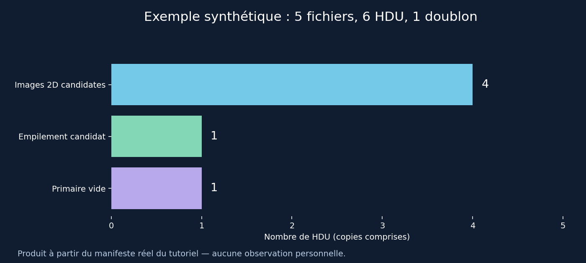

*Illustration PNG produite à partir des comptages du manifeste avec Matplotlib, puis vérifiée visuellement. Le module produit aussi son [graphique SVG réel](images/exemple-inventaire.svg). Ces figures utilisent les données fictives de `examples/make_demo.py`, pas l’archive de l’utilisateur. Matplotlib n’est pas nécessaire à l’inventaire.*

La primaire vide et son extension sont deux HDU : cela explique les six HDU pour cinq fichiers. Les quatre images 2D comprennent la copie et l’extension ; le graphique compte les occurrences, pas seulement les images uniques. Le doublon est identifié par l’empreinte complète ; il n’est ni supprimé ni déplacé.

Ouvrir les produits dans le dossier de sortie :

- `report.md` : synthèse et limites ; `summary.svg` : graphique.
- `inventory.csv` : une ligne par HDU, lisible dans un tableur ; certains textes sont protégés contre l’interprétation comme formules.
- `manifest.json` : document de référence, avec empreintes, chaque HDU, métadonnées sélectionnées, commentaires, provenance et incidents.

Une date brute sans convention confirmée n’est pas un temps de milieu de pose. Une présence de `CTYPE1`/`CTYPE2` n’est pas une validation WCS. Un mot-clé Bayer sur un empilement RGB ne rend pas cette image mosaïquée. Lire le [contrat 1.0](CONTRAT-INVENTAIRE.md) avant d’exploiter les colonnes.

## 4. Vérifier et connaître les limites

```powershell
.\.venv\Scripts\python.exe -m pytest -q
```

L’inventaire est couvert par **25 cas** : préservation des octets, absence de chargement des pixels, types entiers avec `BZERO`, primaire vide et extensions, absence d’héritage implicite, doublons, gzip et compression en tuiles, fichiers invalides/tronqués, Bayer sur RGB, sorties dangereuses, dossiers vides, accès refusé, modification pendant lecture, liens/jonctions, CSV/JSON, valeurs non finies et appels Windows avec espaces et accents. Les séances ajoutent 42 cas, le diagnostic temporel 33, le diagnostic WCS 36, les copies vérifiées 11, la comparaison stellaire neuf, le recalage 21 et le contrôle Gaia des poses 20, soit **197 tests réussis au total**.

Les tests ont révélé un problème de guillemets dans l’appel de test du lanceur Windows ; cet appel a été corrigé puis la suite relancée avec succès. Dans l’environnement de travail contrôlé, les tests de jonctions et de permissions ont nécessité une exécution avec accès au dossier temporaire ; cela ne démontre pas une exigence d’administrateur de l’application. La distribution autonome sur compte standard reste à valider.

Le pilote réel a été traité séparément : toutes ses empreintes indépendantes sont identiques avant inventaire, dans le manifeste et après inventaire. Les preuves détaillées restent dans `local/` : aucune image réelle, coordonnée ni liste privée de fichiers n’entre dans ce tutoriel public. Ce pilote a été exécuté avec l’environnement déjà installé ; la suite complète a ensuite été vérifiée dans l’environnement isolé corrigé. La création du paquet modifiable, la commande `gar --version` et la cohérence des dépendances (`pip check`) ont aussi été contrôlées.

Le succès des tests d’inventaire ne prouve ni l’exactitude de l’horloge, ni la validité d’une WCS, ni la qualité photométrique des pixels. Le regroupement indicatif est disponible avec la commande séparée décrite ci-dessous ; l’alignement, les détections, les courbes de lumière et les exports scientifiques restent à développer. Le verrouillage complet des dépendances, leur audit de redistribution et le paquet portable restent ouverts.

## 5. Retenir une méthode de travail pour la suite

Pour chaque nouveau lot : planifier les sous-étapes, compléter `ROADMAP.md`, faire un commit du plan, implémenter, tester, enrichir ce tutoriel avec des visuels vérifiables et actualiser les autres Markdown. Faire ensuite un commit de réalisation. Une publication GitHub est une action distincte ; les rapports personnels demeurent exclus de Git.

## 6. Regrouper les poses en séances candidates

Le plan S1 à S9 a été enregistré dans **`1523035` avant le développement**. Les commits du lot précédent, `6c79043` et `de15e8f`, ont été publiés sur GitHub avant ce nouveau lot. La commande `gar sessions` utilise uniquement le manifeste déjà enregistré sur l’ordinateur. Elle ne déplace aucun fichier et ne crée ni rapport, ni cache, ni dossier sur la clé USB ou un autre support d’observation.

Elle sépare les cibles, filtres, configurations, dossiers et dates déclarées, puis les interruptions dépassant le seuil. Elle conserve les heures brutes, sans attribuer UTC ou un fuseau à un champ inconnu. Les empilements, copies binaires et dates inutilisables deviennent des exclusions explicites.

### Produire un exemple public sans observations personnelles

Les dossiers ci-dessous doivent être nouveaux ; remplacer leur nom s’ils existent déjà :

```powershell
.\.venv\Scripts\python.exe examples/make_sessions_demo.py ".\local\demo-seances-input"
.\scripts\gar-inventory.bat ".\local\demo-seances-input" --output ".\local\demo-seances-inventory"
.\scripts\gar-sessions.bat ".\local\demo-seances-inventory\manifest.json" --output ".\local\demo-seances-report"
```

Le premier générateur crée neuf FITS fictifs : six poses avec des cibles, filtres, dates et interruptions variés, une pose sans date, une copie et un empilement. L’inventaire produit réellement le manifeste consommé par le regroupement. Le résultat vérifié est :

```text
5 séance(s) candidate(s), 6 HDU retenues, 3 exclues.
```

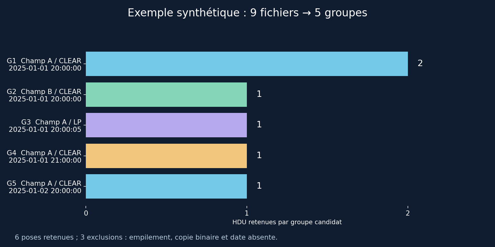

*Illustration PNG produite avec Matplotlib à partir du résultat réel de l’exemple synthétique, puis vérifiée visuellement. Le module produit aussi son [graphique SVG](images/exemple-seances.svg). Les dates et cibles de cette illustration sont fictives ; ce n’est pas une capture d’écran.*

Les deux premières poses du champ A restent ensemble. Le champ B et le filtre LP forment des groupes distincts. L’interruption de près d’une heure puis le changement de date créent encore deux groupes. La copie binaire, l’empilement et la pose sans date sont exclus. La commande retourne **`2`** pour inviter à examiner ces trois exclusions attendues ; cela ne signifie pas que les rapports n’ont pas été produits.

### Examiner et ajuster le résultat

Ouvrir `report.md`, `sessions.csv` et `sessions.json` dans la sortie. Le JSON conserve chaque membre et chaque motif d’exclusion ; le CSV résume les groupes. `sessions.svg` donne le nombre de HDU par groupe dans l’ordre du JSON, jusqu’à 30 groupes.

Pour essayer un seuil de séparation de 15 minutes sur le même manifeste :

```powershell
.\scripts\gar-sessions.bat ".\local\demo-seances-inventory\manifest.json" --gap-seconds 900 --output ".\local\demo-seances-seuil-900"
```

La couverture temporelle est l’écart entre premier et dernier horodatages, sans ajouter le temps de pose final. La somme des expositions est une autre valeur. Si une durée manque, le total reste `null` ; la somme partielle connue est conservée à part. Des horodatages identiques sur des HDU différentes sont signalés pour revue, sans fusion arbitraire.

### Vérifications et précautions

Les 42 nouveaux cas couvrent les changements de configuration, dates, dossiers, interruptions et seuils, les doublons, extensions, durées inconnues, dates non prises en charge, manifestes incorrects, destinations refusées et l’appel Windows. Un test interdit explicitement toute ouverture de FITS pendant `sessions`. Les tests du lot précédent restent exécutés, soit 67 cas réussis.

Le pilote a été vérifié sur son **manifeste local uniquement** : tous les membres retenus se réconcilient avec l’inventaire, sans perte ni doublon, et l’empreinte du manifeste est inchangée. Les détails restent privés. Des variations de `SITELAT`/`SITELONG` peuvent créer plusieurs groupes : cela ne prouve pas un déplacement réel du télescope. Le regroupement utilise les valeurs exactes et ne corrige pas implicitement une position GPS.

Le découpage à minuit peut diviser une véritable séance. Les dates seules, suffixes de fuseau, secondes intercalaires et fractions de seconde de plus de six décimales sont explicitement non prises en charge par ce premier parseur, plutôt que converties ou arrondies silencieusement. Ce sont des limites de regroupement, pas une validation scientifique des heures. Voir le [contrat des séances candidates](CONTRAT-SEANCES.md).

## 7. Diagnostiquer les horodatages sans certifier l’horloge

Le lot T1 à T9 a été planifié dans le commit **`e21a5e8` avant le développement**. Il utilise uniquement les manifestes locaux, sans rouvrir les FITS ni créer quoi que ce soit sur le support externe. Le diagnostic distingue le standard, les déclarations de l’en-tête et les preuves instrumentales encore manquantes. Ses [références et limites](CONTRAT-HORODATAGES.md) expliquent cette distinction.

### Reproduire un cas fictif avec des anomalies connues

Choisir des noms de dossiers nouveaux :

```powershell
.\.venv\Scripts\python.exe examples/make_timing_demo.py ".\local\demo-timing-input"
.\scripts\gar-inventory.bat ".\local\demo-timing-input" --output ".\local\demo-timing-inventory"
.\scripts\gar-timing.bat ".\local\demo-timing-inventory\manifest.json" --output ".\local\demo-timing-report"
```

Le générateur crée onze petits FITS fictifs : neuf images individuelles, une copie et un empilement. Il introduit volontairement une date absente, une date sans heure, une seconde intercalaire non prise en charge, un conflit de durées, une interruption, une date dupliquée et un intervalle court. Une des poses déclare UTC et un début de pose ; cela ne constitue pas une mesure de son exactitude.

Résultat réellement produit et vérifié :

```text
10 HDU candidates, 6 retenues pour cadence, 0 heure scientifiquement qualifiée.
```

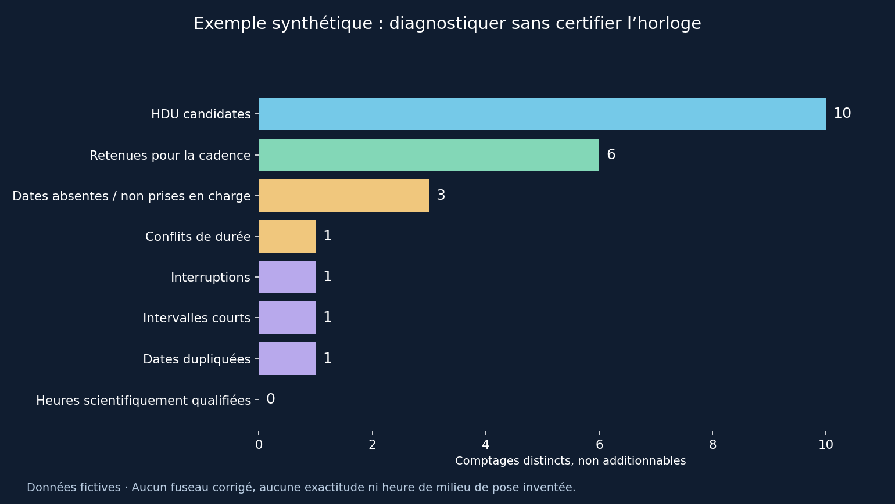

*Illustration PNG produite avec Matplotlib à partir du résultat synthétique, puis vérifiée visuellement. Le module produit aussi ce [graphique SVG](images/exemple-horodatages.svg). Ce n’est pas une capture d’écran ni une mesure des archives personnelles. Les barres représentent des contrôles qui se recouvrent ; elles ne s’additionnent pas.*

L’exemple donne trois dates inutilisables dans ce parseur, un conflit de durée, une interruption, un intervalle court et une date dupliquée. Les six poses retenues servent seulement au diagnostic de cadence. La copie et l’empilement n’augmentent pas artificiellement cette cadence. Le programme reste incapable de certifier une horloge fictive simplement parce qu’elle écrit six décimales.

### Lire les résultats

Ouvrir `report.md`, `timing.csv`, `timing.json` et `timing.svg` dans le dossier de sortie. Le JSON conserve les statuts, commentaires, séquences et intervalles. Le CSV présente les champs principaux et protège les textes interprétables comme formules. Le SHA-256 du manifeste permet de vérifier quelle entrée a été analysée.

`written_quantum_seconds` décrit le pas écrit, **pas une incertitude mesurée**. `clock_accuracy_seconds` reste inconnu ; `mid_exposure_utc` reste vide et `time_validated` faux. Les indications normatives sont séparées de `timesys_declared` ; aucun fuseau ni milieu de pose n’est appliqué automatiquement. Le commentaire « Image created time » ne prouve pas à lui seul le début ou la fin d’une pose.

La commande retourne **`2`** après production des rapports pour rappeler la non-qualification scientifique, même sans anomalie. Le code `1` reste réservé aux erreurs d’entrée, de paramètres ou d’écriture. Il n’existe pas d’option pour transformer un commentaire ou une cadence régulière en certification.

Pour modifier le seuil d’interruption sans relire les observations :

```powershell
.\scripts\gar-timing.bat ".\local\demo-timing-inventory\manifest.json" --gap-seconds 900 --output ".\local\demo-timing-seuil-900"
```

### Vérifier et interpréter la conclusion

La suite complète passe **100 tests**. Les 33 nouveaux cas vérifient notamment la séparation entre résolution et exactitude, les échelles déclarées, commentaires, formes non prises en charge, durées contradictoires, doublons, interruptions et frontières de comparaison. Ils couvrent aussi les cartes brutes mal formées, les chemins répétés dans un manifeste, la protection des sorties et l’appel Windows. Un contrôle interdit explicitement toute ouverture de FITS pendant cette commande.

Le manifeste privé du pilote est inchangé et ses identifiants sont tous réconciliés. Aucune observation externe n’a été rouverte. Le diagnostic n’a pas relevé d’anomalie dans les séquences comparées, mais les informations disponibles ne suffisent pas à qualifier les heures. Les valeurs et rapports personnels demeurent locaux.

Les sources officielles consultées n’ont pas permis de confirmer une convention et une borne d’erreur applicables à ce firmware. Pour avancer, il faudra une description instrumentale applicable ou une comparaison indépendante de synchronisation et de déclenchement, avec incertitude. Cette preuve ne peut pas être remplacée par les noms de fichiers, les heures de modification Windows ou une longue série régulière. Les champs non sélectionnés par l’inventaire ne sont pas déclarés absents des FITS.

## 8. Préparer des propositions à la communauté Seestar

À la demande du fondateur, une [note autonome de propositions FITS](PROPOSITIONS-SEESTAR-S50.md) a été préparée pour qu’il puisse la partager lui-même. Le plan documentaire a été enregistré dans `2f3302c` avant la rédaction finale.

La préparation a consisté à vérifier les constats dans les rapports locaux existants, consulter les références officielles FITS, Siril et AAVSO, puis séparer les faits limités à l’échantillon, les champs non collectés et les suggestions d’amélioration. Aucun FITS de la clé USB n’a été rouvert ni modifié. La note ne contient ni coordonnées, ni identifiants d’instrument, ni dates d’observation personnelles.

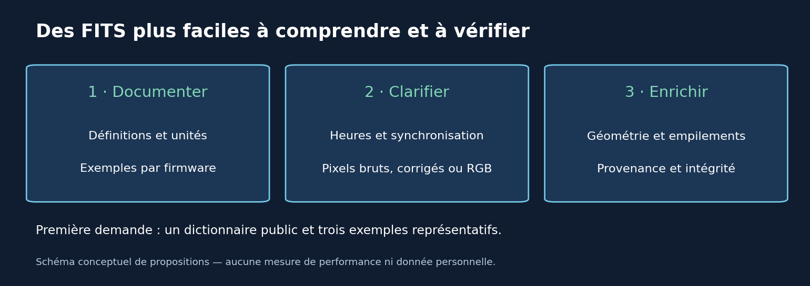

*Schéma de synthèse créé pour la note ; ce n’est ni une capture d’écran ni un résultat de test du télescope.*

Les demandes prioritaires portent sur un dictionnaire versionné, la datation et les traitements appliqués aux pixels. Les autres propositions concernent Bayer/RGB, filtres, WCS par pose, empilements, incertitudes et intégrité. Chaque proposition est assortie d’un bénéfice et d’un moyen de vérification ; aucune acceptation automatique de données scientifiques n’est promise.

Les liens, avis de confidentialité et illustrations ont été vérifiés. Aucun code applicatif n’est modifié par ce travail documentaire ; la suite de 100 tests du logiciel n’a pas besoin d’être relancée pour cette note. L’envoi à la communauté reste l’action du fondateur.

### Ajouter la version anglaise

À la demande du fondateur, la [traduction anglaise complète](SEESTAR-S50-FITS-RECOMMENDATIONS.en.md) a été ajoutée après le plan `76c7e56`. Elle conserve les huit propositions, leurs limites, les références et la distinction entre constats et demandes. Le français reste disponible ; les deux versions se renvoient l’une à l’autre.

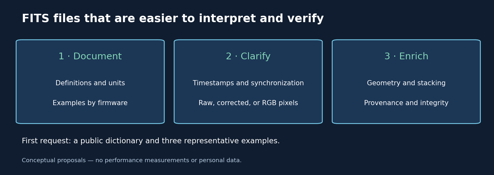

*Illustration traduite, vérifiée visuellement ; schéma conceptuel, pas une mesure ou une capture d’écran.*

La vérification porte sur la fidélité de la traduction, les mots-clés FITS inchangés, les liens et la lisibilité des images PNG/SVG. Aucun code applicatif ni donnée d’observation ne change. La traduction est enregistrée dans un commit documentaire local pour relecture et partage par le fondateur.

## 9. Diagnostiquer les informations WCS conservées

Le lot W1 à W9 a été enregistré dans **`a7044f1` avant le code**. Les notes communautaires française et anglaise ont été publiées avant ce nouveau lot. Le travail WCS, repris le 16 novembre 2026 après une interruption d’exécution des tests, utilise uniquement les manifestes locaux. Aucun FITS du support externe n’est rouvert, déplacé ou modifié ; aucun fichier n’y est créé.

### Comprendre la limite de la collecte

Le manifeste 1.0 ne capture pas toutes les unités, distorsions, matrices alternatives et informations de référentiel. Le diagnostic ne fabrique donc pas de transformation pixels-vers-ciel avec des valeurs implicites. Une matrice CD numériquement cohérente reste distincte d’une solution astrométrique vérifiée sur des étoiles. Les RA/DEC de pointage ne sont pas assimilées à une WCS.

### Reproduire l’exemple public

Choisir des dossiers nouveaux :

```powershell
.\.venv\Scripts\python.exe examples/make_wcs_demo.py ".\local\demo-wcs-input"
.\scripts\gar-inventory.bat ".\local\demo-wcs-input" --output ".\local\demo-wcs-inventory"
.\scripts\gar-wcs.bat ".\local\demo-wcs-inventory\manifest.json" --output ".\local\demo-wcs-report"
```

Le générateur crée huit petits FITS fictifs avec pointage seul, axes incomplets, bloc CD cohérent, matrice singulière, déclaration SIP, paramètre manquant, copie et primaire vide avec extension image. L’inventaire produit le manifeste réellement utilisé par le diagnostic. Certaines informations présentes dans ces FITS fictifs, notamment unités et coefficients SIP, ne sont pas collectées par l’inventaire actuel : l’exemple illustre cette perte de contexte, sans déclarer les champs absents des fichiers.

Résultat vérifié :

```text
8 fichiers, 9 HDU, 1 doublon(s).
9 HDU examinées, 0 WCS scientifiquement validée.
```

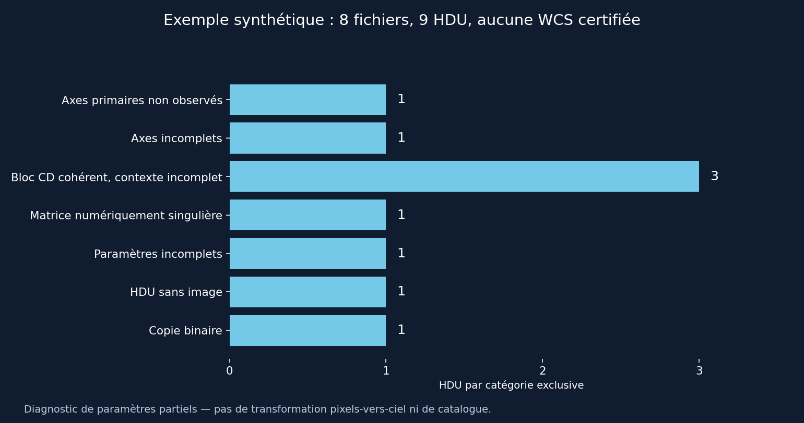

*Illustration PNG produite avec Matplotlib à partir du résultat synthétique et vérifiée visuellement. Le module produit aussi ce [graphique SVG](images/exemple-wcs.svg). Les catégories sont exclusives et totalisent neuf HDU ; ce n’est pas une capture d’écran ni une mesure d’archives personnelles.*

Trois blocs linéaires passent les contrôles numériques limités ; ils restent dans la catégorie « contexte incomplet ». La copie, la primaire vide et les déclarations problématiques sont explicitement comptées. Une WCS partielle SIP n’est pas transformée en WCS simplifiée en supprimant sa distorsion.

### Lire les rapports

`wcs.json` conserve les paramètres observés, statuts, raisons et prochaine action indicative. `wcs.csv` est la vue de consultation, `wcs.svg` le graphique et `report.md` la synthèse. Le programme retourne **`2`** après production du diagnostic pour rappeler qu’aucune WCS n’est scientifiquement validée. Le code `1` indique une erreur d’entrée, de destination ou d’écriture.

Le seuil de conditionnement peut être modifié explicitement :

```powershell
.\scripts\gar-wcs.bat ".\local\demo-wcs-inventory\manifest.json" --max-condition 1000000000 --output ".\local\demo-wcs-seuil"
```

Ce seuil ne définit pas une précision angulaire. Un pixel de référence hors image peut être légitime ; une autre paramétrisation linéaire peut être valide même si ce module ne l’analyse pas. Les [statuts et limites](CONTRAT-WCS.md) doivent être lus avant toute exploitation des nombres.

### Vérifier et décider de la suite

Les **136 tests** passent, dont 36 nouveaux cas : absence de champs, pointage seul, axes inversés, paramètres invalides, matrices incomplètes/singulières/mal conditionnées, limites numériques extrêmes, SIP partiel, références hors image, unités de déclinaison observées ou inconnues, extensions, copies, protections et appel Windows. Un test interdit explicitement toute ouverture de FITS pendant le diagnostic.

Le manifeste privé du pilote reste inchangé et tous ses identifiants sont rapprochés. Ses champs d’axes primaires ne fournissent pas de WCS observable dans cette collecte ; cela ne tranche pas l’existence d’une solution ailleurs ou dans d’autres champs. Aucun catalogue, solveur ou pixel n’a été utilisé. Les détails privés restent dans `local/`.

L’installation modifiable de la version `0.4.0a1`, l’affichage de `gar --version`, l’aide de `gar wcs` et la cohérence des dépendances avec `pip check` ont aussi été vérifiés.

La suite scientifique demandera un contexte WCS complet et des copies locales d’images, puis une comparaison des étoiles à un catalogue ou une résolution si nécessaire. Elle fera l’objet d’un nouveau plan ; les archives d’origine restent intactes et les heures demeurent non qualifiées tant qu’aucune preuve temporelle indépendante n’est fournie.

## 10. Préparer un échantillon local et collecter les en-têtes complets

Plan préalable enregistré dans **`34930d0`**, le 16 novembre 2026. Le choix réel est limité à trois poses chronologiques et un empilement compatible, sélectionnés à partir des rapports locaux. La concordance cible/filtre/nombre ne constitue pas une preuve exacte d’appartenance des poses à l’empilement.

Le nouveau module ouvre chaque source uniquement en `rb`, puis vérifie les empreintes avant copie, sur la copie et après relecture source. Les trois poses ont aussi été rapprochées de leurs empreintes historiques. Les copies et tous les rapports restent dans `local/`, sans déplacement ni écriture sur la clé USB. Le programme lit ensuite les en-têtes **des copies**, sans réenregistrer les images.

### Reproduire sur des données fictives

Choisir trois dossiers nouveaux :

```powershell
.\.venv\Scripts\python.exe examples/make_workset_demo.py ".\local\demo-workset-input"
.\.venv\Scripts\python.exe -m gar workset ".\local\demo-workset-input\selection.json" --output ".\local\demo-workset-report"
```

Le générateur réutilise le cas WCS synthétique et sélectionne trois fichiers fictifs : pointage seul, modèle céleste simple et modèle SIP. Le résultat vérifié est :

```text
3 copies vérifiées ; en-têtes complets collectés.
```

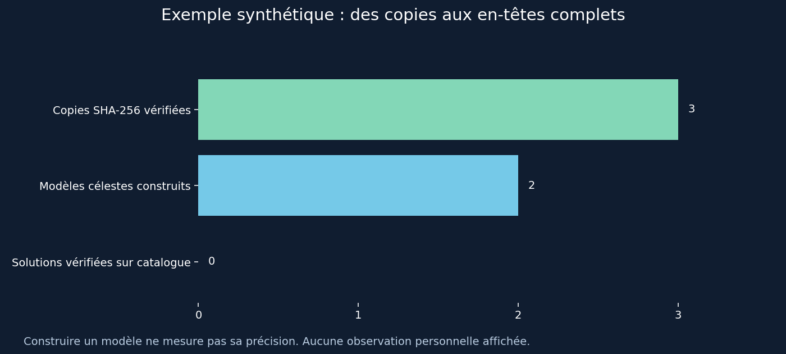

*Graphique produit depuis le rapport synthétique et vérifié visuellement. Aucun fichier ou renseignement personnel n’est illustré. Construire deux modèles ne démontre pas leur précision sur des étoiles.*

### Examiner la collecte complète

`copies/` contient les FITS identiques, `headers/` les représentations textuelles de chaque en-tête et `workset.json` les cartes complètes ordonnées, commentaires, empreintes et résultats de construction. Les champs historiquement non collectés, comme unités, coefficients de distorsion et informations de logiciel, deviennent consultables sans revenir aux originaux. Les textes sont des représentations Astropy ; les FITS copiés sont la référence exacte des octets.

Le modèle est essayé avec le contexte complet disponible dans les HDU locales, sans correction automatique (`fix=False`). Les unités normalisées ou valeurs par défaut de la bibliothèque ne sont pas confondues avec des déclarations écrites. Une information de logiciel ne prouve pas à elle seule la version exacte du firmware. Aucune précision d’horloge, coordonnée céleste ou mesure de résidu n’est inventée.

### Résultats et vérifications

Les **147 tests** passent, dont 11 nouveaux cas sur les copies, empreintes historiques erronées, différences de copie, source changée, jonctions, destinations refusées, extensions et conservation des cartes. Les premiers échecs étaient liés au nom réservé d’un utilitaire de test et à son contrôle d’arguments ; ils ont été corrigés avant toute copie réelle.

Sur l’échantillon privé autorisé, les quatre fichiers copiés sont identiques aux sources aux contrôles avant/après. Trois copies n’ont pas d’axes célestes primaires déclarés ; l’empilement permet la construction d’un modèle SIP, sans validation sur catalogue. Les rapports et cartes complets restent privés. L’horloge et l’exactitude astrométrique demeurent à qualifier.

Lire le [contrat de l’échantillon local](CONTRAT-WORKSET.md) pour les sélections, destinations et dossiers partiels en cas d’erreur. Ce lot n’ajoute pas de résolution astrométrique ni de transfert de WCS entre images.

L’installation modifiable de la version 0.5.0a1, `gar --version`, l’aide de `gar workset` et `pip check` ont été vérifiés. Seuls le code, les tests et illustrations fictives sont destinés à GitHub.

## 11. Comparer la WCS originale à des étoiles de référence

Le plan a été committé dans **`d349984`**, puis les paramètres de détection et de sélection ont été figés dans **`fe3b1c4`**, avant les mesures réelles. Les seuils exploratoires demandent au moins 30 associations, médiane ≤2″, percentile 95 ≤4″, au moins six cellules sur neuf et les quatre quadrants. Aucun de ces seuils n’est une norme de soumission scientifique.

### Préparer les références et préserver la confidentialité

Aucun catalogue adapté n’était disponible dans le dossier du projet. La première tentative d’acquisition a été bloquée avant exécution par le contrôle automatique, car la zone céleste provenait d’observations privées. Le fondateur a ensuite explicitement autorisé sa transmission à l’archive Gaia de l’ESA. Seules les coordonnées du champ et sa taille ont servi à extraire des données publiques ; aucune image, aucun en-tête et aucune position terrestre n’ont été envoyés.

L’extrait Gaia DR3, la requête et son empreinte sont conservés localement. L’analyse ultérieure est hors ligne. Les mouvements propres sont pris en compte à la date approximative de l’image, sans certifier son horloge. Le [contrat astrométrique](CONTRAT-ASTROMETRIE.md) précise les colonnes, l’époque et les limites.

### Reproduire un essai fictif complet

Après installation des nouvelles dépendances, choisir de nouveaux dossiers :

```powershell
$env:PYTHONPATH = Join-Path $PWD 'src'
.\.venv\Scripts\python.exe examples/make_astrometry_demo.py ".\local\demo-astrometry-input"
.\.venv\Scripts\python.exe -m gar astrometry ".\local\demo-astrometry-input\workset\workset.json" --file-index 1 --catalog ".\local\demo-astrometry-input\catalog.csv" --output ".\local\demo-astrometry-report"
```

Le générateur crée 36 étoiles et un catalogue **entièrement fictifs**. Un biais de WCS connu de 0,5 seconde d’arc vers l’Est est injecté ; il ne doit pas être soustrait par l’outil de contrôle. Le résultat réellement obtenu est d’environ 0,501″ de médiane pour 36 associations, neuf cellules et quatre quadrants.

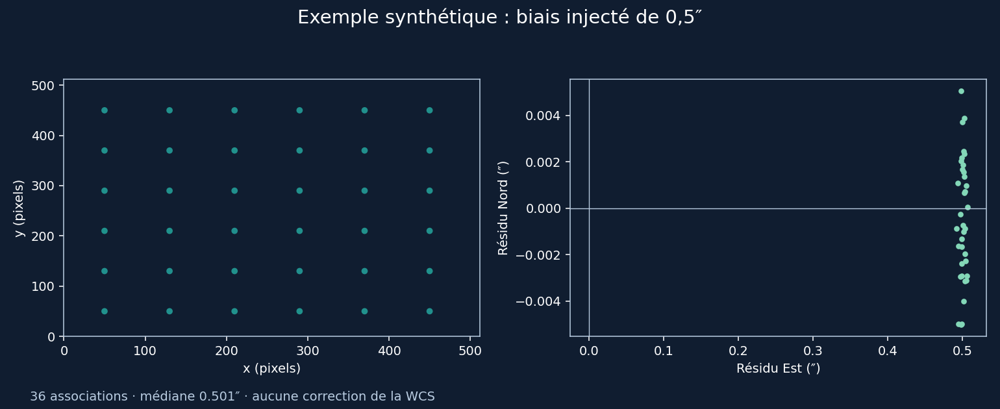

*Figure créée à partir du rapport synthétique et vérifiée visuellement ; aucune observation personnelle n’est affichée. Le biais injecté est toujours visible, car aucun nouveau modèle n’est ajusté. Le [SVG produit par l’application](images/exemple-astrometrie.svg) est également disponible.*

### Lire les diagnostics

Le programme calcule les positions célestes depuis la WCS originale, avec SIP lorsqu’il est présent. Les étoiles détectées et références sont sélectionnées avec les paramètres enregistrés, puis associées au plus proche de manière mutuelle et unique dans un rayon de 8″. Aucune source n’est retirée après association pour améliorer les résidus. Le rayon initial demeure une sélection : les erreurs dépassant ce rayon ne sont pas représentées par les seuls résidus.

`astrometry.json` contient critères, paramètres, effectifs de sélection, métriques, empreintes et provenance. `matches.csv` conserve les identifiants et résidus par étoile. `residuals.svg` montre les positions des associations et leurs écarts Est/Nord ; `report.md` rassemble les résultats et limites. Pour le pilote, un graphique PNG privé est conservé dans la sortie locale et n’est pas publié.

Les statistiques comprennent biais, RMS radial, médiane, percentile 95 et couverture. L’intervalle bootstrap de la médiane est conditionnel à cet échantillon ; il ne remplace pas une incertitude absolue par position ni un modèle complet des corrélations. L’indépendance par rapport aux étoiles qui auraient servi à construire la WCS initiale n’est pas établie. Les limites de distance/vitesse radiale, parallaxe, centroides et date approximative restent explicites.

### Vérifications et résultat du pilote

Les **156 tests** passent, dont neuf nouveaux cas : champ de géométrie connue, biais conservé, WCS incorrecte avec associations fortuites, faibles effectifs/couverture, associations uniques, absence de modification des entrées, colonnes manquantes, saturation et absence de connexion réseau pendant la comparaison. Un premier essai a révélé une incompatibilité de représentation des repères célestes ; la correction consiste à comparer les positions propagées dans un même repère ICRS, sans changer la WCS.

Sur l’empilement privé, les critères préenregistrés sont satisfaits et le SHA-256 est identique avant/après. Les valeurs détaillées, catalogue et images de contrôle restent privés. La conclusion est une **compatibilité géométrique exploratoire avec les références sélectionnées**, sans certification de soumission, sans qualification d’horloge et sans transfert automatique de WCS aux poses individuelles.

Code `0` : critères exploratoires satisfaits ; `2` : résultat produit mais critères non satisfaits ; `1` : analyse impossible. Une mauvaise WCS peut donner quelques associations fortuites, d’où les exigences d’effectif et de couverture, en plus des résidus.

L’installation modifiable 0.6.0a1, l’aide de la commande, `gar --version` et `pip check` ont été vérifiés. Les graphiques fictifs publics et réels privés ont été inspectés visuellement. Les grands résidus du pilote ne sont pas supprimés pour embellir la présentation.

## 12. Recaler trois poses locales avec un contrôle réservé

Plan enregistré dans **`6480df2` avant le code**, le 16 novembre 2026. Ce lot utilise exclusivement les quatre copies locales déjà vérifiées ; aucun accès à la clé USB, aucune nouvelle acquisition de catalogue. Les rapports réels, leurs coordonnées et en-têtes restent sous `local/`, ignoré par Git. Les exemples ci-dessous sont entièrement synthétiques.

### Reproduire le recalage fictif

À la racine du projet, choisir deux dossiers nouveaux :

```powershell
.\.venv\Scripts\python.exe examples/make_registration_demo.py ".\local\demo-recalage-input"
.\.venv\Scripts\python.exe -m gar register ".\local\demo-recalage-input\workset.json" --reference-index 4 --frame-indices 1 2 3 --output ".\local\demo-recalage-report"
```

Le générateur produit 180 étoiles aléatoires espacées, trois poses avec une réponse Bayer **fictive**, et une référence à trois plans. Les rotations injectées sont −12°, +3° et +18°, avec translations connues conservées dans `truth.json`. Les poses ne contiennent pas de WCS copiée. La moyenne de blocs 2×2 atténue la mosaïque de couleur ; les centres sont ramenés aux pixels natifs. Cette opération ne calibre ni les couleurs ni les flux.

Le programme réserve un quart des détections de chaque pose **avant** recherche de triangles et ajustement. Seules les autres détections servent à déterminer rotation et translation. Le modèle est ensuite gelé et les étoiles réservées sont associées à la référence pour mesurer les écarts. Les critères préalables demandent au moins 20 associations d’ajustement, 10 contrôles, médiane ≤0,75 pixel, P95 ≤1,5 pixel, six cellules sur neuf et les quatre quadrants.

Résultats réellement produits par cet exemple :

| Pose synthétique | Rotation retrouvée | Contrôles associés | Médiane (pixel) | P95 (pixel) | Cellules |
|---|---:|---:|---:|---:|---:|
| 1 | −11,9994° | 44 | 0,122 | 0,212 | 9/9 |
| 2 | +2,9982° | 45 | 0,105 | 0,338 | 9/9 |
| 3 | +18,0005° | 39 | 0,105 | 0,220 | 8/9 |

Les trois cas satisfont les critères. Ils démontrent le fonctionnement sur ces injections, sans garantir ces performances pour les observations réelles.

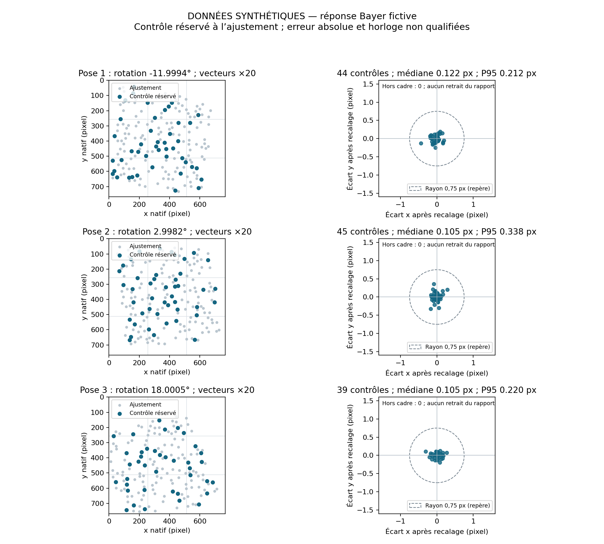

*Figure calculée depuis le rapport synthétique et inspectée visuellement, pas une capture d’écran. À gauche : répartition spatiale et vecteurs de résidus amplifiés ×20 ; à droite : résidus de contrôle, avec nombre de points éventuellement hors cadre. Le cercle de 0,75 pixel est un repère, pas une obligation pour chaque étoile. Le [SVG directement produit](images/exemple-recalage.svg) est également disponible. Aucune observation personnelle n’est publiée.*

Le SVG ne nécessite aucun outil supplémentaire. Pour reproduire le PNG, utiliser un interpréteur disposant de Matplotlib (outil graphique facultatif, distinct des dépendances d’analyse) :

```powershell
python examples/plot_registration.py ".\local\demo-recalage-report\registration.json" ".\local\demo-recalage-report\registration.png" --synthetic
```

Ne passer `--synthetic` que pour des données effectivement fictives. Pour un rapport réel, l’omettre : le graphique indique alors son caractère privé et doit rester dans `local/`.

### Lire la composition et ses limites

`registration.json` contient modèles, paramètres, indices de détections réservées, effectifs associés/non associés, empreintes et provenance. `matches.csv` sépare ajustement et contrôle. `registration.svg` et `report.md` présentent les résultats par pose ; une pose en échec reste explicitement signalée. Codes : `0` pour tous les critères satisfaits, `2` pour un rapport avec échec, `1` pour une analyse impossible.

La transformation explicite est `p_reference = R @ p_pose + t`, puis la WCS céleste originale de la référence, avec SIP. Aucune réflexion, échelle libre ou déformation n’est ajustée ; aucun FITS n’est réécrit. Le programme ne copie pas la WCS de l’empilement dans les en-têtes des poses. Pour utiliser une composition acceptée depuis Python :

```python
import json
from gar.registration import composed_sky
with open("local/demo-recalage-report/registration.json", encoding="utf-8") as stream:
    report = json.load(stream)
position = composed_sky(report["frames"][0], 384, 384)
print(position)
```

Les entrées sont x, y en pixels natifs d’origine zéro. Les modèles refusés et points hors du recouvrement sont bloqués. L’erreur de référence reste héritée ; le contrôle réservé à l’ajustement ne démontre pas l’indépendance des images par rapport à l’empilement. L’association à 3 pixels sélectionne les résidus observables, même sans retrait après association. Le [contrat de recalage](CONTRAT-RECALAGE.md) détaille les triangles, sélections, distorsions prises en charge et limites.

### Vérifications et essai privé

Les **177 tests passent**, dont 21 nouveaux cas : rotations positives/négatives jusqu’à 145°, perturbation des seules étoiles réservées sans effet sur le modèle, échecs de réflexion/champ distinct/faible effectif/couverture, mosaïque Bayer fictive, saturation, préservation des pixels et empreintes, refus des chemins externes avant sondage, absence de réseau, sorties et conservation de la distorsion SIP dans la composition.

Les trois copies réelles satisfont séparément les critères préenregistrés ; les quatre empreintes sont inchangées et les cartes de résidus ont été inspectées localement. Les nombres, positions, modèles et illustrations du champ réel restent privés. Aucun seuil n’a été assoupli après lecture des résultats. L’installation modifiable 0.7.0a1, l’aide `gar register`, la version et la cohérence des dépendances sont vérifiées avant livraison.

Les contrôles de recalage ne remplacent ni un budget d’erreur astrométrique absolue ni une qualification d’horloge. Les prochaines mesures de mobiles ou de flux nécessiteront leurs propres plans, tests et critères. Aucune vitesse, soumission scientifique ou précision UTC n’est annoncée.

## 13. Comparer les trois poses à Gaia, sans réajuster les modèles

Le plan **`93c13cb`** fixe les sous-étapes et critères avant code et mesure réelle. Les entrées réelles sont exclusivement les copies, le recalage gelé et le catalogue déjà locaux. Aucun accès USB, aucune nouvelle requête réseau. Les coordonnées du champ, les en-têtes et rapports réels restent privés sous `local/` ; les illustrations publiques ci-dessous sont synthétiques.

### Reproduire la chaîne sur des données fictives

Avec les dépendances installées, choisir trois dossiers nouveaux :

```powershell
.\.venv\Scripts\python.exe examples/make_gaia_frames_demo.py ".\local\demo-gaia-poses-input"
.\.venv\Scripts\python.exe -m gar register ".\local\demo-gaia-poses-input\workset.json" --reference-index 4 --frame-indices 1 2 3 --output ".\local\demo-gaia-poses-recalage"
.\.venv\Scripts\python.exe -m gar gaia-frames ".\local\demo-gaia-poses-input\workset.json" --registration ".\local\demo-gaia-poses-recalage\registration.json" --catalog ".\local\demo-gaia-poses-input\catalog.csv" --output ".\local\demo-gaia-poses-report"
```

Le générateur produit trois poses Bayer fictives, une référence et un catalogue de forme Gaia, **sans observation Gaia réelle ni téléchargement**. Le catalogue décrit les positions vraies ; la WCS de référence reçoit un biais connu de 0,5″ vers l’Est avant le recalage. Les copies fictives reçoivent une date déclarée pour permettre la propagation des références. Les poses restent sans WCS copiée dans leurs en-têtes.

Le recalage doit d’abord conserver un quart des détections à l’écart de l’ajustement. La comparaison Gaia reproduit cette partition et utilise la composition déjà calculée, sans nouvel ajustement. Tous les seuils restent ceux du plan : ≥20 associations réservées, médiane ≤2″, P95 ≤4″, six cellules et quatre quadrants. Les seuils temporels et de soumission scientifique ne sont pas définis par ce contrôle.

Résultats réellement obtenus sur cet exemple :

| Pose fictive | Contrôles associés | Médiane (″) | P95 (″) | Biais Est (″) | Cellules |
|---|---:|---:|---:|---:|---:|
| 1 | 44 | 0,510 | 0,775 | +0,517 | 9/9 |
| 2 | 45 | 0,502 | 0,774 | +0,492 | 9/9 |
| 3 | 39 | 0,463 | 0,773 | +0,456 | 8/9 |

Les trois cas satisfont les critères et le biais injecté reste visible. Les écarts entre poses reflètent notamment les centroïdes et les échantillons de contrôle différents ; ils ne démontrent pas un mouvement réel.

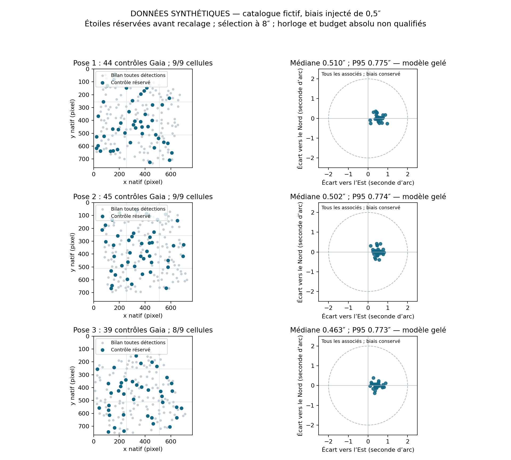

*Graphique issu du JSON synthétique, inspecté visuellement ; ce n’est pas une capture d’écran. À gauche, les associations du bilan secondaire sont grises et les contrôles réservés colorés. À droite, tous les résidus de contrôle sont représentés avec la même échelle entre poses ; le biais vers l’Est n’a pas été soustrait. Les couleurs indiquent ≤2″, ≤4″ ou au-delà ; les seuils portent sur médiane/P95, pas sur chaque point. Le [SVG applicatif](images/exemple-gaia-poses.svg) est disponible sans dépendance graphique supplémentaire.*

Pour reproduire le PNG avec un interpréteur disposant de Matplotlib, facultatif :

```powershell
python examples/plot_gaia_frames.py ".\local\demo-gaia-poses-report\gaia-frames.json" ".\local\demo-gaia-poses-report\gaia-frames.png" --synthetic
```

Omettre `--synthetic` pour des observations réelles et conserver leur figure dans `local/`. Les SVG ne nécessitent pas Matplotlib.

### Comprendre les populations et les sorties

Le contrôle porte sur **toutes les détections réservées dans le recouvrement**, y compris celles qui n’avaient pas trouvé de correspondance dans l’empilement. Le nombre d’associations Gaia peut donc dépasser le nombre du contrôle pose/empilement, sans ajout d’étoiles d’ajustement au verdict. Les points hors recouvrement et les détections non associées sont comptés séparément.

`gaia-frames.json` distingue `control` (verdict principal) de `all_diagnostic` (bilan secondaire incluant les étoiles d’ajustement, sans verdict). Il conserve les critères, associations, résidus Est/Nord, séparations sphériques, biais, RMS, médiane/P95, intervalle bootstrap conditionnel, références partagées, SHA-256 et provenance. Les deux échantillons du CSV se chevauchent : ne pas additionner leurs lignes. `gaia-frames.svg` et `report.md` présentent le contrôle principal par pose.

La sélection Gaia conserve G 9–17,5, RUWE <1,4, mouvements propres disponibles et isolation 16″ ; l’époque est midi TCB de la date calendaire approximative de la pose. L’association est mutuelle et unique à 8″. Aucun modèle ni biais n’est réajusté, aucun grand résidu n’est retiré après association ; **le rayon sélectionne toutefois les erreurs observables**. Les références sont limitées au recouvrement avec une marge de 10 pixels dans les deux images. Lire le [contrat Gaia des poses](CONTRAT-GAIA-POSES.md) pour les contrôles de provenance et limites.

Codes de retour : `0` si toutes les poses satisfont les critères principaux ; `2` si le rapport contient un échec ; `1` si la comparaison est impossible ou incohérente. Un effectif insuffisant reste un échec, sans abaisser le seuil après lecture du résultat.

### Vérifications et contrôle privé

Les **197 tests passent**, dont 20 nouveaux cas : biais injecté conservé, étoiles d’ajustement exclues du verdict, mauvaise composition, champ incorrect, faible effectif/couverture, mouvement propre connu, distorsion SIP et passage à zéro en ascension droite, catalogue incomplet ou identifiants dupliqués, provenance/partition/centroïdes/WCS incohérents, absence de réseau et de nouvel ajustement, préservation des entrées et recalage préalablement refusé. La sélection et la propagation Gaia sont mises en commun avec `gar astrometry`, dont les tests sont conservés.

Commande de vérification depuis l’environnement installé :

```powershell
.\.venv\Scripts\python.exe -m pytest -q -p no:cacheprovider --basetemp="local/pytest-gaia-poses-verification"
.\.venv\Scripts\gar.exe --version
.\.venv\Scripts\gar.exe gaia-frames --help
.\.venv\Scripts\python.exe -m pip check
```

Choisir un dossier de tests neuf : pytest peut nettoyer son dossier temporaire. L’installation modifiable 0.8.0a1, l’aide et les dépendances sont vérifiées avant livraison. Les entrées du pilote réel restent inchangées ; les trois poses satisfont séparément les critères fixés et leurs cartes sont inspectées localement. Les valeurs détaillées, modèles et images du champ restent privés ; seules les données fictives sont illustrées publiquement.

Des références sont communes aux poses. Leur présence dans Gaia ne prouve pas leur indépendance par rapport au solveur initial de l’empilement. Les résultats ne fournissent ni budget d’erreur absolue complet, ni qualification de l’horloge, ni certification MPC. Le bootstrap de la médiane n’est pas l’incertitude absolue de chaque position. La qualification temporelle reste nécessaire avant une future mesure de vitesse d’objet mobile.

## 14. Mettre à jour GitHub et vérifier la publication

Actualisation documentaire planifiée dans **`835eac9`**. Avant cette mise à jour, la présence de la réalisation applicative `9bcf431` sur `main` a été vérifiée directement via GitHub. Le code, les 197 tests du lot 0.8 et les mesures ne sont pas modifiés ici. Le travail complète les accès aux exemples illustrés et corrige les anciens statuts documentaires. Aucun accès USB, aucune réouverture des observations et aucune publication des rapports réels.

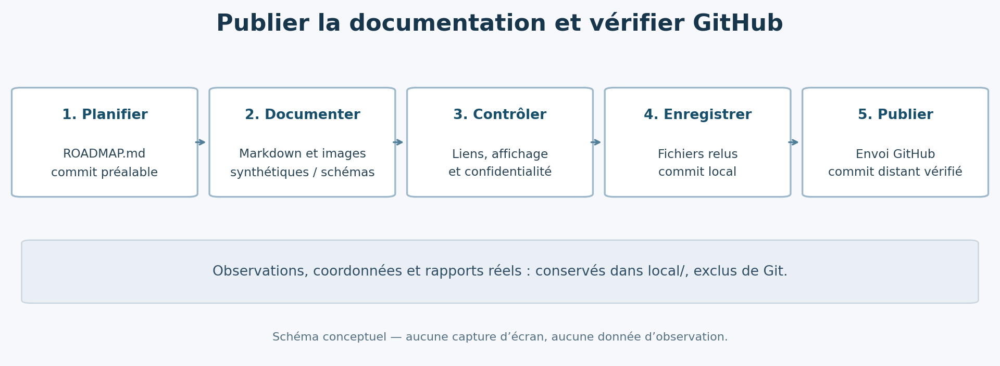

*Schéma de procédure, sans capture d’écran ni résultat scientifique. Le [SVG](images/publication-github.svg) est aussi disponible. Les figures de résultats visibles dans les sections précédentes proviennent des exemples synthétiques réellement calculés.*

### Examiner les fichiers à publier

Depuis la racine du dépôt, examiner l’état et les différences :

```powershell
git status --short
git diff --stat
git diff --check
```

Le dernier contrôle vérifie les espaces et fins de ligne, pas la confidentialité. Lire les différences et vérifier que les données, en-têtes, coordonnées, chemins et rapports réels restent exclus de Git. Ne pas ajouter tout `local/` ; `.gitignore` ne retire pas une donnée déjà suivie. Pour ce lot documentaire, vérifier les liens Markdown, le XML des SVG et l’affichage des PNG ; les 197 tests sont ceux du lot applicatif précédent, sans nouvelle qualification scientifique.

### Enregistrer puis envoyer les fichiers relus

Exemple pour cette mise à jour, avec une sélection explicite :

```powershell
git add README.md GOVERNANCE.md ROADMAP.md docs/DOSSIER-LANCEMENT.md docs/TUTORIEL.md docs/images/publication-github.png docs/images/publication-github.svg
git diff --cached --check
git diff --cached --stat
git commit -m "docs: actualiser le tutoriel illustre et le statut alpha 0.8"
git push origin main
```

Arrêter à chaque erreur et en résoudre la cause avant l’étape suivante. L’authentification relève de Git/GitHub ; aucun jeton n’est copié dans les documents ou commandes publiées. Si d’autres changements distants sont signalés, les examiner avant de synchroniser ; ne pas utiliser un envoi forcé pour les remplacer.

### Confirmer la publication distante

```powershell
git rev-parse HEAD
git ls-remote origin refs/heads/main
git status --short
```

Après un envoi réussi, les deux premières commandes doivent indiquer le même identifiant de commit pour ce lot. Un état local propre ne prouve pas à lui seul la publication. Vérifier également sur [GitHub](https://github.com/steveprudhomme/gnu-astrophotography-recycle) les documents et illustrations attendus. La publication de fichiers dans `main` ne crée ni version GitHub Releases, ni paquet PyPI, ni logiciel portable certifié.
