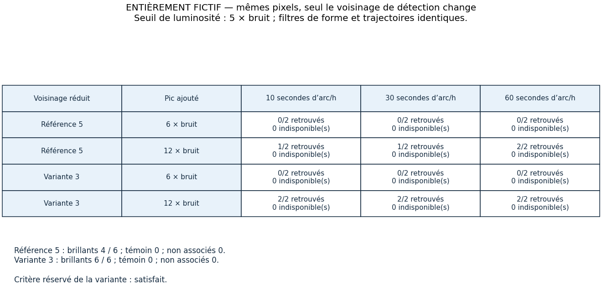
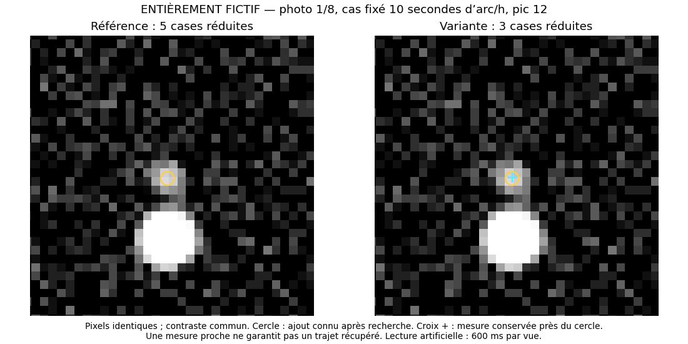
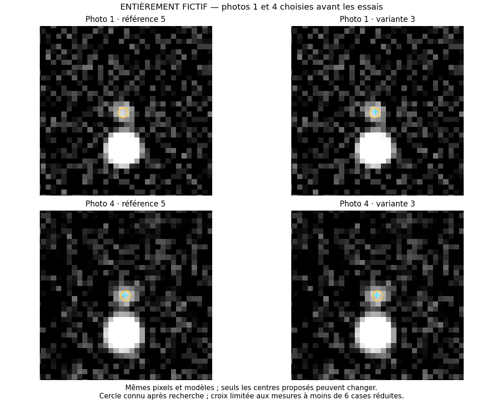

# Essayer le profil à voisinage réduit

Ce parcours compare deux façons de proposer des points dans les mêmes images.
La référence regarde un voisinage de cinq cases réduites. La nouvelle variante en regarde trois.
Le [plan publié avant le code](https://github.com/steveprudhomme/gnu-astrophotography-recycle/commit/785b9dec6c36098bf4982d12d8b0127494374a07) décrit le lot 26.

## Comprendre le changement dès 10 ans

Imagine une petite bosse près d'une grande colline. Pour choisir un sommet, le programme compare la bosse à ses voisines.
Un voisinage plus petit peut laisser apparaître un sommet que le grand voisinage ne retenait pas.
Il faut ensuite vérifier la forme du point et son trajet dans plusieurs photos.

Une **case réduite** regroupe ici 2 × 2 pixels de l'image d'origine.
Le **voisinage** est la zone de comparaison utilisée pour proposer les maxima bruts.
Ce nombre ne garantit pas une distance exacte entre les centres ajustés.

Le **seuil de luminosité** reste égal à cinq fois le bruit mesuré.
Le bruit et le fond sont calculés de la même façon sur les mêmes pixels, puis comparés entre les profils.
Le noyau de calcul, la largeur prévue du point et les filtres de forme restent identiques.
Seule la taille du voisinage change. L'ancien moteur garde son comportement.

| Règle | Référence | Variante |
|---|---:|---:|
| Voisinage pour les maxima | 5 cases réduites | 3 cases réduites |
| Seuil d'entrée | 5 × bruit | 5 × bruit |
| Largeur prévue, FWHM | 3 cases réduites | 3 cases réduites |
| Marge | 8 cases réduites | 8 cases réduites |
| Plafond de sources par photo | 500 | 500 |

La FWHM décrit une largeur du modèle de point. Les règles de trajectoire restent celles du [profil lent](MOBILES-LENTS.md).
Elles demandent notamment six photos sur au moins 1800 secondes déclarées.
Les plafonds restent des refus : aucun catalogue n'est tronqué pour terminer le calcul.

## Préparer l'atelier

Suivre les étapes d'installation du [parcours débutant](DEMARRER-DE-ZERO.md), avec les outils de dessin.
Ouvrir PowerShell dans le dossier du projet. Garder les sorties dans `local/`.
Choisir des noms encore inutilisés. Aucun branchement USB n'est nécessaire.

Les anciens essais ont servi à choisir la variante. Deux nouvelles graines réservées servent à son évaluation : 2026112601 et 2026112602.
Les étoiles, les nombres de bruit et les images sont fictifs. Les trajets ajoutés sont fixés avant le résultat.
Un échec ne donne pas le droit de choisir une autre graine ou de modifier le voisinage après l'essai réservé.

## 1. Fabriquer les deux nouveaux fonds

```powershell
.\.venv\Scripts\python.exe examples/nearby_motion_profile.py make local/exercice-voisinage-fonds
```

La commande utilise le générateur irrégulier du lot 24, sans changer son code.
Elle crée huit images et leurs copies par fond, avec une photo toutes les cinq minutes.
Les modèles d'alignement sont calculés puis conservés. Le contrôle de fabrication peut refuser un contexte.

**Vérifier :** `local/exercice-voisinage-fonds/contexts.json` indique `all_contexts_admissible: true` pour poursuivre les deux fonds.
Un code 2 conserve un contexte refusé. Garder le dossier et le motif ; ne pas remplacer la graine.

## 2. Ajouter les points du premier fond

```powershell
.\.venv\Scripts\python.exe examples/slow_motion_profile.py generate local/exercice-voisinage-fonds/context-s2026112601/baseline/baseline.json local/exercice-voisinage-injections-1
```

La recette d'injection est inchangée. Elle prépare un témoin sans ajout et douze séries avec un point ajouté chacune.
Les vitesses nominales sont 10, 30 et 60 secondes d'arc par heure. Deux amplitudes et deux trajets sont utilisés.
Leurs réponses restent dans `truth.json`. Les deux détecteurs recevront les mêmes pixels et modèles.

**Vérifier :** le dossier contient un manifeste complet, les nouveaux plans de travail et le fichier de réponses.
Les amplitudes six et douze fois le bruit initial ne sont pas des magnitudes astronomiques.

## 3. Analyser les deux profils sans les réponses

```powershell
.\.venv\Scripts\python.exe examples/nearby_motion_profile.py analyze local/exercice-voisinage-injections-1/manifest.json local/exercice-voisinage-analyse-1
```

Le programme traite chaque série avec la référence, puis avec la variante à voisinage réduit.
Les deux utilisent les mêmes modèles d'alignement et les mêmes règles de trajectoire.
Aucune position de réponse n'est fournie au détecteur ou à l'association.
Les vingt-six rapports candidats sont terminés et leurs empreintes sont conservées avant le calcul du score.

Une empreinte est un code calculé à partir du contenu d'un fichier.
**Vérifier :** `analysis.json` conserve les deux variantes, leur état et les 26 rapports.
Une série refusée garde des comptes inconnus ; elle ne devient pas un zéro candidat.

## 4. Comparer aux réponses

```powershell
.\.venv\Scripts\python.exe examples/nearby_motion_profile.py score local/exercice-voisinage-injections-1/manifest.json local/exercice-voisinage-injections-1/truth.json local/exercice-voisinage-analyse-1/analysis.json local/exercice-voisinage-score-1
```

Le score vérifie tous les candidats et les dérivés avant d'ouvrir les réponses.
Il conserve les ajouts retrouvés, les manques, les indisponibles et les candidats sans correspondance.
Les mesures de récupération gardent les mêmes limites de position et de vitesse que le lot précédent.

Le critère prévu pour la variante demande :

- les six ajouts brillants retrouvés ;
- aucun faux candidat fictif, dans le témoin ou les autres séries ;
- aucune perte d'un ajout retrouvé par la référence ;
- les deux comparaisons entièrement disponibles.

**Vérifier :** `score.json` et `comparison.csv` donnent les résultats des deux profils.
Un code 2 conserve un critère manqué ou une comparaison indisponible. Ne pas modifier un paramètre pour effacer ce résultat.

## 5. Dessiner la comparaison

```powershell
.\.venv\Scripts\python.exe examples/plot_nearby_motions.py local/exercice-voisinage-score-1/score.json local/exercice-voisinage-figures-1
```

Le dessinateur vérifie les preuves et produit un bilan, une première vue, une comparaison fixe et un GIF.
Il ne relance aucune détection ou association. Les photos 1 et 4 et le cas `r10-a12-p1` sont choisis dans le plan.
Ce cas désigne le premier trajet à 10 secondes d'arc par heure, avec une amplitude de douze fois le bruit initial.

**Vérifier :** `figures.json` donne les empreintes des quatre médias.
Une croix dans l'image indique une mesure proche conservée, pas nécessairement un trajet récupéré.

## 6. Refaire avec le second fond

```powershell
.\.venv\Scripts\python.exe examples/slow_motion_profile.py generate local/exercice-voisinage-fonds/context-s2026112602/baseline/baseline.json local/exercice-voisinage-injections-2
.\.venv\Scripts\python.exe examples/nearby_motion_profile.py analyze local/exercice-voisinage-injections-2/manifest.json local/exercice-voisinage-analyse-2
.\.venv\Scripts\python.exe examples/nearby_motion_profile.py score local/exercice-voisinage-injections-2/manifest.json local/exercice-voisinage-injections-2/truth.json local/exercice-voisinage-analyse-2/analysis.json local/exercice-voisinage-score-2
.\.venv\Scripts\python.exe examples/plot_nearby_motions.py local/exercice-voisinage-score-2/score.json local/exercice-voisinage-figures-2
```

Garder les deux dossiers. Les neuf commandes de ce parcours rendent 0 dans l'essai réalisé.

## Résultats sur les fonds réservés

| Fond fictif réservé | Référence : retrouvés | Variante : retrouvés | Brillants de la variante | Faux candidats fictifs | Pertes de référence |
|---|---:|---:|---:|---:|---:|
| Premier | 4/12 | 6/12 | 6/6 | 0 | 0 |
| Second | 3/12 | 8/12 | 6/6 | 0 | 0 |

Tous les cas sont disponibles. Les deux critères réservés sont satisfaits.
La variante retrouve zéro puis deux ajouts faibles sur six. Les faibles restent une limite visible.



**Lire sans image.** À faible amplitude, les deux profils retrouvent zéro ajout dans ce premier fond.
À forte amplitude, la référence donne 1/2, 1/2 puis 2/2 aux vitesses 10, 30 et 60.
La variante donne 2/2 pour les trois vitesses. Les témoins et les non-associés restent à zéro.



**Lire sans image.** Le cercle montre la réponse connue après la recherche.
La référence ne possède pas de croix proche dans cette photo. La variante en possède une sur le point ajouté.
Les images d'entrée sont identiques ; les annotations décrivent leurs mesures différentes.



**Lire sans image.** Les deux panneaux du haut montrent la photo 1 ; les deux du bas, la photo 4.
La variante possède une mesure proche dès la première photo. Dans la quatrième, les deux profils en ont une.
Les croix sont limitées aux mesures à moins de six cases réduites du cercle.

[Ouvrir le GIF fictif des huit photos](images/exemple-voisinage-animation.gif).
Ce lien est facultatif. Les vues fixes et les comptes donnent les résultats sans animation.
La lecture dure 600 millisecondes par vue ; les données restent espacées de cinq minutes.

## Autres comparaisons locales

Les deux anciens fonds irréguliers servent de cas connus. La référence y reproduit ses anciens rapports candidats.
La variante passe de 5/12 à 6/12 retrouvés dans le premier, et de 6/12 à 8/12 dans le second.
Elle retrouve les six brillants dans chacun, sans faux candidat fictif ou perte de récupération.
Les deux anciens trajets brillants manqués possèdent alors des mesures sur les huit photos, y compris les six absences initiales étudiées.

Sur les deux fonds réels déjà locaux, les résultats restent **6/12 et 9/12** pour les deux profils.
Chaque profil retrouve les six ajouts brillants de chacun. Les témoins naturels et les non-associés restent à zéro.
Aucune nouvelle trajectoire naturelle n'est proposée. Les figures mixtes et les rapports détaillés restent privés.
Les deux séances du même champ ne constituent pas deux nuits indépendantes.

Les anciens dérivés sont réutilisés sans y ajouter de nouveau point. Le support USB n'est pas lu.
Les quatre références historiques, fictives et réelles, reproduisent leurs anciens candidats et résultats.

## Comprendre les limites et les erreurs

La comparaison change une seule règle sur les mêmes pixels. Le gain mesuré concerne ces cas testés.
Les nouveaux fonds ont passé leur contrôle de fabrication. Les heures et l'échelle restent nominales, sans qualification scientifique.
Les ajouts ne sont pas des découvertes ; aucun objet naturel connu n'a servi de contrôle positif.

Sur fond fictif, nous connaissons les objets ajoutés et pouvons compter les fausses propositions.
Sur fond réel, un candidat non associé ne serait pas automatiquement faux. Il demanderait une revue et d'autres preuves.
Un bilan sans faux candidat dans ces exemples ne garantit pas cette absence dans toute une archive.

- Sortie existante : choisir un nouveau nom et conserver les anciens résultats.
- Fichier lié modifié : examiner la modification ; ne pas recalculer une empreinte pour contourner le refus.
- Plafond de sources ou d'hypothèses dépassé : garder l'indisponibilité ; ne pas tronquer le catalogue ou relever le plafond après résultat.
- Contrôle de fabrication refusé : garder le contexte ; ne pas changer sa graine.
- Critère manqué : conserver le code 2 et les comptes. Une sortie complète ne prouve pas une aptitude scientifique.

Le parcours suit le [guide de rédaction accessible](REDACTION-ACCESSIBLE.md).
Les images sont calculées sur des données entièrement fictives. Elles ne sont pas des captures d'écran.
Les descriptions permettent de comprendre sans GIF ou perception des couleurs. Aucun essai enfant ou audit complet n'est revendiqué.

## Vérifications réalisées

Les 30 nouveaux tests fictifs passent. La suite complète donne 668 tests réussis en 298,80 secondes.
Les neuf commandes ci-dessus rendent 0. Douze commandes supplémentaires comparent les quatre anciens contextes.
Les 2678 anciens fichiers surveillés restent intacts. Les gardes ne relèvent aucun accès USB ou réseau d'analyse.
Les seuls nouveaux FITS et dérivés proviennent de la fabrication fictive. Les images réelles ne sont jamais réécrites.
Les rapports, réponses et figures réels restent dans les dossiers locaux ignorés.
